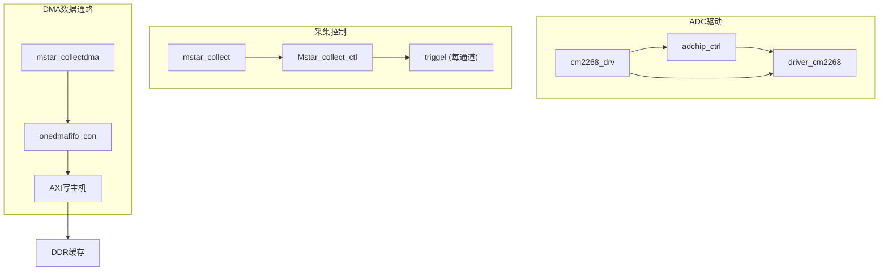
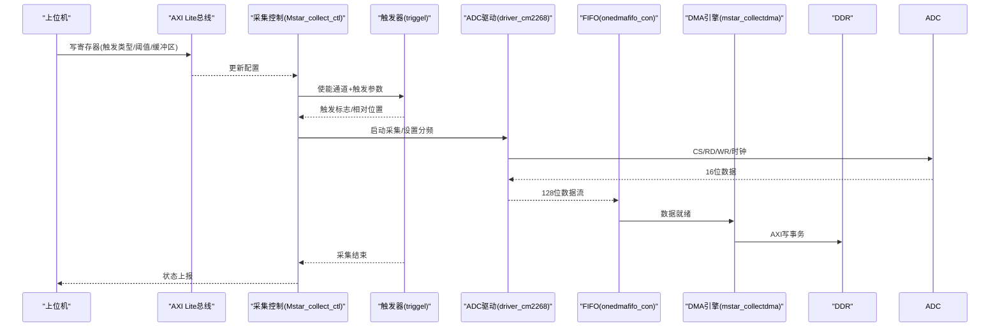
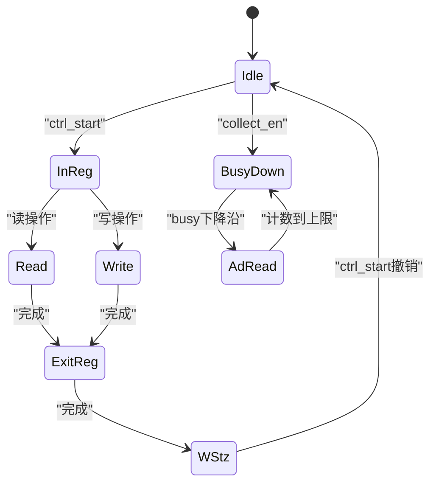
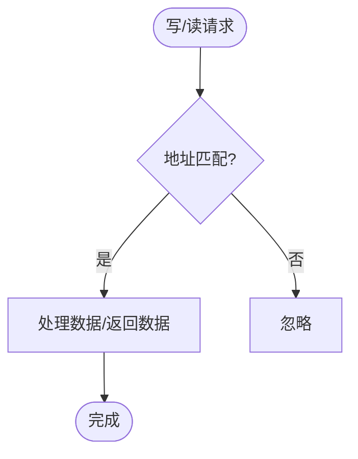
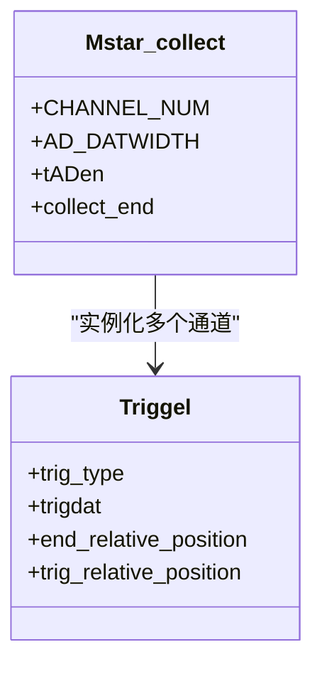
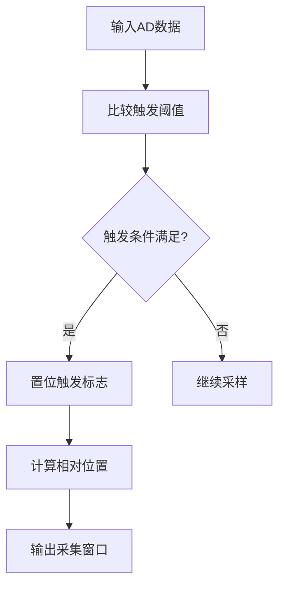
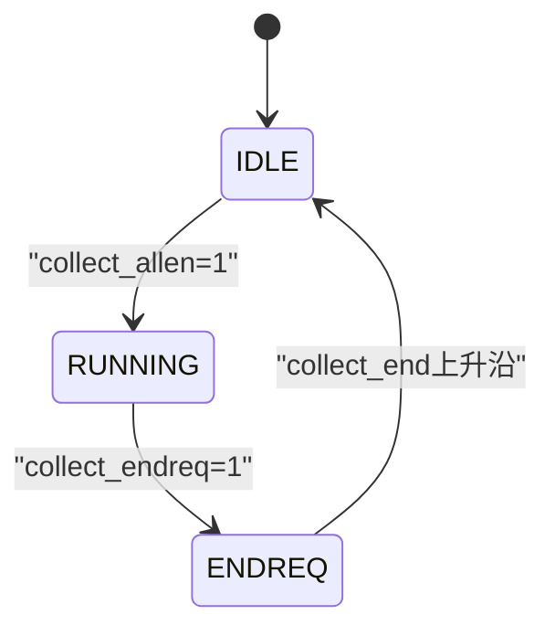
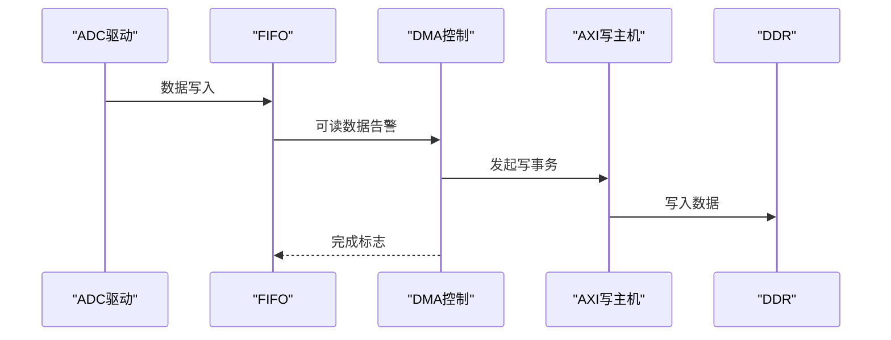
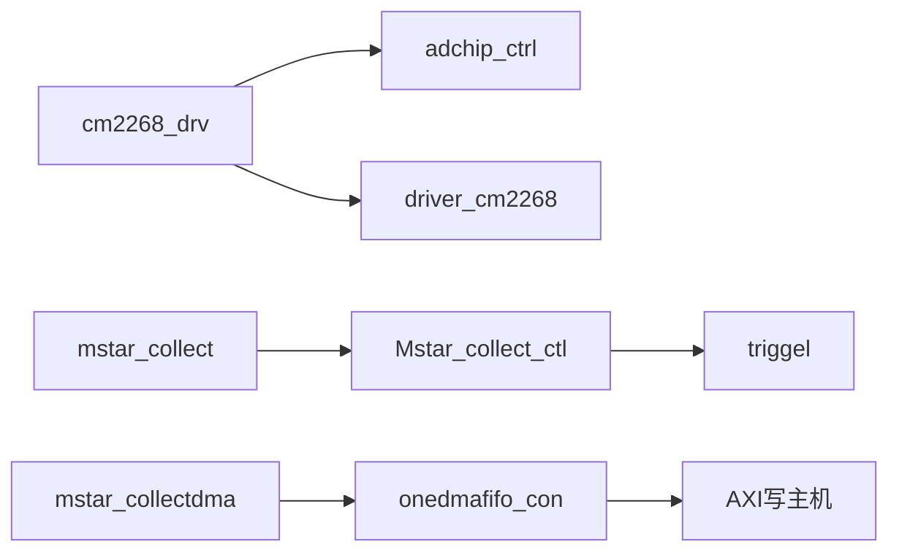

# ADC数据采集子系统

<cite>
**本文引用的文件**   
- [README.md](file://README.md)
- [driver_cm2268.v](file://hdl/ad_driver/driver_cm2268.v)
- [cm2268_drv.v](file://hdl/ad_driver/cm2268_drv.v)
- [adchip_ctrl.v](file://hdl/ad_driver/adchip_ctrl.v)
- [mstar_collect.v](file://hdl/collect/mstar_collect.v)
- [Mstar_collect_ctl.v](file://hdl/collect/Mstar_collect_ctl.v)
- [triggel.v](file://hdl/collect/triggel.v)
- [ad_collect_trig_ctrl.v](file://hdl/collect/ad_collect_trig_ctrl.v)
- [mstar_collectdma.v](file://hdl/collect/mstar_collectdma.v)
- [onedmafifo_con.v](file://hdl/collect/onedmafifo_con.v)
</cite>

## 目录
1. [简介](#简介)
2. [项目结构](#项目结构)
3. [核心组件](#核心组件)
4. [架构总览](#架构总览)
5. [详细组件分析](#详细组件分析)
6. [依赖关系分析](#依赖关系分析)
7. [性能与资源考量](#性能与资源考量)
8. [故障排查指南](#故障排查指南)
9. [结论](#结论)
10. [附录：配置与使用示例](#附录配置与使用示例)

## 简介
本技术文档聚焦于ADC数据采集子系统的实现，重点解析CM2268 ADC芯片的驱动与时序控制、多通道同步采集逻辑、触发机制（外部触发、软件触发、定时触发）、采集控制器状态机与数据流管理。系统通过AXI Lite接口进行参数配置，通过AXI Full DMA将采集数据写入DDR缓存，最终经以太网UDP传输至上位机。

## 项目结构
该工程为基于安路PH1 FPGA的多通道AD采集设备端FPGA设计，包含ADC驱动、采集控制、DMA搬运、AXI总线桥接等模块。关键路径如下：
- ADC驱动层：adchip_ctrl + driver_cm2268
- 采集控制层：Mstar_collect_ctl + triggel
- DMA数据通路：mstar_collectdma + onedmafifo_con + AXI写主机
- 顶层集成：mstar_collect

**图示来源**
- [cm2268_drv.v:70-138](file://hdl/ad_driver/cm2268_drv.v#L70-L138)
- [mstar_collect.v:107-187](file://hdl/collect/mstar_collect.v#L107-L187)
- [mstar_collectdma.v:77-148](file://hdl/collect/mstar_collectdma.v#L77-L148)

**章节来源**
- [README.md:23-73](file://README.md#L23-L73)

## 核心组件
- adchip_ctrl：AXI Lite寄存器接口，暴露采集参数、频率分频、复位、模式标志等；桥接底层ADC驱动。
- driver_cm2268：CM2268时序控制，实现寄存器读写、采样使能、忙检测、数据拼接与输出。
- cm2268_drv：封装adchip_ctrl与driver_cm2268，统一对外接口。
- mstar_collect：多通道采集顶层，实例化各通道触发器与采集控制。
- Mstar_collect_ctl：采集控制逻辑，管理通道使能、触发类型、结束请求、端口IO等。
- triggel：单通道触发器，支持电平/上升沿/下降沿触发，计算相对位置并输出采集窗口。
- mstar_collectdma：DMA引擎，通过AXI Full将数据从FIFO搬至DDR。
- onedmafifo_con：单通道DMA FIFO控制，仲裁读/写、半满标志、完成标志。

**章节来源**
- [adchip_ctrl.v:9-50](file://hdl/ad_driver/adchip_ctrl.v#L9-L50)
- [driver_cm2268.v:9-39](file://hdl/ad_driver/driver_cm2268.v#L9-L39)
- [cm2268_drv.v:9-51](file://hdl/ad_driver/cm2268_drv.v#L9-L51)
- [mstar_collect.v:9-62](file://hdl/collect/mstar_collect.v#L9-L62)
- [Mstar_collect_ctl.v:22-68](file://hdl/collect/Mstar_collect_ctl.v#L22-L68)
- [triggel.v:11-44](file://hdl/collect/triggel.v#L11-L44)
- [mstar_collectdma.v:9-66](file://hdl/collect/mstar_collectdma.v#L9-L66)
- [onedmafifo_con.v:9-50](file://hdl/collect/onedmafifo_con.v#L9-L50)

## 架构总览
整体数据与控制流如下：
- 上位机通过AXI Lite配置采集参数（通道数、触发方式、阈值、缓冲区大小等）。
- 采集控制根据配置生成各通道采集使能与触发条件。
- ADC驱动在采样模式下产生CS/RD/WR与时钟，读取ADC数据并拼接成128位宽数据流。
- 数据经FIFO缓冲后由DMA引擎按AXI Full协议写入DDR。
- 采集结束信号回传控制层，用于停止采集与释放资源。

**图示来源**
- [Mstar_collect_ctl.v:202-284](file://hdl/collect/Mstar_collect_ctl.v#L202-L284)
- [triggel.v:123-272](file://hdl/collect/triggel.v#L123-L272)
- [driver_cm2268.v:155-268](file://hdl/ad_driver/driver_cm2268.v#L155-L268)
- [onedmafifo_con.v:186-269](file://hdl/collect/onedmafifo_con.v#L186-L269)
- [mstar_collectdma.v:77-148](file://hdl/collect/mstar_collectdma.v#L77-L148)

## 详细组件分析

### CM2268 ADC驱动与时序控制
- 功能要点
  - 双模式切换：寄存器模式(modeflg=0)与采样模式(modeflg=1)。
  - 频率分频：通过freq_div控制采样时钟周期，最小值限制避免过快采样。
  - 忙检测：依据ad_busy边沿进入st_adread状态，完成数据读取。
  - 数据拼接：将多通道16位数据拼接为128位，配合ad_dataen输出。
- 状态机
  - st_idle：空闲，等待ctrl_start或collect_en。
  - st_inreg/st_read/st_write：寄存器读写序列。
  - st_exitreg/st_wstz：退出寄存器模式，准备采样。
  - st_busydown/st_adread：等待ADC忙下降沿，开始读取数据。

**图示来源**
- [driver_cm2268.v:47-55](file://hdl/ad_driver/driver_cm2268.v#L47-L55)
- [driver_cm2268.v:103-152](file://hdl/ad_driver/driver_cm2268.v#L103-L152)
- [driver_cm2268.v:169-268](file://hdl/ad_driver/driver_cm2268.v#L169-L268)

**章节来源**
- [driver_cm2268.v:68-95](file://hdl/ad_driver/driver_cm2268.v#L68-L95)
- [driver_cm2268.v:155-268](file://hdl/ad_driver/driver_cm2268.v#L155-L268)

### 寄存器接口与参数配置
- 地址映射
  - ADDR_MODEL_ID：型号ID
  - ADDR_CON：控制字（复位、采集使能、模式标志、完成标志、地址、大小等）
  - ADDR_WDATA/ADDR_RDATA：写/读数据
  - ADDR_FREQDIV：采样分频
  - ADDR_ADDATAx：ADC数据通道数据块
- 读写FSM
  - 写路径：AWVALID→WVALID→BVALID/BREADY
  - 读路径：ARVALID→RVALID/RREADY

**图示来源**
- [adchip_ctrl.v:51-68](file://hdl/ad_driver/adchip_ctrl.v#L51-L68)
- [adchip_ctrl.v:164-185](file://hdl/ad_driver/adchip_ctrl.v#L164-L185)
- [adchip_ctrl.v:186-238](file://hdl/ad_driver/adchip_ctrl.v#L186-L238)

**章节来源**
- [adchip_ctrl.v:82-120](file://hdl/ad_driver/adchip_ctrl.v#L82-L120)
- [adchip_ctrl.v:130-160](file://hdl/ad_driver/adchip_ctrl.v#L130-L160)
- [adchip_ctrl.v:164-238](file://hdl/ad_driver/adchip_ctrl.v#L164-L238)

### 多通道同步采集与数据交织
- 通道组织
  - mstar_collect实例化N个triggel，每个通道独立触发与窗口控制。
  - 通道使能collect_en[i]由Mstar_collect_ctl统一管理。
- 数据交织
  - 各通道16位数据在驱动层拼接为128位，便于DMA高效传输。
  - tADen为所有通道使能的或运算结果，确保数据有效对齐。

**图示来源**
- [mstar_collect.v:157-187](file://hdl/collect/mstar_collect.v#L157-L187)
- [triggel.v:123-272](file://hdl/collect/triggel.v#L123-L272)

**章节来源**
- [mstar_collect.v:86-92](file://hdl/collect/mstar_collect.v#L86-L92)
- [mstar_collect.v:157-187](file://hdl/collect/mstar_collect.v#L157-L187)

### 触发机制详解
- 触发类型
  - 不触发(TRIG_TYPE_NORMAL)
  - 电平触发(TRIG_TYPE_LEVEL)
  - 上升沿触发(TRIG_TYPE_UP)
  - 下降沿触发(TRIG_TYPE_DOWN)
- 触发判断
  - 内部数据比较：w_trigel_datflg基于trigdat与当前ADdat比较。
  - 外部触发：in_trigflg_up记录外部触发时刻，计算trig_relative_position。
- 采集窗口
  - pre_cachsize定义触发前缓存大小，end_relative_position标记采集结束位置。

**图示来源**
- [triggel.v:112-118](file://hdl/collect/triggel.v#L112-L118)
- [triggel.v:123-133](file://hdl/collect/triggel.v#L123-L133)
- [triggel.v:194-228](file://hdl/collect/triggel.v#L194-L228)

**章节来源**
- [triggel.v:45-50](file://hdl/collect/triggel.v#L45-L50)
- [triggel.v:112-133](file://hdl/collect/triggel.v#L112-L133)
- [triggel.v:194-228](file://hdl/collect/triggel.v#L194-L228)

### 采集控制器状态机与数据流管理
- 控制信号
  - collect_en[i]：通道采集使能
  - collect_endreq：采集结束请求
  - trigtype[i*3+:3]：触发类型
  - trigdat[i*AD_DATWIDTH+:AD_DATWIDTH]：触发阈值
- 状态管理
  - 通过get_singer_edge检测collect_end上升沿，清零全局使能。
  - 端口IO通过ADDR_OUTPORT/ADDR_INPORT读写。

**图示来源**
- [Mstar_collect_ctl.v:198-201](file://hdl/collect/Mstar_collect_ctl.v#L198-L201)
- [Mstar_collect_ctl.v:239-255](file://hdl/collect/Mstar_collect_ctl.v#L239-L255)

**章节来源**
- [Mstar_collect_ctl.v:202-284](file://hdl/collect/Mstar_collect_ctl.v#L202-L284)

### DMA数据通路
- 数据路径
  - s_axis_tvalid/tdata来自ADC驱动拼接后的128位数据。
  - onedmafifo_con负责跨时钟域缓冲与AXI写仲裁。
  - axi_dma_example_axi_write_master执行AXI写事务。
- 控制信号
  - DMA_channel_en：通道使能
  - DMA_oksta：DMA完成标志
  - DMA_half_flg：半满标志，用于上层监控

**图示来源**
- [mstar_collectdma.v:77-148](file://hdl/collect/mstar_collectdma.v#L77-L148)
- [onedmafifo_con.v:290-339](file://hdl/collect/onedmafifo_con.v#L290-L339)

**章节来源**
- [mstar_collectdma.v:68-148](file://hdl/collect/mstar_collectdma.v#L68-L148)
- [onedmafifo_con.v:114-125](file://hdl/collect/onedmafifo_con.v#L114-L125)
- [onedmafifo_con.v:186-269](file://hdl/collect/onedmafifo_con.v#L186-L269)

## 依赖关系分析
- 模块耦合
  - cm2268_drv依赖adchip_ctrl与driver_cm2268。
  - mstar_collect依赖Mstar_collect_ctl与triggel。
  - mstar_collectdma依赖onedmafifo_con与AXI写主机。
- 外部依赖
  - AXI Lite总线用于配置。
  - AXI Full总线用于DMA数据传输。
  - DDR控制器用于数据存储。

**图示来源**
- [cm2268_drv.v:70-138](file://hdl/ad_driver/cm2268_drv.v#L70-L138)
- [mstar_collect.v:107-187](file://hdl/collect/mstar_collect.v#L107-L187)
- [mstar_collectdma.v:77-148](file://hdl/collect/mstar_collectdma.v#L77-L148)

**章节来源**
- [cm2268_drv.v:70-138](file://hdl/ad_driver/cm2268_drv.v#L70-L138)
- [mstar_collect.v:107-187](file://hdl/collect/mstar_collect.v#L107-L187)
- [mstar_collectdma.v:77-148](file://hdl/collect/mstar_collectdma.v#L77-L148)

## 性能与资源考量
- 采样率控制
  - freq_div决定采样时钟周期，需大于等于FREQ_DIV_MIN以避免时序违例。
- 数据带宽
  - 128位数据宽度提升DMA吞吐效率，减少AXI事务次数。
- 触发精度
  - 相对位置计数器提供精确的触发点定位，支持预触发与后触发。
- 资源占用
  - FIFO深度与AXI突发长度影响BRAM与DSP资源使用。

[本节为通用指导，不涉及具体文件分析]

## 故障排查指南
- 常见问题
  - 无法进入采样模式：检查modeflg与collect_en配置。
  - 数据为空：确认ad_dataen与s_axis_tvalid是否有效。
  - DMA未完成：查看DMA_oksta与control_done状态。
- 调试建议
  - 通过ADDR_MODEL_ID与ADDR_CONSTA读取状态字。
  - 使用ChipWatcher或ILA抓取关键信号波形。

**章节来源**
- [adchip_ctrl.v:164-185](file://hdl/ad_driver/adchip_ctrl.v#L164-L185)
- [Mstar_collect_ctl.v:202-284](file://hdl/collect/Mstar_collect_ctl.v#L202-L284)
- [onedmafifo_con.v:186-269](file://hdl/collect/onedmafifo_con.v#L186-L269)

## 结论
本ADC数据采集子系统通过分层设计实现了CM2268 ADC的高效驱动、多通道同步采集、灵活触发机制与可靠的数据搬运。AXI Lite与AXI Full总线分别承担配置与数据传输职责，确保了系统的可扩展性与高性能。

[本节为总结性内容，不涉及具体文件分析]

## 附录：配置与使用示例
- 配置步骤
  1. 写ADDR_FREQDIV设置采样分频。
  2. 写ADDR_CHx_TRIGTYPE配置触发类型。
  3. 写ADDR_CHx_TRIDDAT设置触发阈值。
  4. 写ADDR_ENABLEFLG启用通道与触发。
  5. 写ADDR_CONSTA启动采集或请求结束。
- 数据处理
  - 从ADDR_ADDATAx读取拼接后的128位数据。
  - 通过DMA状态寄存器监控采集进度。

**章节来源**
- [adchip_ctrl.v:51-68](file://hdl/ad_driver/adchip_ctrl.v#L51-L68)
- [Mstar_collect_ctl.v:69-78](file://hdl/collect/Mstar_collect_ctl.v#L69-L78)
- [Mstar_collect_ctl.v:213-218](file://hdl/collect/Mstar_collect_ctl.v#L213-L218)