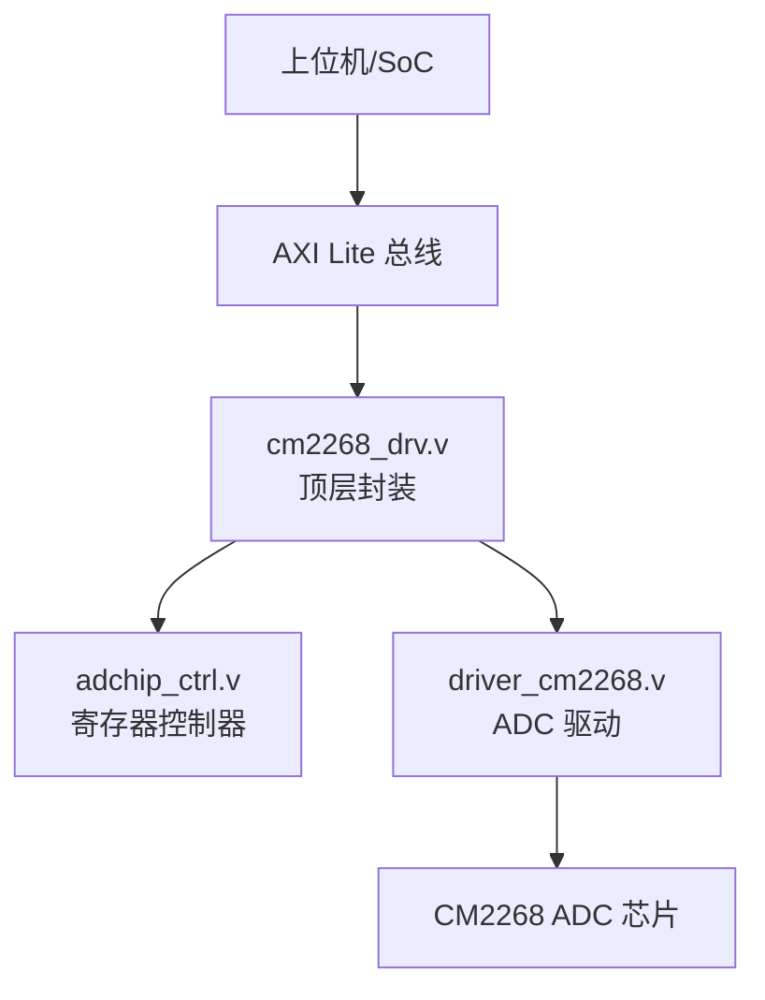
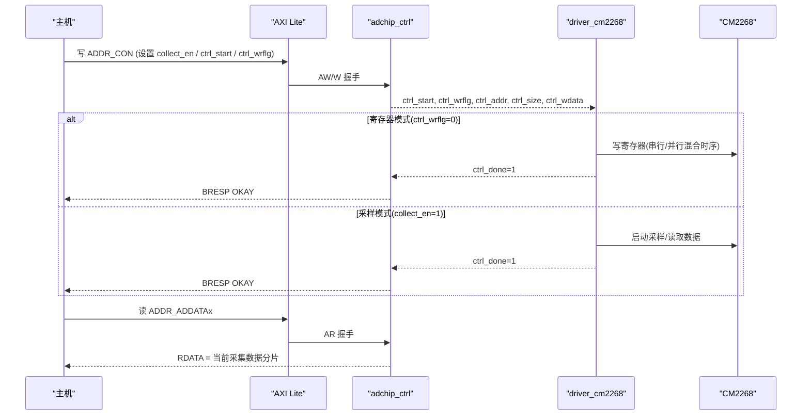
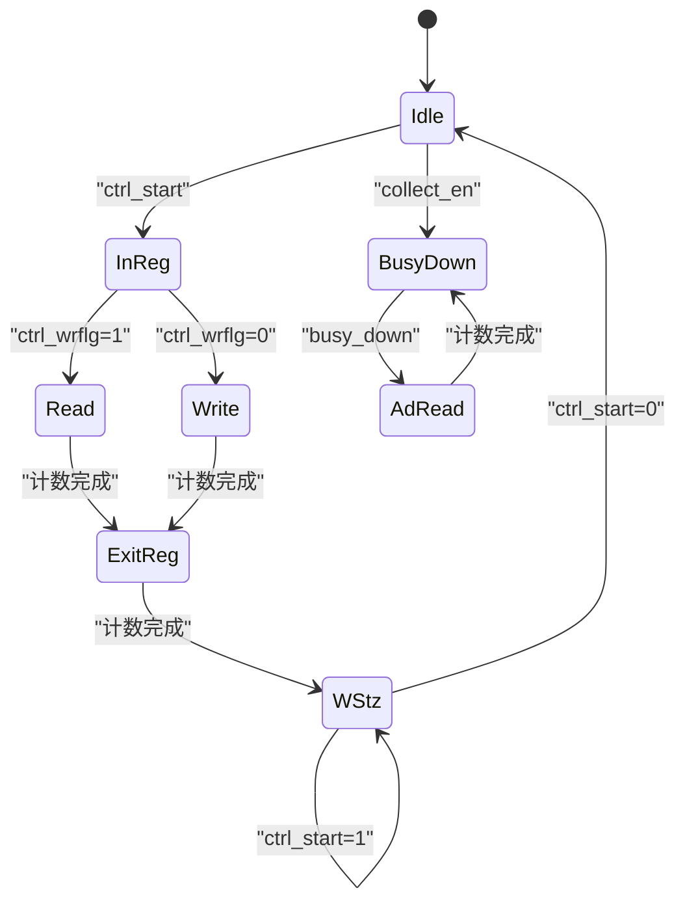
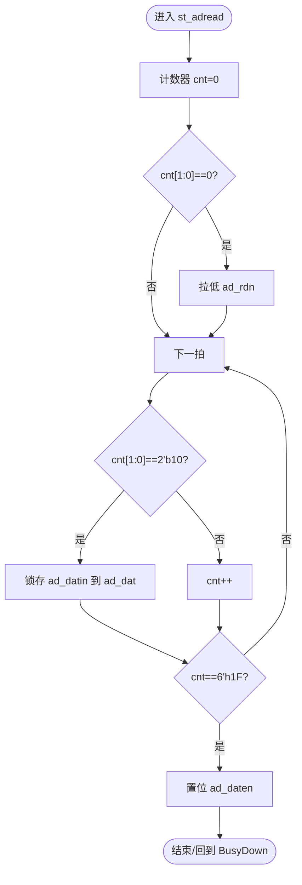
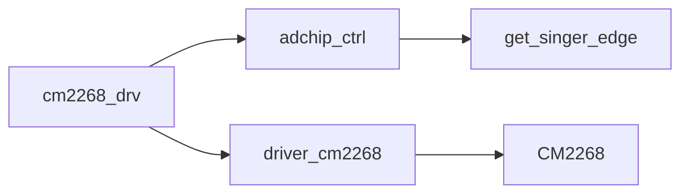

# ADC驱动实现详解

<cite>
**本文引用的文件**   
- [cm2268_drv.v](file://hdl/ad_driver/cm2268_drv.v)
- [driver_cm2268.v](file://hdl/ad_driver/driver_cm2268.v)
- [adchip_ctrl.v](file://hdl/ad_driver/adchip_ctrl.v)
- [README.md](file://README.md)
</cite>

## 目录
1. [引言](#引言)
2. [项目结构](#项目结构)
3. [核心组件](#核心组件)
4. [架构总览](#架构总览)
5. [详细组件分析](#详细组件分析)
6. [依赖关系分析](#依赖关系分析)
7. [性能与约束](#性能与约束)
8. [故障排查指南](#故障排查指南)
9. [结论](#结论)
10. [附录：寄存器与使用示例](#附录寄存器与使用示例)

## 引言
本技术文档围绕 CM2268 ADC 驱动实现，系统性解析顶层模块 cm2268_drv 的架构设计、AXI Lite 接口集成、时钟域转换、数据路径处理等关键功能；深入说明 driver_cm2268 模块的时序控制逻辑（采样时钟生成、数据捕获时序、SPI/并行混合通信协议）；并解释 adchip_ctrl 模块的寄存器管理（地址解码、读写操作、参数配置）。文档包含状态机与时序图，以及面向工程实践的配置与采集流程示例。

## 项目结构
CM2268 ADC 驱动位于 hdl/ad_driver 目录下，由三个核心 RTL 文件组成：
- cm2268_drv.v：顶层封装，桥接 AXI Lite 与 ADC 物理接口
- adchip_ctrl.v：AXI Lite 寄存器控制器，负责地址解码、读写状态机与参数映射
- driver_cm2268.v：ADC 芯片驱动，实现采样时序、数据捕获与模式切换

图表来源
- [cm2268_drv.v:1-142](file://hdl/ad_driver/cm2268_drv.v#L1-L142)
- [adchip_ctrl.v:1-241](file://hdl/ad_driver/adchip_ctrl.v#L1-L241)
- [driver_cm2268.v:1-270](file://hdl/ad_driver/driver_cm2268.v#L1-L270)

章节来源
- [README.md:23-73](file://README.md#L23-L73)

## 核心组件
- cm2268_drv：提供 AXI Lite 接口到 ADC 物理信号的桥接，内部实例化 adchip_ctrl 与 driver_cm2268，完成时钟域隔离与控制信号路由。
- adchip_ctrl：实现 AXI Lite 写/读 FSM，维护寄存器映射，输出控制命令（collect_en、ad_reset、ctrl_start、ctrl_wrflg、ctrl_addr、ctrl_size、ctrl_wdata），并回读当前采集数据片段。
- driver_cm2268：根据控制信号在“寄存器模式”和“ADC 采样模式”之间切换，生成 SPI/并行混合时序，完成 ADC 配置与数据采集，输出 128bit 数据帧及有效标志。

章节来源
- [cm2268_drv.v:1-142](file://hdl/ad_driver/cm2268_drv.v#L1-L142)
- [adchip_ctrl.v:1-241](file://hdl/ad_driver/adchip_ctrl.v#L1-L241)
- [driver_cm2268.v:1-270](file://hdl/ad_driver/driver_cm2268.v#L1-L270)

## 架构总览
cm2268_drv 将 AXI Lite 控制面与 ADC 数据面解耦：
- 控制面：AXI Lite 写入寄存器 → adchip_ctrl 解析地址与数据 → 产生 ctrl_* 控制信号 → driver_cm2268 执行具体操作
- 数据面：driver_cm2268 从 ADC 读取数据 → 打包为 128bit 帧 → adchip_ctrl 暴露为 ADDR_ADDATAx 寄存器供上层读取

图表来源
- [adchip_ctrl.v:161-215](file://hdl/ad_driver/adchip_ctrl.v#L161-L215)
- [driver_cm2268.v:155-268](file://hdl/ad_driver/driver_cm2268.v#L155-L268)
- [cm2268_drv.v:70-138](file://hdl/ad_driver/cm2268_drv.v#L70-L138)

## 详细组件分析

### 顶层封装 cm2268_drv
职责与要点
- 实例化 adchip_ctrl 与 driver_cm2268，连接 AXI Lite 与 ADC 物理引脚
- 将外部复位 ad_rstn 转换为内部 ad_reset_t，并与 ad_reset 输出关联
- 传递 freq_div、collect_en、modeflg、ctrl_* 信号，桥接两子模块的控制面
- 输出 ADC 数据帧 ad_data[128:0] 与数据有效 ad_daten

关键点
- 时钟域：s_axilite_clk 用于 AXI Lite 侧，ad_clk 用于 ADC 驱动侧
- 复位同步：ad_reset_t 作为内部复位，避免跨时钟域复位冲突
- 模式切换：modeflg 指示当前处于寄存器模式或 ADC 采样模式

章节来源
- [cm2268_drv.v:1-142](file://hdl/ad_driver/cm2268_drv.v#L1-L142)

### 寄存器控制器 adchip_ctrl
职责与要点
- 实现 AXI Lite 写/读 FSM：WRIDLE/WRDATA/WRRESP 与 RDIDLE/RDDATA/RDRESET
- 地址解码与寄存器映射：
  - ADDR_MODEL_ID：返回 MODEL_ID
  - ADDR_CON：控制字，包含 ad_reset、ctrl_wrflg、ctrl_start、collect_en、ctrl_size、in_convclk_en、ctrl_addr、ctrl_done_sync、modeflg
  - ADDR_WDATA：写入数据暂存
  - ADDR_RDATA：读取数据暂存
  - ADDR_FREQDIV：采样时钟分频器设定值
  - ADDR_ADDATA0~3：当前采集数据的四段 32bit 切片
- 通过 get_singer_edge 对 ctrl_done 进行边沿检测，确保 ctrl_start 单脉冲释放

关键行为
- 写 ADDR_CON：
  - 若 WDATA[3]=1：拉高 ad_reset，清零 collect_en 与 ctrl_start
  - 否则：更新 collect_en、in_convclk_en；若非寄存器模式则不改变 ctrl_*；若是寄存器模式则更新 ctrl_wrflg、ctrl_start、ctrl_size、ctrl_addr
- 写 ADDR_WDATA：保存 ctrl_wdata
- 写 ADDR_FREQDIV：限制最小分频值 FREQ_DIV_MIN
- 读 ADDR_CON：组合输出当前控制状态位
- 读 ADDR_ADDATAx：按地址偏移输出 ad_curdata 的不同 32bit 片段

章节来源
- [adchip_ctrl.v:51-68](file://hdl/ad_driver/adchip_ctrl.v#L51-L68)
- [adchip_ctrl.v:82-120](file://hdl/ad_driver/adchip_ctrl.v#L82-L120)
- [adchip_ctrl.v:130-160](file://hdl/ad_driver/adchip_ctrl.v#L130-L160)
- [adchip_ctrl.v:161-215](file://hdl/ad_driver/adchip_ctrl.v#L161-L215)
- [adchip_ctrl.v:217-238](file://hdl/ad_driver/adchip_ctrl.v#L217-L238)

### ADC 驱动 driver_cm2268
职责与要点
- 双模式状态机：
  - st_idle：空闲
  - st_inreg：准备寄存器访问（发送地址）
  - st_read：读寄存器（串行/并行混合时序）
  - st_write：写寄存器
  - st_exitreg：退出寄存器访问
  - st_wstz：等待 ctrl_start 撤销
  - st_busydown：等待 ADC busy 下降沿
  - st_adread：读取 ADC 数据帧
- 采样时钟生成：
  - 基于 collect_clk 与 in_convclk_en 控制是否计数
  - 使用 r_freq_cnt 与 w_freq_div 生成 ad_convst 脉冲序列
- 数据捕获：
  - 在 st_adread 中按固定节拍拉低/拉高 ad_rdn，并在指定拍次锁存 ad_datin 到 ad_dat
  - 当计数达到 6'h1F 时置位 ad_daten，表示一帧数据有效
- 模式切换：
  - modeflg=0：寄存器模式
  - modeflg=1：ADC 采样模式

关键细节
- 频率分频保护：w_freq_div=freq_div<FREQ_DIV_MIN ? FREQ_DIV_MIN-1 : freq_div-1
- Busy 边沿检测：busy_temp 打拍后异或得到 busy_down
- 数据有效边缘：ad_dataen_temp 两级打拍后异或得到上升沿 ad_dataen

章节来源
- [driver_cm2268.v:41-68](file://hdl/ad_driver/driver_cm2268.v#L41-L68)
- [driver_cm2268.v:69-96](file://hdl/ad_driver/driver_cm2268.v#L69-L96)
- [driver_cm2268.v:97-153](file://hdl/ad_driver/driver_cm2268.v#L97-L153)
- [driver_cm2268.v:155-268](file://hdl/ad_driver/driver_cm2268.v#L155-L268)

#### 状态机与时序图

图表来源
- [driver_cm2268.v:103-153](file://hdl/ad_driver/driver_cm2268.v#L103-L153)

图表来源
- [driver_cm2268.v:250-268](file://hdl/ad_driver/driver_cm2268.v#L250-L268)

## 依赖关系分析
- cm2268_drv 依赖 adchip_ctrl 与 driver_cm2268，承担信号桥接与复位同步
- adchip_ctrl 依赖 AXI Lite 总线协议与 get_singer_edge 边沿检测
- driver_cm2268 依赖 ADC 芯片的物理接口（CSN、RDn、WRn、FRSTDAT、DATIN/DATOUT）

图表来源
- [cm2268_drv.v:70-138](file://hdl/ad_driver/cm2268_drv.v#L70-L138)
- [adchip_ctrl.v:161-164](file://hdl/ad_driver/adchip_ctrl.v#L161-L164)
- [driver_cm2268.v:155-268](file://hdl/ad_driver/driver_cm2268.v#L155-L268)

## 性能与约束
- 时钟域隔离：AXI Lite 与 ADC 驱动分别运行于 s_axilite_clk 与 ad_clk/collection_clk，避免跨时钟域竞争
- 采样时钟分频：freq_div 决定 ad_convst 周期，需满足硬件最小分频 FREQ_DIV_MIN
- 数据吞吐：每帧 128bit，ad_daten 指示帧有效；可通过 ADDR_ADDATA0~3 分段读取
- 资源占用：FSM 与少量寄存器，开销较低

章节来源
- [driver_cm2268.v:68-96](file://hdl/ad_driver/driver_cm2268.v#L68-L96)
- [adchip_ctrl.v:227-238](file://hdl/ad_driver/adchip_ctrl.v#L227-L238)

## 故障排查指南
常见问题与定位建议
- AXI 无响应
  - 检查 ARESET 是否释放，AWREADY/ARREADY 是否有效
  - 确认 ADDR_CON 写入顺序：先写 ADDR_WDATA，再写 ADDR_CON 触发 ctrl_start
- 无法进入采样模式
  - 检查 collect_en 是否置位，in_convclk_en 是否符合预期
  - 确认 freq_div ≥ FREQ_DIV_MIN，且 ad_convst 波形正常
- 数据未输出或无效
  - 观察 busy_down 是否出现，st_adread 是否进入
  - 检查 ad_daten 是否在计数满 6'h1F 时置位
- 寄存器读写异常
  - 核对地址映射是否正确（ADDR_CON/ADDR_WDATA/ADDR_RDATA/ADDR_FREQDIV/ADDR_ADDATAx）
  - 确认 CTRL_SIZE 与数据字节数匹配

章节来源
- [adchip_ctrl.v:161-215](file://hdl/ad_driver/adchip_ctrl.v#L161-L215)
- [driver_cm2268.v:155-268](file://hdl/ad_driver/driver_cm2268.v#L155-L268)

## 结论
CM2268 ADC 驱动以清晰的三层结构实现：顶层封装 cm2268_drv 负责时钟域与信号桥接；adchip_ctrl 提供稳定的 AXI Lite 寄存器接口与参数映射；driver_cm2268 实现精确的时序控制与数据捕获。该设计具备良好的可配置性与可扩展性，便于在不同 FPGA 平台上复用与扩展更多 ADC 型号。

## 附录：寄存器与使用示例

### 寄存器映射（部分）
- ADDR_MODEL_ID：设备 ID
- ADDR_CON：控制字
  - Bit[3]：ad_reset
  - Bit[2:1]：{ctrl_wrflg, ctrl_start}
  - Bit[5:4]：ctrl_size
  - Bit[7]：in_convclk_en
  - Bit[14:8]：ctrl_addr
  - Bit[17:16]：{ctrl_done_sync, modeflg}
- ADDR_WDATA：写入数据
- ADDR_RDATA：读取数据
- ADDR_FREQDIV：采样时钟分频值（≥ FREQ_DIV_MIN）
- ADDR_ADDATA0~3：当前采集数据的四段 32bit 切片

章节来源
- [adchip_ctrl.v:51-68](file://hdl/ad_driver/adchip_ctrl.v#L51-L68)
- [adchip_ctrl.v:161-185](file://hdl/ad_driver/adchip_ctrl.v#L161-L185)

### 配置与采集流程示例
步骤
1) 初始化
   - 写 ADDR_FREQDIV 设置合适的分频值（≥ FREQ_DIV_MIN）
   - 写 ADDR_CON 清除 ad_reset，确保 collect_en=0、ctrl_start=0
2) 配置 ADC 寄存器（可选）
   - 写 ADDR_WDATA 为目标寄存器数据
   - 写 ADDR_CON：设置 ctrl_wrflg=0、ctrl_start=1、ctrl_addr=目标地址、ctrl_size=数据字节数
   - 等待 ctrl_done 上升沿（通过 ADDR_CON 的 ctrl_done_sync 位判断）
3) 启动采集
   - 写 ADDR_CON：设置 collect_en=1、in_convclk_en=1（如需）
   - 等待 busy_down 边沿，驱动自动进入 st_adread
4) 读取数据
   - 轮询 ADDR_ADDATA0~3 获取 128bit 数据帧
   - 依据 ad_daten 标志判断帧有效

章节来源
- [adchip_ctrl.v:186-238](file://hdl/ad_driver/adchip_ctrl.v#L186-L238)
- [driver_cm2268.v:155-268](file://hdl/ad_driver/driver_cm2268.v#L155-L268)