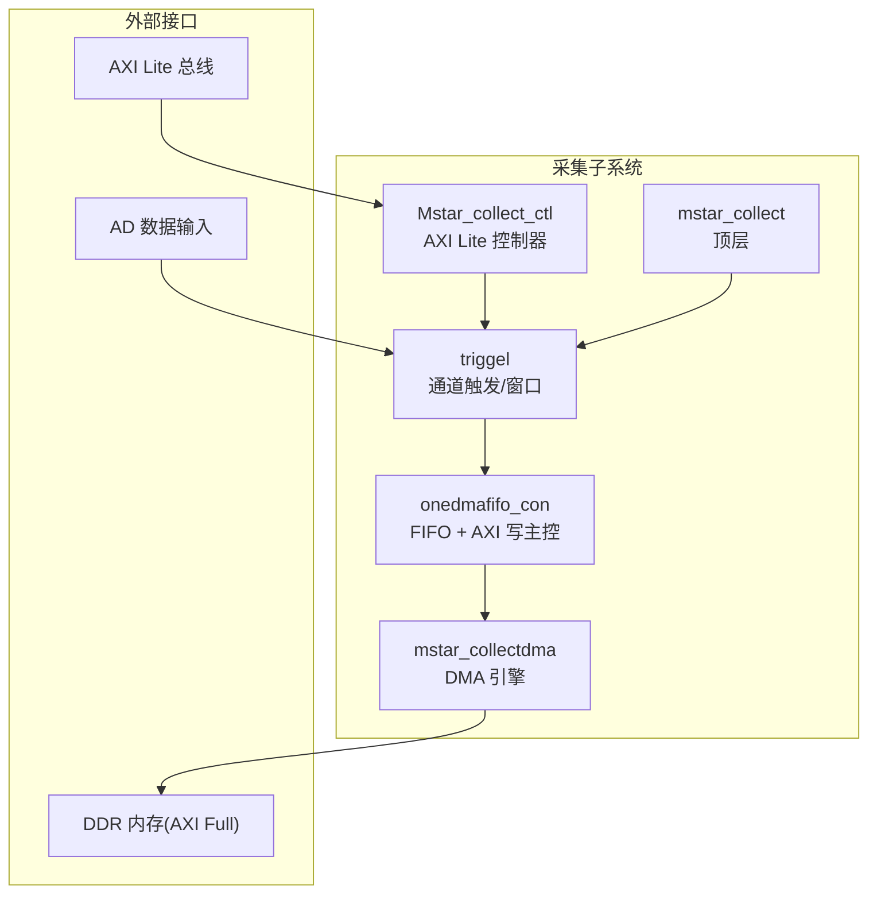
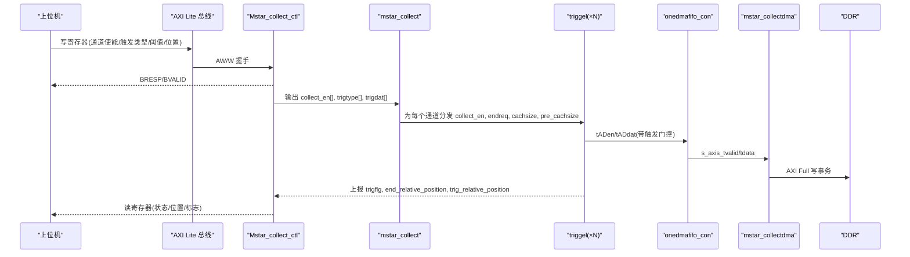
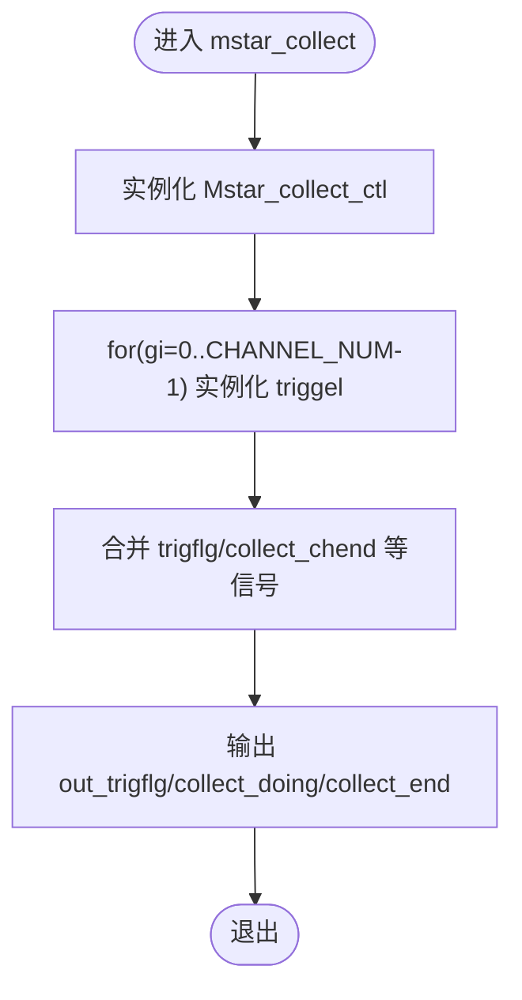
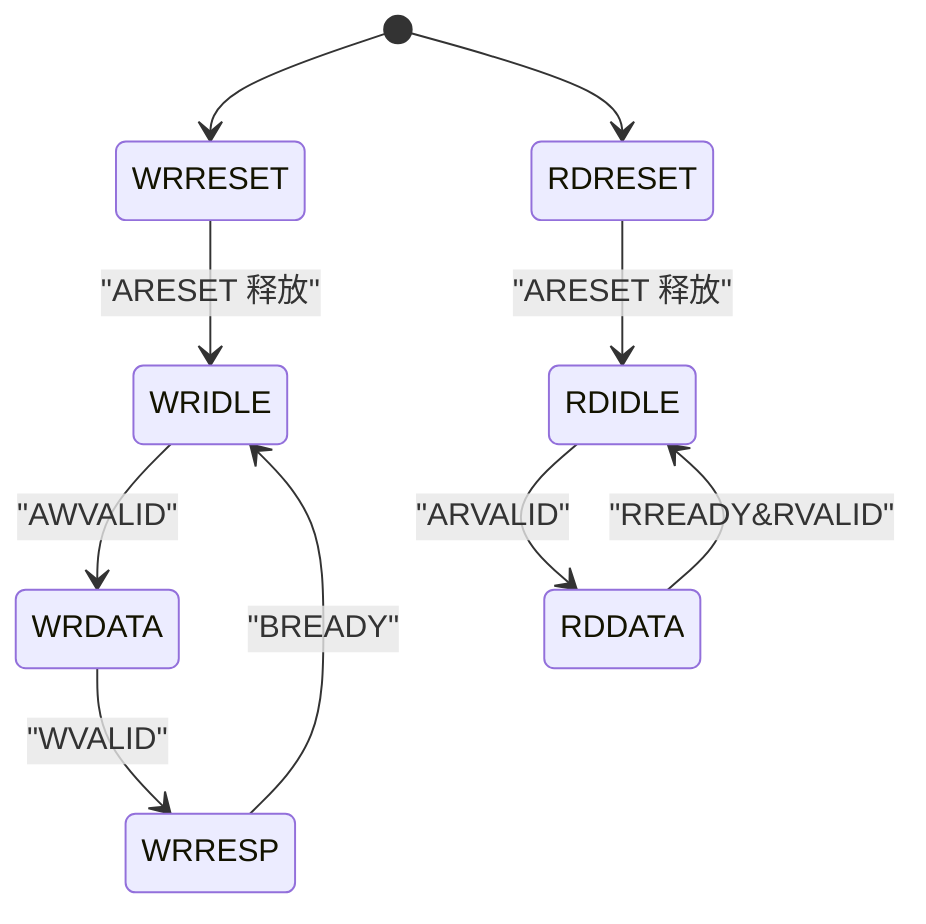
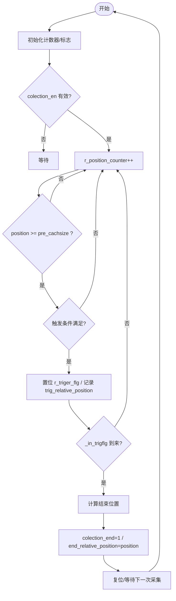
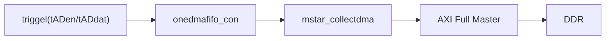
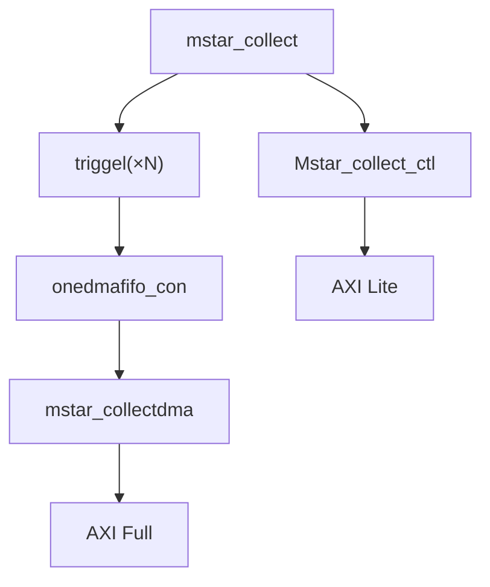

# 多通道采集控制

<cite>
**本文引用的文件**   
- [mstar_collect.v](file://hdl/collect/mstar_collect.v)
- [Mstar_collect_ctl.v](file://hdl/collect/Mstar_collect_ctl.v)
- [triggel.v](file://hdl/collect/triggel.v)
- [ad_collect_trig_ctrl.v](file://hdl/collect/ad_collect_trig_ctrl.v)
- [mstar_collectdma.v](file://hdl/collect/mstar_collectdma.v)
- [onedmafifo_con.v](file://hdl/collect/onedmafifo_con.v)
- [README.md](file://README.md)
</cite>

## 目录
1. [简介](#简介)
2. [项目结构](#项目结构)
3. [核心组件](#核心组件)
4. [架构总览](#架构总览)
5. [详细组件分析](#详细组件分析)
6. [依赖关系分析](#依赖关系分析)
7. [性能与实现要点](#性能与实现要点)
8. [配置示例与使用指南](#配置示例与使用指南)
9. [故障排查](#故障排查)
10. [结论](#结论)

## 简介
本技术文档面向多通道 AD 数据采集与控制子系统，重点解析 mstar_collect 顶层模块及其内部控制器 Mstar_collect_ctl 的设计与实现。内容涵盖：
- 多通道管理与数据流控制
- 触发与采样窗口管理
- 状态机设计与时序行为
- 缓冲区与 DMA 搬运机制
- 同步采集、相位对齐与数据格式处理思路
- 寄存器配置方法与参数设置

该子系统基于安路 PH1 FPGA，通过 AXI Lite 接口进行参数配置，支持多通道并行采集、灵活触发策略、以及将数据经 DMA 写入 DDR 缓存，最终由上层以太网桥接 IP 输出至主机。

## 项目结构
采集相关逻辑位于 hdl/collect 目录，主要包含：
- mstar_collect.v：顶层采集模块，集成 AXI Lite 配置、通道实例化、触发与数据通路
- Mstar_collect_ctl.v：AXI Lite 寄存器控制器，负责通道使能、触发模式、阈值、位置等参数读写
- triggel.v：单通道触发与采样窗口控制（含相对位置计数）
- ad_collect_trig_ctrl.v：通用触发控制（可用作参考或独立触发源）
- mstar_collectdma.v：DMA 引擎封装，对接 AXI Full 总线与 DDR
- onedmafifo_con.v：单通道 FIFO 与 AXI 写主控

图表来源
- [mstar_collect.v:107-155](file://hdl/collect/mstar_collect.v#L107-L155)
- [Mstar_collect_ctl.v:22-68](file://hdl/collect/Mstar_collect_ctl.v#L22-L68)
- [triggel.v:11-44](file://hdl/collect/triggel.v#L11-L44)
- [mstar_collectdma.v:9-66](file://hdl/collect/mstar_collectdma.v#L9-L66)
- [onedmafifo_con.v:9-35](file://hdl/collect/onedmafifo_con.v#L9-L35)

章节来源
- [README.md:23-73](file://README.md#L23-L73)

## 核心组件
- mstar_collect：顶层模块，负责：
  - 暴露 AXI Lite 配置接口
  - 实例化 Mstar_collect_ctl 控制器
  - 按 CHANNEL_NUM 生成多个 triggel 通道实例
  - 汇聚各通道触发标志与结束信号，对外提供统一采集状态
- Mstar_collect_ctl：AXI Lite 寄存器控制器，负责：
  - 读写模型 ID、端口 IO、全局使能标志
  - 每通道触发类型、阈值、结束/触发相对位置
  - 生成 collect_en[CH]、collect_endreq、trigtype[]、trigdat[]
- triggel：单通道触发与采样窗口控制，负责：
  - 根据 trig_type 判断触发条件（电平/上升沿/下降沿/无触发）
  - 维护 r_position_counter 相对位置计数器
  - 计算并输出 trig_relative_position、end_relative_position
  - 产生 colection_end、tADen/tADdat 输出给上层
- mstar_collectdma：DMA 引擎封装，负责：
  - 接收 s_axis_tdata/tvalid，经 AXI Full 写入 DDR
  - 暴露 buflen/pre_buflen 供上层查询缓冲长度
- onedmafifo_con：单通道 FIFO 控制，负责：
  - 在 AD 时钟域与 AXI 时钟域之间做数据缓冲
  - 仲裁 AXI 写事务，配合 ad_dma_axictrl 完成地址/长度管理

章节来源
- [mstar_collect.v:9-62](file://hdl/collect/mstar_collect.v#L9-L62)
- [Mstar_collect_ctl.v:22-68](file://hdl/collect/Mstar_collect_ctl.v#L22-L68)
- [triggel.v:11-44](file://hdl/collect/triggel.v#L11-L44)
- [mstar_collectdma.v:9-66](file://hdl/collect/mstar_collectdma.v#L9-L66)
- [onedmafifo_con.v:9-35](file://hdl/collect/onedmafifo_con.v#L9-L35)

## 架构总览
下图展示从 AD 数据到 DDR 的完整数据流，以及 AXI Lite 对采集控制的配置路径。

图表来源
- [mstar_collect.v:107-155](file://hdl/collect/mstar_collect.v#L107-L155)
- [Mstar_collect_ctl.v:202-254](file://hdl/collect/Mstar_collect_ctl.v#L202-L254)
- [triggel.v:123-271](file://hdl/collect/triggel.v#L123-L271)
- [mstar_collectdma.v:77-149](file://hdl/collect/mstar_collectdma.v#L77-L149)
- [onedmafifo_con.v:25-35](file://hdl/collect/onedmafifo_con.v#L25-L35)

## 详细组件分析

### mstar_collect 顶层模块
- 功能职责
  - 定义参数：CHANNEL_NUM、BUFLENWIDTH、AD_DATWIDTH、POART_WIDTH 等
  - 实例化 Mstar_collect_ctl，连接 AXI Lite 总线
  - 通过 generate for 循环实例化 N 个 triggel 通道
  - 汇总各通道触发标志与结束信号，对外输出 out_trigflg、collect_doing、collect_end
- 关键信号
  - collect_en[CH]：来自控制器，表示通道是否允许采集
  - trigtype[CH*3+:3]、trigdat[CH*AD_DATWIDTH+:AD_DATWIDTH]：触发类型与阈值
  - end_relative_position、trig_relative_position：相对位置信息
  - tADen/tADdat：经触发门控后的数据有效与数据值
- 设计要点
  - 外部触发 in_trigflg 经边沿检测后参与触发逻辑
  - 通过 |trigflg 与 out_trigflg 组合，提供统一的触发输出

图表来源
- [mstar_collect.v:107-155](file://hdl/collect/mstar_collect.v#L107-L155)
- [mstar_collect.v:157-188](file://hdl/collect/mstar_collect.v#L157-L188)

章节来源
- [mstar_collect.v:9-62](file://hdl/collect/mstar_collect.v#L9-L62)
- [mstar_collect.v:107-188](file://hdl/collect/mstar_collect.v#L107-L188)

### Mstar_collect_ctl 控制器
- 功能职责
  - 实现 AXI Lite 读写状态机（WR/RD FSM）
  - 提供寄存器映射：模型 ID、端口 IO、全局使能标志、每通道触发类型/阈值/位置
  - 输出 collect_en[CH]、collect_endreq、trigtype[]、trigdat[]
- 寄存器映射（节选）
  - ADDR_MODEL_ID：返回 MODEL_ID
  - ADDR_ENABLEFLG：读取/写入 {trigout_en,trigin_en,convout_en,convin_en}
  - ADDR_CONSTA：读取/写入 CHANNEL_NUM、AD_DATWIDTH、collect_end_sync、collect_endreq、collect_allen
  - 每通道：ADDR_CHx_TRIGTYPE、ADDR_CHx_TRIDDAT、ADDR_CHx_ENDCOLLECTPOS、ADDR_CHx_TRIGCOLLECTPOS
- 关键逻辑
  - collect_allen 全局采集使能；collect_endreq 请求结束一次采集周期
  - collect_en[CH] = collect_chen[CH] & collect_allen
  - 通过 get_singer_edge 对 collect_end 做边沿检测，用于复位采集状态

图表来源
- [Mstar_collect_ctl.v:98-157](file://hdl/collect/Mstar_collect_ctl.v#L98-L157)
- [Mstar_collect_ctl.v:167-197](file://hdl/collect/Mstar_collect_ctl.v#L167-L197)

章节来源
- [Mstar_collect_ctl.v:22-68](file://hdl/collect/Mstar_collect_ctl.v#L22-L68)
- [Mstar_collect_ctl.v:98-157](file://hdl/collect/Mstar_collect_ctl.v#L98-L157)
- [Mstar_collect_ctl.v:167-197](file://hdl/collect/Mstar_collect_ctl.v#L167-L197)
- [Mstar_collect_ctl.v:202-254](file://hdl/collect/Mstar_collect_ctl.v#L202-L254)
- [Mstar_collect_ctl.v:258-283](file://hdl/collect/Mstar_collect_ctl.v#L258-L283)

### triggel 通道触发与采样窗口
- 功能职责
  - 支持多种触发模式：无触发、电平触发、上升沿触发、下降沿触发
  - 维护相对位置计数器 r_position_counter，范围 0..cachsize-1
  - 根据 pre_cachsize 与 trig_relative_position 计算采集结束点
  - 输出 trigflg、colection_end、tADen/tADdat
- 触发判断
  - 电平触发：比较 w_ADdat 与 trigdat
  - 边沿触发：利用 get_extreflg 提供的 up/down 标志与差分判断
- 位置控制
  - trig_relative_position：记录触发发生时的相对位置
  - end_relative_position：记录采集结束时的相对位置
  - 当 _in_trigflg 到来时，依据 trig_relative_position 与 pre_cachsize 计算结束点

图表来源
- [triggel.v:123-271](file://hdl/collect/triggel.v#L123-L271)
- [triggel.v:89-101](file://hdl/collect/triggel.v#L89-L101)

章节来源
- [triggel.v:11-44](file://hdl/collect/triggel.v#L11-L44)
- [triggel.v:89-101](file://hdl/collect/triggel.v#L89-L101)
- [triggel.v:123-271](file://hdl/collect/triggel.v#L123-L271)

### ad_collect_trig_ctrl 触发控制（参考）
- 功能职责
  - 独立的触发控制模块，提供 AXI Lite 接口
  - 支持 collect_en、collect_endreq、trigen、trigtype、trigdat 等参数
  - 适合用于单一触发源或作为扩展触发控制参考
- 适用场景
  - 当需要独立于主采集通道的触发逻辑时使用
  - 可作为系统级触发协调器

章节来源
- [ad_collect_trig_ctrl.v:22-59](file://hdl/collect/ad_collect_trig_ctrl.v#L22-L59)
- [ad_collect_trig_ctrl.v:187-239](file://hdl/collect/ad_collect_trig_ctrl.v#L187-L239)

### mstar_collectdma 与 onedmafifo_con 数据搬运
- mstar_collectdma
  - 将 s_axis_tdata/tvalid 转换为 AXI Full 写事务
  - 暴露 buflen/pre_buflen 供上层查询当前缓冲长度
- onedmafifo_con
  - 在 AD 时钟域与 AXI 时钟域之间提供 FIFO 缓冲
  - 与 ad_dma_axictrl 协作，管理基址 buf_base_ch 与长度 buf_length_ch
  - 输出 DMA_half_flg、DMA_oksta 等状态

图表来源
- [mstar_collectdma.v:77-149](file://hdl/collect/mstar_collectdma.v#L77-L149)
- [onedmafifo_con.v:25-35](file://hdl/collect/onedmafifo_con.v#L25-L35)

章节来源
- [mstar_collectdma.v:9-66](file://hdl/collect/mstar_collectdma.v#L9-L66)
- [mstar_collectdma.v:77-149](file://hdl/collect/mstar_collectdma.v#L77-L149)
- [onedmafifo_con.v:9-35](file://hdl/collect/onedmafifo_con.v#L9-L35)

## 依赖关系分析
- 模块耦合
  - mstar_collect 依赖 Mstar_collect_ctl 提供配置与状态
  - mstar_collect 依赖 triggel 实现通道级触发与窗口控制
  - triggel 依赖 get_extreflg（通过子模块）进行边沿检测
  - mstar_collectdma 依赖 onedmafifo_con 进行跨时钟域缓冲
- 外部依赖
  - AXI Lite 总线：用于配置与状态读取
  - AXI Full 总线：用于 DMA 数据写入 DDR
  - AD 数据输入：多通道并行数据与有效信号

图表来源
- [mstar_collect.v:107-188](file://hdl/collect/mstar_collect.v#L107-L188)
- [Mstar_collect_ctl.v:22-68](file://hdl/collect/Mstar_collect_ctl.v#L22-L68)
- [mstar_collectdma.v:77-149](file://hdl/collect/mstar_collectdma.v#L77-L149)

章节来源
- [mstar_collect.v:107-188](file://hdl/collect/mstar_collect.v#L107-L188)
- [Mstar_collect_ctl.v:22-68](file://hdl/collect/Mstar_collect_ctl.v#L22-L68)
- [mstar_collectdma.v:77-149](file://hdl/collect/mstar_collectdma.v#L77-L149)

## 性能与实现要点
- 多通道并行
  - 通过 generate for 实例化 triggel，保证各通道独立触发与计数，避免相互干扰
- 触发精度与时序
  - 使用 get_singer_edge 与 get_extreflg 进行边沿检测，提高触发判定稳定性
  - 相对位置计数器以 AD 时钟域运行，确保与采样数据严格对齐
- 缓冲区管理
  - pre_cachsize 与 cachsize 决定触发前/后窗口大小，需合理配置以避免溢出或丢失数据
  - DMA 半满标志可用于双缓冲切换，提升吞吐
- 时钟域隔离
  - AD 数据路径与 AXI 控制路径分离，FIFO 缓冲降低跨时钟域风险

[本节为通用指导，不直接分析具体文件]

## 配置示例与使用指南
以下为常用配置步骤与参数说明（基于寄存器映射与模块接口）：

- 基本参数
  - CHANNEL_NUM：通道数量（默认 8）
  - AD_DATWIDTH：单通道数据位宽（默认 16）
  - BUFLENWIDTH：缓冲长度位宽（默认 28）
  - POART_WIDTH：端口宽度（默认 6）

- 全局控制
  - ADDR_ENABLEFLG：写入 {trigout_en,trigin_en,convout_en,convin_en}，启用/禁用各类触发与转换标志
  - ADDR_CONSTA：写入 collect_allen（全局采集使能）、collect_endreq（请求结束一次采集）

- 每通道触发配置
  - ADDR_CHx_TRIGTYPE：写入 trigtype[2:0] 与 collect_chen[0]
    - 0：不触发
    - 1：电平触发
    - 2：上升沿触发
    - 3：下降沿触发
  - ADDR_CHx_TRIDDAT：写入 trigdat[AD_DATWIDTH-1:0]，作为电平触发的阈值
  - ADDR_CHx_ENDCOLLECTPOS：读取 end_relative_position，获取本次采集结束相对位置
  - ADDR_CHx_TRIGCOLLECTPOS：读取 trig_relative_position，获取触发相对位置

- 典型流程
  1) 配置 CHANNEL_NUM、AD_DATWIDTH、BUFLENWIDTH 等参数（通过顶层参数）
  2) 设置 ADDR_ENABLEFLG，启用所需触发与转换标志
  3) 为每个通道设置 ADDR_CHx_TRIGTYPE 与 ADDR_CHx_TRIDDAT
  4) 设置 ADDR_CONSTA，开启 collect_allen 或单次采集 collect_endreq
  5) 读取 ADDR_CHx_TRIGCOLLECTPOS 与 ADDR_CHx_ENDCOLLECTPOS，验证触发与结束位置
  6) 观察 collect_doing、collect_end 状态，确认采集过程

注意：
- 若使用外部触发 in_trigflg，请确保在 ADDR_ENABLEFLG 中启用 trigin_en
- 合理设置 pre_cachsize 与 cachsize，确保触发窗口覆盖目标事件

章节来源
- [Mstar_collect_ctl.v:69-77](file://hdl/collect/Mstar_collect_ctl.v#L69-L77)
- [Mstar_collect_ctl.v:202-254](file://hdl/collect/Mstar_collect_ctl.v#L202-L254)
- [Mstar_collect_ctl.v:258-283](file://hdl/collect/Mstar_collect_ctl.v#L258-L283)
- [triggel.v:123-271](file://hdl/collect/triggel.v#L123-L271)

## 故障排查
- 常见问题
  - 触发未生效：检查 trigtype 与 trigdat 配置是否正确；确认 trigin_en 是否启用（外部触发）
  - 采集提前结束：检查 pre_cachsize 与 trig_relative_position 的计算是否符合预期
  - DMA 丢数据：确认 cachsize 与 pre_cachsize 设置是否足够；检查 DMA_half_flg 与双缓冲切换逻辑
  - 状态不一致：读取 ADDR_CONSTA 中的 collect_end_sync 与 collect_endreq，确认状态机是否复位
- 调试建议
  - 使用 ChipWatcher 或仿真波形观察 trigflg、collect_chend、end_relative_position、trig_relative_position
  - 逐步简化配置：先关闭触发，仅测试无触发采集；再逐步加入电平/边沿触发

章节来源
- [Mstar_collect_ctl.v:202-254](file://hdl/collect/Mstar_collect_ctl.v#L202-L254)
- [triggel.v:123-271](file://hdl/collect/triggel.v#L123-L271)

## 结论
mstar_collect 顶层模块通过 Mstar_collect_ctl 控制器与 triggel 通道触发逻辑，实现了多通道并行采集、灵活触发与精确窗口控制。结合 onedmafifo_con 与 mstar_collectdma，系统在 AD 时钟域与 AXI 控制域之间建立了稳定的数据通路，并通过 AXI Full 高效写入 DDR。整体架构清晰、模块化程度高，便于扩展与维护。通过合理的寄存器配置与参数调优，可满足多通道同步采集、相位对齐与数据格式处理的工程需求。