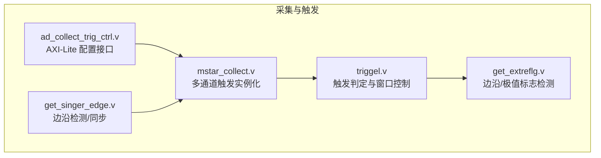
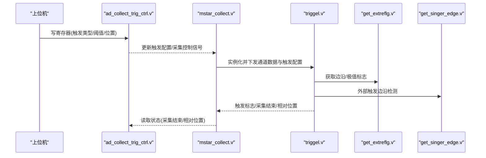
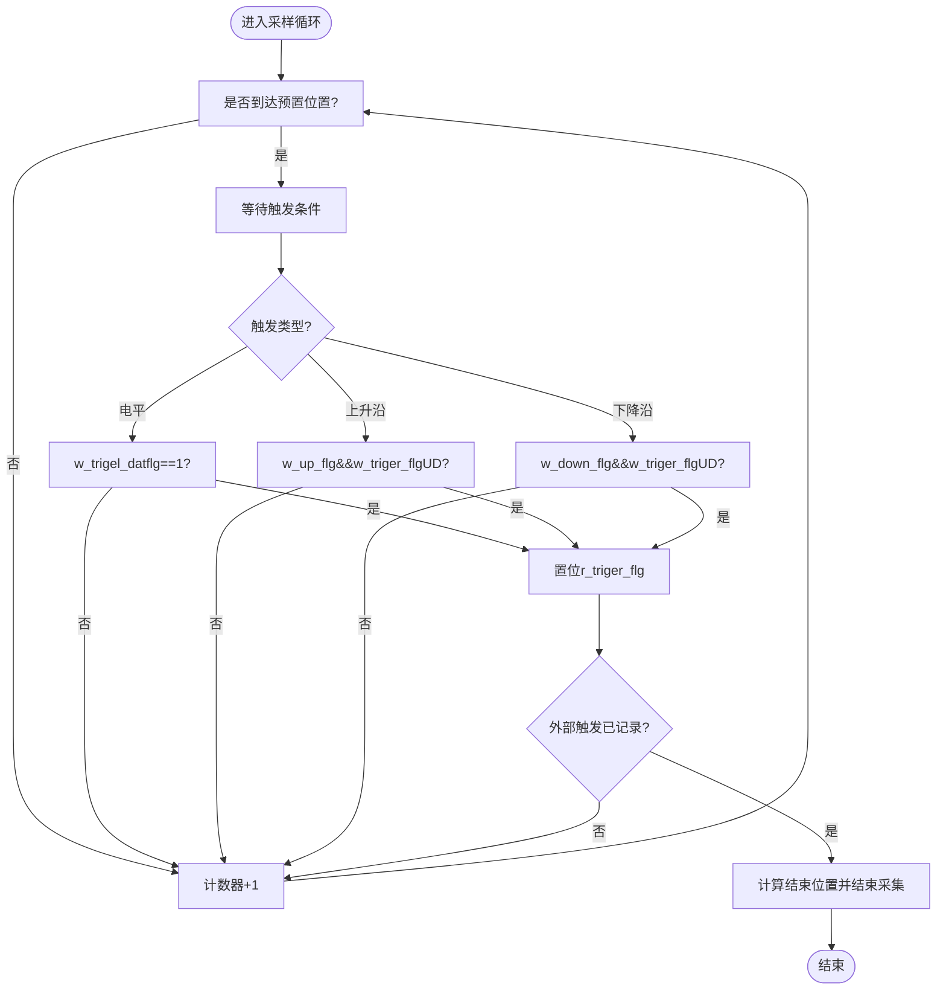
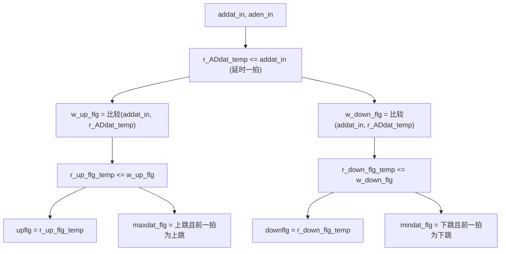
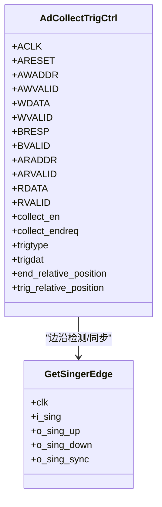
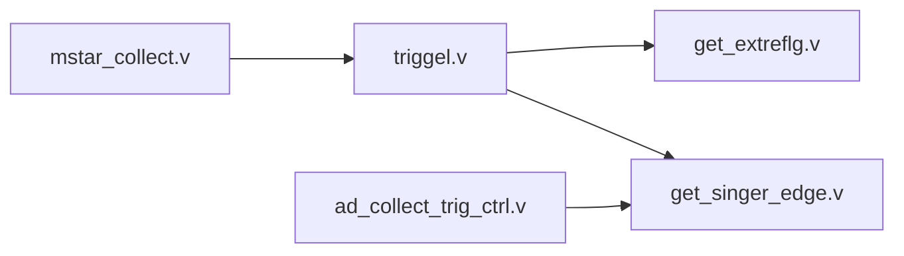

# 触发机制实现

<cite>
**本文引用的文件**   
- [triggel.v](file://hdl/collect/triggel.v)
- [get_extreflg.v](file://hdl/collect/get_extreflg.v)
- [ad_collect_trig_ctrl.v](file://hdl/collect/ad_collect_trig_ctrl.v)
- [mstar_collect.v](file://hdl/collect/mstar_collect.v)
- [get_singer_edge.v](file://hdl/sync/get_singer_edge.v)
- [README.md](file://README.md)
</cite>

## 目录
1. [引言](#引言)
2. [项目结构](#项目结构)
3. [核心组件](#核心组件)
4. [架构总览](#架构总览)
5. [详细组件分析](#详细组件分析)
6. [依赖关系分析](#依赖关系分析)
7. [性能与可靠性考虑](#性能与可靠性考虑)
8. [故障排查指南](#故障排查指南)
9. [结论](#结论)
10. [附录：配置示例与时序说明](#附录配置示例与时序说明)

## 引言
本技术文档聚焦于数据采集系统中的“触发机制”实现，围绕以下目标展开：
- 深入解释 triggel 模块的触发逻辑设计，包括外部触发信号检测、软件触发控制、定时/位置触发等。
- 详细说明 get_extreflg 模块的外部参考信号处理逻辑，包括信号同步、边沿检测、去抖动处理等技术细节。
- 解释多种触发模式的实现原理，包括单次触发、连续触发、延迟触发等模式的工作机制。
- 提供具体的触发配置示例，展示如何设置触发源、触发条件、触发延迟等参数。
- 包含触发时序图与信号波形图，帮助理解不同触发模式下的数据采集时机与控制流程。

该触发机制服务于多通道 AD 采集系统，通过 AXI-Lite 寄存器接口由上位机配置，结合外部触发输入与内部数据阈值比较，实现对采集窗口的精确控制。

## 项目结构
触发相关代码位于 hdl/collect 与 hdl/sync 两个子目录中：
- hdl/collect: 触发主逻辑 triggel.v、外部参考标志检测 get_extreflg.v、AXI-Lite 触发控制 ad_collect_trig_ctrl.v、顶层聚合 mstar_collect.v。
- hdl/sync: 单边沿检测 get_singer_edge.v，用于外部触发信号的边沿提取与同步。



图表来源
- [mstar_collect.v:157-188](file://hdl/collect/mstar_collect.v#L157-L188)
- [triggel.v:89-101](file://hdl/collect/triggel.v#L89-L101)
- [ad_collect_trig_ctrl.v:22-59](file://hdl/collect/ad_collect_trig_ctrl.v#L22-L59)
- [get_singer_edge.v:21-38](file://hdl/sync/get_singer_edge.v#L21-L38)

章节来源
- [README.md:23-58](file://README.md#L23-L58)

## 核心组件
- triggel.v: 触发判定与采集窗口控制的核心模块，支持电平触发、上升沿触发、下降沿触发、无触发（单次）以及基于外部触发的延迟采集。
- get_extreflg.v: 对 AD 数据进行两级延时与比较，输出上升/下降边沿标志及最大/最小值标志，用于边沿触发与阈值判断。
- ad_collect_trig_ctrl.v: 提供 AXI-Lite 寄存器读写接口，暴露采集使能、触发类型、触发阈值、触发位置等配置项。
- mstar_collect.v: 顶层聚合模块，按通道实例化 triggel，并汇总各通道触发状态，生成全局采集结束信号与外部触发输入/输出。
- get_singer_edge.v: 通用单边沿检测与同步模块，用于外部触发输入的边沿提取与打拍同步。

章节来源
- [triggel.v:11-44](file://hdl/collect/triggel.v#L11-L44)
- [get_extreflg.v:8-23](file://hdl/collect/get_extreflg.v#L8-L23)
- [ad_collect_trig_ctrl.v:22-59](file://hdl/collect/ad_collect_trig_ctrl.v#L22-L59)
- [mstar_collect.v:157-188](file://hdl/collect/mstar_collect.v#L157-L188)
- [get_singer_edge.v:21-38](file://hdl/sync/get_singer_edge.v#L21-L38)

## 架构总览
触发系统的整体数据流与控制流如下：
- 上位机通过 AXI-Lite 写入触发类型、触发阈值、触发位置等参数至 ad_collect_trig_ctrl.v。
- ad_collect_trig_ctrl.v 将配置参数传递给 mstar_collect.v，并按需启动/停止采集。
- mstar_collect.v 为每个通道实例化 triggel，传入当前通道数据与触发配置。
- triggel 内部调用 get_extreflg 进行边沿/极值检测，并结合外部触发输入（经 get_singer_edge 边沿检测）完成触发判定。
- 触发成功后，triggel 根据预置缓存大小与触发相对位置计算采集结束点，输出采集结束信号与触发相对位置。



图表来源
- [ad_collect_trig_ctrl.v:187-200](file://hdl/collect/ad_collect_trig_ctrl.v#L187-L200)
- [mstar_collect.v:157-188](file://hdl/collect/mstar_collect.v#L157-L188)
- [triggel.v:89-101](file://hdl/collect/triggel.v#L89-L101)
- [get_singer_edge.v:21-38](file://hdl/sync/get_singer_edge.v#L21-L38)

## 详细组件分析

### triggel 模块：触发判定与采集窗口控制
- 功能要点
  - 支持触发类型：不触发（单次）、电平触发、上升沿触发、下降沿触发。
  - 支持外部触发输入：记录外部触发发生时的相对位置，据此计算采集结束点，实现“延迟触发”。
  - 支持预置缓存大小 pre_cachsize：在达到预置位置后开始等待触发条件满足。
  - 输出触发标志 trigflg、采集结束 colection_end、触发相对位置 trig_relative_position、结束相对位置 end_relative_position。
- 关键实现
  - 使用 get_extreflg 输出 w_up_flg/w_down_flg 作为边沿标志；使用 w_trigel_datflg 进行阈值比较。
  - 使用 _in_trigflg 与 in_trigflg_up 捕获外部触发边沿，并记录触发相对位置。
  - 根据 trig_type 分支执行不同触发策略，并在满足条件时置位 r_triger_flg 或结束采集。
  - 当外部触发发生时，依据 trig_relative_position 与 pre_cachsize 计算结束位置，确保采集窗口对齐。



图表来源
- [triggel.v:123-173](file://hdl/collect/triggel.v#L123-L173)
- [triggel.v:174-230](file://hdl/collect/triggel.v#L174-L230)
- [triggel.v:238-264](file://hdl/collect/triggel.v#L238-L264)

章节来源
- [triggel.v:45-50](file://hdl/collect/triggel.v#L45-L50)
- [triggel.v:89-101](file://hdl/collect/triggel.v#L89-L101)
- [triggel.v:112-118](file://hdl/collect/triggel.v#L112-L118)
- [triggel.v:123-173](file://hdl/collect/triggel.v#L123-L173)
- [triggel.v:174-230](file://hdl/collect/triggel.v#L174-L230)
- [triggel.v:238-264](file://hdl/collect/triggel.v#L238-L264)

### get_extreflg 模块：外部参考信号处理
- 功能要点
  - 对输入 AD 数据进行一级延时，得到 r_ADdat_temp，并与当前 addat_in 进行比较，输出上升/下降边沿标志 w_up_flg/w_down_flg。
  - 通过 r_up_flg_temp/r_down_flg_temp 打一拍，输出 upflg/downflg，实现同步与去抖效果。
  - 同时输出 maxdat_flg/mindat_flg，指示最大值/最小值出现时刻，可用于极值触发扩展。
- 关键技术细节
  - 边沿检测采用相邻两拍数据比较，避免毛刺导致的误触发。
  - 输出打一拍以匹配系统时钟域，提高稳定性。
  - 支持有符号数比较（最高位符号位参与比较），适配正负信号范围。



图表来源
- [get_extreflg.v:30-63](file://hdl/collect/get_extreflg.v#L30-L63)

章节来源
- [get_extreflg.v:8-23](file://hdl/collect/get_extreflg.v#L8-L23)
- [get_extreflg.v:30-63](file://hdl/collect/get_extreflg.v#L30-L63)

### ad_collect_trig_ctrl 模块：AXI-Lite 触发控制
- 功能要点
  - 提供 AXI-Lite 读/写状态机，暴露模型 ID、采集控制、触发类型、触发阈值、采集结束位置、触发相对位置等寄存器。
  - 支持通过 WDATA 控制采集使能 collect_en 与采集结束请求 collect_endreq。
  - 支持通过 WDATA 配置触发类型 trigtype 与触发阈值 trigdat。
  - 通过 get_singer_edge 对 collect_end 进行边沿检测，清理采集控制信号。
- 关键实现
  - 地址映射：ADDR_CONSTA、ADDR_TRIGTYPE、ADDR_TRIDDAT、ADDR_ENDCOLLECTPOS、ADDR_TRIGCOLLECTPOS。
  - 写操作：解析 WDATA 位域，更新 collect_en/collect_endreq/trigtype/trigen/trigdat。
  - 读操作：返回当前状态与配置结果，便于上位机监控。



图表来源
- [ad_collect_trig_ctrl.v:22-59](file://hdl/collect/ad_collect_trig_ctrl.v#L22-L59)
- [ad_collect_trig_ctrl.v:187-200](file://hdl/collect/ad_collect_trig_ctrl.v#L187-L200)
- [get_singer_edge.v:21-38](file://hdl/sync/get_singer_edge.v#L21-L38)

章节来源
- [ad_collect_trig_ctrl.v:60-75](file://hdl/collect/ad_collect_trig_ctrl.v#L60-L75)
- [ad_collect_trig_ctrl.v:118-146](file://hdl/collect/ad_collect_trig_ctrl.v#L118-L146)
- [ad_collect_trig_ctrl.v:156-186](file://hdl/collect/ad_collect_trig_ctrl.v#L156-L186)
- [ad_collect_trig_ctrl.v:187-200](file://hdl/collect/ad_collect_trig_ctrl.v#L187-L200)
- [ad_collect_trig_ctrl.v:204-239](file://hdl/collect/ad_collect_trig_ctrl.v#L204-L239)

### mstar_collect 模块：多通道触发聚合
- 功能要点
  - 为每个通道实例化 triggel，并将通道数据与触发配置传入。
  - 汇总各通道触发标志与采集结束信号，生成全局采集结束与外部触发输出。
  - 连接外部触发输入 in_trigflg 与内部触发输出 out_trigflg，形成闭环触发路径。
- 关键实现
  - generate for 循环实例化 triggel，参数 BUFLENWIDTH/AD_DATWIDTH 传递。
  - 组合各通道 trigflg 与 in_trigflg_r，生成 trig_en_in 供 triggel 使用。
  - 输出 collect_doing、out_trigflg 等状态信号给上层。

章节来源
- [mstar_collect.v:59-92](file://hdl/collect/mstar_collect.v#L59-L92)
- [mstar_collect.v:157-188](file://hdl/collect/mstar_collect.v#L157-L188)

### get_singer_edge 模块：边沿检测与同步
- 功能要点
  - 对输入信号进行两级打拍，输出上升沿 o_sing_up、下降沿 o_sing_down 与同步信号 o_sing_sync。
  - 用于外部触发输入与采集结束信号的边沿检测，确保跨时钟域或异步信号的安全处理。
- 关键实现
  - i_sing_temp0/i_sing_temp1 两级寄存器链，组合逻辑计算边沿。

章节来源
- [get_singer_edge.v:21-38](file://hdl/sync/get_singer_edge.v#L21-L38)

## 依赖关系分析
- triggel 依赖 get_extreflg 提供边沿/极值标志，依赖 get_singer_edge 进行外部触发边沿检测。
- ad_collect_trig_ctrl 依赖 get_singer_edge 对采集结束信号进行边沿检测，清理控制状态。
- mstar_collect 聚合多个 triggel 实例，统一管理与外部触发输入/输出的桥接。



图表来源
- [triggel.v:89-101](file://hdl/collect/triggel.v#L89-L101)
- [triggel.v:117-118](file://hdl/collect/triggel.v#L117-L118)
- [ad_collect_trig_ctrl.v:187-189](file://hdl/collect/ad_collect_trig_ctrl.v#L187-L189)
- [mstar_collect.v:157-188](file://hdl/collect/mstar_collect.v#L157-L188)

章节来源
- [triggel.v:89-101](file://hdl/collect/triggel.v#L89-L101)
- [ad_collect_trig_ctrl.v:187-189](file://hdl/collect/ad_collect_trig_ctrl.v#L187-L189)
- [mstar_collect.v:157-188](file://hdl/collect/mstar_collect.v#L157-L188)

## 性能与可靠性考虑
- 边沿检测与去抖
  - get_extreflg 通过两级比较与打拍，有效抑制毛刺，提升边沿检测可靠性。
  - get_singer_edge 对异步信号进行两级同步，降低亚稳态风险。
- 触发精度
  - triggel 使用相对位置计数器与预置缓存大小，确保触发窗口对齐，减少时序偏差。
- 资源占用
  - 触发逻辑主要为组合逻辑与少量寄存器，资源开销较低，适合多通道并行实例化。
- 可扩展性
  - 通过 AXI-Lite 接口配置触发参数，便于上位机动态调整触发模式与阈值，适应不同应用场景。

[本节为一般性指导，不直接分析具体文件]

## 故障排查指南
- 外部触发无效
  - 检查 in_trigflg 是否有效，确认 get_singer_edge 输出 o_sing_up 是否有脉冲。
  - 核对 triggel 中 _in_trigflg 与 in_trigflg_up 的逻辑，确保外部触发边沿被正确捕获。
- 触发阈值不生效
  - 检查 trigdat 是否正确写入，确认 w_trigel_datflg 的比较逻辑是否符合预期。
  - 验证 get_extreflg 的 upflg/downflg 是否与数据极性一致。
- 采集未结束
  - 检查 colection_endreq 与 collect_end 的状态，确认 ad_collect_trig_ctrl 的状态机是否正常流转。
  - 核对 end_relative_position 与 trig_relative_position 的计算是否符合预置缓存大小。

章节来源
- [triggel.v:117-133](file://hdl/collect/triggel.v#L117-L133)
- [triggel.v:174-230](file://hdl/collect/triggel.v#L174-L230)
- [ad_collect_trig_ctrl.v:204-239](file://hdl/collect/ad_collect_trig_ctrl.v#L204-L239)

## 结论
本触发机制通过 triggel 与 get_extreflg 的配合，实现了灵活可靠的触发判定与采集窗口控制。结合 ad_collect_trig_ctrl 的 AXI-Lite 接口，系统支持多种触发模式与动态配置，适用于多通道 AD 数据采集场景。get_singer_edge 提供的边沿检测与同步能力进一步提升了系统的鲁棒性。整体架构清晰、扩展性强，具备良好的工程实用价值。

[本节为总结性内容，不直接分析具体文件]

## 附录：配置示例与时序说明

### 触发配置示例
- 单次触发（不触发）
  - 设置 trigtype=0，无需配置 trigdat。
  - 启动采集后，系统在达到缓存长度时自动结束。
- 电平触发
  - 设置 trigtype=1，配置 trigdat 为阈值。
  - 当 w_trigel_datflg 为高时触发，记录触发相对位置。
- 上升沿触发
  - 设置 trigtype=2，无需配置 trigdat。
  - 当 w_up_flg 与 w_triger_flgUD 同时为高时触发。
- 下降沿触发
  - 设置 trigtype=3，无需配置 trigdat。
  - 当 w_down_flg 与 w_triger_flgUD 同时为高时触发。
- 外部触发（延迟触发）
  - 通过 in_trigflg 输入外部触发信号，triggel 记录触发相对位置。
  - 根据 trig_relative_position 与 pre_cachsize 计算结束位置，实现延迟采集。

章节来源
- [triggel.v:45-50](file://hdl/collect/triggel.v#L45-L50)
- [triggel.v:194-228](file://hdl/collect/triggel.v#L194-L228)
- [triggel.v:238-264](file://hdl/collect/triggel.v#L238-L264)

### 触发时序图（概念示意）
以下为概念性时序图，展示不同触发模式下采集窗口的对齐与结束时机：

```mermaid
sequenceDiagram
participant CLK as "系统时钟"
participant DATA as "AD数据"
participant TRIG as "触发标志"
participant END as "采集结束"
Note over CLK,END : 电平触发
CLK->>DATA : 数据流
DATA-->>TRIG : 阈值比较为高
TRIG-->>END : 触发后继续采集至结束
Note over CLK,END : 上升沿触发
CLK->>DATA : 数据流
DATA-->>TRIG : 上升沿检测
TRIG-->>END : 触发后继续采集至结束
Note over CLK,END : 外部触发延迟
CLK->>DATA : 数据流
DATA-->>TRIG : 外部触发边沿
TRIG-->>END : 根据相对位置计算结束
```

[此图为概念性示意，不直接映射到具体源码文件]