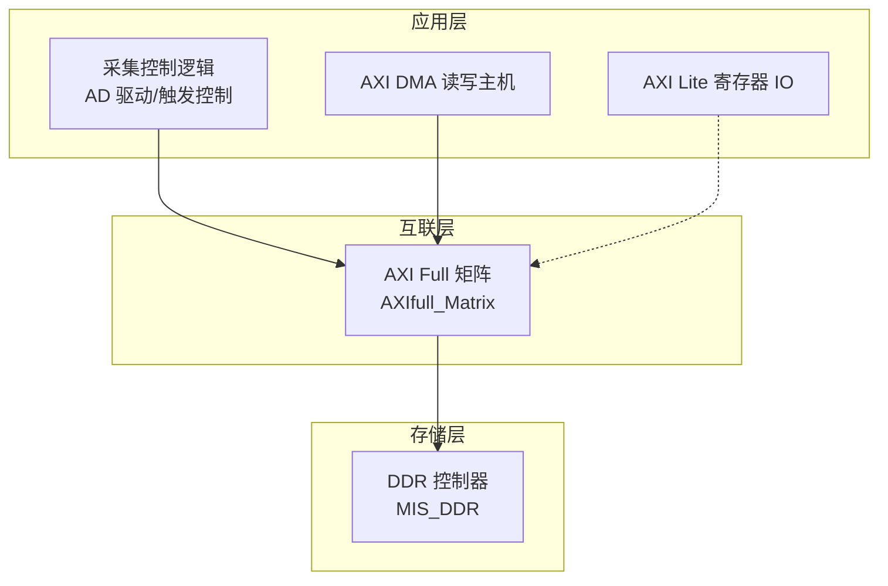
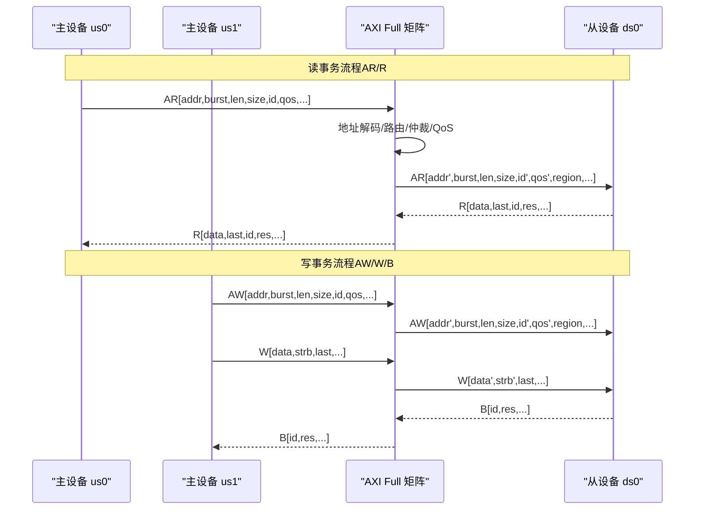
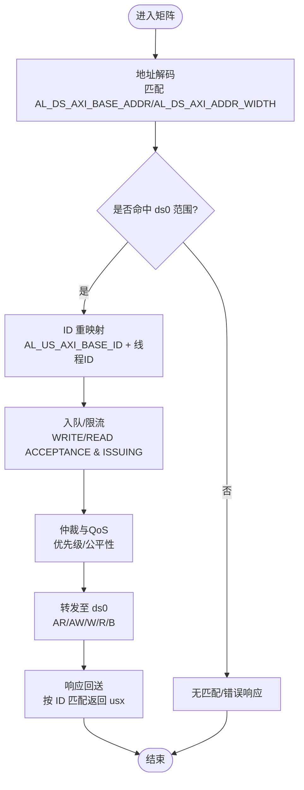
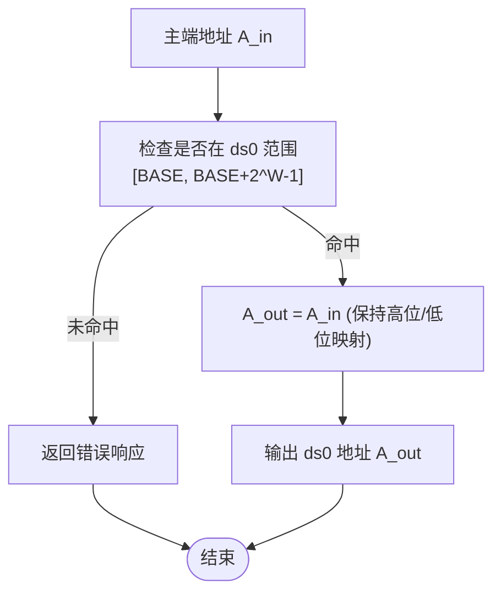
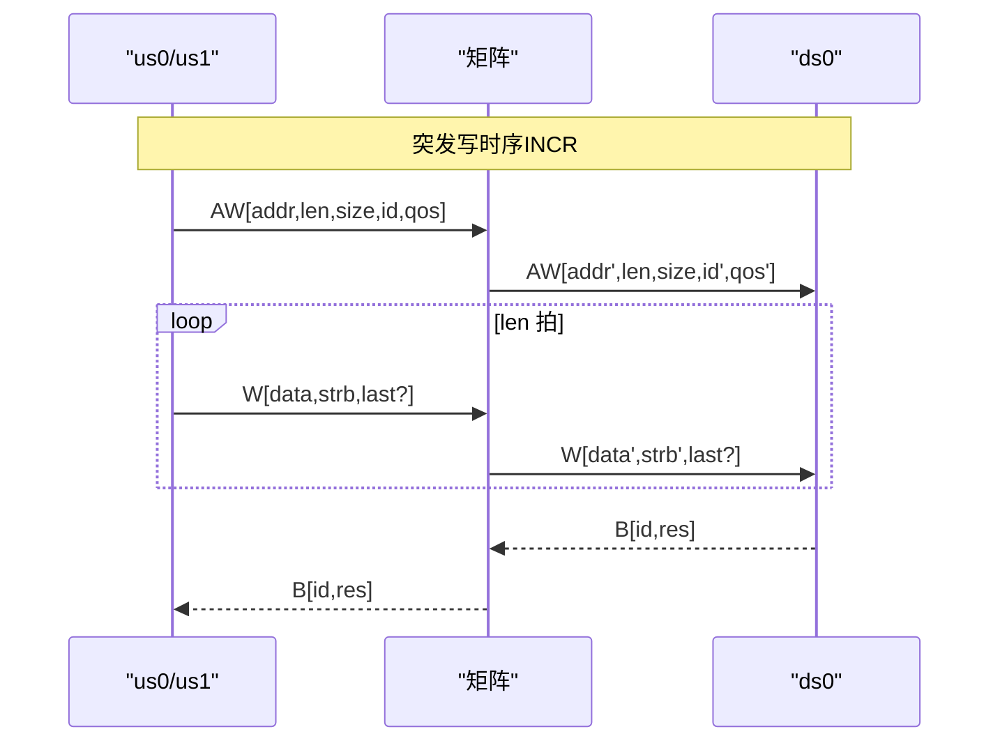
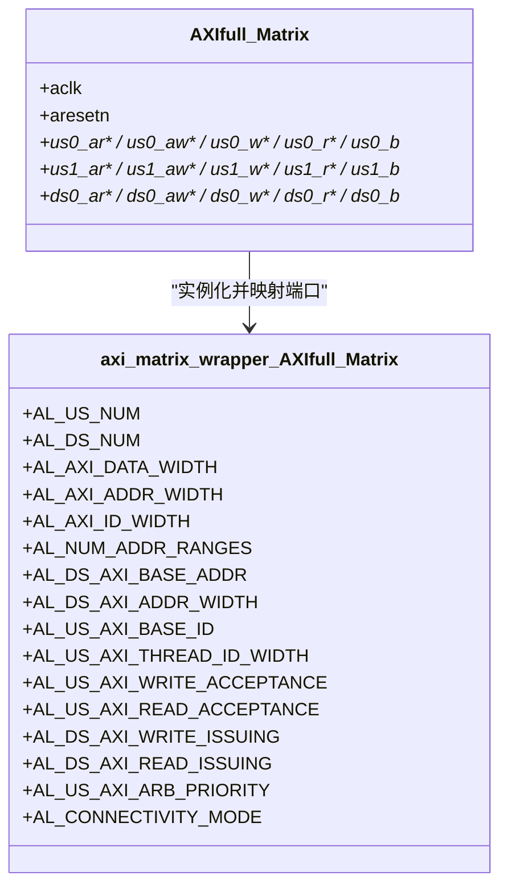

# AXI Full总线

<cite>
**本文引用的文件**   
- [README.md](file://README.md)
- [AXIfull_Matrix.v](file://al_ip/AXIfull_Matrix/AXIfull_Matrix.v)
- [axi_matrix_wrapper_AXIfull_Matrix.v](file://al_ip/AXIfull_Matrix/RTL/axi_matrix_wrapper_AXIfull_Matrix.v)
- [.m_params_AXIfull_Matrix.txt](file://al_ip/AXIfull_Matrix/.m_params_AXIfull_Matrix.txt)
- [.params_AXIfull_Matrix.txt](file://al_ip/AXIfull_Matrix/.params_AXIfull_Matrix.txt)
</cite>

## 目录
1. [简介](#简介)
2. [项目结构](#项目结构)
3. [核心组件](#核心组件)
4. [架构总览](#架构总览)
5. [详细组件分析](#详细组件分析)
6. [依赖关系分析](#依赖关系分析)
7. [性能与优化建议](#性能与优化建议)
8. [故障排查指南](#故障排查指南)
9. [结论](#结论)
10. [附录：参数配置速查](#附录参数配置速查)

## 简介
本技术文档围绕工程中的 AXI Full 总线与 AXI Full 矩阵（交叉开关）展开，重点说明：
- AXI Full 协议的特点与优势：独立命令/数据通道、突发传输、高带宽、可配置 ID/线程等。
- AXI Full 矩阵在本工程中的角色：将多个主设备（us0、us1）连接到从设备（ds0），完成地址路由、仲裁与 QoS 处理。
- 关键参数配置：AL_US_NUM、AL_DS_NUM、AL_AXI_DATA_WIDTH、AL_AXI_ADDR_WIDTH、AL_AXI_ID_WIDTH、AL_NUM_ADDR_RANGES、AL_DS_AXI_BASE_ADDR、AL_DS_AXI_ADDR_WIDTH、AL_US_AXI_BASE_ID、AL_US_AXI_THREAD_ID_WIDTH、连接性/并发度、优先级等。
- 地址映射机制、仲裁策略、QoS 优先级处理。
- 典型连接示例与时序图分析。
- 性能优化建议与常见问题解决方案。

## 项目结构
本项目为多通道 AD 数据采集 FPGA 工程，使用安路科技 PH1 FPGA 与 Tang Dynasty IDE。AXI Full 矩阵位于 IP 目录中，作为系统内部互联的核心枢纽，负责将采集控制逻辑、DMA 主机等主设备与 DDR 控制器等从设备进行高效互联。

图表来源
- [README.md:23-73](file://README.md#L23-L73)
- [AXIfull_Matrix.v:12-129](file://al_ip/AXIfull_Matrix/AXIfull_Matrix.v#L12-L129)

章节来源
- [README.md:1-108](file://README.md#L1-L108)

## 核心组件
- AXI Full 矩阵顶层封装模块：对外暴露 us0/us1 两个主端口和 ds0 一个从端口，内部实例化交叉开关 wrapper。
- 交叉开关 wrapper：实现地址路由、ID 重映射、并发队列、仲裁与 QoS、连接性/吞吐控制等。
- 参数配置文件：定义主/从数量、数据宽度、地址宽度、ID 宽度、地址范围、连接性、优先级等。

章节来源
- [AXIfull_Matrix.v:12-129](file://al_ip/AXIfull_Matrix/AXIfull_Matrix.v#L12-L129)
- [axi_matrix_wrapper_AXIfull_Matrix.v:1-116](file://al_ip/AXIfull_Matrix/RTL/axi_matrix_wrapper_AXIfull_Matrix.v#L1-L116)
- [.m_params_AXIfull_Matrix.txt:1-28](file://al_ip/AXIfull_Matrix/.m_params_AXIfull_Matrix.txt#L1-L28)

## 架构总览
AXI Full 矩阵在本工程中承担“多主到单从”的互联任务。us0 与 us1 为主设备接口，ds0 为从设备接口。矩阵根据地址范围将请求路由至 ds0，并在返回路径上按 ID 进行响应匹配。

图表来源
- [AXIfull_Matrix.v:12-129](file://al_ip/AXIfull_Matrix/AXIfull_Matrix.v#L12-L129)
- [axi_matrix_wrapper_AXIfull_Matrix.v:117-800](file://al_ip/AXIfull_Matrix/RTL/axi_matrix_wrapper_AXIfull_Matrix.v#L117-L800)

## 详细组件分析

### AXI Full 协议特点与优势
- 独立通道：AR/AW（读/写地址）、R（读数据）、W（写数据）、B（写响应）分离，允许命令与数据并行，提升吞吐。
- 突发传输：支持 INCR/BURST 类型，减少地址开销，提高带宽利用率。
- 可配置 ID/线程：通过 ID 区分不同事务流，支持乱序响应与多线程。
- QoS/Region/Cache/Prot 等属性：便于系统级资源管理与安全隔离。
- 宽数据总线：支持 32/64/128/256/512/1024 位，适配高带宽场景。

章节来源
- [axi_matrix_wrapper_AXIfull_Matrix.v:1-116](file://al_ip/AXIfull_Matrix/RTL/axi_matrix_wrapper_AXIfull_Matrix.v#L1-L116)

### AXI Full 矩阵工作原理
- 主设备接入：us0、us1 提供完整 AXI Full 接口，包含 AR/AW/R/W/B 五组信号。
- 从设备接入：ds0 提供完整 AXI Full 接口，矩阵将来自不同主的请求统一转发。
- 地址映射：基于 AL_DS_AXI_BASE_ADDR 与 AL_DS_AXI_ADDR_WIDTH 定义的地址范围，将主端地址翻译为从端地址。
- ID 重映射：AL_US_AXI_BASE_ID 与 AL_US_AXI_THREAD_ID_WIDTH 决定各主端的 ID 基址与可变 ID 位数，避免冲突并支持多线程。
- 并发与队列：AL_US_AXI_WRITE_ACCEPTANCE/READ_ACCEPTANCE 限制主端并发；AL_DS_AXI_WRITE_ISSUING/READ_ISSUING 限制从端并发。
- 仲裁与优先级：AL_US_AXI_ARB_PRIORITY 设置主端优先级；QOS 字段在矩阵内参与调度决策。
- 连接模式：AL_CONNECTIVITY_MODE=1 表示共享地址、多数据通路（SAMD），有利于高吞吐。

图表来源
- [AXIfull_Matrix.v:131-155](file://al_ip/AXIfull_Matrix/AXIfull_Matrix.v#L131-L155)
- [axi_matrix_wrapper_AXIfull_Matrix.v:1-116](file://al_ip/AXIfull_Matrix/RTL/axi_matrix_wrapper_AXIfull_Matrix.v#L1-L116)

章节来源
- [AXIfull_Matrix.v:12-274](file://al_ip/AXIfull_Matrix/AXIfull_Matrix.v#L12-L274)
- [axi_matrix_wrapper_AXIfull_Matrix.v:1-116](file://al_ip/AXIfull_Matrix/RTL/axi_matrix_wrapper_AXIfull_Matrix.v#L1-L116)

### 参数配置选项与作用
- AL_US_NUM：主设备数量。当前设为 2（us0、us1）。
- AL_DS_NUM：从设备数量。当前设为 1（ds0）。
- AL_AXI_DATA_WIDTH：内部数据通路宽度。当前设为 128 位，匹配 us/ds 数据宽度。
- AL_AXI_ADDR_WIDTH：地址宽度。当前设为 27 位，用于寻址空间。
- AL_AXI_ID_WIDTH：ID 宽度。当前设为 4 位，用于事务标识。
- AL_PROTOCOL_SEL：协议选择。0=AXI4，1=AXI3，2=AXI4Lite。当前为 0（AXI4）。
- AL_NUM_ADDR_RANGES：每个从设备的地址范围数。当前为 1。
- AL_DS_AXI_BASE_ADDR：从设备地址范围基址。当前 ds0 范围为 0。
- AL_DS_AXI_ADDR_WIDTH：从设备地址范围大小（低位地址位数）。当前 ds0 为 0x1A（26 位），即范围大小为 2^26。
- AL_US_AXI_BASE_ID：各主端 ID 基址。当前 us0=0x08，us1=0x00（按 64 位打包格式）。
- AL_US_AXI_THREAD_ID_WIDTH：各主端可变 ID 位数。当前 us0=3，us1=3，支持多线程。
- AL_AXI_SUPPORTS_USER_SIGNALS：USER 信号传播开关。当前关闭。
- AL_AXI_WRITE_CONNECTIVITY / READ_CONNECTIVITY：写/读连通性掩码。当前仅启用 m0→s0。
- AL_US_AXI_SINGLE_THREAD：强制单线程。当前关闭。
- AL_US_AXI_WRITE_ACCEPTANCE / READ_ACCEPTANCE：主端最大活跃写/读事务数。当前均为 1。
- AL_DS_AXI_WRITE_ISSUING / READ_ISSUING：从端最大并发写/读事务数。当前均为 4。
- AL_US_AXI_ARB_PRIORITY：主端仲裁优先级。当前均为 0。
- AL_DS_AXI_SECURE：从设备安全标志。当前关闭。
- AL_CONNECTIVITY_MODE：连接模式。1=SAMD（共享地址、多数据通路）。

章节来源
- [.m_params_AXIfull_Matrix.txt:1-28](file://al_ip/AXIfull_Matrix/.m_params_AXIfull_Matrix.txt#L1-L28)
- [.params_AXIfull_Matrix.txt:1-25](file://al_ip/AXIfull_Matrix/.params_AXIfull_Matrix.txt#L1-L25)
- [.params_AXIfull_Matrix.txt:541-576](file://al_ip/AXIfull_Matrix/.params_AXIfull_Matrix.txt#L541-L576)
- [.params_AXIfull_Matrix.txt:591-622](file://al_ip/AXIfull_Matrix/.params_AXIfull_Matrix.txt#L591-L622)

### 地址映射机制
- 地址范围：由 AL_DS_AXI_BASE_ADDR 与 AL_DS_AXI_ADDR_WIDTH 共同定义。对于 ds0，基址为 0，地址宽度为 26 位，因此有效范围为 [0, 2^26 - 1]。
- 地址转换：矩阵对主端地址进行范围匹配，若命中则保留高位基址，低位直接透传或按规则裁剪，形成 ds0 侧地址。
- 未命中处理：若无匹配范围，矩阵应返回错误响应（如 RRESP/RESP 指示非法地址）。

图表来源
- [.m_params_AXIfull_Matrix.txt:8-9](file://al_ip/AXIfull_Matrix/.m_params_AXIfull_Matrix.txt#L8-L9)
- [.params_AXIfull_Matrix.txt:541-573](file://al_ip/AXIfull_Matrix/.params_AXIfull_Matrix.txt#L541-L573)

章节来源
- [.m_params_AXIfull_Matrix.txt:8-9](file://al_ip/AXIfull_Matrix/.m_params_AXIfull_Matrix.txt#L8-L9)
- [.params_AXIfull_Matrix.txt:541-573](file://al_ip/AXIfull_Matrix/.params_AXIfull_Matrix.txt#L541-L573)

### 仲裁策略与 QoS 优先级处理
- 主端优先级：AL_US_AXI_ARB_PRIORITY 可为不同主端分配不同优先级，数值越大优先级越高。当前均设为 0，表示默认平等。
- QoS 字段：ARQOS/AWQOS 在矩阵内可用于细粒度调度，例如区分实时与非实时流量。
- 公平性与并发：结合 WRITE/READ ACCEPTANCE 与 ISSUING 限制，避免某一路独占总线。

章节来源
- [.m_params_AXIfull_Matrix.txt:26](file://al_ip/AXIfull_Matrix/.m_params_AXIfull_Matrix.txt#L26)
- [axi_matrix_wrapper_AXIfull_Matrix.v:82-106](file://al_ip/AXIfull_Matrix/RTL/axi_matrix_wrapper_AXIfull_Matrix.v#L82-L106)

### 连接示例与时序图
- 连接示例：
  - us0 连接采集控制逻辑（发起读/写请求）。
  - us1 连接 AXI DMA 主机（批量数据传输）。
  - ds0 连接 MIS_DDR（DDR 控制器）。
- 时序要点：
  - 读事务：AR 握手 → R 数据流（可能多拍）→ RLAST 标记。
  - 写事务：AW 握手 → W 数据流（可能多拍）→ B 响应。
  - 突发长度：ARLEN/AWLEN 指定突发节拍数。
  - 尺寸与字节选通：ARSIZE/AWSIZE 与 WSTRB 控制每次传输的数据量与字节使能。

图表来源
- [AXIfull_Matrix.v:12-129](file://al_ip/AXIfull_Matrix/AXIfull_Matrix.v#L12-L129)

章节来源
- [AXIfull_Matrix.v:12-129](file://al_ip/AXIfull_Matrix/AXIfull_Matrix.v#L12-L129)

## 依赖关系分析
- 顶层模块 AXIfull_Matrix 实例化 axi_matrix_wrapper_AXIfull_Matrix，并将所有端口一一映射。
- wrapper 内部依据参数生成地址解码、ID 重映射、并发队列、仲裁器、连接性控制等子模块。
- 外部依赖：DDR 控制器（MIS_DDR）作为 ds0 从设备，接收矩阵转发的 AXI Full 请求。

图表来源
- [AXIfull_Matrix.v:131-272](file://al_ip/AXIfull_Matrix/AXIfull_Matrix.v#L131-L272)
- [axi_matrix_wrapper_AXIfull_Matrix.v:1-116](file://al_ip/AXIfull_Matrix/RTL/axi_matrix_wrapper_AXIfull_Matrix.v#L1-L116)

章节来源
- [AXIfull_Matrix.v:131-272](file://al_ip/AXIfull_Matrix/AXIfull_Matrix.v#L131-L272)
- [axi_matrix_wrapper_AXIfull_Matrix.v:1-116](file://al_ip/AXIfull_Matrix/RTL/axi_matrix_wrapper_AXIfull_Matrix.v#L1-L116)

## 性能与优化建议
- 数据宽度匹配：确保 AL_AXI_DATA_WIDTH 与主/从设备一致（当前 128 位），避免不必要的分割与重组。
- 突发长度优化：合理设置 ARLEN/AWLEN，尽量使用较大突发以提升带宽利用率，但需考虑内存控制器与 FIFO 深度。
- 并发度调优：适当增大 AL_US_AXI_WRITE_ACCEPTANCE/READ_ACCEPTANCE 与 AL_DS_AXI_WRITE_ISSUING/READ_ISSUING，以隐藏延迟，但需评估资源与稳定性。
- 优先级与 QoS：为关键路径（如实时采集）分配更高优先级或更高 QoS，保障低时延。
- 地址对齐：确保访问地址与尺寸对齐，减少跨边界突发带来的额外开销。
- USER 信号：如需自定义属性传递，可开启 AL_AXI_SUPPORTS_USER_SIGNALS 并配置 USER 宽度，但会增加资源与复杂度。

[本节为通用指导，不直接分析具体文件]

## 故障排查指南
- 无响应或死锁：
  - 检查 AL_US_AXI_WRITE_ACCEPTANCE/READ_ACCEPTANCE 是否过小导致主端阻塞。
  - 检查 AL_DS_AXI_WRITE_ISSUING/READ_ISSUING 是否过大导致从端拥塞。
- 地址访问失败：
  - 核对 AL_DS_AXI_BASE_ADDR 与 AL_DS_AXI_ADDR_WIDTH 是否与从设备实际地址范围一致。
  - 确认主端访问地址落在 ds0 范围内。
- ID 冲突或响应错配：
  - 检查 AL_US_AXI_BASE_ID 与各主端 AL_US_AXI_THREAD_ID_WIDTH 是否重叠。
  - 确保主端 ID 生成逻辑遵循矩阵约束。
- 带宽不达标：
  - 检查突发长度与尺寸设置是否合理。
  - 评估是否存在频繁的小包访问或碎片化访问。
- QoS 未生效：
  - 确认矩阵内部是否启用 QoS 调度（取决于 wrapper 实现）。
  - 调整 AL_US_AXI_ARB_PRIORITY 与 ARQOS/AWQOS 值。

章节来源
- [.m_params_AXIfull_Matrix.txt:21-26](file://al_ip/AXIfull_Matrix/.m_params_AXIfull_Matrix.txt#L21-L26)
- [.params_AXIfull_Matrix.txt:18-25](file://al_ip/AXIfull_Matrix/.params_AXIfull_Matrix.txt#L18-L25)
- [.params_AXIfull_Matrix.txt:541-576](file://al_ip/AXIfull_Matrix/.params_AXIfull_Matrix.txt#L541-L576)

## 结论
AXI Full 矩阵在本工程中提供了稳定、高吞吐的多主到单从互联能力。通过合理的参数配置（主/从数量、数据/地址/ID 宽度、地址范围、并发度、优先级等），可以灵活适配不同的主从拓扑与性能需求。结合突发传输与独立通道特性，能够充分发挥 DDR 等高带宽存储器的吞吐潜力。在实际应用中，建议根据业务特征调优突发长度、并发度与优先级，以获得最佳性能与稳定性。

[本节为总结性内容，不直接分析具体文件]

## 附录：参数配置速查
- 主/从数量：AL_US_NUM=2，AL_DS_NUM=1
- 数据/地址/ID 宽度：AL_AXI_DATA_WIDTH=128，AL_AXI_ADDR_WIDTH=27，AL_AXI_ID_WIDTH=4
- 协议：AL_PROTOCOL_SEL=0（AXI4）
- 地址范围：AL_NUM_ADDR_RANGES=1，AL_DS_AXI_BASE_ADDR=0，AL_DS_AXI_ADDR_WIDTH=0x1A（26 位）
- ID 基址与线程：AL_US_AXI_BASE_ID={us0:0x08, us1:0x00}，AL_US_AXI_THREAD_ID_WIDTH={us0:3, us1:3}
- 连接性：AL_AXI_WRITE_CONNECTIVITY=0x03（仅 m0→s0），AL_AXI_READ_CONNECTIVITY=0x03
- 并发度：AL_US_AXI_WRITE_ACCEPTANCE=1，AL_US_AXI_READ_ACCEPTANCE=1，AL_DS_AXI_WRITE_ISSUING=4，AL_DS_AXI_READ_ISSUING=4
- 优先级：AL_US_AXI_ARB_PRIORITY=0（平等）
- 连接模式：AL_CONNECTIVITY_MODE=1（SAMD）

章节来源
- [.m_params_AXIfull_Matrix.txt:1-28](file://al_ip/AXIfull_Matrix/.m_params_AXIfull_Matrix.txt#L1-L28)
- [.params_AXIfull_Matrix.txt:1-25](file://al_ip/AXIfull_Matrix/.params_AXIfull_Matrix.txt#L1-L25)
- [.params_AXIfull_Matrix.txt:541-576](file://al_ip/AXIfull_Matrix/.params_AXIfull_Matrix.txt#L541-L576)
- [.params_AXIfull_Matrix.txt:591-622](file://al_ip/AXIfull_Matrix/.params_AXIfull_Matrix.txt#L591-L622)