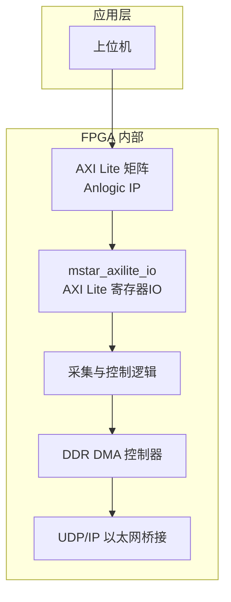
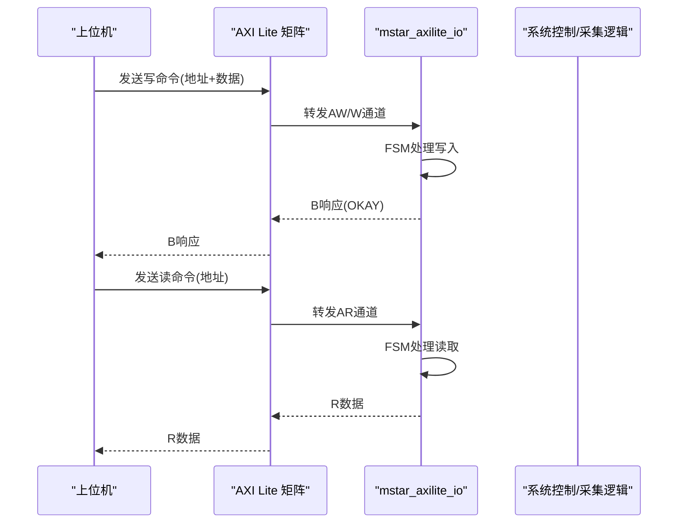
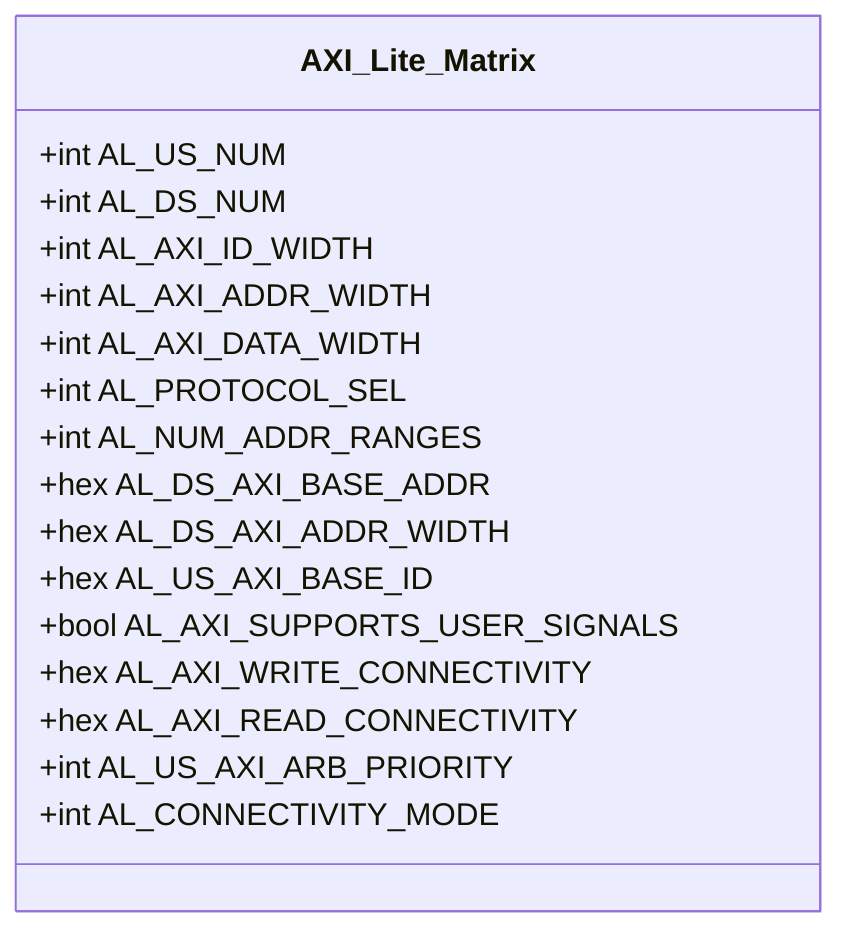
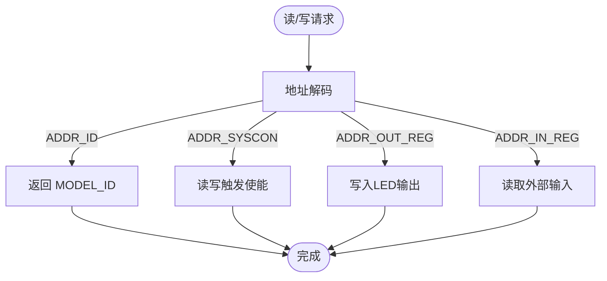
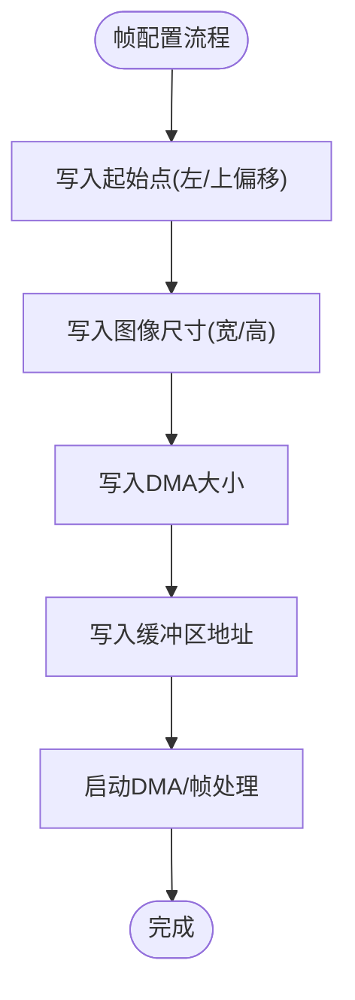
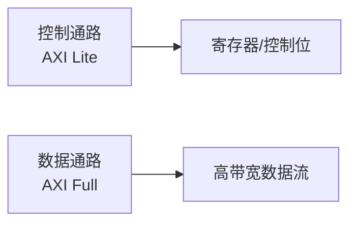
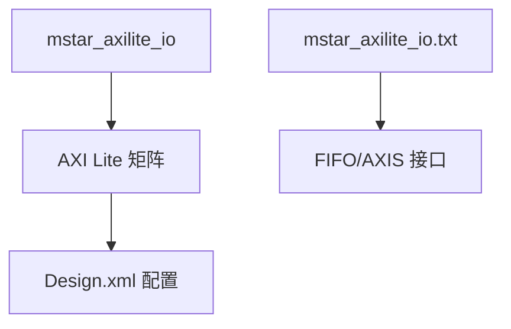

# AXI Lite总线

<cite>
**本文引用的文件**   
- [README.md](file://README.md)
- [mstar_axilite_io.v](file://hdl/axi_io/mstar_axilite_io.v)
- [mstar_axilite_io.txt](file://hdl/axi_io/mstar_axilite_io.txt)
- [AXI_lite_Matrix.xml](file://al_ip/AXI_lite_Matrix/AXI_lite_Matrix.xml)
- [Design.xml（AXI Lite 矩阵）](file://al_ip/AXI_lite_Matrix/Design.xml)
- [axi_matrix_wrapper_AXI_lite_Matrix.v](file://al_ip/AXI_lite_Matrix/RTL/axi_matrix_wrapper_AXI_lite_Matrix.v)
- [axi_matrix_wrapper_AXIfull_Matrix.v](file://al_ip/AXIfull_Matrix/RTL/axi_matrix_wrapper_AXIfull_Matrix.v)
- [mstar_axifulltopaxi.v](file://hdl/axi_io/mstar_axifulltopaxi.v)
</cite>

## 目录
1. [简介](#简介)
2. [项目结构](#项目结构)
3. [核心组件](#核心组件)
4. [架构总览](#架构总览)
5. [详细组件分析](#详细组件分析)
6. [依赖关系分析](#依赖关系分析)
7. [性能与调试指南](#性能与调试指南)
8. [结论](#结论)

## 简介
本技术文档面向使用 AXI Lite 总线进行控制寄存器访问的工程师，结合当前工程中的 mstar_axilite_io 模块与安路 AXI Lite 互联矩阵 IP，系统说明：
- AXI Lite 协议的简化特性与适用场景（单字访问、简单控制接口等）
- AXI Lite 矩阵的架构设计与配置要点
- mstar_axilite_io 的寄存器映射设计（地址分配、数据格式、状态位）
- 完整的寄存器操作示例流程（初始化、参数设置、状态查询）
- 与 AXI Full 的区别及选择原则
- 调试方法与性能评估建议

## 项目结构
本项目为多通道 AD 数据采集 FPGA 工程，包含：
- 采集逻辑、DDR DMA、以太网 UDP 传输
- AXI Lite 寄存器 IO 模块，用于上位机通过 AXI Lite 配置采集参数
- 安路 AXI Lite 矩阵 IP，作为 AXI Lite 主从互联枢纽
- AXI Full 矩阵 IP 与 AXI Full 到 AXI 桥接，用于高带宽数据路径

图表来源
- [README.md:23-73](file://README.md#L23-L73)
- [mstar_axilite_io.v:22-55](file://hdl/axi_io/mstar_axilite_io.v#L22-L55)
- [AXI_lite_Matrix.xml:1-47](file://al_ip/AXI_lite_Matrix/AXI_lite_Matrix.xml#L1-L47)

章节来源
- [README.md:1-108](file://README.md#L1-L108)

## 核心组件
- mstar_axilite_io：实现 AXI Lite 从端寄存器读写，暴露设备 ID、系统控制、输出寄存器、输入寄存器。
- AXI Lite 矩阵：提供多主多从互联，支持协议选择、地址范围划分、连接性配置。
- AXI Full 矩阵与桥接：用于高带宽数据通路，与 AXI Lite 控制通路分离。

章节来源
- [mstar_axilite_io.v:1-195](file://hdl/axi_io/mstar_axilite_io.v#L1-L195)
- [axi_matrix_wrapper_AXI_lite_Matrix.v:1-116](file://al_ip/AXI_lite_Matrix/RTL/axi_matrix_wrapper_AXI_lite_Matrix.v#L1-L116)
- [mstar_axifulltopaxi.v:1-32](file://hdl/axi_io/mstar_axifulltopaxi.v#L1-L32)

## 架构总览
AXI Lite 控制通路采用“主机 → AXI Lite 矩阵 → mstar_axilite_io”的结构；数据通路则通过 AXI Full 矩阵与桥接进入 DDR/UDP 路径。

图表来源
- [mstar_axilite_io.v:86-124](file://hdl/axi_io/mstar_axilite_io.v#L86-L124)
- [mstar_axilite_io.v:134-176](file://hdl/axi_io/mstar_axilite_io.v#L134-L176)
- [axi_matrix_wrapper_AXI_lite_Matrix.v:1-116](file://al_ip/AXI_lite_Matrix/RTL/axi_matrix_wrapper_AXI_lite_Matrix.v#L1-L116)

## 详细组件分析

### AXI Lite 协议简化特性与适用场景
- 单字访问：每次事务仅传输一个数据字，适合少量控制寄存器的读写。
- 握手简化：AW/W/AR/R/B通道语义清晰，便于实现轻量级从端。
- 适用场景：设备ID读取、触发使能、LED输出、GPIO输入等控制类任务。

章节来源
- [mstar_axilite_io.v:22-55](file://hdl/axi_io/mstar_axilite_io.v#L22-L55)
- [mstar_axilite_io.v:86-124](file://hdl/axi_io/mstar_axilite_io.v#L86-L124)
- [mstar_axilite_io.v:134-176](file://hdl/axi_io/mstar_axilite_io.v#L134-L176)

### AXI Lite 矩阵架构与配置
- 主从数量：AL_US_NUM（上游主设备数）、AL_DS_NUM（下游从设备数）。
- 协议选择：AL_PROTOCOL_SEL=2 表示 AXI4LITE。
- 地址范围：AL_DS_AXI_BASE_ADDR 与 AL_DS_AXI_ADDR_WIDTH 定义每个从设备的基址与地址宽度。
- 连接性与仲裁：AL_AXI_WRITE_CONNECTIVITY、AL_AXI_READ_CONNECTIVITY、AL_US_AXI_ARB_PRIORITY 等。

图表来源
- [axi_matrix_wrapper_AXI_lite_Matrix.v:1-116](file://al_ip/AXI_lite_Matrix/RTL/axi_matrix_wrapper_AXI_lite_Matrix.v#L1-L116)
- [Design.xml（AXI Lite 矩阵）:1-16](file://al_ip/AXI_lite_Matrix/Design.xml#L1-L16)

章节来源
- [axi_matrix_wrapper_AXI_lite_Matrix.v:1-116](file://al_ip/AXI_lite_Matrix/RTL/axi_matrix_wrapper_AXI_lite_Matrix.v#L1-L116)
- [AXI_lite_Matrix.xml:1-47](file://al_ip/AXI_lite_Matrix/AXI_lite_Matrix.xml#L1-L47)
- [Design.xml（AXI Lite 矩阵）:1-16](file://al_ip/AXI_lite_Matrix/Design.xml#L1-L16)

### mstar_axilite_io 寄存器映射设计
该模块定义了以下寄存器（以字节偏移计）：
- 地址 0x00：设备 ID 寄存器（只读），返回 MODEL_ID。
- 地址 0x04：系统控制寄存器（可读写），低两位为触发输出/输入使能。
- 地址 0x08：输出寄存器（可写），低四位控制 LED 输出。
- 地址 0x0C：输入寄存器（只读），低两位读取外部输入引脚。

图表来源
- [mstar_axilite_io.v:56-59](file://hdl/axi_io/mstar_axilite_io.v#L56-L59)
- [mstar_axilite_io.v:166-191](file://hdl/axi_io/mstar_axilite_io.v#L166-L191)

章节来源
- [mstar_axilite_io.v:56-59](file://hdl/axi_io/mstar_axilite_io.v#L56-L59)
- [mstar_axilite_io.v:166-191](file://hdl/axi_io/mstar_axilite_io.v#L166-L191)

### 寄存器操作示例流程
以下为典型操作流程（不直接展示代码内容，给出步骤与对应源码位置）：
- 初始化配置
  - 复位后，确保 ARESET 有效，等待 FSM 回到初始状态。
  - 参考写FSM与读FSM的状态机定义。
  - 参考位置：[mstar_axilite_io.v:86-124](file://hdl/axi_io/mstar_axilite_io.v#L86-L124)、[mstar_axilite_io.v:134-176](file://hdl/axi_io/mstar_axilite_io.v#L134-L176)
- 参数设置
  - 向系统控制寄存器（0x04）写入触发输出/输入使能位。
  - 向输出寄存器（0x08）写入LED控制位。
  - 参考位置：[mstar_axilite_io.v:177-191](file://hdl/axi_io/mstar_axilite_io.v#L177-L191)
- 状态查询
  - 读取设备 ID（0x00）确认模型号。
  - 读取系统控制寄存器（0x04）检查触发使能状态。
  - 读取输入寄存器（0x0C）获取外部输入状态。
  - 参考位置：[mstar_axilite_io.v:166-176](file://hdl/axi_io/mstar_axilite_io.v#L166-L176)

章节来源
- [mstar_axilite_io.v:86-124](file://hdl/axi_io/mstar_axilite_io.v#L86-L124)
- [mstar_axilite_io.v:134-176](file://hdl/axi_io/mstar_axilite_io.v#L134-L176)
- [mstar_axilite_io.v:166-191](file://hdl/axi_io/mstar_axilite_io.v#L166-L191)

### 视频帧相关寄存器扩展（mstar_axilite_io.txt）
该文本文件提供了另一个版本的 mstar_axilite_io 接口，包含视频帧相关寄存器：
- 地址 0x00：帧 ID（MODEL_ID）
- 地址 0x04：帧配置（IMAGEPIX_BIT_WIDTH）
- 地址 0x08：起始点（video_left_offset, video_top_offset）
- 地址 0x0C：图像尺寸（video_width, video_height）
- 地址 0x10：DMA大小（dma_size）
- 地址 0x14：缓冲区地址（frame_addr_cnt）

图表来源
- [mstar_axilite_io.txt:65-72](file://hdl/axi_io/mstar_axilite_io.txt#L65-L72)
- [mstar_axilite_io.txt:195-255](file://hdl/axi_io/mstar_axilite_io.txt#L195-L255)

章节来源
- [mstar_axilite_io.txt:24-64](file://hdl/axi_io/mstar_axilite_io.txt#L24-L64)
- [mstar_axilite_io.txt:65-72](file://hdl/axi_io/mstar_axilite_io.txt#L65-L72)
- [mstar_axilite_io.txt:195-255](file://hdl/axi_io/mstar_axilite_io.txt#L195-L255)

### 与 AXI Full 的区别与选择原则
- 差异点
  - 数据宽度：AXI Lite 固定单字（通常32位），AXI Full 支持更宽数据（如128位）。
  - 通道复杂度：AXI Full 具备更多属性信号（burst、lock、cache、user等），AXI Lite 简化。
  - 适用场景：AXI Lite 适合控制寄存器；AXI Full 适合大数据流（如DDR、以太网）。
- 选择原则
  - 控制面：优先使用 AXI Lite，降低资源占用与复杂度。
  - 数据面：使用 AXI Full 矩阵与桥接，提升吞吐能力。

图表来源
- [mstar_axifulltopaxi.v:1-32](file://hdl/axi_io/mstar_axifulltopaxi.v#L1-L32)
- [axi_matrix_wrapper_AXIfull_Matrix.v:1-116](file://al_ip/AXIfull_Matrix/RTL/axi_matrix_wrapper_AXIfull_Matrix.v#L1-L116)

章节来源
- [mstar_axifulltopaxi.v:1-32](file://hdl/axi_io/mstar_axifulltopaxi.v#L1-L32)
- [axi_matrix_wrapper_AXIfull_Matrix.v:1-116](file://al_ip/AXIfull_Matrix/RTL/axi_matrix_wrapper_AXIfull_Matrix.v#L1-L116)

## 依赖关系分析
- mstar_axilite_io 依赖 AXI Lite 矩阵提供的从端接入。
- AXI Lite 矩阵依赖 Design.xml 中的实例化与参数配置。
- 视频帧扩展版本（mstar_axilite_io.txt）依赖 FIFO 与 AXIS 接口（在文件中体现）。

图表来源
- [mstar_axilite_io.v:22-55](file://hdl/axi_io/mstar_axilite_io.v#L22-L55)
- [AXI_lite_Matrix.xml:1-47](file://al_ip/AXI_lite_Matrix/AXI_lite_Matrix.xml#L1-L47)
- [Design.xml（AXI Lite 矩阵）:1-16](file://al_ip/AXI_lite_Matrix/Design.xml#L1-L16)
- [mstar_axilite_io.txt:80-92](file://hdl/axi_io/mstar_axilite_io.txt#L80-L92)

章节来源
- [mstar_axilite_io.v:22-55](file://hdl/axi_io/mstar_axilite_io.v#L22-L55)
- [AXI_lite_Matrix.xml:1-47](file://al_ip/AXI_lite_Matrix/AXI_lite_Matrix.xml#L1-L47)
- [Design.xml（AXI Lite 矩阵）:1-16](file://al_ip/AXI_lite_Matrix/Design.xml#L1-L16)
- [mstar_axilite_io.txt:80-92](file://hdl/axi_io/mstar_axilite_io.txt#L80-L92)

## 性能与调试指南
- 性能考虑
  - AXI Lite 事务开销较低，但吞吐有限；控制面适合小批量、低频访问。
  - 避免频繁轮询状态寄存器，建议使用中断或事件机制（若后续扩展）。
  - 合理配置 AXI Lite 矩阵的连接性与仲裁优先级，减少竞争。
- 调试方法
  - 使用逻辑分析仪抓取 AW/AR/R/B/W 通道握手时序，验证 FSM 状态转换。
  - 通过 LED 输出（ADDR_OUT_REG）观察写操作是否生效。
  - 读取设备 ID（ADDR_ID）确认总线通信正常。
  - 对于视频帧扩展，监控 frame_addr_cnt 与 axis_frame_val/axis_frame_rdy 信号。

章节来源
- [mstar_axilite_io.v:86-124](file://hdl/axi_io/mstar_axilite_io.v#L86-L124)
- [mstar_axilite_io.v:134-176](file://hdl/axi_io/mstar_axilite_io.v#L134-L176)
- [mstar_axilite_io.v:177-191](file://hdl/axi_io/mstar_axilite_io.v#L177-L191)
- [mstar_axilite_io.txt:80-92](file://hdl/axi_io/mstar_axilite_io.txt#L80-L92)

## 结论
- AXI Lite 在本工程中承担控制面职责，结构简单、易于实现与维护。
- mstar_axilite_io 提供清晰的寄存器映射，满足设备ID、触发控制、LED/GPIO 等基本需求。
- AXI Lite 矩阵提供灵活的互联配置，适配多主多从场景。
- 数据面通过 AXI Full 矩阵与桥接实现高带宽传输，与 AXI Lite 控制面解耦。
- 建议在控制面采用 AXI Lite，数据面采用 AXI Full，以获得最佳资源与性能平衡。