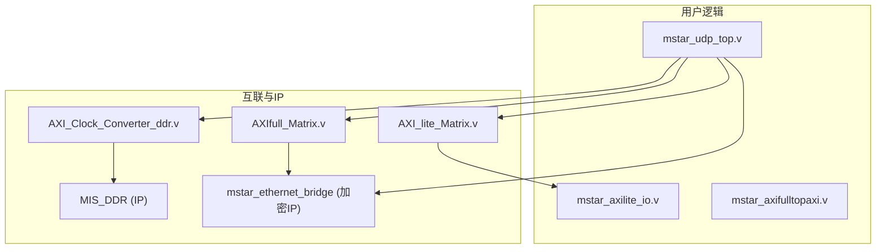
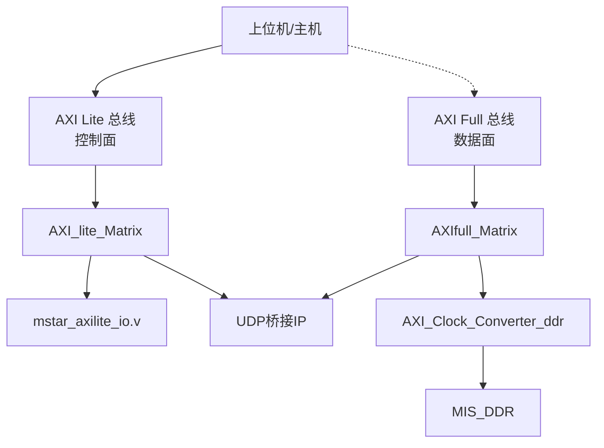
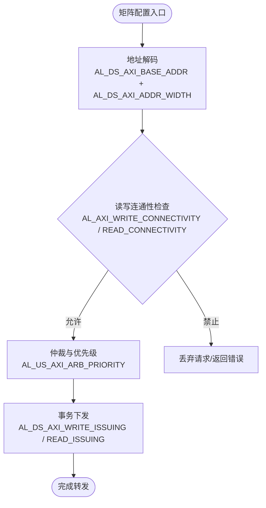
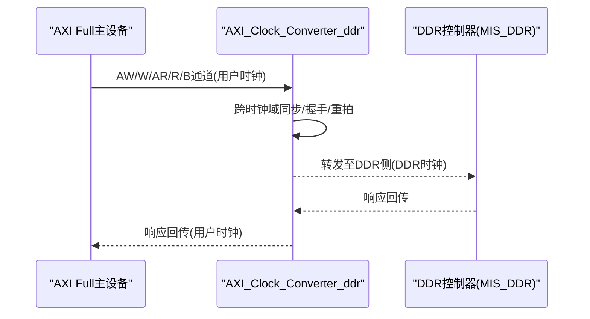
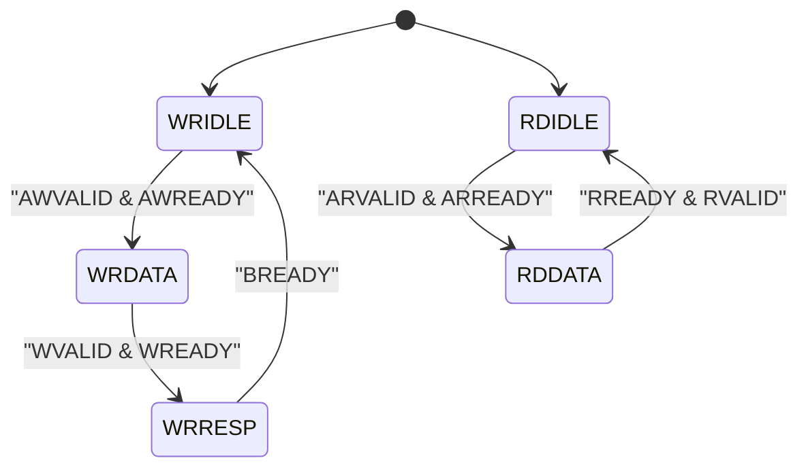
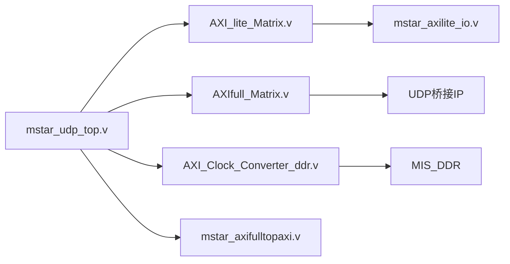
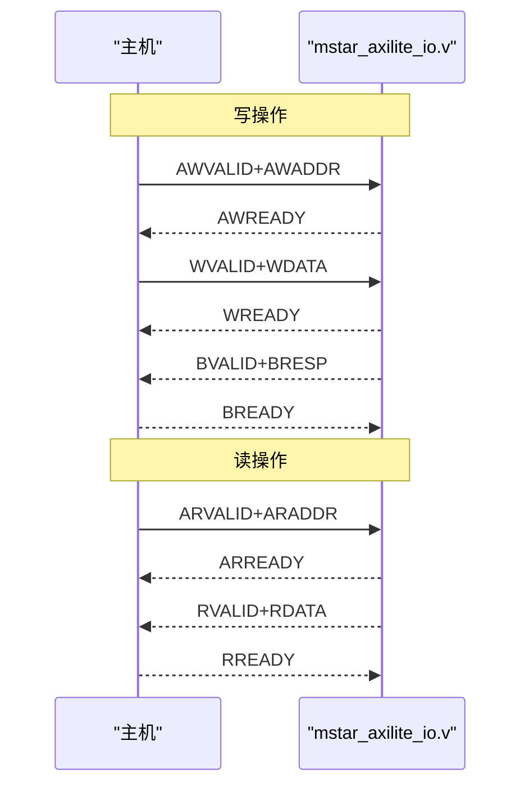
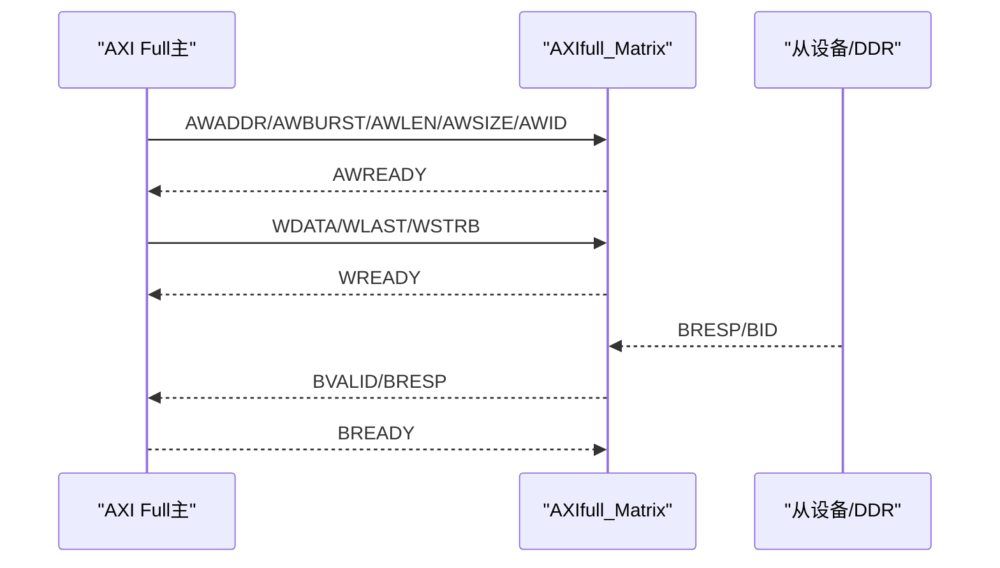

# AXI总线系统

<cite>
**本文引用的文件**   
- [README.md](file://README.md)
- [mstar_udp_top.v](file://hdl/mstar_udp_top.v)
- [AXI_lite_Matrix.v](file://al_ip/AXI_lite_Matrix/AXI_lite_Matrix.v)
- [AXIfull_Matrix.v](file://al_ip/AXIfull_Matrix/AXIfull_Matrix.v)
- [AXI_Clock_Converter_ddr.v](file://al_ip/AXI_Clock_Converter_ddr/AXI_Clock_Converter_ddr.v)
- [mstar_axilite_io.v](file://hdl/axi_io/mstar_axilite_io.v)
- [mstar_axifulltopaxi.v](file://hdl/axi_io/mstar_axifulltopaxi.v)
</cite>

## 目录
1. [简介](#简介)
2. [项目结构](#项目结构)
3. [核心组件](#核心组件)
4. [架构总览](#架构总览)
5. [详细组件分析](#详细组件分析)
6. [依赖关系分析](#依赖关系分析)
7. [性能与带宽特性](#性能与带宽特性)
8. [故障排查指南](#故障排查指南)
9. [结论](#结论)
10. [附录：协议时序与调试要点](#附录协议时序与调试要点)

## 简介
本技术文档围绕工程中的AXI总线系统展开，重点说明以下方面：
- AXI Full与AXI Lite两种总线类型的区别、适用场景与在系统中的角色分工
- 总线矩阵（AXI Matrix）的设计原理、主从设备连接方式、仲裁机制与地址解码配置
- 时钟域转换器的工作原理，解决不同频率域间AXI信号的同步问题
- AXI Lite IO模块的寄存器映射与访问协议
- 总线配置示例与调试方法
- AXI协议时序图与信号波形分析要点

该工程为多通道AD数据采集FPGA平台，包含以太网UDP传输、DDR缓存、AXI总线互联与控制接口。

**章节来源**
- [README.md:1-108](file://README.md#L1-L108)

## 项目结构
工程采用分层组织方式：
- hdl：用户逻辑顶层与功能模块（采集、DMA、AXI IO、UDP桥等）
- al_ip：安路IP核（DDR控制器、AXI Full/Lite矩阵、时钟转换器、PLL等）
- constraint：引脚与时序约束
- 其他：工程配置文件

**图示来源**
- [mstar_udp_top.v:676-762](file://hdl/mstar_udp_top.v#L676-L762)
- [mstar_udp_top.v:763-800](file://hdl/mstar_udp_top.v#L763-L800)
- [mstar_udp_top.v:484-569](file://hdl/mstar_udp_top.v#L484-L569)
- [mstar_udp_top.v:591-675](file://hdl/mstar_udp_top.v#L591-L675)

**章节来源**
- [README.md:23-73](file://README.md#L23-L73)
- [mstar_udp_top.v:1-1173](file://hdl/mstar_udp_top.v#L1-L1173)

## 核心组件
- AXI Lite 矩阵：将上位机通过AXI Lite对控制寄存器的访问路由到多个从设备（如IO模块、UDP桥控制口等），支持地址解码与简单仲裁。
- AXI Full 矩阵：承载高吞吐数据路径，例如UDP IP的数据读写；支持突发传输、宽数据位宽与ID多事务并行。
- AXI 时钟域转换器：在AXI Full路径上实现跨时钟域同步（例如100MHz到DDR PHY更高频域），保证时序收敛与协议正确性。
- AXI Lite IO模块：提供寄存器映射，暴露触发使能、输出控制、输入读取等功能给上位机。
- MIS DDR控制器：作为AXI Full从端，提供大容量数据缓存。
- UDP桥接IP：以AXI Full为主机访问内部缓冲，同时提供AXI Lite控制接口。

**章节来源**
- [AXI_lite_Matrix.v:12-198](file://al_ip/AXI_lite_Matrix/AXI_lite_Matrix.v#L12-L198)
- [AXIfull_Matrix.v:12-274](file://al_ip/AXIfull_Matrix/AXIfull_Matrix.v#L12-L274)
- [AXI_Clock_Converter_ddr.v:12-196](file://al_ip/AXI_Clock_Converter_ddr/AXI_Clock_Converter_ddr.v#L12-L196)
- [mstar_axilite_io.v:22-195](file://hdl/axi_io/mstar_axilite_io.v#L22-L195)
- [mstar_udp_top.v:415-483](file://hdl/mstar_udp_top.v#L415-L483)
- [mstar_udp_top.v:591-675](file://hdl/mstar_udp_top.v#L591-L675)

## 架构总览
下图展示系统中AXI Full与AXI Lite两条总线的作用与交互关系：

**图示来源**
- [mstar_udp_top.v:676-762](file://hdl/mstar_udp_top.v#L676-L762)
- [mstar_udp_top.v:763-800](file://hdl/mstar_udp_top.v#L763-L800)
- [mstar_udp_top.v:484-569](file://hdl/mstar_udp_top.v#L484-L569)
- [mstar_udp_top.v:591-675](file://hdl/mstar_udp_top.v#L591-L675)

## 详细组件分析

### AXI Full与AXI Lite的区别与使用场景
- AXI Lite
  - 特点：单字32位数据、无突发长度字段、无ID通道、控制命令简单、延迟敏感但带宽要求低。
  - 在本工程中用于上位机对控制寄存器进行读写，包括触发使能、LED输出、输入状态读取等。
  - 典型从设备：mstar_axilite_io.v、UDP桥的控制端口。
- AXI Full
  - 特点：支持突发传输、可配置数据宽度（本工程128位）、ID通道支持多事务并行、丰富的属性字段（burst、size、cache、prot、region、qos等）。
  - 在本工程中用于UDP IP的高吞吐数据读写以及可能的DMA数据搬运。
  - 典型从设备：UDP桥的数据端口、MIS_DDR控制器。

对比要点：
- 带宽与吞吐：AXI Full适合大数据流（UDP数据包写入DDR或从DDR读出），AXI Lite适合少量控制参数配置。
- 复杂度与资源：AXI Full需要更多逻辑资源与更严格的时序约束；AXI Lite实现简单、资源占用少。
- 并发与优先级：AXI Full支持ID与QoS，便于多主多从并发与优先级调度；AXI Lite通常由矩阵做简单轮询或固定优先级。

**章节来源**
- [AXI_lite_Matrix.v:94-116](file://al_ip/AXI_lite_Matrix/AXI_lite_Matrix.v#L94-L116)
- [AXIfull_Matrix.v:131-155](file://al_ip/AXIfull_Matrix/AXIfull_Matrix.v#L131-L155)
- [mstar_axilite_io.v:22-195](file://hdl/axi_io/mstar_axilite_io.v#L22-L195)
- [mstar_udp_top.v:591-675](file://hdl/mstar_udp_top.v#L591-L675)

### 总线矩阵设计原理与配置方法
- 地址解码
  - AXI Lite矩阵通过AL_DS_AXI_BASE_ADDR与AL_DS_AXI_ADDR_WIDTH定义各从设备的基址与地址范围，实现地址空间划分。
  - AXI Full矩阵通过AL_DS_AXI_BASE_ADDR与AL_DS_AXI_ADDR_WIDTH定义从设备地址范围，结合AL_CONNECTIVITY_MODE选择Full协议模式。
- 主从连接
  - AXI Lite矩阵：1个主（us0）对应3个从（ds0/ds1/ds2），分别连接到IO模块与UDP桥控制口等。
  - AXI Full矩阵：2个主（us0/us1）对应1个从（ds0），主要服务于UDP数据路径与可能的DMA主。
- 仲裁机制
  - AXI Lite矩阵：AL_US_AXI_ARB_PRIORITY设置主请求优先级；AL_READ_REGISTER_TYPE影响读响应行为。
  - AXI Full矩阵：AL_US_AXI_ARB_PRIORITY设置主优先级；AL_US_AXI_SINGLE_THREAD与AL_US_AXI_WRITE_ACCEPTANCE/READ_ACCEPTANCE控制线程与接受能力。
- 连接性与并发
  - AL_AXI_WRITE_CONNECTIVITY/AL_AXI_READ_CONNECTIVITY决定主从之间的读写连通性。
  - AL_DS_AXI_WRITE_ISSUING/AL_DS_AXI_READ_ISSUING设置从端允许的最大并发写/读事务数。

**图示来源**
- [AXI_lite_Matrix.v:94-116](file://al_ip/AXI_lite_Matrix/AXI_lite_Matrix.v#L94-L116)
- [AXIfull_Matrix.v:131-155](file://al_ip/AXIfull_Matrix/AXIfull_Matrix.v#L131-L155)

**章节来源**
- [AXI_lite_Matrix.v:94-116](file://al_ip/AXI_lite_Matrix/AXI_lite_Matrix.v#L94-L116)
- [AXIfull_Matrix.v:131-155](file://al_ip/AXIfull_Matrix/AXIfull_Matrix.v#L131-L155)

### 时钟域转换器工作原理
- 作用
  - 在AXI Full路径上将用户侧时钟（w_axifull_clk，约100MHz）与DDR PHY侧时钟（ddr_dhi_clk，更高频）进行同步转换，确保AXI协议时序满足目标时钟域要求。
- 关键参数
  - US_ACLK_RATIO与DS_ACLK_RATIO定义两时钟域的比率（本工程US=1，DS=8）。
  - IS_ACLK_ASYNC表示异步时钟域，需内部同步与握手处理。
  - AXI_PROTOCOL=0表示AXI4（非Lite），SUPPORTS_WRITE_CHANNEL/SUPPORTS_READ_CHANNEL开启读写通道。
- 数据流
  - 用户侧（us_*）发起AXI Full事务，转换器内部进行跨时钟域打包、对齐与握手，再在DDR侧（ds_*）按目标时钟节拍驱动DDR控制器。

**图示来源**
- [AXI_Clock_Converter_ddr.v:98-110](file://al_ip/AXI_Clock_Converter_ddr/AXI_Clock_Converter_ddr.v#L98-L110)
- [mstar_udp_top.v:484-569](file://hdl/mstar_udp_top.v#L484-L569)

**章节来源**
- [AXI_Clock_Converter_ddr.v:12-196](file://al_ip/AXI_Clock_Converter_ddr/AXI_Clock_Converter_ddr.v#L12-L196)
- [mstar_udp_top.v:484-569](file://hdl/mstar_udp_top.v#L484-L569)

### AXI Lite IO模块寄存器映射与访问协议
- 寄存器定义
  - ADDR_ID：设备ID寄存器，读返回MODEL_ID。
  - ADDR_SYSCON：系统控制寄存器，bit[1:0]分别为trigout_en与trigin_en。
  - ADDR_OUT_REG：输出寄存器，低4位控制外部输出（如LED）。
  - ADDR_IN_REG：输入寄存器，低2位读取外部输入。
- 访问协议
  - 写流程：AWVALID+AWREADY握手后，WVALID+WREADY传输WDATA，随后BVALID+BREADY完成写响应。
  - 读流程：ARVALID+ARREADY握手后，RVALID+RREADY返回RDATA。
- 状态机
  - 写FSM：WRIDLE→WRDATA→WRRESP→WRIDLE。
  - 读FSM：RDIDLE→RDDATA→RDIDLE。

**图示来源**
- [mstar_axilite_io.v:65-72](file://hdl/axi_io/mstar_axilite_io.v#L65-L72)
- [mstar_axilite_io.v:86-124](file://hdl/axi_io/mstar_axilite_io.v#L86-L124)
- [mstar_axilite_io.v:134-164](file://hdl/axi_io/mstar_axilite_io.v#L134-L164)

**章节来源**
- [mstar_axilite_io.v:22-195](file://hdl/axi_io/mstar_axilite_io.v#L22-L195)

### 总线配置示例
- AXI Lite矩阵
  - 主数量：AL_US_NUM=1
  - 从数量：AL_DS_NUM=3
  - 地址宽度：AL_AXI_ADDR_WIDTH=10
  - 数据宽度：AL_AXI_DATA_WIDTH=32
  - 协议选择：AL_PROTOCOL_SEL=2（AXI Lite）
  - 地址范围：AL_DS_AXI_BASE_ADDR与AL_DS_AXI_ADDR_WIDTH定义三个从设备地址区间
  - 仲裁优先级：AL_US_AXI_ARB_PRIORITY=0（默认轮询或固定优先级）
- AXI Full矩阵
  - 主数量：AL_US_NUM=2
  - 从数量：AL_DS_NUM=1
  - ID宽度：AL_AXI_ID_WIDTH=4
  - 地址宽度：AL_AXI_ADDR_WIDTH=27
  - 数据宽度：AL_AXI_DATA_WIDTH=128
  - 协议选择：AL_PROTOCOL_SEL=0（AXI4 Full）
  - 地址范围：AL_DS_AXI_BASE_ADDR=0，AL_DS_AXI_ADDR_WIDTH=0x1A（十进制26）
  - 连接模式：AL_CONNECTIVITY_MODE=1（Full模式）
- 时钟域转换器
  - AXI_ID_WIDTH=4，AXI_ADDR_WIDTH=27，AXI_DATA_WIDTH=128
  - US_ACLK_RATIO=1，DS_ACLK_RATIO=8，IS_ACLK_ASYNC=1
  - AXI_PROTOCOL=0（AXI4），启用读写通道

**章节来源**
- [AXI_lite_Matrix.v:94-116](file://al_ip/AXI_lite_Matrix/AXI_lite_Matrix.v#L94-L116)
- [AXIfull_Matrix.v:131-155](file://al_ip/AXIfull_Matrix/AXIfull_Matrix.v#L131-L155)
- [AXI_Clock_Converter_ddr.v:98-110](file://al_ip/AXI_Clock_Converter_ddr/AXI_Clock_Converter_ddr.v#L98-L110)

### 调试方法
- 观察LED与输入输出
  - 通过ADDR_OUT_REG写控制LED亮灭，ADDR_IN_REG读外部输入状态，验证AXI Lite链路是否正常。
- 抓包与仿真
  - 在仿真环境中抓取AXI Lite与AXI Full的握手信号（valid/ready、addr/data、resp），确认协议时序与地址解码是否正确。
- 时钟域检查
  - 检查AXI_Clock_Converter_ddr的US/DS时钟比率与异步标志，确保跨时钟域握手稳定。
- 矩阵连通性
  - 检查AL_AXI_WRITE_CONNECTIVITY/READ_CONNECTIVITY是否匹配预期主从连接，避免请求被丢弃。

**章节来源**
- [mstar_axilite_io.v:166-192](file://hdl/axi_io/mstar_axilite_io.v#L166-L192)
- [AXI_Clock_Converter_ddr.v:98-110](file://al_ip/AXI_Clock_Converter_ddr/AXI_Clock_Converter_ddr.v#L98-L110)
- [AXI_lite_Matrix.v:94-116](file://al_ip/AXI_lite_Matrix/AXI_lite_Matrix.v#L94-L116)
- [AXIfull_Matrix.v:131-155](file://al_ip/AXIfull_Matrix/AXIfull_Matrix.v#L131-L155)

## 依赖关系分析
- mstar_udp_top.v
  - 实例化AXI_lite_Matrix与AXIfull_Matrix，并连接UDP桥与DDR路径。
  - 管理时钟与复位（sysPLL、reset_sync、resetn_sync）。
- AXI_lite_Matrix
  - 封装anlogic AXI Lite矩阵wrapper，负责控制面路由。
- AXIfull_Matrix
  - 封装anlogic AXI Full矩阵wrapper，负责数据面路由。
- AXI_Clock_Converter_ddr
  - 封装时钟转换器，连接UDP/数据主与DDR控制器。
- mstar_axilite_io.v
  - 提供AXI Lite寄存器接口，暴露控制与状态。
- mstar_axifulltopaxi.v
  - 提供AXI Full到内部AXI适配桥（可能用于DDR配置或特定IP桥接）。

**图示来源**
- [mstar_udp_top.v:676-762](file://hdl/mstar_udp_top.v#L676-L762)
- [mstar_udp_top.v:763-800](file://hdl/mstar_udp_top.v#L763-L800)
- [mstar_udp_top.v:484-569](file://hdl/mstar_udp_top.v#L484-L569)
- [mstar_udp_top.v:591-675](file://hdl/mstar_udp_top.v#L591-L675)

**章节来源**
- [mstar_udp_top.v:1-1173](file://hdl/mstar_udp_top.v#L1-L1173)
- [AXI_lite_Matrix.v:12-198](file://al_ip/AXI_lite_Matrix/AXI_lite_Matrix.v#L12-L198)
- [AXIfull_Matrix.v:12-274](file://al_ip/AXIfull_Matrix/AXIfull_Matrix.v#L12-L274)
- [AXI_Clock_Converter_ddr.v:12-196](file://al_ip/AXI_Clock_Converter_ddr/AXI_Clock_Converter_ddr.v#L12-L196)
- [mstar_axilite_io.v:22-195](file://hdl/axi_io/mstar_axilite_io.v#L22-L195)
- [mstar_axifulltopaxi.v:1-32](file://hdl/axi_io/mstar_axifulltopaxi.v#L1-L32)

## 性能与带宽特性
- AXI Full路径
  - 数据宽度128位，突发传输提升吞吐；ID通道允许多事务并行，提高总线利用率。
  - 时钟域转换引入额外延迟，需在约束中考虑跨时钟域路径与时序裕量。
- AXI Lite路径
  - 控制面延迟敏感，带宽需求低；矩阵仲裁优先级影响控制响应时间。
- DDR控制器
  - 作为AXI Full从端，受PHY时钟与控制器内部队列影响；需关注写/读并发限制（ISSUING参数）。

[本节为通用性能讨论，不直接分析具体文件]

## 故障排查指南
- AXI Lite无法读写
  - 检查ADDR_ID/ADDR_SYSCON/ADDR_OUT_REG/ADDR_IN_REG地址是否在矩阵配置的地址范围内。
  - 检查AL_DS_AXI_BASE_ADDR与AL_DS_AXI_ADDR_WIDTH是否与实际从设备地址一致。
  - 验证AW/AR握手与B/R响应时序是否符合AXI Lite协议。
- AXI Full无数据或卡顿
  - 检查AL_AXI_WRITE_CONNECTIVITY/READ_CONNECTIVITY是否允许相应主从通信。
  - 检查AL_DS_AXI_WRITE_ISSUING/READ_ISSUING是否过小导致背压。
  - 检查时钟域转换器的US/DS时钟比率与异步标志是否正确。
- LED不亮或输入状态异常
  - 检查ADDR_OUT_REG写入值与ADDR_IN_REG读取值是否与外部硬件一致。
  - 检查mstar_axilite_io.v的状态机是否进入WRRESP/RDDATA状态。

**章节来源**
- [AXI_lite_Matrix.v:94-116](file://al_ip/AXI_lite_Matrix/AXI_lite_Matrix.v#L94-L116)
- [AXIfull_Matrix.v:131-155](file://al_ip/AXIfull_Matrix/AXIfull_Matrix.v#L131-L155)
- [AXI_Clock_Converter_ddr.v:98-110](file://al_ip/AXI_Clock_Converter_ddr/AXI_Clock_Converter_ddr.v#L98-L110)
- [mstar_axilite_io.v:86-124](file://hdl/axi_io/mstar_axilite_io.v#L86-L124)
- [mstar_axilite_io.v:134-164](file://hdl/axi_io/mstar_axilite_io.v#L134-L164)

## 结论
本工程的AXI总线系统通过AXI Lite矩阵与AXI Full矩阵分离控制面与数据面，既保证了控制操作的简洁可靠，又满足了UDP数据路径的高吞吐需求。时钟域转换器有效解决了不同频率域间的同步问题，提升了整体时序收敛性。AXI Lite IO模块提供了清晰的寄存器映射与访问协议，便于上位机配置与调试。建议在扩展新从设备时，优先明确地址空间与连通性配置，并结合仿真与在线观测手段进行验证。

[本节为总结性内容，不直接分析具体文件]

## 附录：协议时序与调试要点

### AXI Lite读写时序要点
- 写时序
  - AWVALID与AWREADY握手建立地址通道；随后WVALID与WREADY握手传输数据；最后BVALID与BREADY握手完成写响应。
- 读时序
  - ARVALID与ARREADY握手建立读地址通道；随后RVALID与RREADY握手返回数据。

**图示来源**
- [mstar_axilite_io.v:86-124](file://hdl/axi_io/mstar_axilite_io.v#L86-L124)
- [mstar_axilite_io.v:134-164](file://hdl/axi_io/mstar_axilite_io.v#L134-L164)

### AXI Full突发传输要点
- 地址通道（AW/AR）携带burst、len、size、id等属性，数据通道（W/R）按len节拍传输数据块，last指示最后一个数据。
- 响应通道（B/R）携带id与resp，确保事务顺序与错误处理。

**图示来源**
- [AXIfull_Matrix.v:12-129](file://al_ip/AXIfull_Matrix/AXIfull_Matrix.v#L12-L129)

### 调试建议清单
- 使用仿真工具抓取AXI握手信号，验证valid/ready配对与时序。
- 在FPGA上通过ADDR_OUT_REG控制LED，ADDR_IN_REG读取输入，快速验证AXI Lite链路。
- 检查矩阵配置参数（地址范围、连通性、仲裁优先级）与物理连接一致性。
- 对于跨时钟域路径，确认时钟比率与异步标志，必要时调整约束与缓冲策略。

[本节为通用调试指导，不直接分析具体文件]