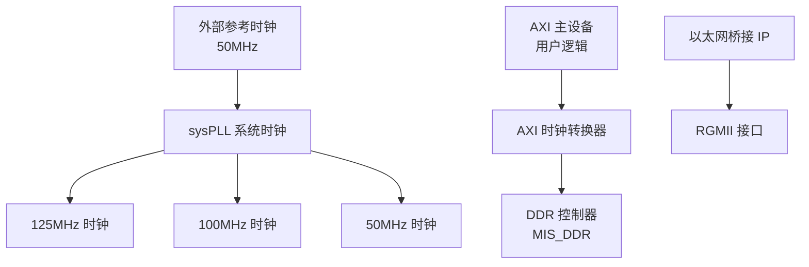
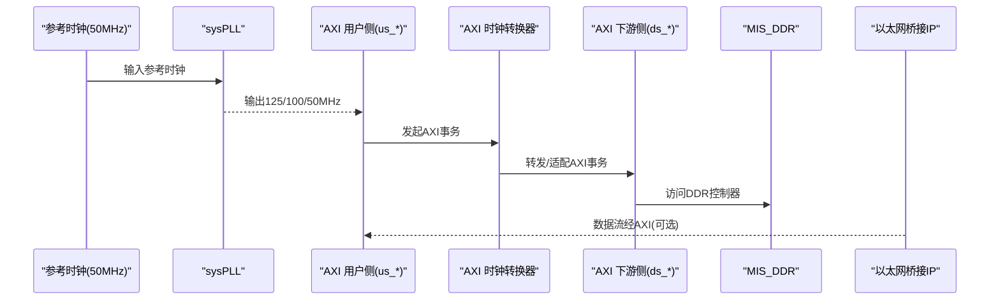
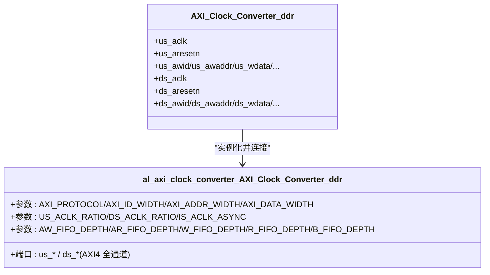
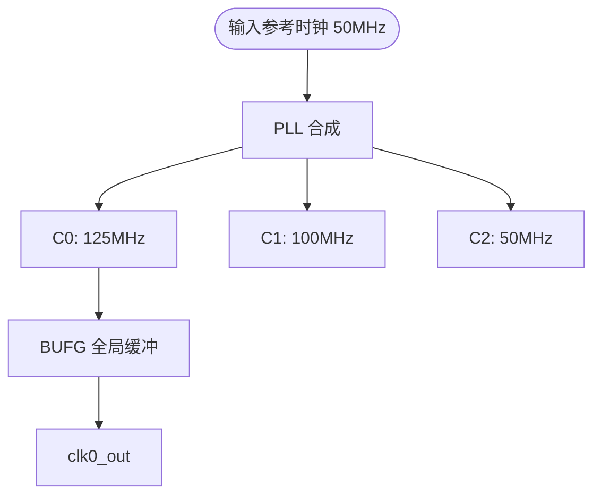
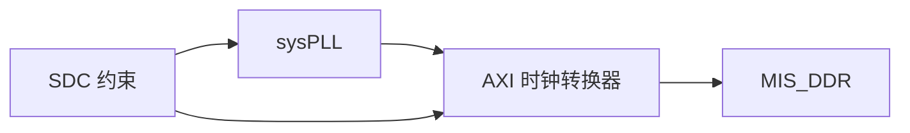

# 时钟域转换器

<cite>
**本文引用的文件**   
- [README.md](file://README.md)
- [AXI_Clock_Converter_ddr.v](file://al_ip/AXI_Clock_Converter_ddr/AXI_Clock_Converter_ddr.v)
- [al_axi_clock_converter_AXI_Clock_Converter_ddr.v](file://al_ip/AXI_Clock_Converter_ddr/RTL/al_axi_clock_converter_AXI_Clock_Converter_ddr.v)
- [sysPLL.v](file://al_ip/sysPLL/sysPLL.v)
- [ph1p_phy_pll_wrapper_sysPLL.v](file://al_ip/sysPLL/RTL/ph1p_phy_pll_wrapper_sysPLL.v)
- [mstar_udp_sdc.sdc](file://hdl/constraint/mstar_udp_sdc.sdc)
</cite>

## 目录
1. [引言](#引言)
2. [项目结构](#项目结构)
3. [核心组件](#核心组件)
4. [架构总览](#架构总览)
5. [详细组件分析](#详细组件分析)
6. [依赖关系分析](#依赖关系分析)
7. [性能与时序约束](#性能与时序约束)
8. [故障诊断与排错](#故障诊断与排错)
9. [结论](#结论)
10. [附录：配置示例与最佳实践](#附录配置示例与最佳实践)

## 引言
本技术文档围绕“时钟域转换器”展开，重点说明跨时钟域同步的重要性与挑战（亚稳态、数据丢失风险），并结合工程中的 AXI 时钟转换器与 sysPLL 系统时钟管理模块，给出实现原理、参数化配置方法与时序约束建议。文档同时提供常见时序问题的诊断思路与解决策略，帮助读者在不同频率的 AXI 设备之间安全、可靠地进行数据桥接。

## 项目结构
本项目为多通道 AD 数据采集 FPGA 工程，顶层通过以太网 UDP 传输采集数据至主机。工程中涉及的关键 IP 包括：
- AXI 时钟转换器：用于在用户侧与 DDR 控制器侧进行 AXI 总线跨时钟域转换
- sysPLL：系统 PLL，生成多路不同频率的时钟（如 125MHz、100MHz、50MHz）
- MIS_DDR：DDR 控制器（含内部 PHY 与时序控制）
- 以太网桥接 IP（加密）：RGMII 接口与 UDP/IP 协议栈

图表来源
- [sysPLL.v:11-20](file://al_ip/sysPLL/sysPLL.v#L11-L20)
- [mstar_udp_sdc.sdc:1-6](file://hdl/constraint/mstar_udp_sdc.sdc#L1-L6)

章节来源
- [README.md:23-73](file://README.md#L23-L73)

## 核心组件
- AXI 时钟转换器（AXI_Clock_Converter_ddr）
  - 对外暴露用户侧（us_*）与下游侧（ds_*）两组 AXI 端口
  - 支持读写通道、ID/地址/数据宽度等参数化配置
  - 支持整数倍时钟比（US_ACLK_RATIO / DS_ACLK_RATIO）与异步模式（IS_ACLK_ASYNC）
- sysPLL 系统时钟
  - 输入 50MHz 参考时钟，输出三路时钟：C0=125MHz、C1=100MHz、C2=50MHz
  - 支持粗/细相位调整、占空比控制、反馈模式选择等
- 时序约束（SDC）
  - 定义各时钟周期、重命名时钟名、设置跨时钟域最大延迟（datapath_only）

章节来源
- [AXI_Clock_Converter_ddr.v:12-96](file://al_ip/AXI_Clock_Converter_ddr/AXI_Clock_Converter_ddr.v#L12-L96)
- [sysPLL.v:11-31](file://al_ip/sysPLL/sysPLL.v#L11-L31)
- [mstar_udp_sdc.sdc:1-16](file://hdl/constraint/mstar_udp_sdc.sdc#L1-L16)

## 架构总览
下图展示从参考时钟到 AXI 时钟转换器再到 DDR 控制器的整体路径，以及以太网桥接 IP 的接入点。

图表来源
- [sysPLL.v:45-87](file://al_ip/sysPLL/sysPLL.v#L45-L87)
- [AXI_Clock_Converter_ddr.v:98-194](file://al_ip/AXI_Clock_Converter_ddr/AXI_Clock_Converter_ddr.v#L98-L194)

## 详细组件分析

### AXI 时钟转换器
- 功能概述
  - 将用户侧 AXI 总线（us_*）与下游侧 AXI 总线（ds_*）进行跨时钟域桥接
  - 支持写通道（AW/W/B）与读通道（AR/R）
  - 支持 ID、地址、数据位宽等参数化配置
  - 支持整数倍时钟比（US_ACLK_RATIO / DS_ACLK_RATIO）与异步模式（IS_ACLK_ASYNC）
- 关键参数
  - AXI_PROTOCOL：协议类型（例如 AXI4LITE 或自定义）
  - AXI_ID_WIDTH / AXI_ADDR_WIDTH / AXI_DATA_WIDTH：ID、地址、数据位宽
  - US_ACLK_RATIO / DS_ACLK_RATIO：时钟比（慢端设为 1，范围 16:1~1:16）
  - IS_ACLK_ASYNC：是否异步模式
  - FIFO 深度：AW_FIFO_DEPTH、AR_FIFO_DEPTH、W_FIFO_DEPTH、R_FIFO_DEPTH、B_FIFO_DEPTH
  - USER 信号支持：AXI_SUPPORTS_USER_SIGNALS 与各通道 USER 宽度
- 典型实例化
  - 顶层封装中实例化并绑定具体位宽与时钟比，例如：
    - AXI_ID_WIDTH=4, AXI_ADDR_WIDTH=27, AXI_DATA_WIDTH=128
    - US_ACLK_RATIO=1, DS_ACLK_RATIO=8, IS_ACLK_ASYNC=1
    - 启用读写通道（SUPPORTS_WRITE_CHANNEL=1, SUPPORTS_READ_CHANNEL=1）

图表来源
- [AXI_Clock_Converter_ddr.v:98-194](file://al_ip/AXI_Clock_Converter_ddr/AXI_Clock_Converter_ddr.v#L98-L194)
- [al_axi_clock_converter_AXI_Clock_Converter_ddr.v:1-27](file://al_ip/AXI_Clock_Converter_ddr/RTL/al_axi_clock_converter_AXI_Clock_Converter_ddr.v#L1-L27)

章节来源
- [AXI_Clock_Converter_ddr.v:12-96](file://al_ip/AXI_Clock_Converter_ddr/AXI_Clock_Converter_ddr.v#L12-L96)
- [al_axi_clock_converter_AXI_Clock_Converter_ddr.v:1-27](file://al_ip/AXI_Clock_Converter_ddr/RTL/al_axi_clock_converter_AXI_Clock_Converter_ddr.v#L1-L27)

### sysPLL 系统时钟管理
- 功能概述
  - 输入 50MHz 参考时钟，通过 PLL 合成多路时钟：
    - C0 = 125MHz
    - C1 = 100MHz
    - C2 = 50MHz
  - 支持每路时钟的使能、分频、粗/细相位调整、占空比控制
  - 支持反馈模式（内部/外部）、环路参数（LPF_RES/LPF_CAP/ICP_CUR）、SSC 等
- 关键参数（顶层 sysPLL.v）
  - FIN=50MHz，REFCLK_DIV=2，FBCLK_DIV=5
  - CLKC0/1/2_ENABLE=ENABLE，DIV/C_PHASE/F_PHASE/DUTY 等参数
  - FEEDBK_MODE=EXTERNAL，PLL_FEED_TYPE=EXTERNAL
- 底层封装（ph1p_phy_pll_wrapper_sysPLL.v）
  - 映射到 PH1P_PHY_PLL_V2，提供多路时钟输出与 DRP/PS 控制接口

图表来源
- [sysPLL.v:11-20](file://al_ip/sysPLL/sysPLL.v#L11-L20)
- [sysPLL.v:32-36](file://al_ip/sysPLL/sysPLL.v#L32-L36)
- [ph1p_phy_pll_wrapper_sysPLL.v:185-335](file://al_ip/sysPLL/RTL/ph1p_phy_pll_wrapper_sysPLL.v#L185-L335)

章节来源
- [sysPLL.v:11-87](file://al_ip/sysPLL/sysPLL.v#L11-L87)
- [ph1p_phy_pll_wrapper_sysPLL.v:1-116](file://al_ip/sysPLL/RTL/ph1p_phy_pll_wrapper_sysPLL.v#L1-L116)

### 跨时钟域同步的挑战与处理
- 挑战
  - 亚稳态：当信号跨越不同时钟域时，可能因建立/保持时间不满足而进入亚稳态
  - 数据丢失：握手协议不当或 FIFO 深度不足可能导致数据溢出/下溢
  - 对齐问题：突发传输（burst）在多时钟域下需保证数据与状态对齐
- 处理手段
  - 使用 AXI 时钟转换器内置 FIFO 缓冲（AW/AR/W/R/B 通道独立 FIFO）
  - 合理设置 FIFO 深度以匹配峰值带宽与突发长度
  - 使用握手协议（valid/ready）确保数据完整性
  - 对复位信号进行跨时钟域同步（工程中有 reset_sync/resetn_sync 等模块）

章节来源
- [al_axi_clock_converter_AXI_Clock_Converter_ddr.v:12-25](file://al_ip/AXI_Clock_Converter_ddr/RTL/al_axi_clock_converter_AXI_Clock_Converter_ddr.v#L12-L25)

## 依赖关系分析
- AXI 时钟转换器依赖 sysPLL 提供的多路时钟
- 时序约束定义了各时钟之间的最大延迟，确保跨时钟域路径满足时序要求
- 以太网桥接 IP 与 AXI 总线存在可能的数据通路耦合（取决于系统设计）

图表来源
- [sysPLL.v:45-87](file://al_ip/sysPLL/sysPLL.v#L45-L87)
- [AXI_Clock_Converter_ddr.v:98-194](file://al_ip/AXI_Clock_Converter_ddr/AXI_Clock_Converter_ddr.v#L98-L194)
- [mstar_udp_sdc.sdc:1-16](file://hdl/constraint/mstar_udp_sdc.sdc#L1-L16)

章节来源
- [mstar_udp_sdc.sdc:1-16](file://hdl/constraint/mstar_udp_sdc.sdc#L1-L16)

## 性能与时序约束
- 时钟定义与重命名
  - 定义 clk_25MHz（由 50MHz 端口产生）与 clk_125MHz（RGMII RXC）
  - derive_clocks 自动推导衍生时钟
  - rename_clock 将 PLL 输出重命名为 w_clk125M/w_clk100M/w_clk50M
- 跨时钟域最大延迟（datapath_only）
  - 125MHz ↔ 100MHz：8.000ns
  - 125MHz ↔ 50MHz：40.000ns
  - 100MHz ↔ 50MHz：40.000ns
  - 100MHz ↔ MIS_DDR usr_clk：15.000ns（出）/10.000ns（入）
  - RGMII 自环路径：8.000ns
- 建议
  - 根据实际数据路径与突发长度调整 FIFO 深度
  - 对关键跨时钟域路径添加 false_path 或 set_max_delay 约束
  - 使用静态时序分析工具检查 setup/hold 违例

章节来源
- [mstar_udp_sdc.sdc:1-16](file://hdl/constraint/mstar_udp_sdc.sdc#L1-L16)

## 故障诊断与排错
- 常见问题
  - 亚稳态导致的数据错误：检查跨时钟域路径是否经过同步器或 FIFO
  - 数据丢失：确认 FIFO 深度足够，避免 overflow/underflow
  - 时序违例：检查 SDC 约束是否正确，尤其是跨时钟域的最大延迟
  - 复位不同步：确保复位信号在各时钟域内正确同步
- 排查步骤
  - 查看静态时序分析报告，定位违例路径
  - 仿真验证握手协议与 FIFO 行为
  - 调整 FIFO 深度与时钟比参数
  - 校验复位同步逻辑

章节来源
- [al_axi_clock_converter_AXI_Clock_Converter_ddr.v:12-25](file://al_ip/AXI_Clock_Converter_ddr/RTL/al_axi_clock_converter_AXI_Clock_Converter_ddr.v#L12-L25)
- [mstar_udp_sdc.sdc:8-16](file://hdl/constraint/mstar_udp_sdc.sdc#L8-L16)

## 结论
本工程的 AXI 时钟转换器与 sysPLL 系统时钟管理模块共同构成了稳定的跨时钟域数据通路。通过合理的参数配置与时序约束，可以有效抑制亚稳态和数据丢失风险，确保不同频率 AXI 设备之间的可靠通信。建议在项目中结合静态时序分析与仿真验证，持续优化 FIFO 深度与时钟分配策略。

## 附录：配置示例与最佳实践
- AXI 时钟转换器配置示例
  - 位宽与时钟比：
    - AXI_ID_WIDTH=4, AXI_ADDR_WIDTH=27, AXI_DATA_WIDTH=128
    - US_ACLK_RATIO=1, DS_ACLK_RATIO=8, IS_ACLK_ASYNC=1
  - FIFO 深度：
    - W_FIFO_DEPTH=512, R_FIFO_DEPTH=512, AW_FIFO_DEPTH=32, AR_FIFO_DEPTH=32, B_FIFO_DEPTH=16
  - 通道支持：
    - SUPPORTS_WRITE_CHANNEL=1, SUPPORTS_READ_CHANNEL=1
- sysPLL 配置要点
  - 输入 50MHz，输出 125/100/50MHz
  - 启用所有时钟输出，合理设置分频与相位
  - 反馈模式与环路参数按器件手册配置
- 时序约束建议
  - 明确跨时钟域最大延迟
  - 对关键路径添加额外约束
  - 定期运行静态时序分析并修复违例

章节来源
- [AXI_Clock_Converter_ddr.v:98-194](file://al_ip/AXI_Clock_Converter_ddr/AXI_Clock_Converter_ddr.v#L98-L194)
- [sysPLL.v:45-87](file://al_ip/sysPLL/sysPLL.v#L45-L87)
- [mstar_udp_sdc.sdc:1-16](file://hdl/constraint/mstar_udp_sdc.sdc#L1-L16)