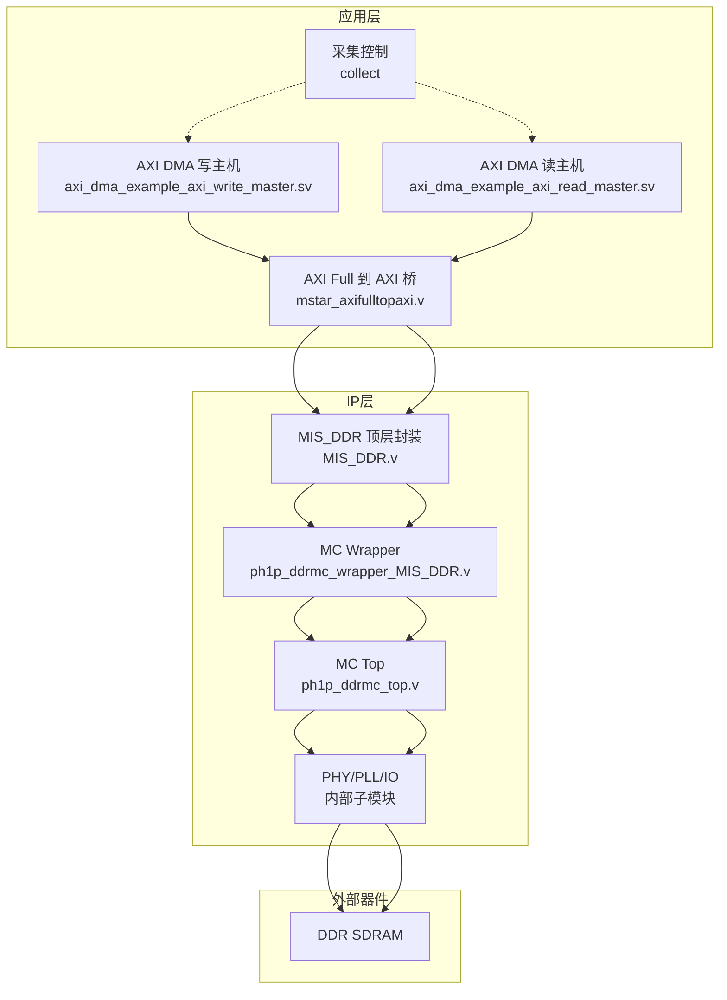
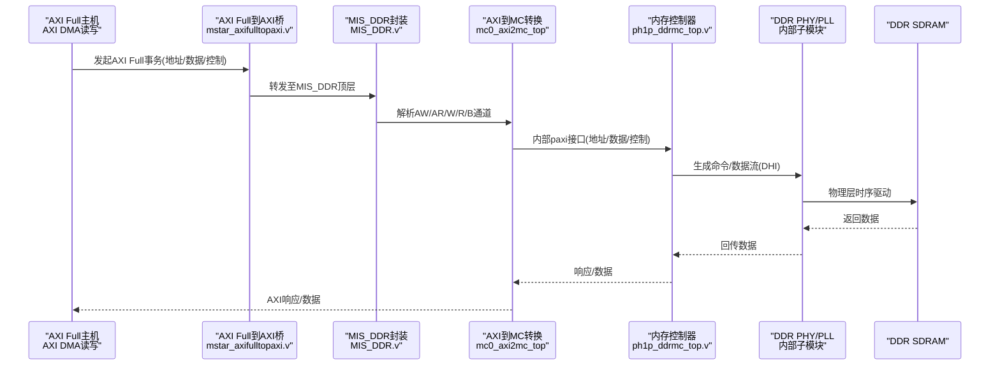
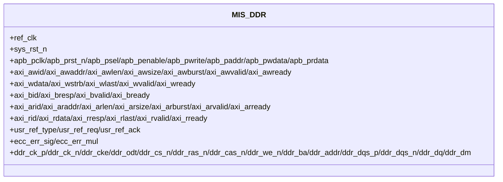
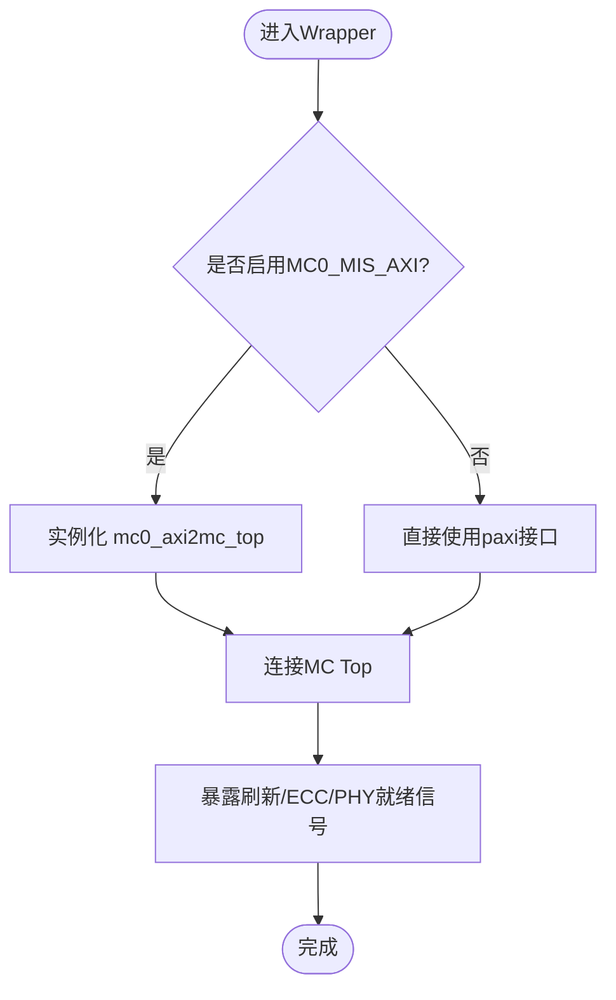
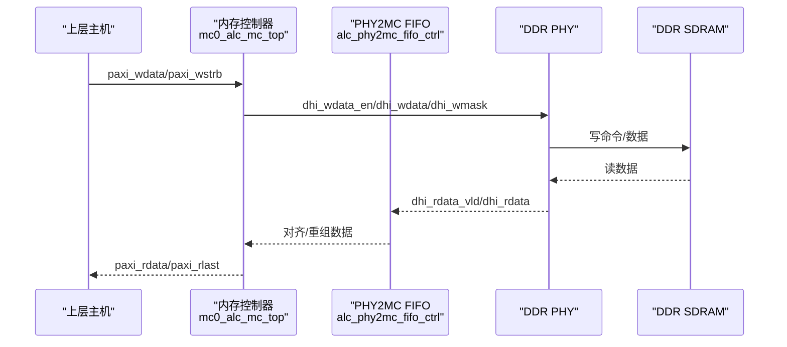
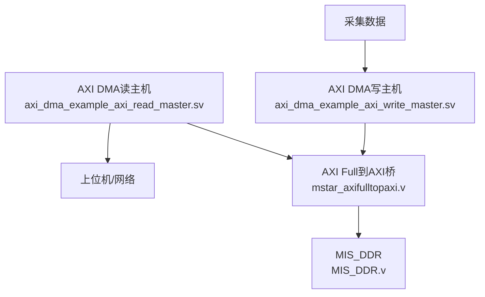
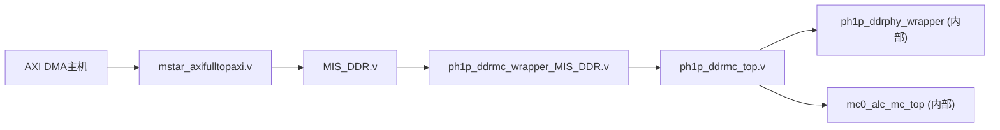
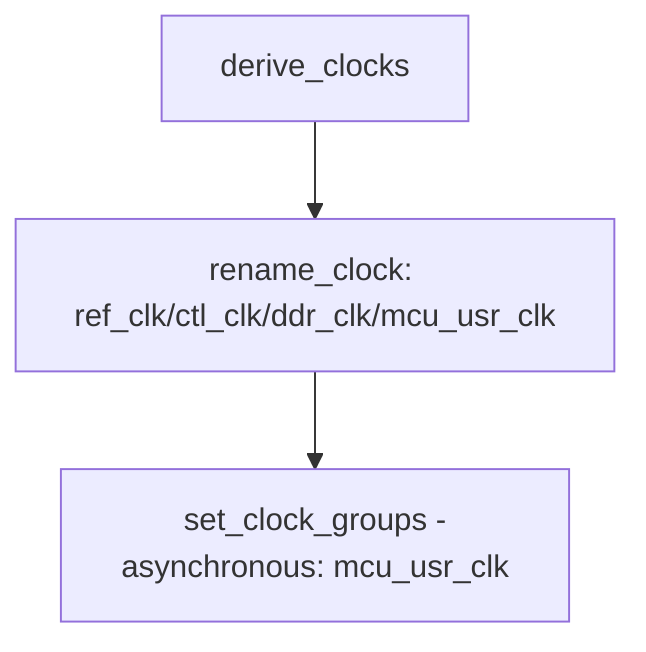

# DDR存储管理系统

<cite>
**本文引用的文件**   
- [README.md](file://README.md)
- [MIS_DDR.v](file://al_ip/MIS_DDR/MIS_DDR.v)
- [ph1p_ddrmc_wrapper_MIS_DDR.v](file://al_ip/MIS_DDR/ph1p_ddrmc_wrapper_MIS_DDR.v)
- [ph1p_ddrmc_top.v](file://al_ip/MIS_DDR/src/rtl/top/ph1p_ddrmc_top.v)
- [MIS_DDR.sdc](file://al_ip/MIS_DDR/src/sdc/MIS_DDR.sdc)
- [MIS_DDR.adc](file://al_ip/MIS_DDR/src/adc/MIS_DDR.adc)
- [mstar_axifulltopaxi.v](file://hdl/axi_io/mstar_axifulltopaxi.v)
- [axi_dma_example_axi_write_master.sv](file://hdl/axi_dma/axi_dma_example_axi_write_master.sv)
- [axi_dma_example_axi_read_master.sv](file://hdl/axi_dma/axi_dma_example_axi_read_master.sv)
</cite>

## 目录
1. [简介](#简介)
2. [项目结构](#项目结构)
3. [核心组件](#核心组件)
4. [架构总览](#架构总览)
5. [详细组件分析](#详细组件分析)
6. [依赖关系分析](#依赖关系分析)
7. [性能与带宽优化](#性能与带宽优化)
8. [时序约束与STA要点](#时序约束与sta要点)
9. [配置示例与最佳实践](#配置示例与最佳实践)
10. [故障排查指南](#故障排查指南)
11. [结论](#结论)

## 简介
本技术文档面向DDR存储管理系统，围绕安路科技PH1 FPGA上的MIS_DDR IP核展开，系统性说明：
- MIS_DDR的AXI Full接口协议、地址映射策略与带宽优化方法
- 内存控制器工作原理（刷新机制、ECC错误校正、性能监控）
- 与上层数据交互方式（写入、读取、地址计算）
- 配置示例与优化建议
- DDR时序约束与静态时序分析要点
- 内存使用最佳实践与性能调优指南

该工程为多通道AD数据采集系统的一部分，通过DDR进行DMA缓存，并通过以太网UDP传输至上位机。

**章节来源**
- [README.md:5-14](file://README.md#L5-L14)

## 项目结构
本项目在IP层包含MIS_DDR DDR控制器及相关矩阵、时钟转换等IP；在HDL层包含采集逻辑、AXI DMA读写主机、AXI Lite IO桥接与时序/引脚约束。

**图表来源**
- [MIS_DDR.v:12-82](file://al_ip/MIS_DDR/MIS_DDR.v#L12-L82)
- [ph1p_ddrmc_wrapper_MIS_DDR.v:14-198](file://al_ip/MIS_DDR/ph1p_ddrmc_wrapper_MIS_DDR.v#L14-L198)
- [ph1p_ddrmc_top.v:8-143](file://al_ip/MIS_DDR/src/rtl/top/ph1p_ddrmc_top.v#L8-L143)
- [mstar_axifulltopaxi.v:1-32](file://hdl/axi_io/mstar_axifulltopaxi.v#L1-L32)
- [axi_dma_example_axi_write_master.sv:1-38](file://hdl/axi_dma/axi_dma_example_axi_write_master.sv#L1-L38)
- [axi_dma_example_axi_read_master.sv:1-39](file://hdl/axi_dma/axi_dma_example_axi_read_master.sv#L1-L39)

**章节来源**
- [README.md:23-73](file://README.md#L23-L73)

## 核心组件
- MIS_DDR顶层模块：对外暴露APB调试接口、AXI Full主从接口、用户刷新请求信号、ECC错误信号以及DDR物理接口。
- ph1p_ddrmc_wrapper_MIS_DDR：将AXI Full转换为MC内部总线，并实例化MC Top与PHY。
- ph1p_ddrmc_top：连接PHY与MC，提供用户刷新、ECC错误上报、内部AXI接口给MC。
- mstar_axifulltopaxi：实现AXI Full 128-bit数据总线与内部AXI适配。
- AXI DMA读写主机：作为上层数据通路，向DDR写入或从DDR读取数据。

关键参数与端口（节选）：
- AXI地址宽度：26位（由wrapper定义），数据宽度：128位，掩码宽度：16字节。
- MC地址映射：ROW_COL_BANK（行-列-银行）。
- ECC：关闭（OFF），刷新由用户触发。
- PHY就绪信号ddrphy_rdy用于MC初始化完成指示。

**章节来源**
- [MIS_DDR.v:12-82](file://al_ip/MIS_DDR/MIS_DDR.v#L12-L82)
- [MIS_DDR.v:84-130](file://al_ip/MIS_DDR/MIS_DDR.v#L84-L130)
- [ph1p_ddrmc_wrapper_MIS_DDR.v:14-68](file://al_ip/MIS_DDR/ph1p_ddrmc_wrapper_MIS_DDR.v#L14-L68)
- [ph1p_ddrmc_top.v:8-56](file://al_ip/MIS_DDR/src/rtl/top/ph1p_ddrmc_top.v#L8-L56)

## 架构总览
下图展示从AXI Full主机到DDR的物理路径，包括时钟域、协议转换与控制器层级。

**图表来源**
- [MIS_DDR.v:131-200](file://al_ip/MIS_DDR/MIS_DDR.v#L131-L200)
- [ph1p_ddrmc_wrapper_MIS_DDR.v:229-308](file://al_ip/MIS_DDR/ph1p_ddrmc_wrapper_MIS_DDR.v#L229-L308)
- [ph1p_ddrmc_top.v:316-382](file://al_ip/MIS_DDR/src/rtl/top/ph1p_ddrmc_top.v#L316-L382)

## 详细组件分析

### MIS_DDR顶层封装
- 功能：聚合APB调试、AXI Full接口、用户刷新、ECC错误输出与DDR物理接口。
- 关键参数：
  - tCK=1876ps（对应约533MHz等效速率）
  - BK_NUM=2, BA_WIDTH=2, ROW_WIDTH=13, COL_WIDTH=10
  - AXI_ADDR_WIDTH=26, AXI_DATA_WIDTH=128, AXI_MASK_WIDTH=16
  - MC_ECC="OFF", MC_ADDR_MAP="ROW_COL_BANK", MC_REORDER="NORMAL"
- 端口分组：
  - APB调试：apb_pclk/apb_prst_n/apb_psel/apb_penable/apb_pwrite/apb_paddr/apb_pwdata/apb_prdata
  - AXI Full：aw/ar/w/r/b五通道
  - 用户刷新：usr_ref_type/usr_ref_req/usr_ref_ack
  - ECC错误：ecc_err_sig/ecc_err_mul
  - DDR物理：ck/cke/odt/cs_n/ras_n/cas_n/we_n/ba/addr/dqs/dq/dm

**图表来源**
- [MIS_DDR.v:12-82](file://al_ip/MIS_DDR/MIS_DDR.v#L12-L82)

**章节来源**
- [MIS_DDR.v:12-82](file://al_ip/MIS_DDR/MIS_DDR.v#L12-L82)
- [MIS_DDR.v:84-130](file://al_ip/MIS_DDR/MIS_DDR.v#L84-L130)

### ph1p_ddrmc_wrapper_MIS_DDR（AXI到MC桥接）
- 功能：
  - 当启用MC0_MIS_AXI时，实例化mc0_axi2mc_top将AXI Full转为内部paxi接口。
  - 实例化ph1p_ddrmc_top，连接PHY与MC。
  - 暴露用户刷新与ECC错误信号。
- 关键参数：
  - MC_ADDR_WIDTH = BG+BA+ROW+COL
  - MC_DATA_WIDTH = DX*64（ECC关闭）
  - AXI_ADDR_WIDTH = MC_ADDR_WIDTH + log2(MC_DATA_WIDTH/8) - 3
  - AXI_DATA_WIDTH = MC_DATA_WIDTH
  - AXI_MASK_WIDTH = MC_MASK_WIDTH
- 内部连线：
  - paxi_awaddr/paxi_wdata/paxi_araddr/paxi_rdata等内部总线连接MC。

**图表来源**
- [ph1p_ddrmc_wrapper_MIS_DDR.v:229-308](file://al_ip/MIS_DDR/ph1p_ddrmc_wrapper_MIS_DDR.v#L229-L308)
- [ph1p_ddrmc_wrapper_MIS_DDR.v:314-445](file://al_ip/MIS_DDR/ph1p_ddrmc_wrapper_MIS_DDR.v#L314-L445)

**章节来源**
- [ph1p_ddrmc_wrapper_MIS_DDR.v:14-68](file://al_ip/MIS_DDR/ph1p_ddrmc_wrapper_MIS_DDR.v#L14-L68)
- [ph1p_ddrmc_wrapper_MIS_DDR.v:229-308](file://al_ip/MIS_DDR/ph1p_ddrmc_wrapper_MIS_DDR.v#L229-L308)
- [ph1p_ddrmc_wrapper_MIS_DDR.v:314-445](file://al_ip/MIS_DDR/ph1p_ddrmc_wrapper_MIS_DDR.v#L314-L445)

### ph1p_ddrmc_top（MC与PHY集成）
- 功能：
  - 实例化DDR PHY包装器，提供DHI命令/数据接口。
  - 实例化内存控制器mc0_alc_mc_top，处理刷新、ECC、地址映射与重排序。
  - 提供用户刷新接口与ECC错误信号。
- 关键参数：
  - MC_ECC="OFF"
  - MC_ADDR_MAP="ROW_COL_BANK"
  - MC_REORDER="STRICT"
- 数据通路：
  - 写：paxi_wdata/paxi_wstrb -> dhi_wdata_en/dhi_wdata/dhi_wmask -> PHY
  - 读：PHY -> dhi_rdata_vld/dhi_rdata -> FIFO -> MC -> paxi_rdata

**图表来源**
- [ph1p_ddrmc_top.v:178-296](file://al_ip/MIS_DDR/src/rtl/top/ph1p_ddrmc_top.v#L178-L296)
- [ph1p_ddrmc_top.v:301-311](file://al_ip/MIS_DDR/src/rtl/top/ph1p_ddrmc_top.v#L301-L311)
- [ph1p_ddrmc_top.v:316-382](file://al_ip/MIS_DDR/src/rtl/top/ph1p_ddrmc_top.v#L316-L382)

**章节来源**
- [ph1p_ddrmc_top.v:8-56](file://al_ip/MIS_DDR/src/rtl/top/ph1p_ddrmc_top.v#L8-L56)
- [ph1p_ddrmc_top.v:178-296](file://al_ip/MIS_DDR/src/rtl/top/ph1p_ddrmc_top.v#L178-L296)
- [ph1p_ddrmc_top.v:301-311](file://al_ip/MIS_DDR/src/rtl/top/ph1p_ddrmc_top.v#L301-L311)
- [ph1p_ddrmc_top.v:316-382](file://al_ip/MIS_DDR/src/rtl/top/ph1p_ddrmc_top.v#L316-L382)

### 上层数据交互（AXI DMA读写主机与桥）
- mstar_axifulltopaxi：实现AXI Full 128-bit数据总线与内部AXI适配，提供APB调试接口与DDR相关时钟/复位输出。
- axi_dma_example_axi_write_master.sv：AXI DMA写主机，通过AXI Full将数据写入DDR。
- axi_dma_example_axi_read_master.sv：AXI DMA读主机，通过AXI Full从DDR读取数据。

**图表来源**
- [mstar_axifulltopaxi.v:1-32](file://hdl/axi_io/mstar_axifulltopaxi.v#L1-L32)
- [axi_dma_example_axi_write_master.sv:1-38](file://hdl/axi_dma/axi_dma_example_axi_write_master.sv#L1-L38)
- [axi_dma_example_axi_read_master.sv:1-39](file://hdl/axi_dma/axi_dma_example_axi_read_master.sv#L1-L39)

**章节来源**
- [mstar_axifulltopaxi.v:1-32](file://hdl/axi_io/mstar_axifulltopaxi.v#L1-L32)
- [axi_dma_example_axi_write_master.sv:1-38](file://hdl/axi_dma/axi_dma_example_axi_write_master.sv#L1-L38)
- [axi_dma_example_axi_read_master.sv:1-39](file://hdl/axi_dma/axi_dma_example_axi_read_master.sv#L1-L39)

## 依赖关系分析
- MIS_DDR依赖ph1p_ddrmc_wrapper_MIS_DDR与内部MC/PHY子模块。
- wrapper依赖mc0_axi2mc_top（AXI到MC转换）与ph1p_ddrmc_top（MC与PHY集成）。
- top依赖ph1p_ddrphy_wrapper与mc0_alc_mc_top。
- 上层依赖mstar_axifulltopaxi桥接与AXI DMA主机。

**图表来源**
- [MIS_DDR.v:84-200](file://al_ip/MIS_DDR/MIS_DDR.v#L84-L200)
- [ph1p_ddrmc_wrapper_MIS_DDR.v:229-445](file://al_ip/MIS_DDR/ph1p_ddrmc_wrapper_MIS_DDR.v#L229-L445)
- [ph1p_ddrmc_top.v:178-382](file://al_ip/MIS_DDR/src/rtl/top/ph1p_ddrmc_top.v#L178-L382)
- [mstar_axifulltopaxi.v:1-32](file://hdl/axi_io/mstar_axifulltopaxi.v#L1-L32)

**章节来源**
- [MIS_DDR.v:84-200](file://al_ip/MIS_DDR/MIS_DDR.v#L84-L200)
- [ph1p_ddrmc_wrapper_MIS_DDR.v:229-445](file://al_ip/MIS_DDR/ph1p_ddrmc_wrapper_MIS_DDR.v#L229-L445)
- [ph1p_ddrmc_top.v:178-382](file://al_ip/MIS_DDR/src/rtl/top/ph1p_ddrmc_top.v#L178-L382)

## 性能与带宽优化
- 数据宽度与突发长度：
  - AXI数据宽度128位，掩码16字节，支持突发传输（axi_awlen/axi_arlen）。
  - 建议使用长突发（如256B/512B）以提高吞吐。
- 地址映射与重排序：
  - 地址映射采用ROW_COL_BANK，有利于行命中与预取。
  - 重排序模式NORMAL/STRICT影响命令调度，需根据访问模式选择。
- 刷新机制：
  - 用户刷新接口usr_ref_type/usr_ref_req/usr_ref_ack允许上层按需触发刷新，避免频繁自动刷新带来的延迟。
- ECC：
  - 当前配置为关闭（OFF），如需数据完整性保障可开启并调整数据/掩码宽度。
- PHY就绪：
  - ddrphy_rdy指示PHY校准完成，MC应在该信号有效后开始服务AXI事务。

优化建议：
- 对齐数据边界：确保AXI地址按数据宽度对齐，减少掩码开销。
- 合并小事务：将多个小写操作合并为大突发，提升带宽利用率。
- 合理设置突发长度：根据DDR特性与上层数据块大小选择合适的axi_awlen/axi_arlen。
- 刷新策略：结合采集周期与数据量，动态触发刷新，平衡延迟与可靠性。

**章节来源**
- [MIS_DDR.v:84-130](file://al_ip/MIS_DDR/MIS_DDR.v#L84-L130)
- [ph1p_ddrmc_wrapper_MIS_DDR.v:14-68](file://al_ip/MIS_DDR/ph1p_ddrmc_wrapper_MIS_DDR.v#L14-L68)
- [ph1p_ddrmc_top.v:316-382](file://al_ip/MIS_DDR/src/rtl/top/ph1p_ddrmc_top.v#L316-L382)

## 时序约束与STA要点
- 时钟命名与分组：
  - ref_clk、ctl_clk、ddr_clk、mcu_usr_clk分别来自PLL0/PLL1。
  - 将mcu_usr_clk设为异步组，避免跨时钟域误判。
- 约束文件：
  - MIS_DDR.sdc中定义了derive_clocks与rename_clock，并对mcu_usr_clk进行异步分组。
- STA关注点：
  - AXI接口时钟axi_aclk与DDR PHY时钟域的隔离。
  - 用户刷新信号的同步与建立保持时间。
  - ECC错误信号的捕获与时钟域同步。

**图表来源**
- [MIS_DDR.sdc:1-13](file://al_ip/MIS_DDR/src/sdc/MIS_DDR.sdc#L1-L13)

**章节来源**
- [MIS_DDR.sdc:1-13](file://al_ip/MIS_DDR/src/sdc/MIS_DDR.sdc#L1-L13)

## 配置示例与最佳实践
- 引脚与IO标准：
  - MIS_DDR.adc定义了DDR相关引脚位置与SSTL15标准，包括CK、ADDR、BA、DQS、DQ、DM等。
  - PLL与IOCLK实例位置已指定，便于布局布线优化。
- 典型配置步骤：
  - 确认目标器件与IDE版本（参考README）。
  - 打开工程文件tand_udp.al，综合→布局布线→生成比特流。
  - 检查MIS_DDR.sdc与MIS_DDR.adc约束是否正确加载。
- 最佳实践：
  - 使用AXI Full长突发与对齐地址，最大化带宽。
  - 在上层采集逻辑中协调刷新时机，避免数据丢失。
  - 若启用ECC，需重新评估数据宽度与掩码宽度，并确保上层数据格式兼容。

**章节来源**
- [MIS_DDR.adc:1-74](file://al_ip/MIS_DDR/src/adc/MIS_DDR.adc#L1-L74)
- [README.md:75-86](file://README.md#L75-L86)

## 故障排查指南
- 常见问题：
  - AXI事务无响应：检查ddrphy_rdy是否为高，确认PHY校准完成。
  - 数据错误：若启用ECC，观察ecc_err_sig/ecc_err_mul信号定位单/多重错误。
  - 刷新失败：检查usr_ref_req/ack握手是否正确，确认刷新类型usr_ref_type设置。
- 调试手段：
  - 通过APB接口读取控制器状态寄存器（需参考具体寄存器映射）。
  - 使用ILA/ChipScope抓取AXI与DDR信号波形，验证时序与数据通路。

**章节来源**
- [MIS_DDR.v:61-66](file://al_ip/MIS_DDR/MIS_DDR.v#L61-L66)
- [ph1p_ddrmc_wrapper_MIS_DDR.v:397-404](file://al_ip/MIS_DDR/ph1p_ddrmc_wrapper_MIS_DDR.v#L397-L404)
- [ph1p_ddrmc_top.v:349-356](file://al_ip/MIS_DDR/src/rtl/top/ph1p_ddrmc_top.v#L349-L356)

## 结论
MIS_DDR IP核在本工程中提供了完整的DDR存储管理能力，涵盖AXI Full接口、地址映射、刷新与ECC等功能。通过合理的配置与优化策略，可实现高吞吐、低延迟的数据采集与传输。建议在项目中遵循对齐与突发优化、刷新策略协同、时序约束严谨等最佳实践，以确保系统稳定与高性能运行。