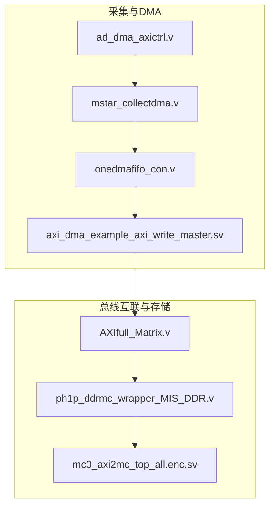
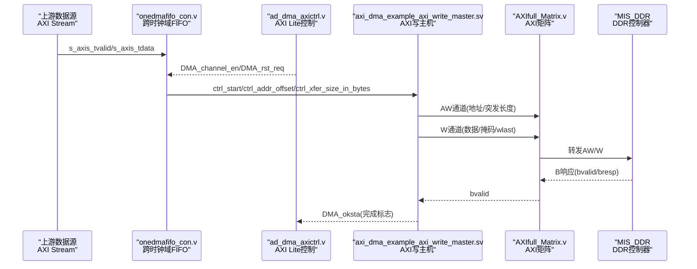
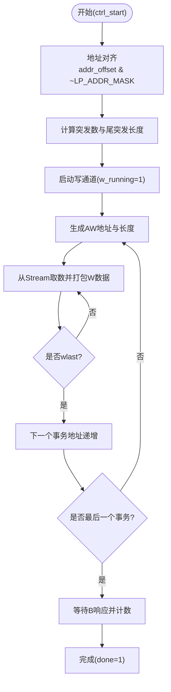
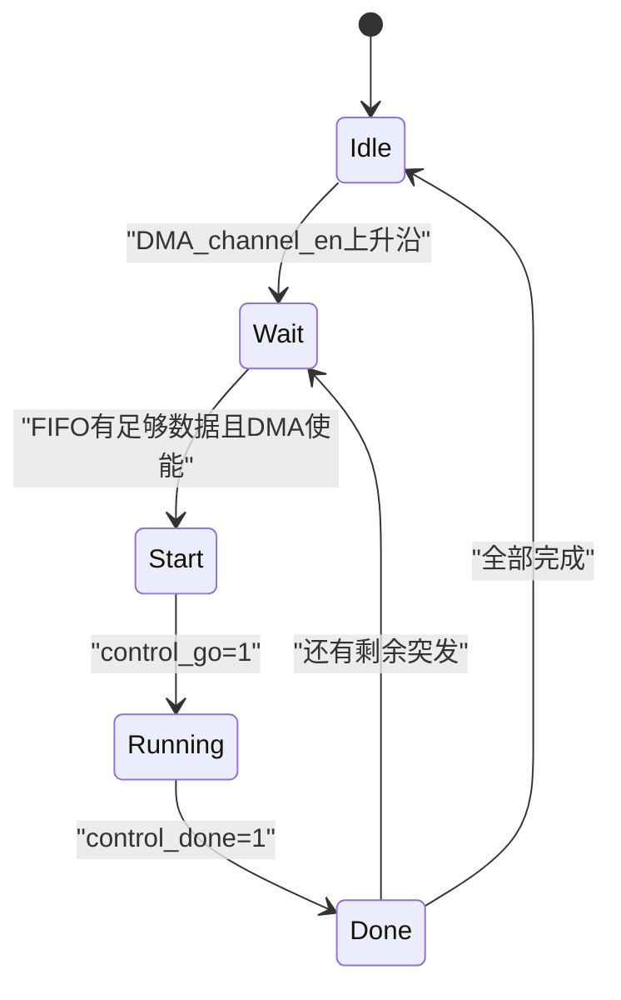
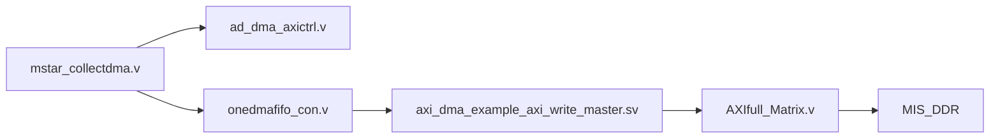

# AXI写主机模块

<cite>
**本文引用的文件**   
- [axi_dma_example_axi_write_master.sv](file://hdl/axi_dma/axi_dma_example_axi_write_master.sv)
- [mstar_collectdma.v](file://hdl/collect/mstar_collectdma.v)
- [onedmafifo_con.v](file://hdl/collect/onedmafifo_con.v)
- [ad_dma_axictrl.v](file://hdl/collect/ad_dma_axictrl.v)
- [AXIfull_Matrix.v](file://al_ip/AXIfull_Matrix/AXIfull_Matrix.v)
- [ph1p_ddrmc_wrapper_MIS_DDR.v](file://al_ip/MIS_DDR/ph1p_ddrmc_wrapper_MIS_DDR.v)
- [mc0_axi2mc_top_all.enc.sv](file://al_ip/MIS_DDR/src/rtl/axi/mc0_axi2mc_top_all.enc.sv)
- [README.md](file://README.md)
</cite>

## 目录
1. [简介](#简介)
2. [项目结构](#项目结构)
3. [核心组件](#核心组件)
4. [架构总览](#架构总览)
5. [详细组件分析](#详细组件分析)
6. [依赖关系分析](#依赖关系分析)
7. [性能与调优](#性能与调优)
8. [故障诊断指南](#故障诊断指南)
9. [结论](#结论)
10. [附录：配置参数与集成要点](#附录配置参数与集成要点)

## 简介
本技术文档聚焦于工程中的“AXI写主机模块”，面向将采集数据通过AXI Full接口写入DDR的完整流程。内容涵盖：
- 从AXI Stream接收数据、流控与背压机制
- 写缓冲区管理、数据对齐、突发边界处理
- AXI Full写通道（AW/W/B）实现细节
- 地址管理与突发传输控制
- 配置寄存器、错误处理与状态监控
- 性能调优建议与常见问题排查

该模块位于数据采集链路中，负责把来自ADC的数据经DMA引擎打包为AXI事务并写入DDR，再由上层网络或上位机读取。

## 项目结构
本项目采用分层组织方式：
- hdl/collect：采集与DMA控制逻辑
- hdl/axi_dma：AXI DMA读写主机示例
- al_ip：安路IP核（DDR控制器、AXI矩阵、时钟转换等）
- hdl/udpip：加密以太网桥接IP（不开放源码）

图示来源
- [mstar_collectdma.v:1-66](file://hdl/collect/mstar_collectdma.v#L1-L66)
- [onedmafifo_con.v:1-50](file://hdl/collect/onedmafifo_con.v#L1-L50)
- [ad_dma_axictrl.v:1-56](file://hdl/collect/ad_dma_axictrl.v#L1-L56)
- [axi_dma_example_axi_write_master.sv:22-74](file://hdl/axi_dma/axi_dma_example_axi_write_master.sv#L22-L74)
- [AXIfull_Matrix.v:131-153](file://al_ip/AXIfull_Matrix/AXIfull_Matrix.v#L131-L153)
- [ph1p_ddrmc_wrapper_MIS_DDR.v:91-128](file://al_ip/MIS_DDR/ph1p_ddrmc_wrapper_MIS_DDR.v#L91-L128)

章节来源
- [README.md:23-73](file://README.md#L23-L73)

## 核心组件
- mstar_collectdma.v：采集DMA顶层封装，连接AXI Lite控制接口与AXI写主机，以及AXI Stream数据入口。
- onedmafifo_con.v：单通道FIFO控制，跨时钟域缓冲、突发长度计算、DMA状态机与AXI写主机实例化。
- ad_dma_axictrl.v：AXI Lite寄存器控制器，提供DMA使能、复位请求、缓冲区基址与长度等配置。
- axi_dma_example_axi_write_master.sv：AXI Full写主机，实现AW/W/B三通道协议、突发长度与地址递增、W到AW的关联、B响应计数与完成标志。
- AXIfull_Matrix.v：AXI Full矩阵，将多个主设备连接到DDR控制器。
- ph1p_ddrmc_wrapper_MIS_DDR.v / mc0_axi2mc_top_all.enc.sv：DDR控制器包装与AXI到MC内部接口转换。

章节来源
- [mstar_collectdma.v:1-66](file://hdl/collect/mstar_collectdma.v#L1-L66)
- [onedmafifo_con.v:1-50](file://hdl/collect/onedmafifo_con.v#L1-L50)
- [ad_dma_axictrl.v:1-56](file://hdl/collect/ad_dma_axictrl.v#L1-L56)
- [axi_dma_example_axi_write_master.sv:22-74](file://hdl/axi_dma/axi_dma_example_axi_write_master.sv#L22-L74)
- [AXIfull_Matrix.v:131-153](file://al_ip/AXIfull_Matrix/AXIfull_Matrix.v#L131-L153)
- [ph1p_ddrmc_wrapper_MIS_DDR.v:91-128](file://al_ip/MIS_DDR/ph1p_ddrmc_wrapper_MIS_DDR.v#L91-L128)

## 架构总览
下图展示从AXI Stream输入到DDR写完成的端到端时序与数据流。

图示来源
- [onedmafifo_con.v:290-339](file://hdl/collect/onedmafifo_con.v#L290-L339)
- [axi_dma_example_axi_write_master.sv:330-419](file://hdl/axi_dma/axi_dma_example_axi_write_master.sv#L330-L419)
- [AXIfull_Matrix.v:131-153](file://al_ip/AXIfull_Matrix/AXIfull_Matrix.v#L131-L153)
- [ph1p_ddrmc_wrapper_MIS_DDR.v:230-268](file://al_ip/MIS_DDR/ph1p_ddrmc_wrapper_MIS_DDR.v#L230-L268)

## 详细组件分析

### AXI写主机（axi_dma_example_axi_write_master.sv）
该模块是AXI Full写通道的核心实现，负责：
- 接收AXI Stream数据，按突发长度打包为AXI事务
- 生成AW通道地址请求，自动递增地址并按突发边界对齐
- 管理W通道数据传输，设置wstrb掩码与wlast
- 处理B通道响应，统计未完成事务数，产生完成信号

关键行为与实现要点：
- 突发长度与字节宽度计算：根据C_M_AXI_DATA_WIDTH推导LP_DW_BYTES与最大突发长度LP_AXI_BURST_LEN，确保不超过AXI协议限制（最大4KB突发）。
- 地址对齐：起始地址按LP_ADDR_MASK对齐，避免非对齐导致的协议问题。
- 数据对齐与掩码：在最后一个事务时，使用final_strb对尾部字节进行掩码，保证只写有效数据。
- W到AW关联：通过wfirst脉冲触发AW发送，确保地址请求与数据到达同步，避免无数据的地址事务。
- 并发事务控制：使用outstanding计数器限制未完成的AW-B事务数量，防止FIFO溢出。
- 完成标志：当最后一个B响应到来时置位done，供上层状态机识别传输结束。

图示来源
- [axi_dma_example_axi_write_master.sv:166-188](file://hdl/axi_dma/axi_dma_example_axi_write_master.sv#L166-L188)
- [axi_dma_example_axi_write_master.sv:195-267](file://hdl/axi_dma/axi_dma_example_axi_write_master.sv#L195-L267)
- [axi_dma_example_axi_write_master.sv:330-419](file://hdl/axi_dma/axi_dma_example_axi_write_master.sv#L330-L419)

章节来源
- [axi_dma_example_axi_write_master.sv:22-74](file://hdl/axi_dma/axi_dma_example_axi_write_master.sv#L22-L74)
- [axi_dma_example_axi_write_master.sv:92-105](file://hdl/axi_dma/axi_dma_example_axi_write_master.sv#L92-L105)
- [axi_dma_example_axi_write_master.sv:166-188](file://hdl/axi_dma/axi_dma_example_axi_write_master.sv#L166-L188)
- [axi_dma_example_axi_write_master.sv:195-267](file://hdl/axi_dma/axi_dma_example_axi_write_master.sv#L195-L267)
- [axi_dma_example_axi_write_master.sv:330-419](file://hdl/axi_dma/axi_dma_example_axi_write_master.sv#L330-L419)

### 采集DMA顶层（mstar_collectdma.v）
职责：
- 暴露AXI Lite接口用于配置DMA参数（缓冲区基址、长度、预触发长度、DMA使能与复位）
- 将AXI Stream数据传入FIFO控制模块
- 实例化AD DMA控制与FIFO控制，并将AXI写主机输出连接到总线矩阵

关键点：
- 参数C_M_AXI_DATA_WIDTH=128，适配后端AXI写主机与DDR数据宽度
- 通过ad_dma_axictrl获取DMA_channel_en、DMA_rst_req、buf_base_ch、buf_length_ch等
- 将m_axi_*写通道信号直接上连至系统总线

章节来源
- [mstar_collectdma.v:1-66](file://hdl/collect/mstar_collectdma.v#L1-L66)
- [mstar_collectdma.v:77-110](file://hdl/collect/mstar_collectdma.v#L77-L110)
- [mstar_collectdma.v:111-148](file://hdl/collect/mstar_collectdma.v#L111-L148)

### FIFO控制与突发调度（onedmafifo_con.v）
职责：
- 跨时钟域缓冲（ad_clk到m_axi_clk），使用axis_dmadat_fifo
- 根据FIFO可读数据量与DMA使能，决定何时发起DMA突发
- 计算每次突发长度（默认DMALEN=256字节），更新当前写入基址
- 管理DMA状态机（空闲、等待、传输中、完成）
- 实例化axi_dma_example_axi_write_master，传递ctrl_start、ctrl_addr_offset、ctrl_xfer_size_in_bytes

关键行为：
- w_buf_dmaen_ch：当FIFO剩余数据超过阈值且DMA通道使能时，触发一次突发
- control_write_base：基于buf_base_ch与r_buf_curDatNum_ch计算当前写入基址
- control_write_length：固定为DMALEN（256字节），对齐到AXI数据宽度
- DMA_half_flg：当写入偏移达到缓冲区一半时置位，可用于半满中断或双缓冲切换
- 采集结束时，若FIFO仍有数据，则一次性写出剩余数据

图示来源
- [onedmafifo_con.v:184-269](file://hdl/collect/onedmafifo_con.v#L184-L269)

章节来源
- [onedmafifo_con.v:51-86](file://hdl/collect/onedmafifo_con.v#L51-L86)
- [onedmafifo_con.v:114-125](file://hdl/collect/onedmafifo_con.v#L114-L125)
- [onedmafifo_con.v:184-269](file://hdl/collect/onedmafifo_con.v#L184-L269)
- [onedmafifo_con.v:290-339](file://hdl/collect/onedmafifo_con.v#L290-L339)

### AXI Lite控制（ad_dma_axictrl.v）
职责：
- 实现AXI Lite写/读FSM，解析寄存器地址
- 提供DMA_channel_en、DMA_rst_req、buf_baseaddr、buf_length、buf_pretriglen等寄存器
- 读取状态位（如DMA_half_flg、DMA_ok_sync）

寄存器映射（节选）：
- ADDR_DMACON：低两位分别为DMA_rst_req与DMA_channel_en；高位包含DMA_half_flg与DMA_ok_sync
- ADDR_BUFBASE：缓冲区基地址
- ADDR_BUFLEN：缓冲区长度
- ADDR_PREBUF：预触发长度

章节来源
- [ad_dma_axictrl.v:57-61](file://hdl/collect/ad_dma_axictrl.v#L57-L61)
- [ad_dma_axictrl.v:96-102](file://hdl/collect/ad_dma_axictrl.v#L96-L102)
- [ad_dma_axictrl.v:195-248](file://hdl/collect/ad_dma_axictrl.v#L195-L248)

### 总线互联与DDR控制器
- AXIfull_Matrix.v：将多个AXI主设备（例如DMA写主机）路由到DDR控制器，支持地址范围与ID线程配置。
- ph1p_ddrmc_wrapper_MIS_DDR.v：DDR控制器顶层包装，提供AXI接口到MC内部接口的转换。
- mc0_axi2mc_top_all.enc.sv：加密实现的AXI到MC转换，定义AXI写地址/数据/响应通道端口。

章节来源
- [AXIfull_Matrix.v:131-153](file://al_ip/AXIfull_Matrix/AXIfull_Matrix.v#L131-L153)
- [ph1p_ddrmc_wrapper_MIS_DDR.v:91-128](file://al_ip/MIS_DDR/ph1p_ddrmc_wrapper_MIS_DDR.v#L91-L128)
- [ph1p_ddrmc_wrapper_MIS_DDR.v:230-268](file://al_ip/MIS_DDR/ph1p_ddrmc_wrapper_MIS_DDR.v#L230-L268)
- [mc0_axi2mc_top_all.enc.sv:36-62](file://al_ip/MIS_DDR/src/rtl/axi/mc0_axi2mc_top_all.enc.sv#L36-L62)

## 依赖关系分析
- mstar_collectdma.v依赖ad_dma_axictrl.v与onedmafifo_con.v，提供控制与数据路径。
- onedmafifo_con.v依赖axis_dmadat_fifo（跨时钟域FIFO）与axi_dma_example_axi_write_master.sv（AXI写主机）。
- axi_dma_example_axi_write_master.sv依赖AXI协议与可选FIFO（可配置C_INCLUDE_DATA_FIFO）。
- 所有AXI写主机通过AXIfull_Matrix.v连接到MIS_DDR控制器。

图示来源
- [mstar_collectdma.v:77-148](file://hdl/collect/mstar_collectdma.v#L77-L148)
- [onedmafifo_con.v:290-339](file://hdl/collect/onedmafifo_con.v#L290-L339)
- [AXIfull_Matrix.v:131-153](file://al_ip/AXIfull_Matrix/AXIfull_Matrix.v#L131-L153)

章节来源
- [mstar_collectdma.v:77-148](file://hdl/collect/mstar_collectdma.v#L77-L148)
- [onedmafifo_con.v:290-339](file://hdl/collect/onedmafifo_con.v#L290-L339)
- [AXIfull_Matrix.v:131-153](file://al_ip/AXIfull_Matrix/AXIfull_Matrix.v#L131-L153)

## 性能与调优
- 突发长度与数据宽度匹配：确保C_M_AXI_DATA_WIDTH与DDR控制器一致（工程中为128位），以最大化带宽。
- 突发大小限制：AXI协议最大4KB突发，需结合LP_AXI_BURST_LEN与LP_DW_BYTES合理设置，避免超长事务导致拥塞。
- 地址对齐：起始地址按LP_ADDR_MASK对齐，减少非对齐访问带来的额外事务。
- 并发事务控制：通过C_MAX_OUTSTANDING限制未完成的AW-B事务数，平衡吞吐与资源占用。
- 流控与背压：AXI Stream侧通过s_axis_tready反馈背压，避免上游数据溢出；FIFO深度需足够容纳突发峰值。
- 掩码优化：仅在最后一个事务设置final_strb，减少无效写掩码开销。
- 半满中断：利用DMA_half_flg实现双缓冲或半满中断，降低丢包风险。

[本节为通用指导，不直接分析具体文件]

## 故障诊断指南
常见问题与定位方法：
- 写通道无响应：检查AW通道是否被stall_aw阻塞（outstanding计数器满），确认B通道是否返回。
- 数据丢失：检查s_axis_tready是否长期为低，上游是否因背压停止发送；确认FIFO是否溢出。
- 地址越界：核对buf_base_ch与buf_length_ch是否与DDR地址空间匹配，避免超出矩阵地址范围。
- 完成标志不置位：确认B通道计数是否正确，最后一个事务是否收到bvalid。
- 半满标志异常：检查DMA状态机与r_buf_curDatNum_ch更新逻辑，确认缓冲区长度配置正确。

章节来源
- [axi_dma_example_axi_write_master.sv:421-438](file://hdl/axi_dma/axi_dma_example_axi_write_master.sv#L421-L438)
- [onedmafifo_con.v:184-269](file://hdl/collect/onedmafifo_con.v#L184-L269)
- [ad_dma_axictrl.v:195-248](file://hdl/collect/ad_dma_axictrl.v#L195-L248)

## 结论
AXI写主机模块在本工程中实现了从AXI Stream到DDR的高效写入路径，具备完善的突发控制、地址对齐、掩码处理与背压机制。通过AXI Lite寄存器可灵活配置DMA行为，配合AXI矩阵与DDR控制器形成稳定可靠的写数据通路。合理设置突发长度、地址对齐与并发事务数，可在保证协议合规的前提下提升吞吐与稳定性。

[本节为总结性内容，不直接分析具体文件]

## 附录：配置参数与集成要点
- C_M_AXI_ADDR_WIDTH：AXI地址宽度（工程中为27位）
- C_M_AXI_DATA_WIDTH：AXI数据宽度（工程中为128位）
- C_XFER_SIZE_WIDTH：传输长度位宽（工程中为14位）
- C_MAX_OUTSTANDING：最大并发事务数（由FIFO深度与突发长度推导）
- C_INCLUDE_DATA_FIFO：是否启用内部数据FIFO（工程中关闭，使用外部axis_dmadat_fifo）
- DMALEN：单次突发长度（工程中为256字节）
- 寄存器地址：
  - ADDR_DMACON：DMA控制（低位DMA_rst_req/DMA_channel_en，高位DMA_half_flg/DMA_ok_sync）
  - ADDR_BUFBASE：缓冲区基地址
  - ADDR_BUFLEN：缓冲区长度
  - ADDR_PREBUF：预触发长度

章节来源
- [onedmafifo_con.v:310-339](file://hdl/collect/onedmafifo_con.v#L310-L339)
- [ad_dma_axictrl.v:57-61](file://hdl/collect/ad_dma_axictrl.v#L57-L61)
- [ad_dma_axictrl.v:195-248](file://hdl/collect/ad_dma_axictrl.v#L195-L248)