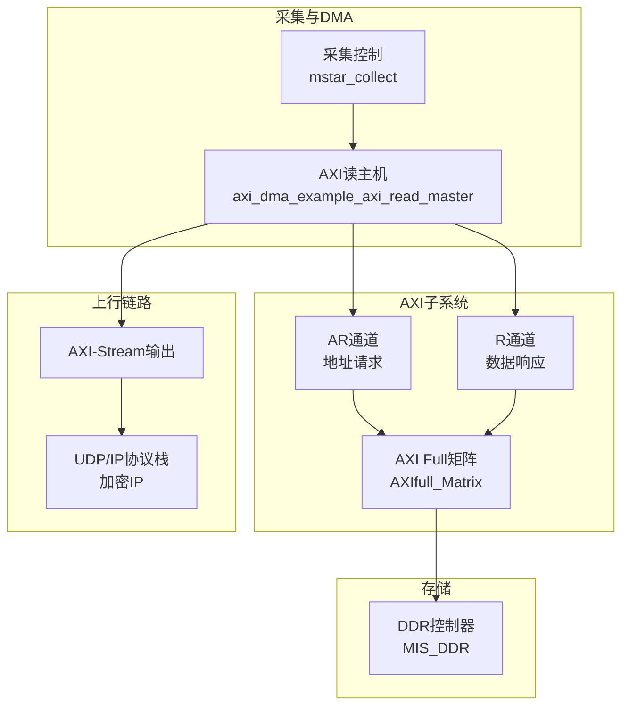
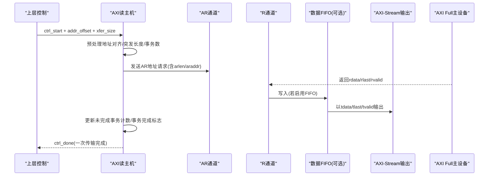
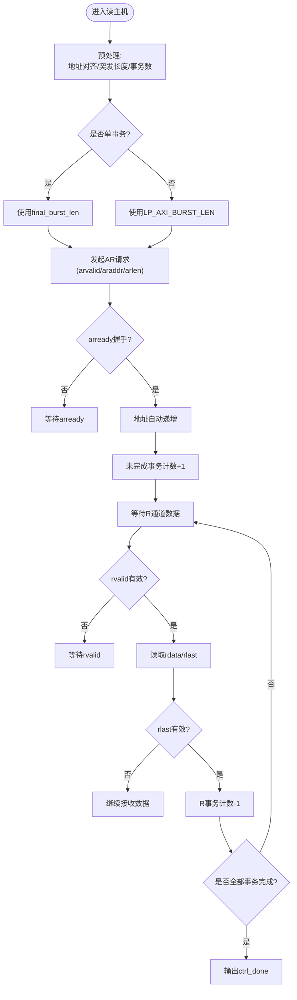
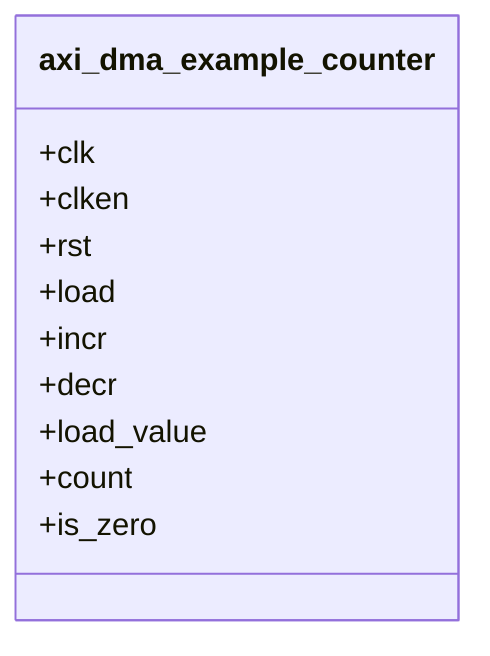
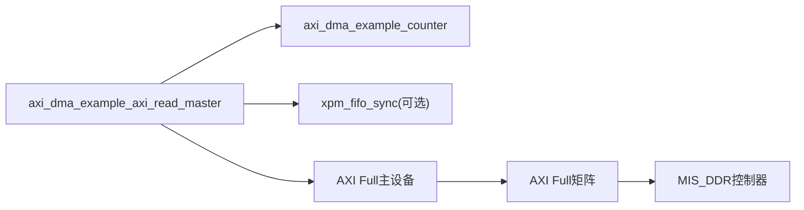

# AXI读主机模块

<cite>
**本文引用的文件**   
- [axi_dma_example_axi_read_master.sv](file://hdl/axi_dma/axi_dma_example_axi_read_master.sv)
- [axi_dma_example_counter.sv](file://hdl/axi_dma/axi_dma_example_counter.sv)
- [README.md](file://README.md)
</cite>

## 目录
1. [简介](#简介)
2. [项目结构](#项目结构)
3. [核心组件](#核心组件)
4. [架构总览](#架构总览)
5. [详细组件分析](#详细组件分析)
6. [依赖关系分析](#依赖关系分析)
7. [性能与优化](#性能与优化)
8. [故障排查指南](#故障排查指南)
9. [结论](#结论)
10. [附录：配置参数与使用示例](#附录配置参数与使用示例)

## 简介
本技术文档围绕AXI读主机模块，系统阐述从DDR读取数据的完整流程，包括地址计算、突发传输、事务管理、AR/R通道实现、状态机设计、未完成事务计数、突发长度计算、地址自动递增等关键技术点。同时提供FIFO缓冲区的配置选项、性能优化技巧与调试方法，帮助读者快速掌握该模块的设计要点与使用方法。

## 项目结构
本项目为多通道AD数据采集的FPGA工程，其中AXI读主机位于hdl/axi_dma目录下，负责通过AXI Full接口从DDR控制器读取数据并输出至AXI-Stream总线，供后续以太网UDP链路消费。

图表来源
- [README.md:23-73](file://README.md#L23-L73)

章节来源
- [README.md:23-73](file://README.md#L23-L73)

## 核心组件
- AXI读主机（axi_dma_example_axi_read_master）：实现AXI Full读主机的AR/R通道逻辑、突发长度与地址自动递增、未完成事务计数、可选数据FIFO缓冲以及AXI-Stream输出。
- 通用计数器（axi_dma_example_counter）：用于事务计数、未完成事务计数、零标志生成等。

章节来源
- [axi_dma_example_axi_read_master.sv:22-79](file://hdl/axi_dma/axi_dma_example_axi_read_master.sv#L22-L79)
- [axi_dma_example_counter.sv:22-36](file://hdl/axi_dma/axi_dma_example_counter.sv#L22-L36)

## 架构总览
AXI读主机在收到外部启动脉冲后，对起始地址和传输字节数进行预处理，计算突发长度与事务数量，随后按AXI协议发起AR地址请求，并在R通道接收数据，必要时通过同步FIFO缓冲后以AXI-Stream格式输出。

图表来源
- [axi_dma_example_axi_read_master.sv:175-202](file://hdl/axi_dma/axi_dma_example_axi_read_master.sv#L175-L202)
- [axi_dma_example_axi_read_master.sv:219-252](file://hdl/axi_dma/axi_dma_example_axi_read_master.sv#L219-L252)
- [axi_dma_example_axi_read_master.sv:297-358](file://hdl/axi_dma/axi_dma_example_axi_read_master.sv#L297-L358)
- [axi_dma_example_axi_read_master.sv:360-382](file://hdl/axi_dma/axi_dma_example_axi_read_master.sv#L360-L382)

## 详细组件分析

### AXI读主机（axi_dma_example_axi_read_master）
- 功能职责
  - 接收ctrl_start、起始地址、传输字节数，进行地址对齐与突发长度计算。
  - 管理AR通道的地址请求，支持自动地址递增与突发长度切换。
  - 处理R通道数据响应，统计事务完成，维护未完成事务计数。
  - 可选插入同步FIFO缓冲，将AXI读数据转换为AXI-Stream输出。
- 关键信号
  - 控制：ctrl_start、ctrl_done、ctrl_addr_offset、ctrl_xfer_size_in_bytes、crtl_fifo_hfull
  - AR通道：m_axi_arvalid/m_axi_arready/m_axi_araddr/m_axi_arlen
  - R通道：m_axi_rvalid/m_axi_rready/m_axi_rdata/m_axi_rlast
  - AXI-Stream：m_axis_tvalid/m_axis_tready/m_axis_tdata/m_axis_tlast
- 内部变量与状态
  - start_d1/start：启动脉冲锁存与状态推进
  - total_len_r/num_transactions/final_burst_len：总长度、事务数、末次突发长度
  - ar_idle/ar_done：AR通道空闲/完成标志
  - outstanding_vacancy_count/stall_ar：未完成事务计数与背压
  - r_final_transaction/rxfer/r_completed：R通道事务完成与数据搬运标志

#### 状态机与时序
- 启动阶段
  - 采样ctrl_start，锁存start_d1，计算total_len_r与地址对齐后的起始地址。
  - 根据LP_AXI_BURST_LEN与数据宽度计算突发长度与事务数。
- AR通道阶段
  - 当ar_idle为低且未stall_ar时，拉高arvalid发起AR请求；arready握手成功后地址自增。
  - 最后一个事务使用final_burst_len，其余使用最大突发长度。
- R通道阶段
  - 每收到rlast且对应事务完成时，递减R通道事务计数器；当所有事务完成，置位done_int并输出ctrl_done。
- 未完成事务计数
  - 每次AR握手成功即占用一个未完成事务槽位；每当R通道完成一个事务释放一个槽位；当槽位满则stall_ar暂停新的AR请求，避免FIFO溢出或总线拥塞。

图表来源
- [axi_dma_example_axi_read_master.sv:175-202](file://hdl/axi_dma/axi_dma_example_axi_read_master.sv#L175-L202)
- [axi_dma_example_axi_read_master.sv:219-252](file://hdl/axi_dma/axi_dma_example_axi_read_master.sv#L219-L252)
- [axi_dma_example_axi_read_master.sv:360-382](file://hdl/axi_dma/axi_dma_example_axi_read_master.sv#L360-L382)

章节来源
- [axi_dma_example_axi_read_master.sv:22-79](file://hdl/axi_dma/axi_dma_example_axi_read_master.sv#L22-L79)
- [axi_dma_example_axi_read_master.sv:100-117](file://hdl/axi_dma/axi_dma_example_axi_read_master.sv#L100-L117)
- [axi_dma_example_axi_read_master.sv:175-202](file://hdl/axi_dma/axi_dma_example_axi_read_master.sv#L175-L202)
- [axi_dma_example_axi_read_master.sv:219-252](file://hdl/axi_dma/axi_dma_example_axi_read_master.sv#L219-L252)
- [axi_dma_example_axi_read_master.sv:274-291](file://hdl/axi_dma/axi_dma_example_axi_read_master.sv#L274-L291)
- [axi_dma_example_axi_read_master.sv:297-358](file://hdl/axi_dma/axi_dma_example_axi_read_master.sv#L297-L358)
- [axi_dma_example_axi_read_master.sv:360-382](file://hdl/axi_dma/axi_dma_example_axi_read_master.sv#L360-L382)

### 通用计数器（axi_dma_example_counter）
- 功能职责
  - 提供可配置的位宽计数器，支持load/incr/decr操作，输出count与is_zero标志。
  - 用于事务计数、未完成事务计数、零检测等场景。
- 关键行为
  - load优先加载load_value；incr与decr互斥；is_zero在计数值为0时置位。

图表来源
- [axi_dma_example_counter.sv:22-36](file://hdl/axi_dma/axi_dma_example_counter.sv#L22-L36)
- [axi_dma_example_counter.sv:59-95](file://hdl/axi_dma/axi_dma_example_counter.sv#L59-L95)

章节来源
- [axi_dma_example_counter.sv:22-36](file://hdl/axi_dma/axi_dma_example_counter.sv#L22-L36)
- [axi_dma_example_counter.sv:59-95](file://hdl/axi_dma/axi_dma_example_counter.sv#L59-L95)

## 依赖关系分析
- AXI读主机依赖通用计数器实现事务计数与未完成事务计数。
- 可选XPM同步FIFO用于解耦AXI读通道与AXI-Stream输出，提升吞吐与稳定性。
- 与DDR控制器通过AXI Full矩阵互联，遵循AXI4协议时序与约束。

图表来源
- [axi_dma_example_axi_read_master.sv:255-291](file://hdl/axi_dma/axi_dma_example_axi_read_master.sv#L255-L291)
- [axi_dma_example_axi_read_master.sv:297-358](file://hdl/axi_dma/axi_dma_example_axi_read_master.sv#L297-L358)
- [README.md:59-69](file://README.md#L59-L69)

章节来源
- [axi_dma_example_axi_read_master.sv:255-291](file://hdl/axi_dma/axi_dma_example_axi_read_master.sv#L255-L291)
- [axi_dma_example_axi_read_master.sv:297-358](file://hdl/axi_dma/axi_dma_example_axi_read_master.sv#L297-L358)
- [README.md:59-69](file://README.md#L59-L69)

## 性能与优化
- 突发长度与数据宽度匹配
  - LP_AXI_BURST_LEN由LP_MAX_BURST_BYTES与数据宽度推导，确保每个事务尽可能满载，减少事务开销。
- 未完成事务计数与背压
  - C_MAX_OUTSTANDING限制并发事务数，结合outstanding_vacancy_count与stall_ar防止FIFO溢出与总线拥塞。
- FIFO深度与模式
  - FIFO深度按LP_AXI_BURST_LEN*C_MAX_OUTSTANDING计算，保证至少容纳N个突发的事务数据；FWFT模式降低延迟。
- 地址对齐与4KB边界
  - 地址按LP_ADDR_MASK对齐，避免非对齐访问导致的协议问题与性能损失。
- 单事务优化
  - single_transaction分支直接采用final_burst_len，减少额外逻辑路径。

章节来源
- [axi_dma_example_axi_read_master.sv:100-117](file://hdl/axi_dma/axi_dma_example_axi_read_master.sv#L100-L117)
- [axi_dma_example_axi_read_master.sv:175-202](file://hdl/axi_dma/axi_dma_example_axi_read_master.sv#L175-L202)
- [axi_dma_example_axi_read_master.sv:274-291](file://hdl/axi_dma/axi_dma_example_axi_read_master.sv#L274-L291)
- [axi_dma_example_axi_read_master.sv:297-358](file://hdl/axi_dma/axi_dma_example_axi_read_master.sv#L297-L358)

## 故障排查指南
- 无数据输出
  - 检查ctrl_start是否被正确采样，start_d1与start状态是否正确推进。
  - 确认AR通道握手：m_axi_arvalid/m_axi_arready是否建立连接。
  - 检查R通道：m_axi_rvalid/m_axi_rready是否握手，rlast是否在最后一个数据周期出现。
- 数据错位或丢失
  - 核对地址对齐与LP_ADDR_MASK设置，确保起始地址满足4KB对齐要求。
  - 检查突发长度与数据宽度匹配，避免部分突发导致的数据截断。
- FIFO溢出或欠载
  - 调整C_MAX_OUTSTANDING与FIFO深度，确保足够缓冲空间。
  - 观察crtl_fifo_hfull与stall_ar，确认背压逻辑是否生效。
- 事务计数异常
  - 验证axi_dma_example_counter的load/increment/decrement信号是否与arxfer/rxfer一致。
  - 检查is_zero标志是否用于事务完成判断。

章节来源
- [axi_dma_example_axi_read_master.sv:175-202](file://hdl/axi_dma/axi_dma_example_axi_read_master.sv#L175-L202)
- [axi_dma_example_axi_read_master.sv:219-252](file://hdl/axi_dma/axi_dma_example_axi_read_master.sv#L219-L252)
- [axi_dma_example_axi_read_master.sv:274-291](file://hdl/axi_dma/axi_dma_example_axi_read_master.sv#L274-L291)
- [axi_dma_example_axi_read_master.sv:297-358](file://hdl/axi_dma/axi_dma_example_axi_read_master.sv#L297-L358)
- [axi_dma_example_axi_read_master.sv:360-382](file://hdl/axi_dma/axi_dma_example_axi_read_master.sv#L360-L382)

## 结论
AXI读主机模块通过严谨的地址对齐、突发长度计算与事务计数机制，实现了高效稳定的DDR读数据流程。AR/R通道严格遵循AXI4协议，配合未完成事务计数与可选FIFO缓冲，既保证了吞吐又提升了鲁棒性。合理配置参数与遵循最佳实践，可在实际工程中取得良好的性能表现。

## 附录：配置参数与使用示例

### 关键参数说明
- C_M_AXI_ADDR_WIDTH：地址位宽，默认64。
- C_M_AXI_DATA_WIDTH：数据位宽，支持32/64/128/256/512/1024，默认128。
- C_XFER_SIZE_WIDTH：传输大小位宽，默认等于地址位宽。
- C_MAX_OUTSTANDING：最大未完成事务数，默认16。
- C_INCLUDE_DATA_FIFO：是否包含数据FIFO，默认1（启用）。

章节来源
- [axi_dma_example_axi_read_master.sv:22-47](file://hdl/axi_dma/axi_dma_example_axi_read_master.sv#L22-L47)

### 典型使用步骤
- 配置起始地址与传输字节数：
  - 设置ctrl_addr_offset与ctrl_xfer_size_in_bytes。
  - 确保起始地址按4KB对齐，避免协议问题。
- 启动传输：
  - 拉高ctrl_start一个时钟周期，模块开始预处理与发起AR请求。
- 监控完成：
  - 观察ctrl_done指示一次传输完成。
- 数据消费：
  - 若启用FIFO，从m_axis_tvalid/m_axis_tready获取数据流；否则直接从R通道消费。

章节来源
- [axi_dma_example_axi_read_master.sv:54-79](file://hdl/axi_dma/axi_dma_example_axi_read_master.sv#L54-L79)
- [axi_dma_example_axi_read_master.sv:175-202](file://hdl/axi_dma/axi_dma_example_axi_read_master.sv#L175-L202)
- [axi_dma_example_axi_read_master.sv:297-358](file://hdl/axi_dma/axi_dma_example_axi_read_master.sv#L297-L358)

### FIFO缓冲区配置选项
- 深度：LP_FIFO_DEPTH = 2^ceil(log2(LP_AXI_BURST_LEN * C_MAX_OUTSTANDING))
- 读写模式：READ_MODE = "fwft"（First Word Fall Through），降低延迟
- 读写位宽：WRITE_DATA_WIDTH/READ_DATA_WIDTH = C_M_AXI_DATA_WIDTH + 1（附加rlast）
- 计数位宽：LP_FIFO_COUNT_WIDTH = ceil(log2(LP_FIFO_DEPTH)) + 1

章节来源
- [axi_dma_example_axi_read_master.sv:113-117](file://hdl/axi_dma/axi_dma_example_axi_read_master.sv#L113-L117)
- [axi_dma_example_axi_read_master.sv:297-358](file://hdl/axi_dma/axi_dma_example_axi_read_master.sv#L297-L358)