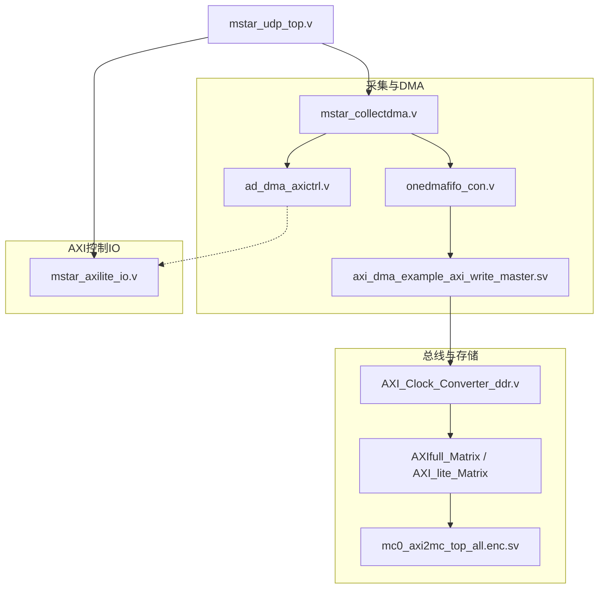
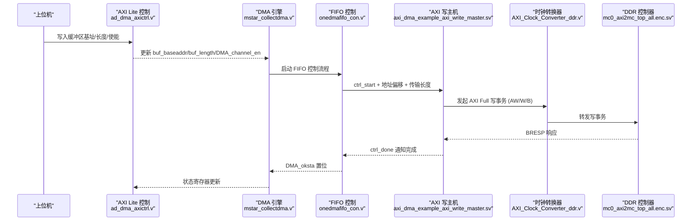
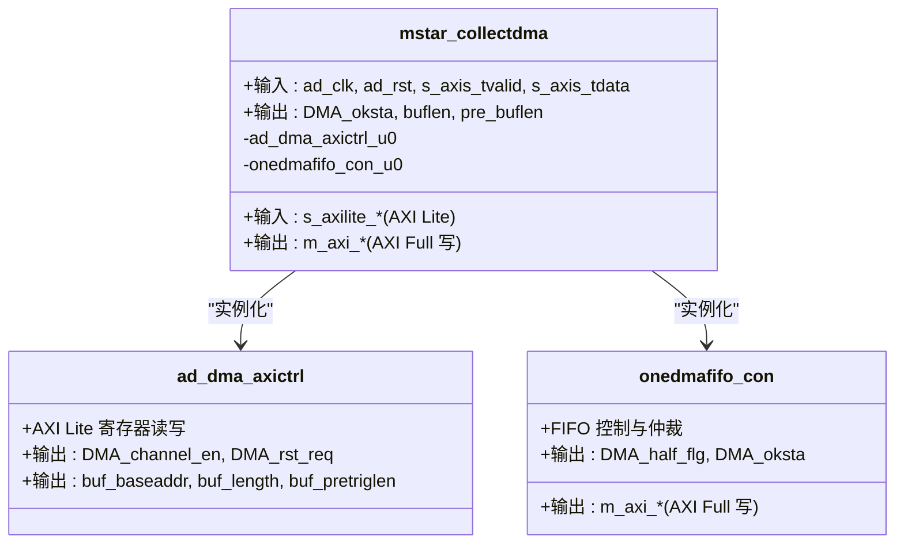
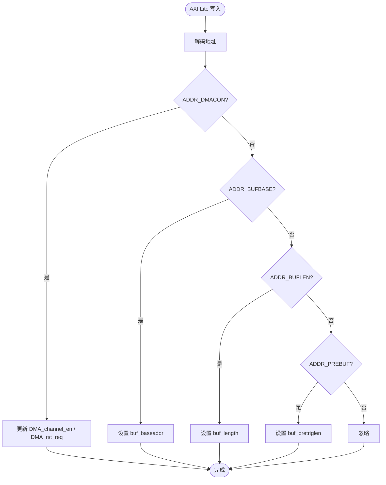
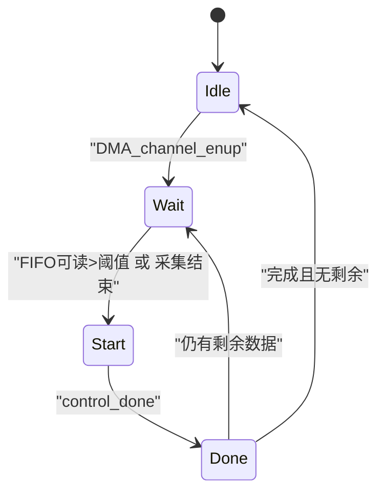
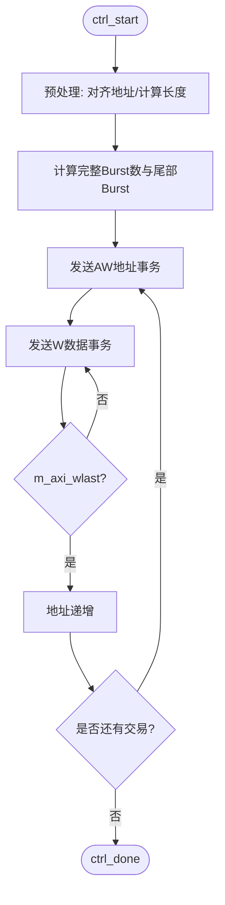
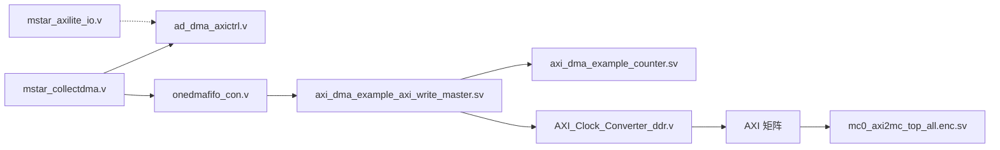

# DMA控制器

<cite>
**本文引用的文件**   
- [README.md](file://README.md)
- [mstar_collectdma.v](file://hdl/collect/mstar_collectdma.v)
- [ad_dma_axictrl.v](file://hdl/collect/ad_dma_axictrl.v)
- [onedmafifo_con.v](file://hdl/collect/onedmafifo_con.v)
- [axi_dma_example_axi_write_master.sv](file://hdl/axi_dma/axi_dma_example_axi_write_master.sv)
- [axi_dma_example_axi_read_master.sv](file://hdl/axi_dma/axi_dma_example_axi_read_master.sv)
- [axi_dma_example_counter.sv](file://hdl/axi_dma/axi_dma_example_counter.sv)
- [mstar_axilite_io.v](file://hdl/axi_io/mstar_axilite_io.v)
- [AXI_Clock_Converter_ddr.v](file://al_ip/AXI_Clock_Converter_ddr/AXI_Clock_Converter_ddr.v)
- [al_axi_clock_converter_AXI_Clock_Converter_ddr.v](file://al_ip/AXI_Clock_Converter_ddr/RTL/al_axi_clock_converter_AXI_Clock_Converter_ddr.v)
- [Design.xml](file://al_ip/AXI_Clock_Converter_ddr/Design.xml)
- [mc0_axi2mc_top_all.enc.sv](file://al_ip/MIS_DDR/src/rtl/axi/mc0_axi2mc_top_all.enc.sv)
- [mstar_udp_top.v](file://hdl/mstar_udp_top.v)
</cite>

## 目录
1. [简介](#简介)
2. [项目结构](#项目结构)
3. [核心组件](#核心组件)
4. [架构总览](#架构总览)
5. [详细组件分析](#详细组件分析)
6. [依赖关系分析](#依赖关系分析)
7. [性能与带宽特性](#性能与带宽特性)
8. [故障排查与调试](#故障排查与调试)
9. [结论](#结论)
10. [附录：寄存器映射与使用示例](#附录寄存器映射与使用示例)

## 简介
本技术文档面向基于 Anlogic PH1 FPGA 的多通道数据采集系统中的 DMA 控制器。该 DMA 控制器负责将 ADC 采集数据通过 AXI Full 总线写入 DDR，同时提供 AXI Lite 控制接口用于配置缓冲区、启动/停止传输、查询状态等。系统还包含触发信号处理、跨时钟域同步、AXI 总线矩阵与时钟域转换等关键模块，以实现高吞吐、低延迟的数据搬运。

## 项目结构
工程采用分层组织方式：
- hdl/collect：采集与 DMA 控制逻辑（DMA 引擎、FIFO 缓冲、AXI 写主机）
- hdl/axi_dma：通用 AXI DMA 读写主机参考实现
- hdl/axi_io：AXI Lite 寄存器 IO 模块
- al_ip：安路 IP 核（DDR 控制器、AXI 全功能矩阵、AXI Lite 矩阵、AXI 时钟转换器、各类 FIFO）
- hdl/mstar_udp_top.v：顶层集成，连接以太网、ADC、DDR、DMA 与控制总线

图表来源
- [mstar_collectdma.v:1-150](file://hdl/collect/mstar_collectdma.v#L1-L150)
- [ad_dma_axictrl.v:1-250](file://hdl/collect/ad_dma_axictrl.v#L1-L250)
- [onedmafifo_con.v:1-341](file://hdl/collect/onedmafifo_con.v#L1-L341)
- [axi_dma_example_axi_write_master.sv:1-444](file://hdl/axi_dma/axi_dma_example_axi_write_master.sv#L1-L444)
- [mstar_axilite_io.v:1-195](file://hdl/axi_io/mstar_axilite_io.v#L1-L195)
- [AXI_Clock_Converter_ddr.v:1-137](file://al_ip/AXI_Clock_Converter_ddr/AXI_Clock_Converter_ddr.v#L1-L137)
- [mc0_axi2mc_top_all.enc.sv:1-37](file://al_ip/MIS_DDR/src/rtl/axi/mc0_axi2mc_top_all.enc.sv#L1-L37)
- [mstar_udp_top.v:479-518](file://hdl/mstar_udp_top.v#L479-L518)

章节来源
- [README.md:1-108](file://README.md#L1-L108)

## 核心组件
- mstar_collectdma.v：采集数据 DMA 引擎，封装 AXI Lite 控制与 AXI Full 写通道，协调 FIFO 与写主机
- ad_dma_axictrl.v：AXI Lite 到 DMA 控制信号的桥接，管理 DMA 使能、复位请求、缓冲区基址/长度/预触发长度等寄存器
- onedmafifo_con.v：单通道 DMA FIFO 控制，完成 AD 侧数据缓存、AXI 写仲裁、Burst 长度计算与半满/完成标志
- axi_dma_example_axi_write_master.sv：AXI Full 写主机，负责地址递增、Burst 拆分、Outstanding 控制、W/B 通道握手
- axi_dma_example_axi_read_master.sv：AXI Full 读主机（参考实现），用于从 DDR 读取数据至 Stream
- mstar_axilite_io.v：通用 AXI Lite 寄存器 IO，提供触发使能、IO 控制等系统级寄存器
- AXI_Clock_Converter_ddr.v：AXI 时钟域转换器，适配不同时钟域间的 AXI 事务
- mc0_axi2mc_top_all.enc.sv：DDR 控制器 AXI 接口封装，作为 AXI Full 目标设备

章节来源
- [mstar_collectdma.v:1-150](file://hdl/collect/mstar_collectdma.v#L1-L150)
- [ad_dma_axictrl.v:1-250](file://hdl/collect/ad_dma_axictrl.v#L1-L250)
- [onedmafifo_con.v:1-341](file://hdl/collect/onedmafifo_con.v#L1-L341)
- [axi_dma_example_axi_write_master.sv:1-444](file://hdl/axi_dma/axi_dma_example_axi_write_master.sv#L1-L444)
- [axi_dma_example_axi_read_master.sv:1-386](file://hdl/axi_dma/axi_dma_example_axi_read_master.sv#L1-L386)
- [mstar_axilite_io.v:1-195](file://hdl/axi_io/mstar_axilite_io.v#L1-L195)
- [AXI_Clock_Converter_ddr.v:1-137](file://al_ip/AXI_Clock_Converter_ddr/AXI_Clock_Converter_ddr.v#L1-L137)
- [mc0_axi2mc_top_all.enc.sv:1-37](file://al_ip/MIS_DDR/src/rtl/axi/mc0_axi2mc_top_all.enc.sv#L1-L37)

## 架构总览
DMA 控制器整体架构如下：
- 采集端（AD 侧）以 AXI-Stream 形式输出数据，经跨时钟域 FIFO 进入 AXI Full 写通道
- ad_dma_axictrl.v 暴露 AXI Lite 寄存器，供上位机配置 DMA 参数并控制启停
- onedmafifo_con.v 根据 FIFO 可读数据量与采集结束标志，调度 AXI 写事务
- axi_dma_example_axi_write_master.sv 实现 AXI Full 写协议，按 Burst 长度与地址对齐进行高效传输
- AXI_Clock_Converter_ddr.v 在 AXI Full 路径上完成时钟域转换，确保与 DDR 控制器时序匹配
- AXI 矩阵（Full/Lite）对多主设备进行地址路由与带宽仲裁

图表来源
- [ad_dma_axictrl.v:57-249](file://hdl/collect/ad_dma_axictrl.v#L57-L249)
- [mstar_collectdma.v:68-149](file://hdl/collect/mstar_collectdma.v#L68-L149)
- [onedmafifo_con.v:114-341](file://hdl/collect/onedmafifo_con.v#L114-L341)
- [axi_dma_example_axi_write_master.sv:157-444](file://hdl/axi_dma/axi_dma_example_axi_write_master.sv#L157-L444)
- [AXI_Clock_Converter_ddr.v:98-137](file://al_ip/AXI_Clock_Converter_ddr/AXI_Clock_Converter_ddr.v#L98-L137)
- [mc0_axi2mc_top_all.enc.sv:8-37](file://al_ip/MIS_DDR/src/rtl/axi/mc0_axi2mc_top_all.enc.sv#L8-L37)

## 详细组件分析

### DMA 引擎（mstar_collectdma.v）
职责：
- 封装 AXI Lite 控制接口与 AXI Full 写通道
- 实例化 ad_dma_axictrl.v 与 onedmafifo_con.v
- 导出 DMA 状态、缓冲区长度、预触发长度等信号

关键点：
- 通过 ad_dma_axictrl.v 获取 buf_baseaddr、buf_length、buf_pretriglen
- 将 s_axis_tdata/s_axis_tvalid 接入 FIFO 控制
- 将 m_axi_* 端口直接连接到 AXI Full 写主机

图表来源
- [mstar_collectdma.v:1-150](file://hdl/collect/mstar_collectdma.v#L1-L150)
- [ad_dma_axictrl.v:1-250](file://hdl/collect/ad_dma_axictrl.v#L1-L250)
- [onedmafifo_con.v:1-341](file://hdl/collect/onedmafifo_con.v#L1-L341)

章节来源
- [mstar_collectdma.v:1-150](file://hdl/collect/mstar_collectdma.v#L1-L150)

### AXI Lite 控制桥（ad_dma_axictrl.v）
职责：
- 实现 AXI Lite 读写 FSM，解析寄存器地址
- 暴露 DMA 控制寄存器：ID、控制字、缓冲区基址、长度、预触发长度
- 生成 DMA_channel_en、DMA_rst_req 等控制信号

寄存器定义（节选）：
- ADDR_ADMA_ID：设备 ID
- ADDR_DMACON：控制字（位[1:0] 为 DMA_rst_req/DMA_channel_en；位[17:16] 为 DMA_half_flg/dma_OK）
- ADDR_BUFBASE：缓冲区基址
- ADDR_BUFLEN：缓冲区长度
- ADDR_PREBUF：预触发长度

图表来源
- [ad_dma_axictrl.v:57-249](file://hdl/collect/ad_dma_axictrl.v#L57-L249)

章节来源
- [ad_dma_axictrl.v:1-250](file://hdl/collect/ad_dma_axictrl.v#L1-L250)

### FIFO 控制与写仲裁（onedmafifo_con.v）
职责：
- 管理 AD 侧数据到 AXI Full 写通道的缓冲与仲裁
- 根据 FIFO 可读数据量与采集结束标志，决定何时发起写事务
- 计算 Burst 长度、地址偏移，并驱动 axi_dma_example_axi_write_master.sv

状态机：
- DMASTA_IDLE：空闲，等待 DMA_channel_enup
- DMASTA_DMAWAIT：等待 FIFO 有足够数据或采集结束
- DMASTA_DMAST：发起写事务，等待 control_done
- DMASTA_DMADO：处理完成，更新计数与半满标志

图表来源
- [onedmafifo_con.v:88-270](file://hdl/collect/onedmafifo_con.v#L88-L270)

章节来源
- [onedmafifo_con.v:1-341](file://hdl/collect/onedmafifo_con.v#L1-L341)

### AXI Full 写主机（axi_dma_example_axi_write_master.sv）
职责：
- 接收 ctrl_start、ctrl_addr_offset、ctrl_xfer_size_in_bytes
- 计算 Burst 长度、地址对齐、Outstanding 数量
- 驱动 AW/W/B 通道，产生 m_axi_wlast、ctrl_done

关键逻辑：
- 最大 Burst 长度限制为 256 beat，按数据宽度换算字节
- 支持部分 Burst（final_burst_len）
- 使用计数器跟踪交易数与 Outstanding 事务

图表来源
- [axi_dma_example_axi_write_master.sv:157-444](file://hdl/axi_dma/axi_dma_example_axi_write_master.sv#L157-L444)

章节来源
- [axi_dma_example_axi_write_master.sv:1-444](file://hdl/axi_dma/axi_dma_example_axi_write_master.sv#L1-L444)

### AXI Full 读主机（axi_dma_example_axi_read_master.sv）
职责：
- 从 DDR 读取数据并通过 AXI-Stream 输出
- 支持可选数据 FIFO 缓冲，控制 Outstanding 数量

注意：当前 DMA 控制器主要使用写主机，读主机作为参考实现存在。

章节来源
- [axi_dma_example_axi_read_master.sv:1-386](file://hdl/axi_dma/axi_dma_example_axi_read_master.sv#L1-L386)

### 通用计数器（axi_dma_example_counter.sv）
职责：
- 可配置的递减/递增计数器，用于 Burst 计数、交易计数、Outstanding 计数

用途：
- 在写主机中用于 w_transactions_to_go、b_transactions_to_go 等
- 在读主机中用于 ar/r 交易计数

章节来源
- [axi_dma_example_counter.sv:1-39](file://hdl/axi_dma/axi_dma_example_counter.sv#L1-L39)

### AXI Lite IO（mstar_axilite_io.v）
职责：
- 提供系统级寄存器：ID、SYSCON（触发使能）、OUT_REG、IN_REG
- 与 DMA 控制桥分离，便于扩展其他系统控制功能

章节来源
- [mstar_axilite_io.v:1-195](file://hdl/axi_io/mstar_axilite_io.v#L1-L195)

### AXI 时钟域转换（AXI_Clock_Converter_ddr.v）
职责：
- 在 us_aclk 与 ds_aclk 之间转换 AXI 事务
- 支持异步时钟模式，内部 FIFO 深度可配

配置要点：
- AXI_ADDR_WIDTH=27，AXI_DATA_WIDTH=128
- US_ACLK_RATIO=1，DS_ACLK_RATIO=8（示例）
- 支持读写通道

章节来源
- [AXI_Clock_Converter_ddr.v:1-137](file://al_ip/AXI_Clock_Converter_ddr/AXI_Clock_Converter_ddr.v#L1-L137)
- [al_axi_clock_converter_AXI_Clock_Converter_ddr.v:1-20](file://al_ip/AXI_Clock_Converter_ddr/RTL/al_axi_clock_converter_AXI_Clock_Converter_ddr.v#L1-L20)
- [Design.xml:1-562](file://al_ip/AXI_Clock_Converter_ddr/Design.xml#L1-L562)

### DDR 控制器接口（mc0_axi2mc_top_all.enc.sv）
职责：
- 封装 AXI 到 DDR Memory Controller 的接口
- 定义 AXI 地址/数据宽度、掩码宽度等参数

章节来源
- [mc0_axi2mc_top_all.enc.sv:1-37](file://al_ip/MIS_DDR/src/rtl/axi/mc0_axi2mc_top_all.enc.sv#L1-L37)

## 依赖关系分析
- mstar_collectdma.v 依赖 ad_dma_axictrl.v 与 onedmafifo_con.v
- onedmafifo_con.v 依赖 axi_dma_example_axi_write_master.sv
- axi_dma_example_axi_write_master.sv 依赖 axi_dma_example_counter.sv
- 所有 AXI Full 路径经过 AXI_Clock_Converter_ddr.v 后进入 AXI 矩阵与 DDR 控制器
- mstar_axilite_io.v 独立于 DMA 控制桥，提供系统级控制

图表来源
- [mstar_collectdma.v:1-150](file://hdl/collect/mstar_collectdma.v#L1-L150)
- [ad_dma_axictrl.v:1-250](file://hdl/collect/ad_dma_axictrl.v#L1-L250)
- [onedmafifo_con.v:1-341](file://hdl/collect/onedmafifo_con.v#L1-L341)
- [axi_dma_example_axi_write_master.sv:1-444](file://hdl/axi_dma/axi_dma_example_axi_write_master.sv#L1-L444)
- [axi_dma_example_counter.sv:1-39](file://hdl/axi_dma/axi_dma_example_counter.sv#L1-L39)
- [AXI_Clock_Converter_ddr.v:1-137](file://al_ip/AXI_Clock_Converter_ddr/AXI_Clock_Converter_ddr.v#L1-L137)
- [mc0_axi2mc_top_all.enc.sv:1-37](file://al_ip/MIS_DDR/src/rtl/axi/mc0_axi2mc_top_all.enc.sv#L1-L37)

章节来源
- [mstar_collectdma.v:1-150](file://hdl/collect/mstar_collectdma.v#L1-L150)
- [ad_dma_axictrl.v:1-250](file://hdl/collect/ad_dma_axictrl.v#L1-L250)
- [onedmafifo_con.v:1-341](file://hdl/collect/onedmafifo_con.v#L1-L341)
- [axi_dma_example_axi_write_master.sv:1-444](file://hdl/axi_dma/axi_dma_example_axi_write_master.sv#L1-L444)
- [axi_dma_example_counter.sv:1-39](file://hdl/axi_dma/axi_dma_example_counter.sv#L1-L39)
- [AXI_Clock_Converter_ddr.v:1-137](file://al_ip/AXI_Clock_Converter_ddr/AXI_Clock_Converter_ddr.v#L1-L137)
- [mc0_axi2mc_top_all.enc.sv:1-37](file://al_ip/MIS_DDR/src/rtl/axi/mc0_axi2mc_top_all.enc.sv#L1-L37)

## 性能与带宽特性
- Burst 长度：默认最大 256 beat，按数据宽度换算字节，避免协议违规
- 地址对齐：起始地址按 Burst 边界对齐，减少碎片化访问
- Outstanding 控制：通过计数器限制未完成的 AW/B 交易数量，防止 FIFO 溢出
- 时钟域转换：AXI_Clock_Converter_ddr.v 内部 FIFO 深度可配，支持异步时钟模式
- 带宽仲裁：AXI 矩阵（Full/Lite）在多主设备间进行地址路由与带宽分配

优化建议：
- 调整 C_MAX_OUTSTANDING 以平衡吞吐与资源占用
- 合理设置 FIFO 深度以避免背压
- 使用较大 Burst 长度提升带宽利用率

[本节为通用指导，不直接分析具体文件]

## 故障排查与调试
常见问题：
- DMA 未启动：检查 ADDR_DMACON 的 DMA_channel_en 位是否正确写入
- 传输未完成：检查 FIFO 是否空、采集结束标志是否有效
- AXI 协议错误：检查地址对齐、Burst 长度、Outstanding 数量
- 时钟域问题：确认 AXI_Clock_Converter_ddr.v 的参数配置与实际时钟频率匹配

调试手段：
- 使用 ChipWatcher 探针观察 AXI 握手信号（代码中有注释掉的探针实例）
- 读取状态寄存器：DMA_oksta、DMA_half_flg、buf_length_ch 等
- 监控 FIFO 可读数据量 fifo_rdwn 与 control_done

章节来源
- [ad_dma_axictrl.v:195-249](file://hdl/collect/ad_dma_axictrl.v#L195-L249)
- [onedmafifo_con.v:114-341](file://hdl/collect/onedmafifo_con.v#L114-L341)
- [axi_dma_example_axi_write_master.sv:157-444](file://hdl/axi_dma/axi_dma_example_axi_write_master.sv#L157-L444)

## 结论
本 DMA 控制器通过模块化设计实现了高效的 ADC 数据采集与 DDR 缓存。其核心优势包括：
- 清晰的 AXI Lite 控制接口与 AXI Full 数据路径分离
- 灵活的 FIFO 缓冲与写仲裁机制
- 完善的 AXI 协议实现与时钟域转换支持
- 可扩展的系统级寄存器 IO

在实际应用中，建议根据系统带宽需求调整 Burst 长度、Outstanding 数量与 FIFO 深度，并结合触发信号与缓冲区管理策略优化整体性能。

[本节为总结性内容，不直接分析具体文件]

## 附录：寄存器映射与使用示例

### DMA 控制寄存器映射（ad_dma_axictrl.v）
- ADDR_ADMA_ID：设备 ID（只读）
- ADDR_DMACON：控制字（位[1:0] 为 DMA_rst_req/DMA_channel_en；位[17:16] 为 DMA_half_flg/dma_OK）
- ADDR_BUFBASE：缓冲区基址（只写）
- ADDR_BUFLEN：缓冲区长度（只写）
- ADDR_PREBUF：预触发长度（只写）

### 使用示例
1. 初始化：
   - 写入 ADDR_BUFBASE 设置缓冲区基址
   - 写入 ADDR_BUFLEN 设置缓冲区长度
   - 写入 ADDR_PREBUF 设置预触发长度
2. 启动传输：
   - 写入 ADDR_DMACON 的 DMA_channel_en 位为 1
3. 查询状态：
   - 读取 ADDR_DMACON 获取 DMA_oksta、DMA_half_flg
4. 停止传输：
   - 写入 ADDR_DMACON 的 DMA_rst_req 位为 1

### 触发信号处理（mstar_axilite_io.v）
- ADDR_SYSCON：位[1:0] 分别为 trigout_en/trigin_en
- 可通过该寄存器启用外部触发输入/输出

章节来源
- [ad_dma_axictrl.v:57-249](file://hdl/collect/ad_dma_axictrl.v#L57-L249)
- [mstar_axilite_io.v:56-195](file://hdl/axi_io/mstar_axilite_io.v#L56-L195)