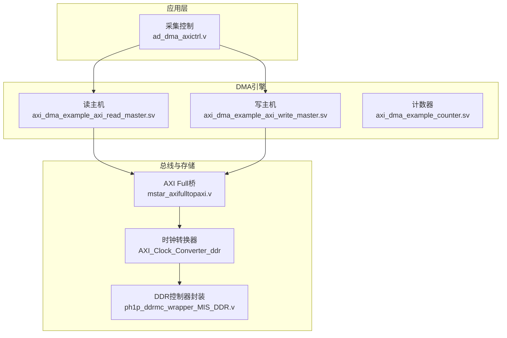
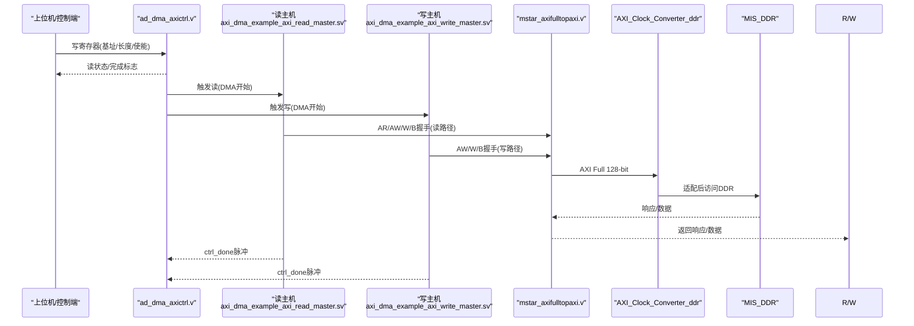
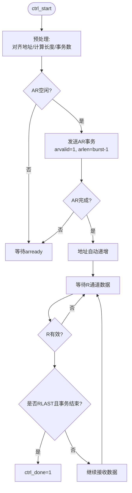
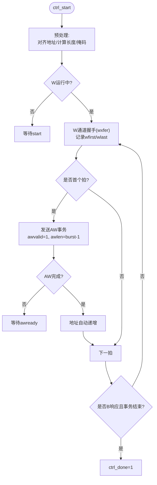
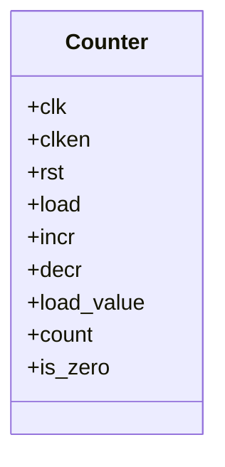
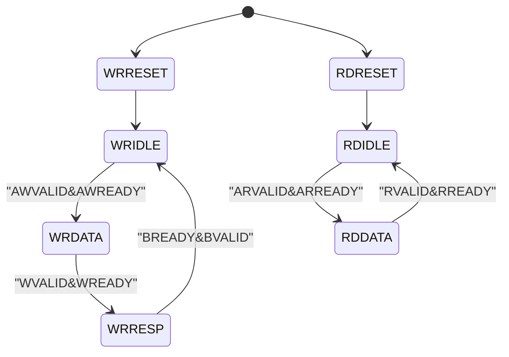
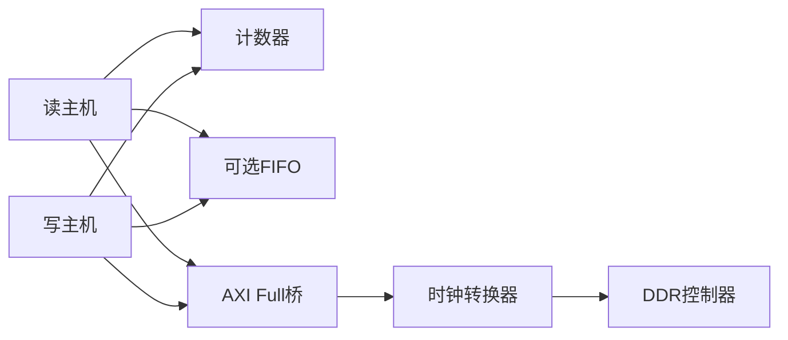
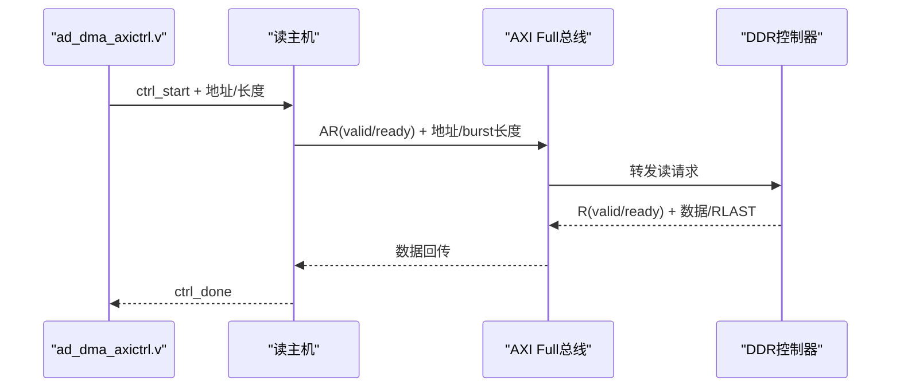
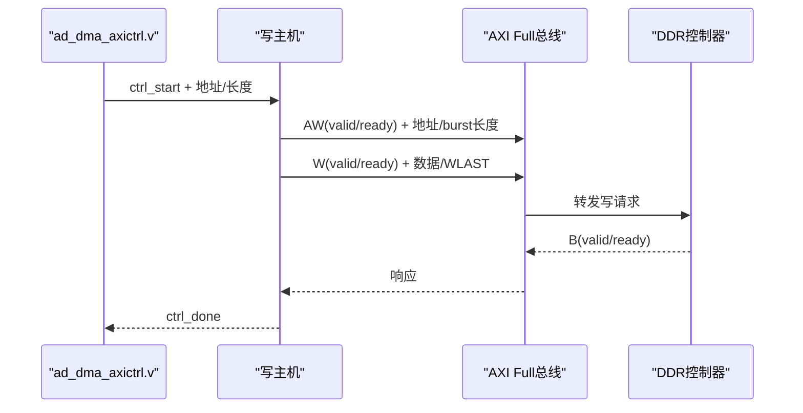

# DMA数据传输引擎

<cite>
**本文引用的文件**   
- [README.md](file://README.md)
- [axi_dma_example_axi_read_master.sv](file://hdl/axi_dma/axi_dma_example_axi_read_master.sv)
- [axi_dma_example_axi_write_master.sv](file://hdl/axi_dma/axi_dma_example_axi_write_master.sv)
- [axi_dma_example_counter.sv](file://hdl/axi_dma/axi_dma_example_counter.sv)
- [ad_dma_axictrl.v](file://hdl/collect/ad_dma_axictrl.v)
- [mstar_axifulltopaxi.v](file://hdl/axi_io/mstar_axifulltopaxi.v)
- [AXI_Clock_Converter_ddr.txt](file://al_ip/AXI_Clock_Converter_ddr/.params_AXI_Clock_Converter_ddr.txt)
- [ph1p_ddrmc_wrapper_MIS_DDR.v](file://al_ip/MIS_DDR/ph1p_ddrmc_wrapper_MIS_DDR.v)
</cite>

## 目录
1. [引言](#引言)
2. [项目结构](#项目结构)
3. [核心组件](#核心组件)
4. [架构总览](#架构总览)
5. [详细组件分析](#详细组件分析)
6. [依赖关系分析](#依赖关系分析)
7. [性能与优化](#性能与优化)
8. [调试与故障排查](#调试与故障排查)
9. [结论](#结论)
10. [附录：配置示例与流程图](#附录配置示例与流程图)

## 引言
本技术文档围绕工程中的DMA数据传输引擎展开，重点解释基于AXI Full的DMA读写主机、状态机与事务处理流程、缓冲区管理、地址自动递增机制，以及与DDR控制器和AXI矩阵的集成方式。文档同时给出配置示例、数据流时序图、性能优化建议与常见问题排查方法，帮助读者快速理解并正确使用该DMA子系统。

## 项目结构
本项目为多通道AD采集FPGA工程，DMA相关逻辑主要位于以下位置：
- hdl/axi_dma：AXI Full读/写主机实现（DMA引擎核心）
- hdl/collect：采集控制与AXI Lite寄存器接口（用于配置DMA参数）
- hdl/axi_io：AXI Full到内部AXI桥接（适配不同位宽与协议）
- al_ip：时钟转换器、DDR控制器封装等IP核

图表来源
- [axi_dma_example_axi_read_master.sv:22-79](file://hdl/axi_dma/axi_dma_example_axi_read_master.sv#L22-L79)
- [axi_dma_example_axi_write_master.sv:22-74](file://hdl/axi_dma/axi_dma_example_axi_write_master.sv#L22-L74)
- [ad_dma_axictrl.v:22-56](file://hdl/collect/ad_dma_axictrl.v#L22-L56)
- [mstar_axifulltopaxi.v:9-32](file://hdl/axi_io/mstar_axifulltopaxi.v#L9-L32)
- [ph1p_ddrmc_wrapper_MIS_DDR.v:105-128](file://al_ip/MIS_DDR/ph1p_ddrmc_wrapper_MIS_DDR.v#L105-L128)

章节来源
- [README.md:23-73](file://README.md#L23-L73)

## 核心组件
- AXI读主机（Read Master）：通过AXI Full AR/R通道从DDR读取数据，支持突发传输、地址自动递增、未完成事务计数、可选数据FIFO缓冲，并将数据以AXI-Stream形式输出。
- AXI写主机（Write Master）：通过AXI Full AW/W/B通道向DDR写入数据，支持突发传输、掩码对齐、未完成事务计数、可选数据FIFO缓冲，并从AXI-Stream输入获取数据。
- 通用计数器（Counter）：用于burst长度与事务计数，提供is_zero标志，驱动状态机与流水线节拍。
- AXI Lite控制接口（ad_dma_axictrl.v）：暴露少量寄存器用于启动/复位DMA、设置缓冲区基址与长度、预触发长度等，供上位机或系统软件配置。

章节来源
- [axi_dma_example_axi_read_master.sv:22-79](file://hdl/axi_dma/axi_dma_example_axi_read_master.sv#L22-L79)
- [axi_dma_example_axi_write_master.sv:22-74](file://hdl/axi_dma/axi_dma_example_axi_write_master.sv#L22-L74)
- [axi_dma_example_counter.sv:22-36](file://hdl/axi_dma/axi_dma_example_counter.sv#L22-L36)
- [ad_dma_axictrl.v:22-56](file://hdl/collect/ad_dma_axictrl.v#L22-L56)

## 架构总览
DMA引擎采用“控制平面 + 数据平面”分离设计：
- 控制平面：通过AXI Lite寄存器配置DMA起始地址、传输长度、通道使能/复位等；采集控制模块根据采集事件触发DMA读写。
- 数据平面：读主机将DDR数据经AXI-Stream输出至下游网络/缓存；写主机从上游AXI-Stream接收数据写入DDR。两者均通过AXI Full总线访问DDR控制器。

图表来源
- [ad_dma_axictrl.v:195-248](file://hdl/collect/ad_dma_axictrl.v#L195-L248)
- [axi_dma_example_axi_read_master.sv:175-252](file://hdl/axi_dma/axi_dma_example_axi_read_master.sv#L175-L252)
- [axi_dma_example_axi_write_master.sv:166-188](file://hdl/axi_dma/axi_dma_example_axi_write_master.sv#L166-L188)
- [mstar_axifulltopaxi.v:9-32](file://hdl/axi_io/mstar_axifulltopaxi.v#L9-L32)
- [AXI_Clock_Converter_ddr.txt:1-24](file://al_ip/AXI_Clock_Converter_ddr/.params_AXI_Clock_Converter_ddr.txt#L1-L24)
- [ph1p_ddrmc_wrapper_MIS_DDR.v:105-128](file://al_ip/MIS_DDR/ph1p_ddrmc_wrapper_MIS_DDR.v#L105-L128)

## 详细组件分析

### AXI读主机（Read Master）
- 功能要点
  - 支持可配置的C_M_AXI_DATA_WIDTH（默认128bit），按最大突发长度（LP_AXI_BURST_LEN）组织事务。
  - 地址自动递增：每次AR事务完成后，地址增加一个完整burst字节数。
  - 未完成事务计数：限制并发AR事务数量，避免下游FIFO溢出。
  - 可选数据FIFO：在AXI R通道与AXI-Stream之间插入同步FIFO，提升吞吐与隔离。
  - 完成信号：当最后一个beat的RLAST与事务计数归零时，拉高ctrl_done。

- 关键状态与流程
  - 初始化：采样ctrl_start，计算total_len_r、addr_offset_r、num_transactions、final_burst_len。
  - AR通道：arvalid/arready握手，arlen设置为LP_AXI_BURST_LEN-1或最终burst长度。
  - R通道：rxfer统计，结合RLAST与事务计数判断事务完成。
  - 完成判定：done_int = rxfer & m_axi_rlast & r_final_transaction，随后置位ctrl_done。

图表来源
- [axi_dma_example_axi_read_master.sv:175-252](file://hdl/axi_dma/axi_dma_example_axi_read_master.sv#L175-L252)
- [axi_dma_example_axi_read_master.sv:255-291](file://hdl/axi_dma/axi_dma_example_axi_read_master.sv#L255-L291)
- [axi_dma_example_axi_read_master.sv:360-382](file://hdl/axi_dma/axi_dma_example_axi_read_master.sv#L360-L382)

章节来源
- [axi_dma_example_axi_read_master.sv:22-79](file://hdl/axi_dma/axi_dma_example_axi_read_master.sv#L22-L79)
- [axi_dma_example_axi_read_master.sv:175-252](file://hdl/axi_dma/axi_dma_example_axi_read_master.sv#L175-L252)
- [axi_dma_example_axi_read_master.sv:297-358](file://hdl/axi_dma/axi_dma_example_axi_read_master.sv#L297-L358)
- [axi_dma_example_axi_read_master.sv:360-382](file://hdl/axi_dma/axi_dma_example_axi_read_master.sv#L360-L382)

### AXI写主机（Write Master）
- 功能要点
  - 支持可配置的C_M_AXI_DATA_WIDTH（默认32bit），按最大突发长度组织事务。
  - 地址自动递增：AW事务完成后，地址增加一个完整burst字节数。
  - 掩码对齐：对最后一个burst使用final_strb进行字节掩码，确保尾部数据正确写入。
  - 未完成事务计数：分别跟踪AW→B与W→AW的并发度，防止FIFO溢出与协议违规。
  - 可选数据FIFO：在AXI-Stream与AXI W通道之间插入同步FIFO，平滑数据流。

- 关键状态与流程
  - 初始化：采样ctrl_start，计算total_len_r、addr_offset_r、byte_remainder_r、num_transactions、final_burst_len。
  - W通道：wxfer统计，wfirst标记burst首拍，w_almost_final_transaction用于准备最后一个burst的长度。
  - AW通道：awvalid/awready握手，awlen设置为LP_AXI_BURST_LEN-1或最终burst长度。
  - B通道：bxfer统计，当最后一个B事务到达时置位ctrl_done。

图表来源
- [axi_dma_example_axi_write_master.sv:166-188](file://hdl/axi_dma/axi_dma_example_axi_write_master.sv#L166-L188)
- [axi_dma_example_axi_write_master.sv:206-267](file://hdl/axi_dma/axi_dma_example_axi_write_master.sv#L206-L267)
- [axi_dma_example_axi_write_master.sv:290-327](file://hdl/axi_dma/axi_dma_example_axi_write_master.sv#L290-L327)
- [axi_dma_example_axi_write_master.sv:336-397](file://hdl/axi_dma/axi_dma_example_axi_write_master.sv#L336-L397)
- [axi_dma_example_axi_write_master.sv:402-438](file://hdl/axi_dma/axi_dma_example_axi_write_master.sv#L402-L438)

章节来源
- [axi_dma_example_axi_write_master.sv:22-74](file://hdl/axi_dma/axi_dma_example_axi_write_master.sv#L22-L74)
- [axi_dma_example_axi_write_master.sv:166-188](file://hdl/axi_dma/axi_dma_example_axi_write_master.sv#L166-L188)
- [axi_dma_example_axi_write_master.sv:206-267](file://hdl/axi_dma/axi_dma_example_axi_write_master.sv#L206-L267)
- [axi_dma_example_axi_write_master.sv:290-327](file://hdl/axi_dma/axi_dma_example_axi_write_master.sv#L290-L327)
- [axi_dma_example_axi_write_master.sv:336-397](file://hdl/axi_dma/axi_dma_example_axi_write_master.sv#L336-L397)
- [axi_dma_example_axi_write_master.sv:402-438](file://hdl/axi_dma/axi_dma_example_axi_write_master.sv#L402-L438)

### 通用计数器（Counter）
- 功能要点
  - 支持load/increment/decrement操作，提供is_zero标志，用于burst长度与事务计数。
  - 在DMA引擎中被多次实例化，分别用于AR/R事务计数、AW/B事务计数、W→AW并发计数等。

图表来源
- [axi_dma_example_counter.sv:22-36](file://hdl/axi_dma/axi_dma_example_counter.sv#L22-L36)
- [axi_dma_example_counter.sv:59-95](file://hdl/axi_dma/axi_dma_example_counter.sv#L59-L95)

章节来源
- [axi_dma_example_counter.sv:22-36](file://hdl/axi_dma/axi_dma_example_counter.sv#L22-L36)
- [axi_dma_example_counter.sv:59-95](file://hdl/axi_dma/axi_dma_example_counter.sv#L59-L95)

### AXI Lite控制接口（ad_dma_axictrl.v）
- 功能要点
  - 暴露寄存器：设备ID、DMA控制字、缓冲区基址、缓冲区长度、预触发长度。
  - 状态机：分别实现写FSM（WRIDLE/WRDATA/WRRESP/WRRESET）与读FSM（RDIDLE/RDDATA/RDRESET）。
  - 控制信号：DMA_channel_en、DMA_rst_req、dma_OK同步、DMA_half_flg等。

图表来源
- [ad_dma_axictrl.v:74-99](file://hdl/collect/ad_dma_axictrl.v#L74-L99)
- [ad_dma_axictrl.v:124-152](file://hdl/collect/ad_dma_axictrl.v#L124-L152)
- [ad_dma_axictrl.v:162-192](file://hdl/collect/ad_dma_axictrl.v#L162-L192)

章节来源
- [ad_dma_axictrl.v:22-56](file://hdl/collect/ad_dma_axictrl.v#L22-L56)
- [ad_dma_axictrl.v:74-99](file://hdl/collect/ad_dma_axictrl.v#L74-L99)
- [ad_dma_axictrl.v:124-152](file://hdl/collect/ad_dma_axictrl.v#L124-L152)
- [ad_dma_axictrl.v:162-192](file://hdl/collect/ad_dma_axictrl.v#L162-L192)
- [ad_dma_axictrl.v:195-248](file://hdl/collect/ad_dma_axictrl.v#L195-L248)

## 依赖关系分析
- 读主机依赖：
  - axi_dma_example_counter：用于AR/R事务计数与未完成事务计数。
  - xpm_fifo_sync（可选）：用于R通道与AXI-Stream之间的数据缓冲。
- 写主机依赖：
  - axi_dma_example_counter：用于AW/W/B事务计数与并发控制。
  - xpm_fifo_sync（可选）：用于AXI-Stream与W通道之间的数据缓冲。
- 总线与存储：
  - mstar_axifulltopaxi.v：AXI Full到内部AXI桥接，适配位宽与协议。
  - AXI_Clock_Converter_ddr：跨时钟域转换，配置为AXI4、128bit数据宽度。
  - ph1p_ddrmc_wrapper_MIS_DDR.v：DDR控制器封装，提供标准AXI Full接口。

图表来源
- [axi_dma_example_axi_read_master.sv:297-358](file://hdl/axi_dma/axi_dma_example_axi_read_master.sv#L297-L358)
- [axi_dma_example_axi_write_master.sv:206-267](file://hdl/axi_dma/axi_dma_example_axi_write_master.sv#L206-L267)
- [mstar_axifulltopaxi.v:9-32](file://hdl/axi_io/mstar_axifulltopaxi.v#L9-L32)
- [AXI_Clock_Converter_ddr.txt:1-24](file://al_ip/AXI_Clock_Converter_ddr/.params_AXI_Clock_Converter_ddr.txt#L1-L24)
- [ph1p_ddrmc_wrapper_MIS_DDR.v:105-128](file://al_ip/MIS_DDR/ph1p_ddrmc_wrapper_MIS_DDR.v#L105-L128)

章节来源
- [axi_dma_example_axi_read_master.sv:297-358](file://hdl/axi_dma/axi_dma_example_axi_read_master.sv#L297-L358)
- [axi_dma_example_axi_write_master.sv:206-267](file://hdl/axi_dma/axi_dma_example_axi_write_master.sv#L206-L267)
- [mstar_axifulltopaxi.v:9-32](file://hdl/axi_io/mstar_axifulltopaxi.v#L9-L32)
- [AXI_Clock_Converter_ddr.txt:1-24](file://al_ip/AXI_Clock_Converter_ddr/.params_AXI_Clock_Converter_ddr.txt#L1-L24)
- [ph1p_ddrmc_wrapper_MIS_DDR.v:105-128](file://al_ip/MIS_DDR/ph1p_ddrmc_wrapper_MIS_DDR.v#L105-L128)

## 性能与优化
- 突发传输（Burst）
  - 读/写主机均按LP_AXI_BURST_LEN组织事务，减少AR/AW开销，提高带宽利用率。
  - 最后一个burst可能为部分长度，需正确设置arlen/awlen与掩码。
- 流水线处理
  - 读主机：AR与R通道并行流水，结合未完成事务计数保持高吞吐。
  - 写主机：AW与W通道并行流水，B通道异步完成，整体流水线效率高。
- 数据FIFO
  - 启用xpm_fifo_sync可缓解上下游速率不匹配，降低背压风险。
  - FIFO深度与C_MAX_OUTSTANDING共同决定最大并发与延迟。
- 地址对齐
  - 起始地址按burst长度对齐，避免协议错误与性能下降。
- 时钟与位宽
  - AXI_Clock_Converter_ddr配置为AXI4、128bit数据宽度，确保与DDR控制器匹配。

[本节为通用指导，无需具体文件引用]

## 调试与故障排查
- 常见现象与定位
  - ctrl_done未拉高：检查事务计数是否正确递减、RLAST/BLAST是否到达、是否被stall_ar/stall_aw阻塞。
  - 数据错位或丢失：确认起始地址对齐、掩码final_strb是否正确、FIFO是否溢出/下溢。
  - 总线死锁：检查AR/ARready、AW/ARready、W/Wready、B/Bready握手是否满足AXI协议。
- 调试手段
  - 观察计数器值：ar_transactions_to_go、w_transactions_to_go、b_transactions_to_go等。
  - 监控未完成事务计数：outstanding_vacancy_count，判断是否达到C_MAX_OUTSTANDING导致stall。
  - 使用ChipWatcher或ILA抓取AXI握手信号，验证valid/ready时序。
- 参考实现
  - ad_dma_axictrl.v的状态机与寄存器读写可用于验证控制通路。
  - mstar_axifulltopaxi.v的桥接逻辑可用于验证AXI Full到内部AXI的适配。

章节来源
- [axi_dma_example_axi_read_master.sv:274-291](file://hdl/axi_dma/axi_dma_example_axi_read_master.sv#L274-L291)
- [axi_dma_example_axi_write_master.sv:421-438](file://hdl/axi_dma/axi_dma_example_axi_write_master.sv#L421-L438)
- [ad_dma_axictrl.v:124-152](file://hdl/collect/ad_dma_axictrl.v#L124-L152)
- [ad_dma_axictrl.v:162-192](file://hdl/collect/ad_dma_axictrl.v#L162-L192)

## 结论
本DMA引擎通过AXI Full总线高效访问DDR，采用突发传输、流水线处理与可选FIFO缓冲，实现了高吞吐、低延迟的数据搬运。读/写主机各自独立处理AR/R与AW/W/B通道，配合通用计数器完成事务管理与并发控制。上层通过AXI Lite寄存器配置DMA参数，便于系统集成与扩展。建议在工程中合理设置C_MAX_OUTSTANDING、FIFO深度与burst长度，以获得最佳性能。

[本节为总结性内容，无需具体文件引用]

## 附录：配置示例与流程图

### DMA配置示例（寄存器映射）
- 设备ID寄存器：ADDR_ADMA_ID
- DMA控制寄存器：ADDR_DMACON（包含DMA_channel_en、DMA_rst_req等）
- 缓冲区基址寄存器：ADDR_BUFBASE
- 缓冲区长度寄存器：ADDR_BUFLEN
- 预触发长度寄存器：ADDR_PREBUF

章节来源
- [ad_dma_axictrl.v:57-61](file://hdl/collect/ad_dma_axictrl.v#L57-L61)
- [ad_dma_axictrl.v:195-248](file://hdl/collect/ad_dma_axictrl.v#L195-L248)

### 数据传输流程图（读路径）

图表来源
- [axi_dma_example_axi_read_master.sv:175-252](file://hdl/axi_dma/axi_dma_example_axi_read_master.sv#L175-L252)
- [ph1p_ddrmc_wrapper_MIS_DDR.v:105-128](file://al_ip/MIS_DDR/ph1p_ddrmc_wrapper_MIS_DDR.v#L105-L128)

### 数据传输流程图（写路径）

图表来源
- [axi_dma_example_axi_write_master.sv:166-188](file://hdl/axi_dma/axi_dma_example_axi_write_master.sv#L166-L188)
- [ph1p_ddrmc_wrapper_MIS_DDR.v:105-128](file://al_ip/MIS_DDR/ph1p_ddrmc_wrapper_MIS_DDR.v#L105-L128)