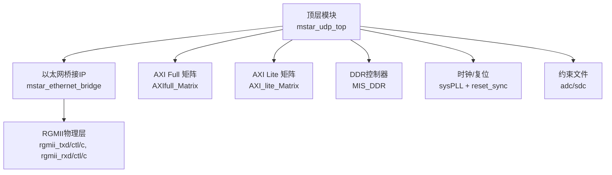
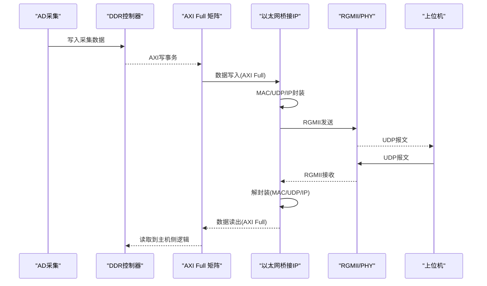
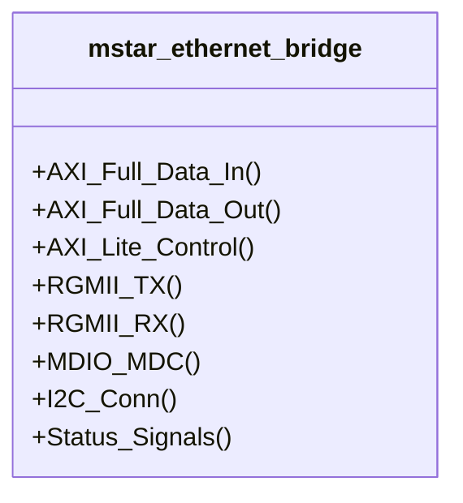
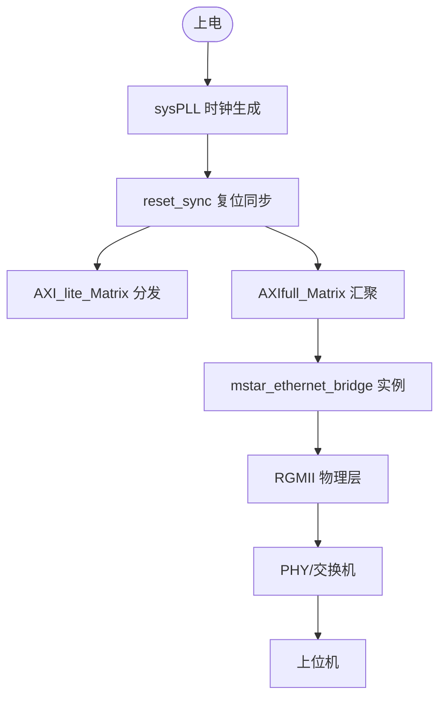
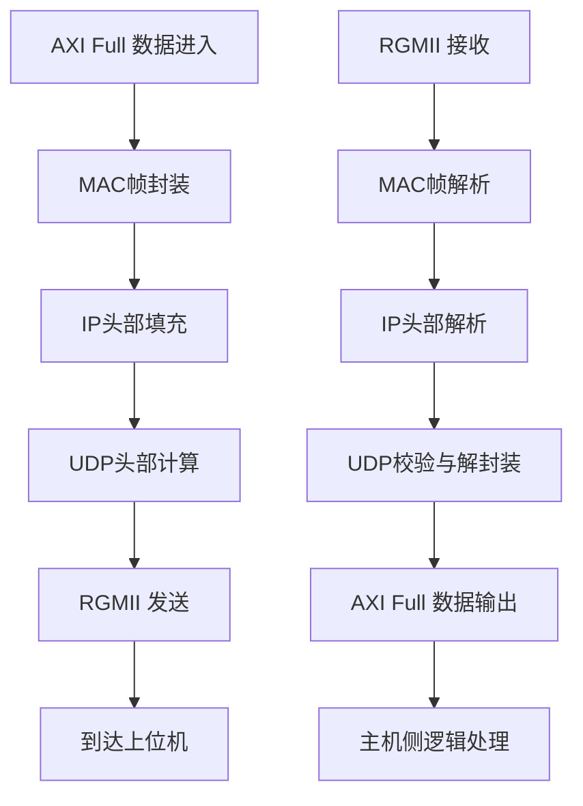
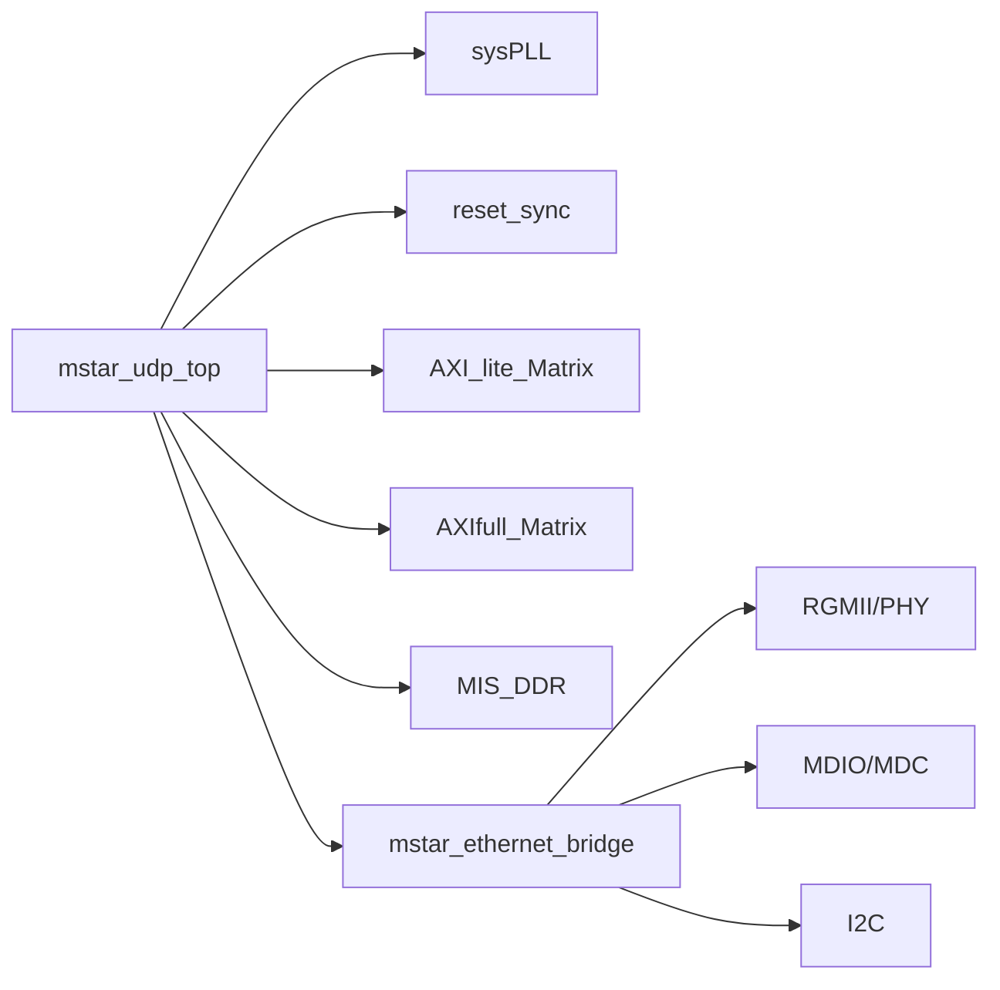

# UDP/IP网络通信

<cite>
**本文引用的文件**   
- [README.md](file://README.md)
- [mstar_udp_top.v](file://hdl/mstar_udp_top.v)
- [mstar_ethernet_bridge.ipr.v](file://hdl/udpip/mstar_ethernet_bridge.ipr.v)
- [mstar_udp_adc.adc](file://hdl/constraint/mstar_udp_adc.adc)
- [mstar_udp_sdc.sdc](file://hdl/constraint/mstar_udp_sdc.sdc)
</cite>

## 目录
1. [简介](#简介)
2. [项目结构](#项目结构)
3. [核心组件](#核心组件)
4. [架构总览](#架构总览)
5. [详细组件分析](#详细组件分析)
6. [依赖关系分析](#依赖关系分析)
7. [性能与可靠性](#性能与可靠性)
8. [配置与调试](#配置与调试)
9. [结论](#结论)

## 简介
本技术文档面向UDP/IP网络通信子系统，重点说明加密IP核 mstar_ethernet_bridge 的功能、接口与集成方法。该IP实现以太网桥接功能（含MAC层、UDP/IP协议栈、AXI总线接口等），通过RGMII物理层接口与上位机进行UDP数据通信。由于IP为加密形式，本文聚焦于外部接口定义、数据流路径、封装/解包流程、配置与调试方法，以及性能优化与可靠性保障建议。

## 项目结构
工程采用分层组织：顶层模块集成AD采集、DDR缓存、AXI互联矩阵与以太网桥接IP；约束文件定义引脚与时序；加密IP以网表形式提供，仅暴露对外端口。

图示来源
- [mstar_udp_top.v:371-406](file://hdl/mstar_udp_top.v#L371-L406)
- [mstar_udp_top.v:591-675](file://hdl/mstar_udp_top.v#L591-L675)
- [mstar_udp_top.v:676-762](file://hdl/mstar_udp_top.v#L676-L762)
- [mstar_udp_top.v:763-800](file://hdl/mstar_udp_top.v#L763-L800)
- [mstar_udp_top.v:415-483](file://hdl/mstar_udp_top.v#L415-L483)

章节来源
- [README.md:23-73](file://README.md#L23-L73)
- [mstar_udp_top.v:1-92](file://hdl/mstar_udp_top.v#L1-L92)

## 核心组件
- 以太网桥接IP（加密）：mstar_ethernet_bridge
  - 提供AXI Full数据通道与AXI Lite控制通道
  - 内部包含MAC层、UDP/IP协议栈
  - 通过RGMII与PHY交互
- 顶层模块：mstar_udp_top
  - 负责时钟/复位生成、AXI矩阵互联、DDR控制器接入
  - 实例化以太网桥接IP并连接RGMII与AXI总线
- 约束文件：引脚与时序约束
  - RGMII引脚分配、MDIO/MDC、LED/状态指示
  - 多时钟域时序约束（125MHz/100MHz/50MHz）

章节来源
- [README.md:87-90](file://README.md#L87-L90)
- [mstar_udp_top.v:591-675](file://hdl/mstar_udp_top.v#L591-L675)
- [mstar_udp_adc.adc:1-37](file://hdl/constraint/mstar_udp_adc.adc#L1-L37)
- [mstar_udp_sdc.sdc:1-16](file://hdl/constraint/mstar_udp_sdc.sdc#L1-L16)

## 架构总览
系统数据流从AD采集经DDR缓存，由AXI Full写入以太网桥接IP，IP完成UDP/IP封装后通过RGMII发送至上位机；反向路径则从RGMII接收数据，解封装后经AXI Full输出至主机侧逻辑。

图示来源
- [mstar_udp_top.v:415-483](file://hdl/mstar_udp_top.v#L415-L483)
- [mstar_udp_top.v:763-800](file://hdl/mstar_udp_top.v#L763-L800)
- [mstar_udp_top.v:591-675](file://hdl/mstar_udp_top.v#L591-L675)

## 详细组件分析

### 以太网桥接IP（mstar_ethernet_bridge）
- 接口类型
  - AXI Full数据接口：用于高吞吐数据读写（128位数据宽度）
  - AXI Lite控制接口：用于寄存器配置与状态查询
  - RGMII物理接口：rgmii_txd[3:0]/tx_ctl/txc、rgmii_rxd[3:0]/rx_ctl/rxc
  - MDIO/MDC：PHY管理接口
  - I2C：con_scl/con_sda、user_scl/user_sda
  - 状态信号：speed_status_1g、speed_status_100M、link_error、cryptopp_wdten
- 功能概述
  - 内部实现MAC层与UDP/IP协议栈
  - 将AXI Full数据流封装为以太网帧+UDP报文，或反之解封装
  - 提供链路状态与速率指示，便于上层监控

图示来源
- [mstar_ethernet_bridge.ipr.v:5-138](file://hdl/udpip/mstar_ethernet_bridge.ipr.v#L5-L138)

章节来源
- [mstar_ethernet_bridge.ipr.v:5-138](file://hdl/udpip/mstar_ethernet_bridge.ipr.v#L5-L138)

### 顶层模块（mstar_udp_top）
- 时钟与复位
  - sysPLL产生125MHz/100MHz/50MHz时钟
  - reset_sync对多时钟域复位同步
- AXI互联
  - AXI_lite_Matrix将AXI Lite总线分发给多个从设备
  - AXIfull_Matrix汇聚AXI Full数据通路至以太网桥接IP
- DDR控制器
  - MIS_DDR通过AXI Clock Converter接入不同时钟域
- 以太网桥接IP实例化
  - 连接RGMII、MDIO/MDC、I2C与AXI总线

图示来源
- [mstar_udp_top.v:371-406](file://hdl/mstar_udp_top.v#L371-L406)
- [mstar_udp_top.v:676-762](file://hdl/mstar_udp_top.v#L676-L762)
- [mstar_udp_top.v:763-800](file://hdl/mstar_udp_top.v#L763-L800)
- [mstar_udp_top.v:591-675](file://hdl/mstar_udp_top.v#L591-L675)

章节来源
- [mstar_udp_top.v:371-406](file://hdl/mstar_udp_top.v#L371-L406)
- [mstar_udp_top.v:676-762](file://hdl/mstar_udp_top.v#L676-L762)
- [mstar_udp_top.v:763-800](file://hdl/mstar_udp_top.v#L763-L800)
- [mstar_udp_top.v:591-675](file://hdl/mstar_udp_top.v#L591-L675)

### 数据包封装与解包流程
- 上行方向（FPGA→上位机）
  - 输入：AXI Full数据流（来自DDR/采集逻辑）
  - 处理：MAC帧头添加、IP头部填充、UDP头部计算校验和
  - 输出：RGMII串行帧流
- 下行方向（上位机→FPGA）
  - 输入：RGMII串行帧流
  - 处理：MAC帧解析、IP/UDP校验与解封装
  - 输出：AXI Full数据流（供主机侧逻辑使用）

图示来源
- [mstar_ethernet_bridge.ipr.v:5-138](file://hdl/udpip/mstar_ethernet_bridge.ipr.v#L5-L138)

章节来源
- [README.md:87-90](file://README.md#L87-L90)

### 与上位机的通信协议与数据格式
- 传输层：UDP
- 网络层：IPv4（具体地址/端口由IP内配置决定）
- 数据载荷：采集数据帧（由上层应用定义）
- 注意：由于IP为加密形式，具体寄存器映射与默认IP/端口不在源码中可见，需通过AXI Lite访问内部寄存器进行配置与调试。

章节来源
- [README.md:87-90](file://README.md#L87-L90)

## 依赖关系分析
- 顶层模块依赖
  - sysPLL：提供多频时钟
  - reset_sync：跨时钟域复位同步
  - AXI_lite_Matrix：AXI Lite总线路由
  - AXIfull_Matrix：AXI Full数据路由
  - MIS_DDR：DDR控制器
  - mstar_ethernet_bridge：以太网桥接IP
- 外部依赖
  - RGMII/PHY：物理层收发
  - MDIO/MDC：PHY配置与管理
  - I2C：外设配置（如EEPROM等）

图示来源
- [mstar_udp_top.v:371-406](file://hdl/mstar_udp_top.v#L371-L406)
- [mstar_udp_top.v:591-675](file://hdl/mstar_udp_top.v#L591-L675)
- [mstar_udp_top.v:676-762](file://hdl/mstar_udp_top.v#L676-L762)
- [mstar_udp_top.v:763-800](file://hdl/mstar_udp_top.v#L763-L800)

章节来源
- [mstar_udp_top.v:371-406](file://hdl/mstar_udp_top.v#L371-L406)
- [mstar_udp_top.v:591-675](file://hdl/mstar_udp_top.v#L591-L675)
- [mstar_udp_top.v:676-762](file://hdl/mstar_udp_top.v#L676-L762)
- [mstar_udp_top.v:763-800](file://hdl/mstar_udp_top.v#L763-L800)

## 性能与可靠性
- 性能优化
  - 使用AXI Full（128位）提高带宽利用率
  - 合理设置AXI Burst长度与地址对齐，减少事务开销
  - 利用DDR作为缓冲，平滑AD采样峰值流量
  - 调整UDP报文大小，平衡延迟与吞吐
- 可靠性保证
  - 链路状态检测：speed_status_1g、speed_status_100M、link_error
  - 看门狗/心跳：cryptopp_wdten可用于指示IP运行状态
  - 复位同步：确保多时钟域稳定复位
  - 校验机制：IP内部实现UDP/IP校验，确保数据完整性

章节来源
- [mstar_udp_top.v:351-370](file://hdl/mstar_udp_top.v#L351-L370)
- [mstar_udp_top.v:591-675](file://hdl/mstar_udp_top.v#L591-L675)

## 配置与调试
- 引脚与时序约束
  - RGMII引脚：rgmii_txd[3:0]、rgmii_tx_ctl、rgmii_txc、rgmii_rxd[3:0]、rgmii_rx_ctl、rgmii_rxc
  - MDIO/MDC：mdio、mdc
  - LED/状态：led、speed_status_1g、speed_status_100M、link_error
  - 时钟约束：clk_50m、rgmii_rxc（125MHz）
- 调试方法
  - 观察LED与状态引脚判断链路速度与连通性
  - 通过AXI Lite访问IP内部寄存器，查看统计信息（丢包、错误计数等）
  - 使用抓包工具在上位机侧捕获UDP报文，验证封装/解封装正确性
  - 结合cryptopp_wdten与link_error进行故障定位

章节来源
- [mstar_udp_adc.adc:1-37](file://hdl/constraint/mstar_udp_adc.adc#L1-L37)
- [mstar_udp_sdc.sdc:1-16](file://hdl/constraint/mstar_udp_sdc.sdc#L1-L16)
- [mstar_udp_top.v:351-370](file://hdl/mstar_udp_top.v#L351-L370)

## 结论
本工程的UDP/IP网络通信子系统以加密IP为核心，通过AXI Full与AXI Lite分别承载数据与控制面，配合RGMII物理层实现高效可靠的以太网通信。在IP源码不可见的情况下，本文基于顶层模块与约束文件梳理了接口定义、数据流路径与配置调试要点，并为性能优化与可靠性保障提供了实践建议。实际集成时，应重点关注AXI总线时序、RGMII引脚约束与链路状态监控，以确保系统稳定运行。