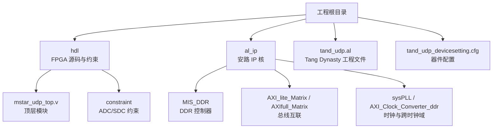
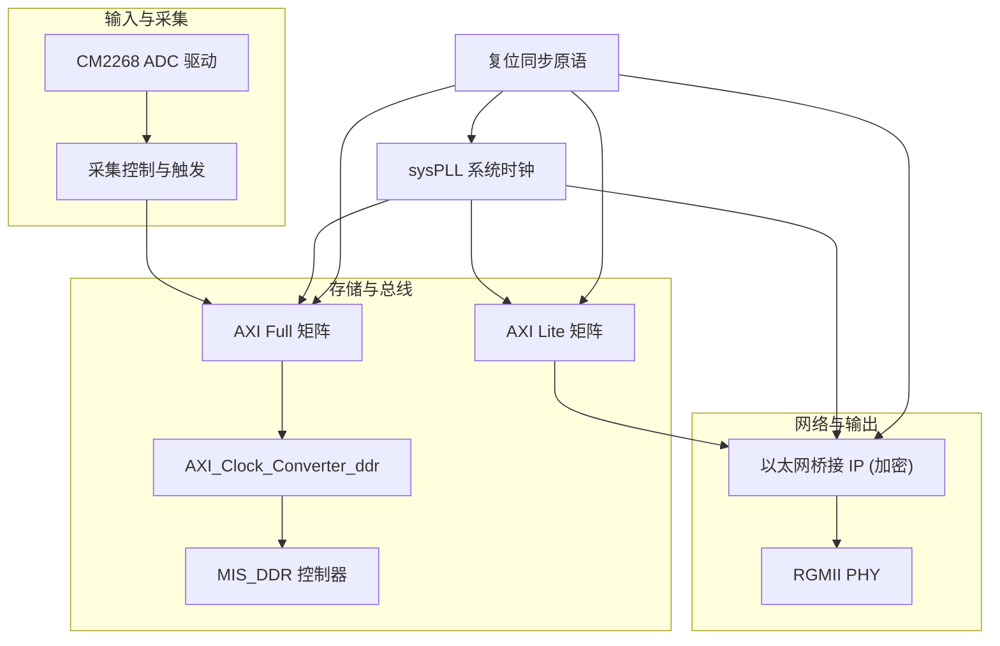
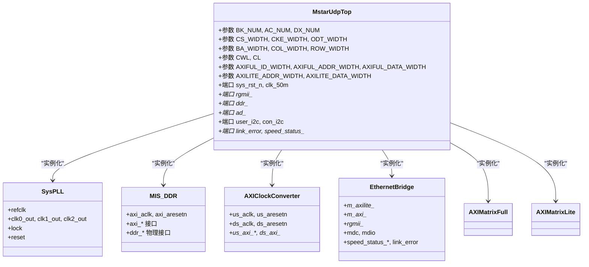
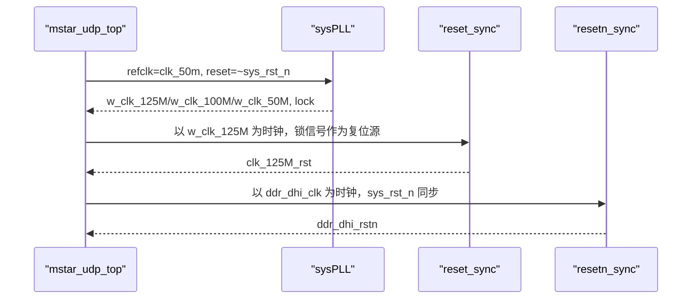
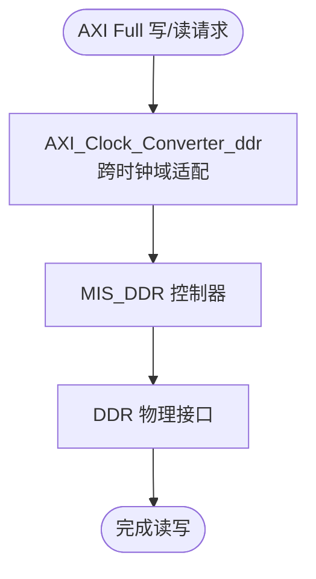
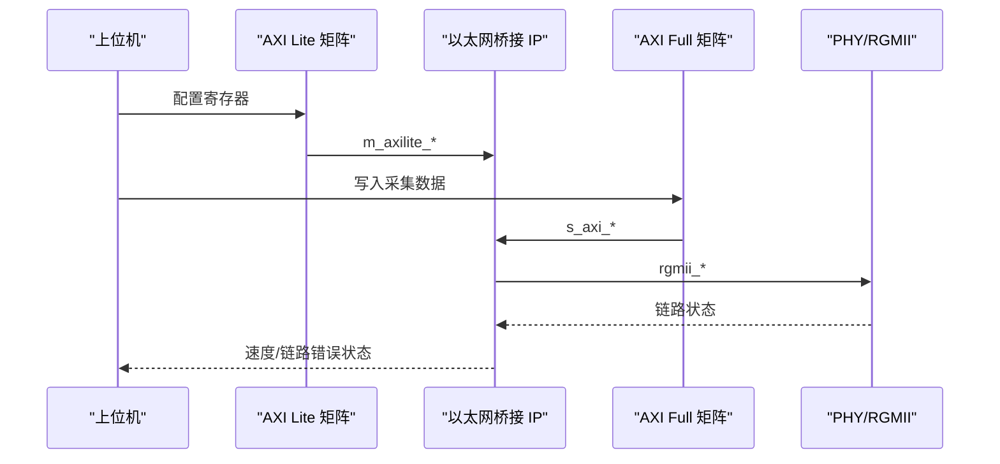
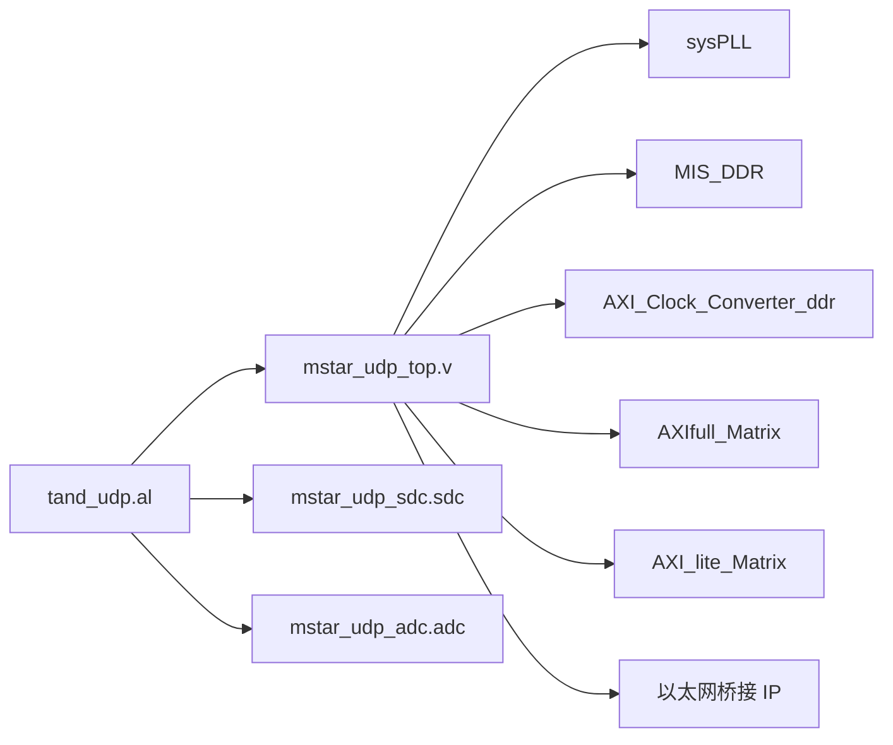
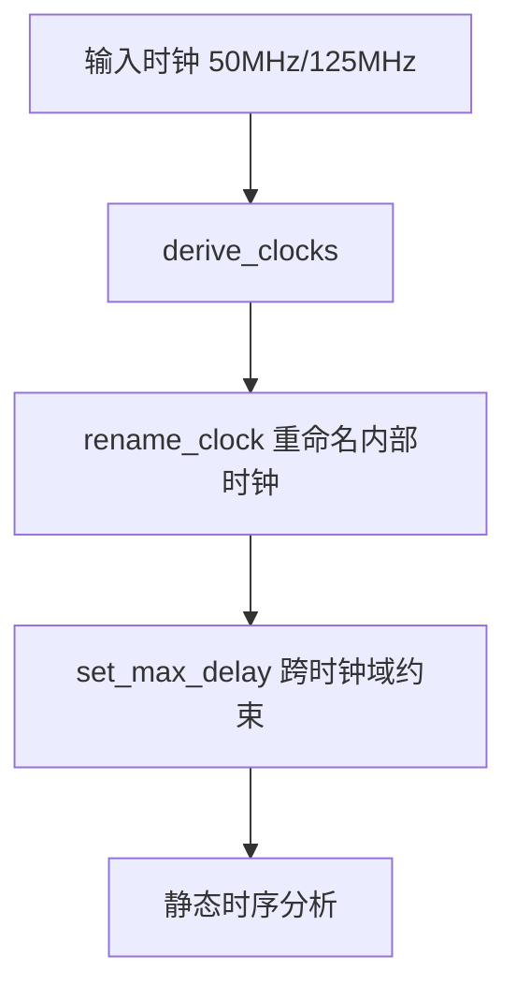

# 快速开始

<cite>
**本文引用的文件**   
- [README.md](file://README.md)
- [tand_udp.al](file://tand_udp.al)
- [tand_udp_devicesetting.cfg](file://tand_udp_devicesetting.cfg)
- [mstar_udp_top.v](file://hdl/mstar_udp_top.v)
- [mstar_udp_sdc.sdc](file://hdl/constraint/mstar_udp_sdc.sdc)
- [mstar_udp_adc.adc](file://hdl/constraint/mstar_udp_adc.adc)
</cite>

## 目录
1. [简介](#简介)
2. [项目结构](#项目结构)
3. [核心组件](#核心组件)
4. [架构总览](#架构总览)
5. [详细组件分析](#详细组件分析)
6. [依赖关系分析](#依赖关系分析)
7. [性能与约束](#性能与约束)
8. [常见问题与故障排除](#常见问题与故障排除)
9. [结论](#结论)
10. [附录：最小化测试用例](#附录最小化测试用例)

## 简介
本指南面向首次接触该项目的开发者，目标是帮助你在最短时间内完成开发环境搭建、工程导入、目标器件设置、编译流程与基本验证。该项目基于安路科技 PH1 FPGA，使用 Tang Dynasty IDE 进行开发与综合布局布线，实现多通道 AD 数据采集并通过以太网 UDP 传输至上位机。

## 项目结构
仓库采用“功能模块 + IP 核 + 约束”的组织方式：
- hdl：FPGA 顶层与业务逻辑（AD 驱动、采集控制、AXI DMA、AXI Lite IO、同步原语等）
- al_ip：安路 IP 核（DDR、AXI 矩阵、时钟转换、PLL、FIFO 等）
- constraint：引脚与时序约束
- 工程配置：Tang Dynasty 工程文件与器件配置

图表来源
- [tand_udp.al:15-234](file://tand_udp.al#L15-L234)
- [README.md:23-73](file://README.md#L23-L73)

章节来源
- [README.md:23-73](file://README.md#L23-L73)
- [tand_udp.al:15-234](file://tand_udp.al#L15-L234)

## 核心组件
- 顶层模块 mstar_udp_top：集成 AD 驱动、采集控制、DDR 缓存、以太网桥接 IP、AXI 总线互联与系统时钟复位管理。
- 以太网桥接 IP（加密网表）：提供 MAC/UDP/IP 协议栈与 RGMII 接口，通过 AXI Full/Lite 暴露寄存器与数据通路。
- DDR 控制器 MIS_DDR：对接外部 DDR，提供大容量数据缓存。
- AXI 矩阵与时钟转换器：实现 AXI Full/Lite 总线互联与跨时钟域适配。
- 约束文件：引脚分配与静态时序约束，确保信号在目标器件上正确映射与时序收敛。

章节来源
- [mstar_udp_top.v:1-92](file://hdl/mstar_udp_top.v#L1-L92)
- [README.md:87-89](file://README.md#L87-L89)
- [tand_udp.al:185-234](file://tand_udp.al#L185-L234)

## 架构总览
下图展示从 AD 采集到以太网输出的数据流与控制路径，以及关键 IP 的交互关系。

图表来源
- [mstar_udp_top.v:371-414](file://hdl/mstar_udp_top.v#L371-L414)
- [mstar_udp_top.v:415-569](file://hdl/mstar_udp_top.v#L415-L569)
- [mstar_udp_top.v:591-675](file://hdl/mstar_udp_top.v#L591-L675)
- [mstar_udp_top.v:676-762](file://hdl/mstar_udp_top.v#L676-L762)
- [mstar_udp_top.v:763-800](file://hdl/mstar_udp_top.v#L763-L800)

## 详细组件分析

### 顶层模块 mstar_udp_top
- 职责：系统时钟生成与复位、各子模块实例化、AXI Full/Lite 总线互联、DDR 控制器接入、以太网桥接 IP 接入、GPIO/I2C/MDIO 等外设接口管理。
- 关键信号：
  - 时钟与复位：sys_rst_n、clk_50m、w_clk_125M、w_clk_100M、w_clk_50M、各类复位同步信号。
  - 以太网：rgmii_txd/tx_ctl/txc、rgmii_rxd/rx_ctl/rxc、mdc/mdio、link_error、speed_status。
  - DDR：ddr_addr/ba/cke/odt/cs_n/ras_n/cas_n/we_n/dq/dqs_p/n/dm 等。
  - AD 接口：ad_reset/ad_convst/ad_csn/ad_rdn/ad_wrn/ad_data/busy/frstdat 等。
  - 用户 I/O：led、in_port/out_port、trig_in/trig_out、user_scl/user_sda、con_scl/con_sda。

图表来源
- [mstar_udp_top.v:9-92](file://hdl/mstar_udp_top.v#L9-L92)
- [mstar_udp_top.v:371-414](file://hdl/mstar_udp_top.v#L371-L414)
- [mstar_udp_top.v:415-569](file://hdl/mstar_udp_top.v#L415-L569)
- [mstar_udp_top.v:591-675](file://hdl/mstar_udp_top.v#L591-L675)
- [mstar_udp_top.v:676-762](file://hdl/mstar_udp_top.v#L676-L762)
- [mstar_udp_top.v:763-800](file://hdl/mstar_udp_top.v#L763-L800)

章节来源
- [mstar_udp_top.v:1-800](file://hdl/mstar_udp_top.v#L1-L800)

### 时钟与复位路径
- 通过 sysPLL 将 50MHz 参考时钟分频出 125MHz、100MHz、50MHz 时钟，并产生 lock 信号用于复位同步。
- 使用 reset_sync/resetn_sync 对多时钟域复位进行同步处理，避免亚稳态。

图表来源
- [mstar_udp_top.v:371-414](file://hdl/mstar_udp_top.v#L371-L414)

章节来源
- [mstar_udp_top.v:371-414](file://hdl/mstar_udp_top.v#L371-L414)

### DDR 数据通路
- AXI Full 主设备（采集/DMA）经 AXI_Clock_Converter_ddr 将 100MHz 域的 AXI 请求转换为 DDR 控制器所需的 133MHz 域。
- MIS_DDR 负责 DDR 物理层时序与命令调度，向上提供 AXI 接口。

图表来源
- [mstar_udp_top.v:415-569](file://hdl/mstar_udp_top.v#L415-L569)

章节来源
- [mstar_udp_top.v:415-569](file://hdl/mstar_udp_top.v#L415-L569)

### 以太网数据通路
- 以太网桥接 IP 通过 AXI Full 接收/发送数据，通过 AXI Lite 进行寄存器配置。
- RGMII 接口直接连接 PHY，提供千兆/百兆速率状态与链路错误指示。

图表来源
- [mstar_udp_top.v:591-675](file://hdl/mstar_udp_top.v#L591-L675)
- [mstar_udp_top.v:676-762](file://hdl/mstar_udp_top.v#L676-L762)
- [mstar_udp_top.v:763-800](file://hdl/mstar_udp_top.v#L763-L800)

章节来源
- [mstar_udp_top.v:591-800](file://hdl/mstar_udp_top.v#L591-L800)

## 依赖关系分析
- 工程文件 tand_udp.al 定义了顶层模块、源文件集合、IP 核、约束文件与运行策略。
- 顶层模块依赖 sysPLL、MIS_DDR、AXI_Clock_Converter_ddr、AXI_lite_Matrix、AXIfull_Matrix、以太网桥接 IP。
- 约束文件定义引脚分配与时序约束，确保综合与布局布线结果满足硬件要求。

图表来源
- [tand_udp.al:15-234](file://tand_udp.al#L15-L234)
- [mstar_udp_top.v:371-800](file://hdl/mstar_udp_top.v#L371-L800)

章节来源
- [tand_udp.al:15-234](file://tand_udp.al#L15-L234)
- [mstar_udp_top.v:371-800](file://hdl/mstar_udp_top.v#L371-L800)

## 性能与约束
- 时钟约束：定义 50MHz 与 125MHz 输入时钟，派生内部时钟并重命名；跨时钟域最大延迟约束覆盖 125M↔100M、125M↔50M、100M↔50M 及 DDR 用户时钟。
- 引脚约束：RGMII、MDIO/MDC、LED、按键、I2C、AD 接口等全部引脚已分配，电气属性与上下拉配置明确。

图表来源
- [mstar_udp_sdc.sdc:1-17](file://hdl/constraint/mstar_udp_sdc.sdc#L1-L17)

章节来源
- [mstar_udp_sdc.sdc:1-17](file://hdl/constraint/mstar_udp_sdc.sdc#L1-L17)
- [mstar_udp_adc.adc:1-95](file://hdl/constraint/mstar_udp_adc.adc#L1-L95)

## 常见问题与故障排除
- 无法打开工程或找不到源文件
  - 确认 Tang Dynasty IDE 版本 ≥ 6.2，且工作区路径与工程文件一致。
  - 检查 hdl 与 al_ip 目录是否完整，未缺失任何 IP 核 XML 与 RTL 文件。
- 综合失败或报未定义模块
  - 确认顶层模块标签与 module 名称一致（mstar_udp_top）。
  - 检查约束文件是否被加入工程（ADC/SDC），以及 IP 核 XML 是否被引用。
- 时序违例
  - 检查 SDC 中时钟定义与 rename_clock 是否正确，跨时钟域 max_delay 是否合理。
  - 关注 DDR 用户时钟与其他时钟之间的约束是否足够。
- 引脚冲突或布局布线失败
  - 核对 ADC 约束文件中所有引脚 LOCATION 是否与板卡原理图一致。
  - 检查 IOSTANDARD、PULLTYPE、DRIVESTRENGTH 是否符合硬件设计。
- 以太网不通或链路错误
  - 观察 link_error 与 speed_status_1g/speed_status_100M 状态。
  - 检查 MDIO/MDC 与 RGMII 引脚约束是否正确，PHY 复位信号是否有效。
- DDR 初始化或读写异常
  - 确认 MIS_DDR 的 APB 配置与 AXI 时钟/复位是否正确。
  - 检查 AXI_Clock_Converter_ddr 的 us/ds 时钟域与复位同步。

章节来源
- [README.md:75-85](file://README.md#L75-L85)
- [tand_udp.al:242-275](file://tand_udp.al#L242-L275)
- [mstar_udp_sdc.sdc:1-17](file://hdl/constraint/mstar_udp_sdc.sdc#L1-L17)
- [mstar_udp_adc.adc:1-95](file://hdl/constraint/mstar_udp_adc.adc#L1-L95)

## 结论
通过本指南，你可以快速完成 Tang Dynasty IDE 的安装与工程导入，确认目标器件与约束文件，执行综合、布局布线与比特流生成，并进行基本功能验证。若遇到时序或引脚问题，可依据约束与依赖关系逐步排查。

## 附录：最小化测试用例
以下用例用于验证系统基本功能，建议在硬件平台上按顺序执行：

- 用例一：时钟与复位自检
  - 目的：验证 sysPLL 输出时钟与复位同步是否正常。
  - 步骤：
    - 上电后观察 LED 闪烁（由 cryptopp_wdten 控制）。
    - 使用逻辑分析仪抓取 w_clk_125M/w_clk_100M/w_clk_50M 与复位信号。
  - 预期：时钟稳定，复位同步信号在 lock 后释放。

- 用例二：AXI Lite 寄存器访问
  - 目的：验证 AXI Lite 矩阵与以太网桥接 IP 的寄存器读写通路。
  - 步骤：
    - 通过上位机或调试工具向 AXI Lite 地址空间写入配置。
    - 读取状态寄存器，确认链路速度与错误标志。
  - 预期：读写成功，状态反映实际链路情况。

- 用例三：以太网环回或简单发包
  - 目的：验证以太网桥接 IP 与 RGMII 通路。
  - 步骤：
    - 配置以太网桥接 IP 的基本参数（如 MAC/IP）。
    - 使用上位机发送 UDP 包，观察链路状态与丢包率。
  - 预期：链路建立，数据包正常收发。

- 用例四：AD 采集与 DDR 缓存
  - 目的：验证 AD 驱动、采集控制与 DDR 缓存通路。
  - 步骤：
    - 触发 AD 采集，观察 ad_busy/frstdat 与触发信号。
    - 通过 AXI Full 读取 DDR 中的数据块，校验数据完整性。
  - 预期：采集数据连续无丢失，DDR 读写时序满足约束。

- 用例五：时序收敛检查
  - 目的：确认综合与布局布线后的时序报告满足约束。
  - 步骤：
    - 查看综合与布局布线报告中的时序裕量。
    - 重点关注跨时钟域路径与 DDR 相关路径。
  - 预期：所有路径满足时序要求，无违例。

章节来源
- [README.md:75-85](file://README.md#L75-L85)
- [tand_udp.al:256-275](file://tand_udp.al#L256-L275)
- [mstar_udp_top.v:355-370](file://hdl/mstar_udp_top.v#L355-L370)
- [mstar_udp_top.v:591-675](file://hdl/mstar_udp_top.v#L591-L675)