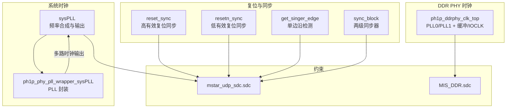
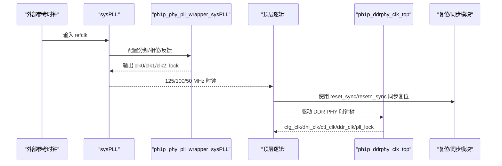
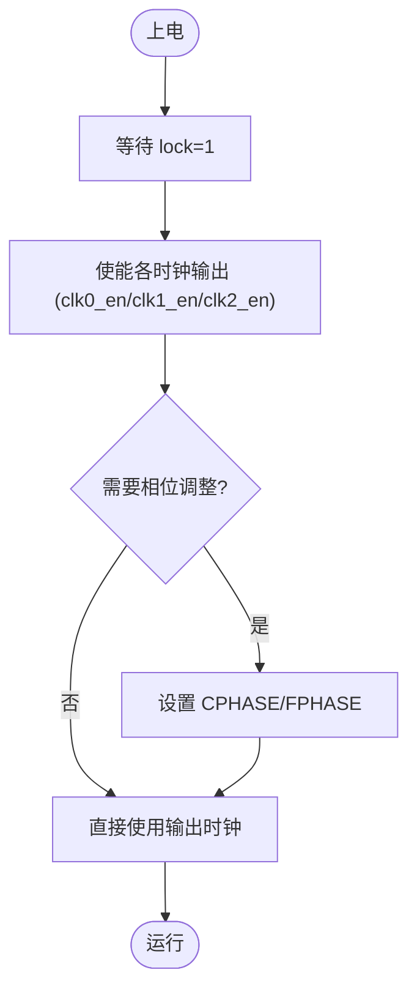
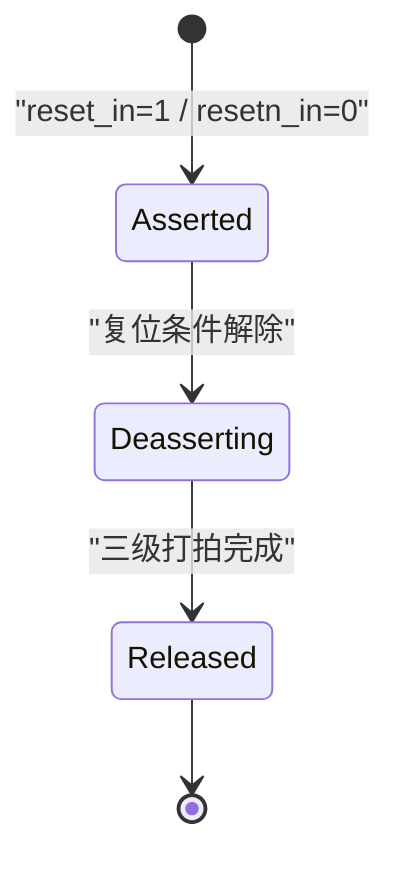
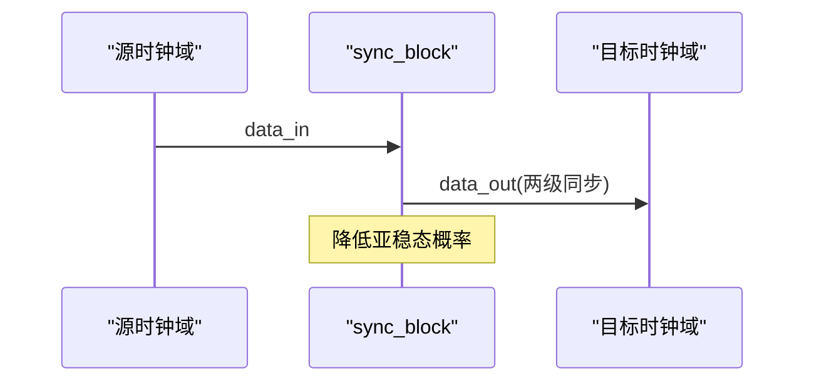
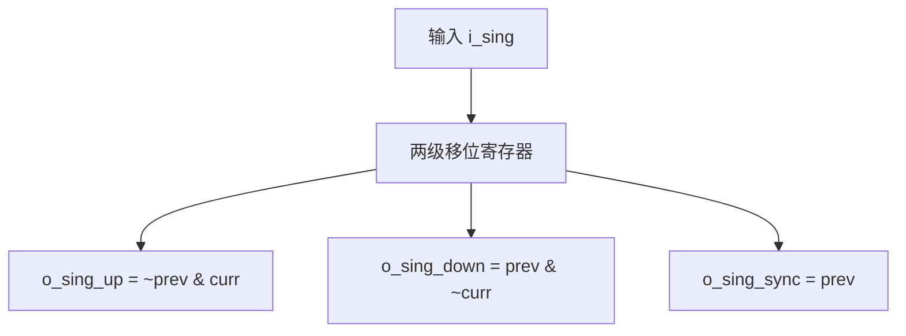
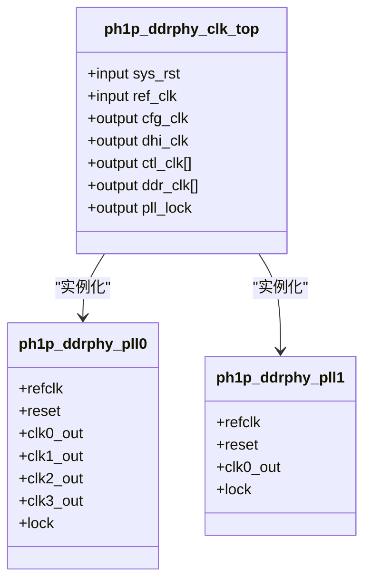
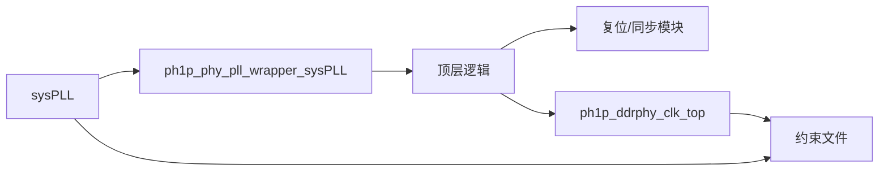
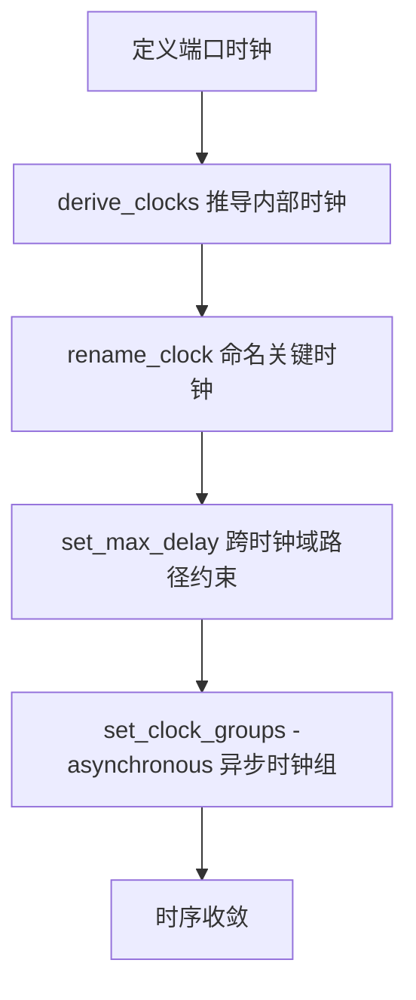

# 时钟和复位管理

<cite>
**本文引用的文件**   
- [README.md](file://README.md)
- [sysPLL.v](file://al_ip/sysPLL/sysPLL.v)
- [ph1p_phy_pll_wrapper_sysPLL.v](file://al_ip/sysPLL/RTL/ph1p_phy_pll_wrapper_sysPLL.v)
- [mstar_udp_sdc.sdc](file://hdl/constraint/mstar_udp_sdc.sdc)
- [reset_sync.v](file://hdl/sync/reset_sync.v)
- [resetn_sync.v](file://hdl/sync/resetn_sync.v)
- [get_singer_edge.v](file://hdl/sync/get_singer_edge.v)
- [sync_block.v](file://hdl/sync/sync_block.v)
- [ph1p_ddrphy_clk_top.v](file://al_ip/MIS_DDR/src/rtl/clk/ph1p_ddrphy_clk_top.v)
- [MIS_DDR.sdc](file://al_ip/MIS_DDR/src/sdc/MIS_DDR.sdc)
</cite>

## 目录
1. [简介](#简介)
2. [项目结构](#项目结构)
3. [核心组件](#核心组件)
4. [架构总览](#架构总览)
5. [详细组件分析](#详细组件分析)
6. [依赖关系分析](#依赖关系分析)
7. [性能与约束建议](#性能与约束建议)
8. [故障排查指南](#故障排查指南)
9. [结论](#结论)

## 简介
本技术文档聚焦于工程中的时钟与复位管理系统，覆盖以下主题：
- PLL 时钟生成器的配置与使用（频率合成、相位调整、时钟输出管理）
- 复位同步逻辑（异步复位同步化、复位释放时序控制）
- 跨时钟域同步机制（单比特信号同步、多比特信号同步、握手协议）
- 边沿检测电路实现原理
- 时钟域划分建议与复位策略最佳实践
- 时序分析与约束设置指导

该工程为基于安路 PH1 FPGA 的多通道 AD 数据采集系统，包含以太网 UDP 传输、DDR 缓存、AXI 总线等子系统。时钟与复位是保证各子系统稳定协同工作的基础。

**章节来源**
- [README.md:1-108](file://README.md#L1-L108)

## 项目结构
与时钟和复位相关的代码主要分布在以下位置：
- 系统级 PLL：al_ip/sysPLL
- 复位与同步原语：hdl/sync
- DDR PHY 时钟树：al_ip/MIS_DDR/src/rtl/clk
- 约束文件：hdl/constraint 与 al_ip/MIS_DDR/src/sdc

**图表来源**
- [sysPLL.v:23-135](file://al_ip/sysPLL/sysPLL.v#L23-L135)
- [ph1p_phy_pll_wrapper_sysPLL.v:185-335](file://al_ip/sysPLL/RTL/ph1p_phy_pll_wrapper_sysPLL.v#L185-L335)
- [reset_sync.v:13-41](file://hdl/sync/reset_sync.v#L13-L41)
- [resetn_sync.v:13-37](file://hdl/sync/resetn_sync.v#L13-L37)
- [get_singer_edge.v:21-38](file://hdl/sync/get_singer_edge.v#L21-L38)
- [sync_block.v:14-30](file://hdl/sync/sync_block.v#L14-L30)
- [ph1p_ddrphy_clk_top.v:49-76](file://al_ip/MIS_DDR/src/rtl/clk/ph1p_ddrphy_clk_top.v#L49-L76)
- [mstar_udp_sdc.sdc:1-16](file://hdl/constraint/mstar_udp_sdc.sdc#L1-L16)
- [MIS_DDR.sdc:1-12](file://al_ip/MIS_DDR/src/sdc/MIS_DDR.sdc#L1-L12)

**章节来源**
- [README.md:23-73](file://README.md#L23-L73)

## 核心组件
- 系统 PLL（sysPLL）：提供 125MHz、100MHz、50MHz 三组时钟，支持锁相环锁定指示与复位输入。
- PLL 封装（ph1p_phy_pll_wrapper_sysPLL）：暴露细粒度参数（分频、粗/细相位、占空比、反馈模式、DRP 接口等），用于精确配置频率与相位。
- 复位同步模块（reset_sync/resetn_sync）：对异步复位进行三级打拍同步，确保复位释放的确定性。
- 边沿检测模块（get_singer_edge）：在目标时钟域内对输入信号进行两级打拍，并产生上升沿/下降沿脉冲。
- 单比特同步器（sync_block）：两级寄存器同步，用于跨时钟域的单比特信号传递。
- DDR PHY 时钟树（ph1p_ddrphy_clk_top）：通过 PLL0/PLL1 与 MLCLK/IOCLK 缓冲，生成控制时钟、DDR 数据时钟及配置时钟。

**章节来源**
- [sysPLL.v:11-31](file://al_ip/sysPLL/sysPLL.v#L11-L31)
- [ph1p_phy_pll_wrapper_sysPLL.v:117-179](file://al_ip/sysPLL/RTL/ph1p_phy_pll_wrapper_sysPLL.v#L117-L179)
- [reset_sync.v:13-41](file://hdl/sync/reset_sync.v#L13-L41)
- [resetn_sync.v:13-37](file://hdl/sync/resetn_sync.v#L13-L37)
- [get_singer_edge.v:21-38](file://hdl/sync/get_singer_edge.v#L21-L38)
- [sync_block.v:14-30](file://hdl/sync/sync_block.v#L14-L30)
- [ph1p_ddrphy_clk_top.v:4-25](file://al_ip/MIS_DDR/src/rtl/clk/ph1p_ddrphy_clk_top.v#L4-L25)

## 架构总览
下图展示系统时钟生成、复位同步与 DDR PHY 时钟树的交互关系。

**图表来源**
- [sysPLL.v:45-135](file://al_ip/sysPLL/sysPLL.v#L45-L135)
- [ph1p_phy_pll_wrapper_sysPLL.v:185-335](file://al_ip/sysPLL/RTL/ph1p_phy_pll_wrapper_sysPLL.v#L185-L335)
- [ph1p_ddrphy_clk_top.v:49-138](file://al_ip/MIS_DDR/src/rtl/clk/ph1p_ddrphy_clk_top.v#L49-L138)
- [reset_sync.v:28-41](file://hdl/sync/reset_sync.v#L28-L41)
- [resetn_sync.v:24-37](file://hdl/sync/resetn_sync.v#L24-L37)

## 详细组件分析

### 系统 PLL（sysPLL）与频率合成
- 功能概述
  - 从外部参考时钟生成 125MHz、100MHz、50MHz 三组时钟。
  - 提供锁相环锁定指示（lock）与复位输入（reset）。
  - 通过 BUFG 对 C0 路径进行全局时钟缓冲，降低时钟偏斜。
- 关键配置要点
  - 反馈路径与分频：REFCLK_DIV、FBCLK_DIV 决定 VCO 工作点。
  - 输出通道：C0/C1/C2 分别对应 125/100/50MHz，可通过 CLKCn_DIV 与 CPHASE/FPHASE 调节频率与相位。
  - 占空比校正：CLKCn_DUTY50/DUTY_INT 可启用 50% 占空比修正。
  - 动态相位：CPHASE（粗相位）、FPHASE（细相位）可用于微调输出相位。
  - 反馈模式：FEEDBACK_MODE 支持内部/外部反馈；PLL_FEED_TYPE 支持 INTERNAL/EXTERNAL。
- 使用时序
  - 上电后等待 lock 置位，再使能下游逻辑。
  - 复位信号需经同步后再进入各时钟域。

**图表来源**
- [sysPLL.v:45-135](file://al_ip/sysPLL/sysPLL.v#L45-L135)
- [ph1p_phy_pll_wrapper_sysPLL.v:185-335](file://al_ip/sysPLL/RTL/ph1p_phy_pll_wrapper_sysPLL.v#L185-L335)

**章节来源**
- [sysPLL.v:11-31](file://al_ip/sysPLL/sysPLL.v#L11-L31)
- [sysPLL.v:45-135](file://al_ip/sysPLL/sysPLL.v#L45-L135)
- [ph1p_phy_pll_wrapper_sysPLL.v:117-179](file://al_ip/sysPLL/RTL/ph1p_phy_pll_wrapper_sysPLL.v#L117-L179)
- [ph1p_phy_pll_wrapper_sysPLL.v:185-335](file://al_ip/sysPLL/RTL/ph1p_phy_pll_wrapper_sysPLL.v#L185-L335)

### 复位同步逻辑
- reset_sync（高有效复位）
  - 三级打拍同步，确保异步复位在高电平期间被可靠采样，并在释放时按节拍逐步撤销。
  - 适用于复位极性为高的设计。
- resetn_sync（低有效复位）
  - 三级打拍同步，针对低电平有效的复位信号，确保复位释放时序可控。
- 复位释放时序控制
  - 建议在 PLL lock 之后才释放用户逻辑复位，避免亚稳态或状态机异常。
  - 对于不同时钟域，应分别使用各自时钟域的复位同步器。

**图表来源**
- [reset_sync.v:28-41](file://hdl/sync/reset_sync.v#L28-L41)
- [resetn_sync.v:24-37](file://hdl/sync/resetn_sync.v#L24-L37)

**章节来源**
- [reset_sync.v:13-41](file://hdl/sync/reset_sync.v#L13-L41)
- [resetn_sync.v:13-37](file://hdl/sync/resetn_sync.v#L13-L37)

### 跨时钟域同步机制
- 单比特信号同步（sync_block）
  - 两级寄存器同步，降低亚稳态传播风险。
  - 适用于控制信号或状态标志的低速率跨时钟域传递。
- 多比特信号同步
  - 建议使用 FIFO 或握手协议（如 AXI 握手）保证数据完整性。
  - 若必须直接跨域，需配合格雷码编码与多拍同步。
- 握手协议
  - 典型握手：req/ack 或 valid/ready，确保发送方与接收方状态一致。
  - 在工程中可与 AXI Lite/AXI Full 总线结合，实现可靠的跨时钟域数据传输。

**图表来源**
- [sync_block.v:14-30](file://hdl/sync/sync_block.v#L14-L30)

**章节来源**
- [sync_block.v:14-30](file://hdl/sync/sync_block.v#L14-L30)

### 边沿检测电路
- get_singer_edge
  - 在目标时钟域内对输入信号进行两级打拍，计算相邻周期的差值以产生上升沿/下降沿脉冲。
  - 支持向量输入（SING_WIDTH），便于批量信号的边沿检测。
  - 同时输出同步后的中间状态，便于后续逻辑使用。

**图表来源**
- [get_singer_edge.v:32-37](file://hdl/sync/get_singer_edge.v#L32-L37)

**章节来源**
- [get_singer_edge.v:21-38](file://hdl/sync/get_singer_edge.v#L21-L38)

### DDR PHY 时钟树
- ph1p_ddrphy_clk_top
  - 通过 PLL0 生成多路时钟（cfg_clk、ctl_clk、ddr_clk），并通过 MLCLK/IOCLK 缓冲优化时钟质量。
  - PLL1 由 PLL0 的输出作为参考，进一步衍生 usr_clk 等时钟。
  - 输出 pll_lock 指示整体时钟链路就绪。
- 时钟用途
  - cfg_clk：用于配置与控制逻辑。
  - ctl_clk：用于控制通路。
  - ddr_clk：用于 DDR 数据通路。
  - dhi_clk/usr_clk：用于主机接口或用户逻辑。

**图表来源**
- [ph1p_ddrphy_clk_top.v:49-76](file://al_ip/MIS_DDR/src/rtl/clk/ph1p_ddrphy_clk_top.v#L49-L76)
- [ph1p_ddrphy_clk_top.v:78-138](file://al_ip/MIS_DDR/src/rtl/clk/ph1p_ddrphy_clk_top.v#L78-L138)

**章节来源**
- [ph1p_ddrphy_clk_top.v:4-25](file://al_ip/MIS_DDR/src/rtl/clk/ph1p_ddrphy_clk_top.v#L4-L25)
- [ph1p_ddrphy_clk_top.v:49-138](file://al_ip/MIS_DDR/src/rtl/clk/ph1p_ddrphy_clk_top.v#L49-L138)

## 依赖关系分析
- 系统 PLL 依赖底层封装模块（ph1p_phy_pll_wrapper_sysPLL），后者再实例化具体 PLL IP（PH1P_PHY_PLL_V2）。
- 顶层逻辑依赖 sysPLL 输出的多路时钟，并使用 reset_sync/resetn_sync 对各时钟域复位进行同步。
- DDR PHY 时钟树依赖外部参考时钟与 PLL0/PLL1，输出多种时钟给不同子模块。
- 约束文件定义时钟名称、周期与跨时钟域最大延迟，确保时序收敛。

**图表来源**
- [sysPLL.v:45-135](file://al_ip/sysPLL/sysPLL.v#L45-L135)
- [ph1p_phy_pll_wrapper_sysPLL.v:185-335](file://al_ip/sysPLL/RTL/ph1p_phy_pll_wrapper_sysPLL.v#L185-L335)
- [mstar_udp_sdc.sdc:1-16](file://hdl/constraint/mstar_udp_sdc.sdc#L1-L16)
- [MIS_DDR.sdc:1-12](file://al_ip/MIS_DDR/src/sdc/MIS_DDR.sdc#L1-L12)

**章节来源**
- [sysPLL.v:45-135](file://al_ip/sysPLL/sysPLL.v#L45-L135)
- [ph1p_phy_pll_wrapper_sysPLL.v:185-335](file://al_ip/sysPLL/RTL/ph1p_phy_pll_wrapper_sysPLL.v#L185-L335)
- [mstar_udp_sdc.sdc:1-16](file://hdl/constraint/mstar_udp_sdc.sdc#L1-L16)
- [MIS_DDR.sdc:1-12](file://al_ip/MIS_DDR/src/sdc/MIS_DDR.sdc#L1-L12)

## 性能与约束建议
- 时钟域划分建议
  - 将高速数据通路（如 DDR、RGMII）与控制通路分离，分别使用独立的时钟域。
  - 控制通路可使用较低频率时钟（如 50MHz），减少功耗与资源占用。
  - 对于跨时钟域的数据传输，优先采用 FIFO 或握手协议，避免直接多比特跨域。
- 复位策略最佳实践
  - 所有异步复位在进入目标时钟域前必须进行三级打拍同步。
  - 复位释放应在 PLL lock 之后进行，确保时钟稳定。
  - 对不同时钟域分别维护各自的复位同步链，避免跨域复位传播。
- 时序分析与约束设置指导
  - 定义外部端口时钟（如 50MHz、RGMII RXC 125MHz）。
  - 使用 derive_clocks 自动推导内部时钟，并对关键时钟 rename_clock 命名以便约束。
  - 对跨时钟域路径设置 set_max_delay（datapath_only），限制组合逻辑延迟，避免时序违例。
  - 对 DDR PHY 时钟组使用 set_clock_groups -asynchronous 声明异步关系，避免错误路径检查。

**图表来源**
- [mstar_udp_sdc.sdc:1-16](file://hdl/constraint/mstar_udp_sdc.sdc#L1-L16)
- [MIS_DDR.sdc:1-12](file://al_ip/MIS_DDR/src/sdc/MIS_DDR.sdc#L1-L12)

**章节来源**
- [mstar_udp_sdc.sdc:1-16](file://hdl/constraint/mstar_udp_sdc.sdc#L1-L16)
- [MIS_DDR.sdc:1-12](file://al_ip/MIS_DDR/src/sdc/MIS_DDR.sdc#L1-L12)

## 故障排查指南
- 现象：PLL 未锁定或时钟不稳定
  - 检查 lock 信号是否置位，确认 REFCLK 频率与分频参数匹配。
  - 验证 FEEDBACK_MODE 与 PLL_FEED_TYPE 配置是否正确。
  - 检查复位是否在 lock 之前释放，导致 PLL 初始化失败。
- 现象：复位毛刺或状态机异常
  - 确认所有异步复位均经过 reset_sync/resetn_sync 同步。
  - 检查复位释放顺序，确保先时钟稳定，后复位释放。
- 现象：跨时钟域数据丢失或亚稳态
  - 单比特信号使用 sync_block 两级同步。
  - 多比特信号改用 FIFO 或握手协议，避免直接跨域。
- 现象：时序违例
  - 检查 set_max_delay 约束是否合理，必要时减小跨域组合逻辑延迟。
  - 对 DDR PHY 时钟组使用 set_clock_groups -asynchronous 避免错误路径。

**章节来源**
- [sysPLL.v:45-135](file://al_ip/sysPLL/sysPLL.v#L45-L135)
- [reset_sync.v:28-41](file://hdl/sync/reset_sync.v#L28-L41)
- [resetn_sync.v:24-37](file://hdl/sync/resetn_sync.v#L24-L37)
- [sync_block.v:26-30](file://hdl/sync/sync_block.v#L26-L30)
- [mstar_udp_sdc.sdc:8-15](file://hdl/constraint/mstar_udp_sdc.sdc#L8-L15)
- [MIS_DDR.sdc:12-12](file://al_ip/MIS_DDR/src/sdc/MIS_DDR.sdc#L12-L12)

## 结论
本工程通过 sysPLL 与 ph1p_ddrphy_clk_top 构建了稳定的多时钟域体系，配合 reset_sync/resetn_sync 与 sync_block 实现了可靠的复位同步与跨时钟域信号传递。通过合理的约束设置与复位策略，可有效提升系统的时序收敛性与稳定性。在实际应用中，建议遵循本文的时钟域划分与复位最佳实践，并结合具体业务需求优化相位与频率配置。