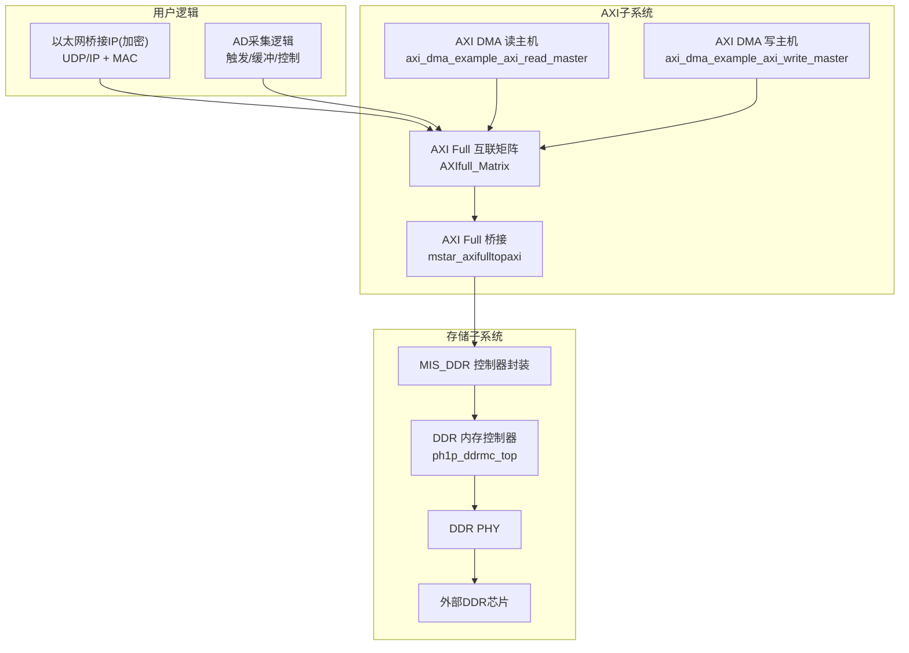
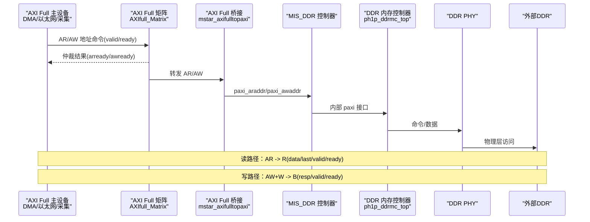
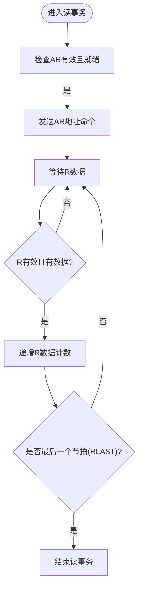
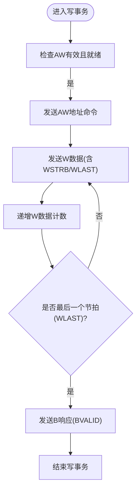
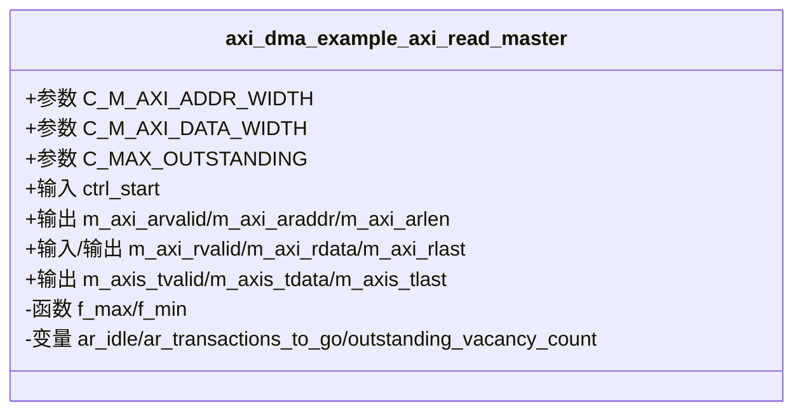
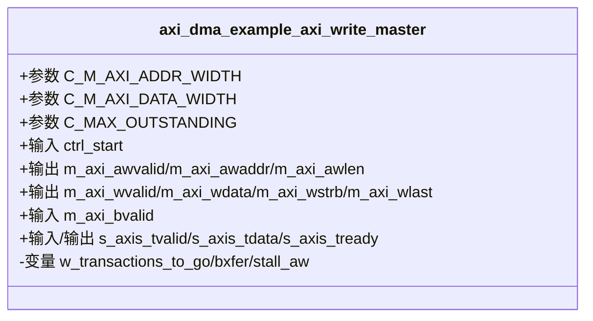
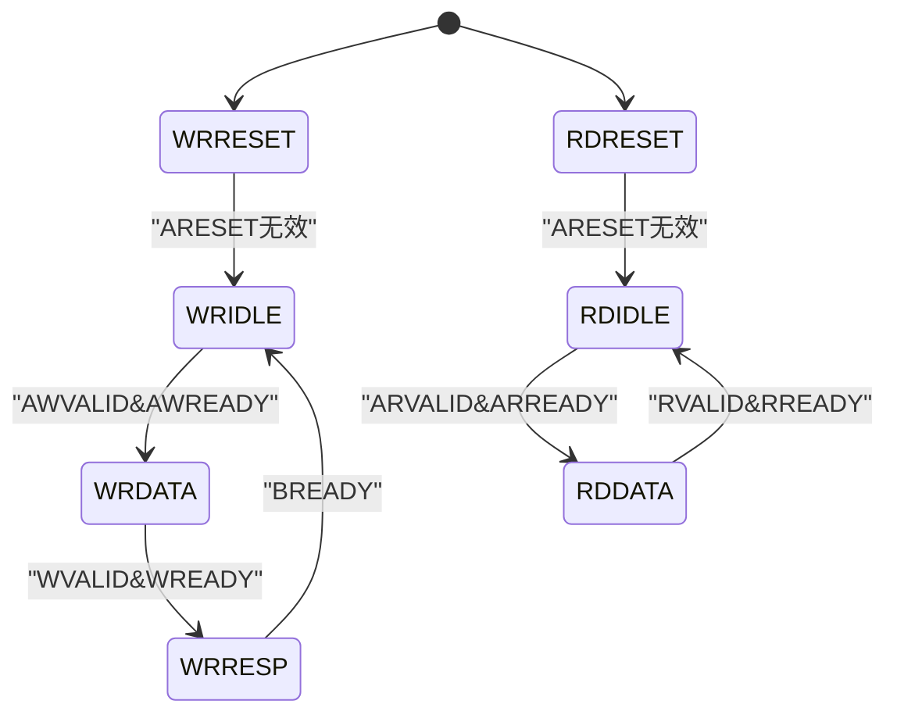
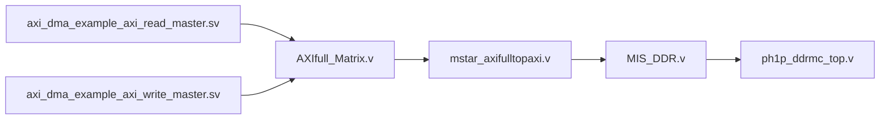

# AXI Full总线详解

<cite>
**本文引用的文件**   
- [README.md](file://README.md)
- [mstar_axifulltopaxi.v](file://hdl/axi_io/mstar_axifulltopaxi.v)
- [AXIfull_Matrix.v](file://al_ip/AXIfull_Matrix/AXIfull_Matrix.v)
- [MIS_DDR.v](file://al_ip/MIS_DDR/MIS_DDR.v)
- [ph1p_ddrmc_top.v](file://al_ip/MIS_DDR/src/rtl/top/ph1p_ddrmc_top.v)
- [axi_dma_example_axi_read_master.sv](file://hdl/axi_dma/axi_dma_example_axi_read_master.sv)
- [axi_dma_example_axi_write_master.sv](file://hdl/axi_dma/axi_dma_example_axi_write_master.sv)
- [ad_dma_axictrl.v](file://hdl/collect/ad_dma_axictrl.v)
</cite>

## 目录
1. [引言](#引言)
2. [项目结构](#项目结构)
3. [核心组件](#核心组件)
4. [架构总览](#架构总览)
5. [详细组件分析](#详细组件分析)
6. [依赖关系分析](#依赖关系分析)
7. [性能与带宽计算](#性能与带宽计算)
8. [故障排查指南](#故障排查指南)
9. [结论](#结论)

## 引言
本技术文档围绕项目中基于安路 PH1 FPGA 的 AXI Full 数据通路展开，重点说明：
- AXI Full 协议的关键特性：独立读写通道、突发传输、地址命令分离、写响应通道等。
- 在系统中的具体应用：DDR 内存访问（采集数据缓存）、以太网数据传输（通过加密 IP 桥接）。
- 接口信号定义与事务流程：AR/AW 地址命令、R/W 数据传输、B 写响应。
- 时序图与状态机：读/写完整事务时序、DMA 控制器状态机。
- 带宽计算、性能优化策略与实际使用示例。

本项目为多通道 AD 数据采集系统，通过 DDR 作为高速缓存，经 UDP/IP 从 RGMII 千兆以太网输出至上位机；同时提供 AXI Lite 寄存器接口用于配置。AXI Full 在此工程中承担高吞吐的数据搬运任务。

**章节来源**
- [README.md:5-14](file://README.md#L5-L14)

## 项目结构
工程以“功能模块 + IP 集成”的方式组织：
- hdl/axi_io：AXI Full 到内部 AXI 的桥接与 DDR 控制封装。
- al_ip/AXIfull_Matrix：AXI Full 互联矩阵，实现多主设备对单从设备的仲裁与路由。
- al_ip/MIS_DDR：DDR 控制器顶层封装，包含 PHY、MC、APB 配置等。
- hdl/axi_dma：AXI DMA 读写主机示例，演示如何发起 AXI Full 读/写事务。
- hdl/collect：采集逻辑与 AXI Lite 控制，管理 DMA 参数与触发。

**图表来源**
- [AXIfull_Matrix.v:12-129](file://al_ip/AXIfull_Matrix/AXIfull_Matrix.v#L12-L129)
- [mstar_axifulltopaxi.v:9-72](file://hdl/axi_io/mstar_axifulltopaxi.v#L9-L72)
- [MIS_DDR.v:12-82](file://al_ip/MIS_DDR/MIS_DDR.v#L12-L82)
- [ph1p_ddrmc_top.v:8-93](file://al_ip/MIS_DDR/src/rtl/top/ph1p_ddrmc_top.v#L8-L93)

**章节来源**
- [README.md:23-73](file://README.md#L23-L73)

## 核心组件
- mstar_axifulltopaxi：将外部 AXI Full 128-bit 接口适配到内部 MIS_DDR 的 paxi 接口，完成地址对齐、突发长度处理、握手协调。
- AXIfull_Matrix：多主（us0/us1）到单从（ds0）的 AXI Full 互连，支持 ID、QoS、优先级、连接性配置。
- MIS_DDR：DDR 控制器封装，提供 APB 配置、AXI 用户接口、PHY 控制、ECC 错误上报等。
- ph1p_ddrmc_top：DDR 内存控制器顶层，组合 PHY 封装、FIFO、MC 核心，映射 paxi 到 DDR 物理层。
- axi_dma_example_axi_read_master / axi_dma_example_axi_write_master：AXI DMA 读写主机示例，演示突发长度、地址对齐、未完成事务计数、FIFO 缓冲等。
- ad_dma_axictrl：采集系统的 AXI Lite 控制逻辑，管理 DMA 使能、复位、缓冲区基址/长度等参数。

**章节来源**
- [mstar_axifulltopaxi.v:5-8](file://hdl/axi_io/mstar_axifulltopaxi.v#L5-L8)
- [AXIfull_Matrix.v:12-129](file://al_ip/AXIfull_Matrix/AXIfull_Matrix.v#L12-L129)
- [MIS_DDR.v:12-82](file://al_ip/MIS_DDR/MIS_DDR.v#L12-L82)
- [ph1p_ddrmc_top.v:8-93](file://al_ip/MIS_DDR/src/rtl/top/ph1p_ddrmc_top.v#L8-L93)
- [axi_dma_example_axi_read_master.sv:6-8](file://hdl/axi_dma/axi_dma_example_axi_read_master.sv#L6-L8)
- [axi_dma_example_axi_write_master.sv:6-8](file://hdl/axi_dma/axi_dma_example_axi_write_master.sv#L6-L8)
- [ad_dma_axictrl.v:6-9](file://hdl/collect/ad_dma_axictrl.v#L6-L9)

## 架构总览
下图展示 AXI Full 在系统中的数据流与控制流：

**图表来源**
- [AXIfull_Matrix.v:12-129](file://al_ip/AXIfull_Matrix/AXIfull_Matrix.v#L12-L129)
- [mstar_axifulltopaxi.v:73-186](file://hdl/axi_io/mstar_axifulltopaxi.v#L73-L186)
- [MIS_DDR.v:30-82](file://al_ip/MIS_DDR/MIS_DDR.v#L30-L82)
- [ph1p_ddrmc_top.v:79-93](file://al_ip/MIS_DDR/src/rtl/top/ph1p_ddrmc_top.v#L79-L93)

## 详细组件分析

### AXI Full 接口信号与协议要点
- 地址命令通道：
  - AR 通道：ARADDR、ARLEN、ARSIZE、ARBURST、ARID、ARPROT、ARQOS 等。
  - AW 通道：AWADDR、AWLEN、AWSIZE、AWBURST、AWID、AWPROT、AWQOS 等。
- 数据传输通道：
  - W 通道：WDATA、WSTRB、WLAST、WVALID/WREADY。
  - R 通道：RDATA、RLAST、RRESP、RVALID/RREADY。
- 写响应通道：
  - B 通道：BRESP、BVALID/BREADY。

在本工程中：
- mstar_axifulltopaxi 对外暴露标准 AXI Full 端口，对内转换为 MIS_DDR 的 paxi 接口，并处理突发长度与地址对齐。
- AXIfull_Matrix 提供多主接入能力，支持 ID/QoS/优先级等高级特性。
- MIS_DDR 与 ph1p_ddrmc_top 负责将 AXI 事务映射到 DDR 物理层时序。

**章节来源**
- [mstar_axifulltopaxi.v:30-52](file://hdl/axi_io/mstar_axifulltopaxi.v#L30-L52)
- [AXIfull_Matrix.v:14-129](file://al_ip/AXIfull_Matrix/AXIfull_Matrix.v#L14-L129)
- [MIS_DDR.v:30-82](file://al_ip/MIS_DDR/MIS_DDR.v#L30-L82)

### 读事务时序与状态机
读事务由 AR 命令启动，随后 R 通道返回数据块。mstar_axifulltopaxi 内部维护 AR 计数器与 R 数据计数器，确保 RLAST 与 ARLEN 对齐。

**图表来源**
- [mstar_axifulltopaxi.v:90-135](file://hdl/axi_io/mstar_axifulltopaxi.v#L90-L135)

**章节来源**
- [mstar_axifulltopaxi.v:90-135](file://hdl/axi_io/mstar_axifulltopaxi.v#L90-L135)

### 写事务时序与状态机
写事务由 AW 命令和 W 数据组成，最后由 B 响应确认。mstar_axifulltopaxi 内部维护 AW 地址计数与 W 数据计数，并在最后一个 W 节拍后拉高 BVALID。

**图表来源**
- [mstar_axifulltopaxi.v:137-186](file://hdl/axi_io/mstar_axifulltopaxi.v#L137-L186)

**章节来源**
- [mstar_axifulltopaxi.v:137-186](file://hdl/axi_io/mstar_axifulltopaxi.v#L137-L186)

### AXI DMA 读主机（示例）
axi_dma_example_axi_read_master 展示了如何通过 AXI Full 从 DDR 读取数据：
- 支持最大突发长度与字节对齐。
- 维护未完成事务计数，避免 FIFO 溢出。
- 可选同步 FIFO 缓冲，将 AXI4 读通道转为 AXI4-Stream。

**图表来源**
- [axi_dma_example_axi_read_master.sv:22-79](file://hdl/axi_dma/axi_dma_example_axi_read_master.sv#L22-L79)
- [axi_dma_example_axi_read_master.sv:103-117](file://hdl/axi_dma/axi_dma_example_axi_read_master.sv#L103-L117)
- [axi_dma_example_axi_read_master.sv:219-291](file://hdl/axi_dma/axi_dma_example_axi_read_master.sv#L219-L291)

**章节来源**
- [axi_dma_example_axi_read_master.sv:22-79](file://hdl/axi_dma/axi_dma_example_axi_read_master.sv#L22-L79)
- [axi_dma_example_axi_read_master.sv:103-117](file://hdl/axi_dma/axi_dma_example_axi_read_master.sv#L103-L117)
- [axi_dma_example_axi_read_master.sv:219-291](file://hdl/axi_dma/axi_dma_example_axi_read_master.sv#L219-L291)

### AXI DMA 写主机（示例）
axi_dma_example_axi_write_master 展示了如何通过 AXI Full 写入 DDR：
- 支持突发长度、地址对齐、部分突发处理。
- 维护 AW-W-B 通道的未完成事务计数。
- 可选同步 FIFO 缓冲，将 AXI4-Stream 转为 AXI4 写通道。

**图表来源**
- [axi_dma_example_axi_write_master.sv:22-74](file://hdl/axi_dma/axi_dma_example_axi_write_master.sv#L22-L74)
- [axi_dma_example_axi_write_master.sv:92-106](file://hdl/axi_dma/axi_dma_example_axi_write_master.sv#L92-L106)
- [axi_dma_example_axi_write_master.sv:336-438](file://hdl/axi_dma/axi_dma_example_axi_write_master.sv#L336-L438)

**章节来源**
- [axi_dma_example_axi_write_master.sv:22-74](file://hdl/axi_dma/axi_dma_example_axi_write_master.sv#L22-L74)
- [axi_dma_example_axi_write_master.sv:92-106](file://hdl/axi_dma/axi_dma_example_axi_write_master.sv#L92-L106)
- [axi_dma_example_axi_write_master.sv:336-438](file://hdl/axi_dma/axi_dma_example_axi_write_master.sv#L336-L438)

### 采集系统 AXI Lite 控制（DMA 参数管理）
ad_dma_axictrl 实现 AXI Lite 寄存器读写，管理 DMA 通道使能、复位、缓冲区基址/长度/预触发长度等。其内部状态机简单处理写/读握手，并提供寄存器映射。

**图表来源**
- [ad_dma_axictrl.v:74-81](file://hdl/collect/ad_dma_axictrl.v#L74-L81)
- [ad_dma_axictrl.v:96-102](file://hdl/collect/ad_dma_axictrl.v#L96-L102)
- [ad_dma_axictrl.v:124-152](file://hdl/collect/ad_dma_axictrl.v#L124-L152)
- [ad_dma_axictrl.v:162-192](file://hdl/collect/ad_dma_axictrl.v#L162-L192)

**章节来源**
- [ad_dma_axictrl.v:74-81](file://hdl/collect/ad_dma_axictrl.v#L74-L81)
- [ad_dma_axictrl.v:96-102](file://hdl/collect/ad_dma_axictrl.v#L96-L102)
- [ad_dma_axictrl.v:124-152](file://hdl/collect/ad_dma_axictrl.v#L124-L152)
- [ad_dma_axictrl.v:162-192](file://hdl/collect/ad_dma_axictrl.v#L162-L192)

## 依赖关系分析
- mstar_axifulltopaxi 依赖 MIS_DDR 的 paxi 接口，负责协议转换与时序协调。
- AXIfull_Matrix 提供多主接入，依赖内部 wrapper 进行仲裁与路由。
- MIS_DDR 依赖 ph1p_ddrmc_top，后者组合 PHY、FIFO、MC 核心。
- DMA 示例模块通过 AXI Full 与矩阵或桥接交互，不直接耦合底层 DDR。

**图表来源**
- [axi_dma_example_axi_read_master.sv:22-79](file://hdl/axi_dma/axi_dma_example_axi_read_master.sv#L22-L79)
- [axi_dma_example_axi_write_master.sv:22-74](file://hdl/axi_dma/axi_dma_example_axi_write_master.sv#L22-L74)
- [AXIfull_Matrix.v:12-129](file://al_ip/AXIfull_Matrix/AXIfull_Matrix.v#L12-L129)
- [mstar_axifulltopaxi.v:9-72](file://hdl/axi_io/mstar_axifulltopaxi.v#L9-L72)
- [MIS_DDR.v:12-82](file://al_ip/MIS_DDR/MIS_DDR.v#L12-L82)
- [ph1p_ddrmc_top.v:8-93](file://al_ip/MIS_DDR/src/rtl/top/ph1p_ddrmc_top.v#L8-L93)

**章节来源**
- [AXIfull_Matrix.v:12-129](file://al_ip/AXIfull_Matrix/AXIfull_Matrix.v#L12-L129)
- [mstar_axifulltopaxi.v:9-72](file://hdl/axi_io/mstar_axifulltopaxi.v#L9-L72)
- [MIS_DDR.v:12-82](file://al_ip/MIS_DDR/MIS_DDR.v#L12-L82)
- [ph1p_ddrmc_top.v:8-93](file://al_ip/MIS_DDR/src/rtl/top/ph1p_ddrmc_top.v#L8-L93)

## 性能与带宽计算
- 接口宽度：AXI Full 数据宽度为 128-bit（16 字节）。
- 突发长度：AXI 协议允许最大 256 拍突发，工程中 DMA 示例按 4KB 对齐与最大突发长度计算。
- 时钟频率：需结合系统 aclk 与 DDR 控制器配置（MIS_DDR 参数 tCK、PLL 分频等）确定实际吞吐。
- 理论带宽：若 aclk = f MHz，则每周期可传输 16 字节，理论带宽 ≈ f × 16 Bytes/s。考虑突发与未完成事务限制，实际带宽会略低。
- 优化策略：
  - 增大突发长度（LP_AXI_BURST_LEN），减少事务开销。
  - 合理设置 C_MAX_OUTSTANDING，平衡 FIFO 深度与延迟。
  - 地址对齐至 4KB，避免协议边界问题。
  - 使用 QoS/ID 区分优先级，保证关键数据通路优先。

**章节来源**
- [mstar_axifulltopaxi.v:10-11](file://hdl/axi_io/mstar_axifulltopaxi.v#L10-L11)
- [axi_dma_example_axi_read_master.sv:103-117](file://hdl/axi_dma/axi_dma_example_axi_read_master.sv#L103-L117)
- [axi_dma_example_axi_write_master.sv:92-106](file://hdl/axi_dma/axi_dma_example_axi_write_master.sv#L92-L106)
- [MIS_DDR.v:86-129](file://al_ip/MIS_DDR/MIS_DDR.v#L86-L129)

## 故障排查指南
- 读/写握手失败：
  - 检查 AR/AW 的 valid/ready 是否满足协议要求，确保地址命令先于数据到达。
  - 核对 RLAST/WLAST 是否与 ARLEN/AWLEN 一致。
- 数据错位或丢失：
  - 检查地址对齐与突发长度是否匹配接口宽度（128-bit）。
  - 确认 WSTRB 掩码是否正确，尤其是最后半拍。
- FIFO 溢出或欠载：
  - 调整 C_MAX_OUTSTANDING 与 FIFO 深度，避免未完成任务过多。
  - 检查 AXI-Stream 侧的 tready/tvalid 握手。
- DDR 初始化与就绪：
  - 观察 ddrphy_rdy 信号，确保 PHY 校准完成后再发起 AXI 事务。
  - 检查 APB 配置是否正确（参考 MIS_DDR 的 APB 接口）。

**章节来源**
- [mstar_axifulltopaxi.v:90-186](file://hdl/axi_io/mstar_axifulltopaxi.v#L90-L186)
- [axi_dma_example_axi_read_master.sv:274-291](file://hdl/axi_dma/axi_dma_example_axi_read_master.sv#L274-L291)
- [axi_dma_example_axi_write_master.sv:421-438](file://hdl/axi_dma/axi_dma_example_axi_write_master.sv#L421-L438)
- [MIS_DDR.v:28-29](file://al_ip/MIS_DDR/MIS_DDR.v#L28-L29)

## 结论
本工程通过 AXI Full 实现了高吞吐的 DDR 数据通路，结合 AXI Lite 控制与以太网桥接，构建了完整的采集-缓存-传输链路。关键设计点包括：
- 独立的读写通道与突发传输提升带宽利用率。
- 地址命令分离简化了时序控制。
- 桥接与矩阵提供灵活的拓扑与仲裁。
- DMA 示例提供了可复用的读写主机模板。
在实际应用中，建议根据系统时钟与 DDR 参数调优突发长度、未完成事务数与 FIFO 深度，以获得最佳性能与稳定性。