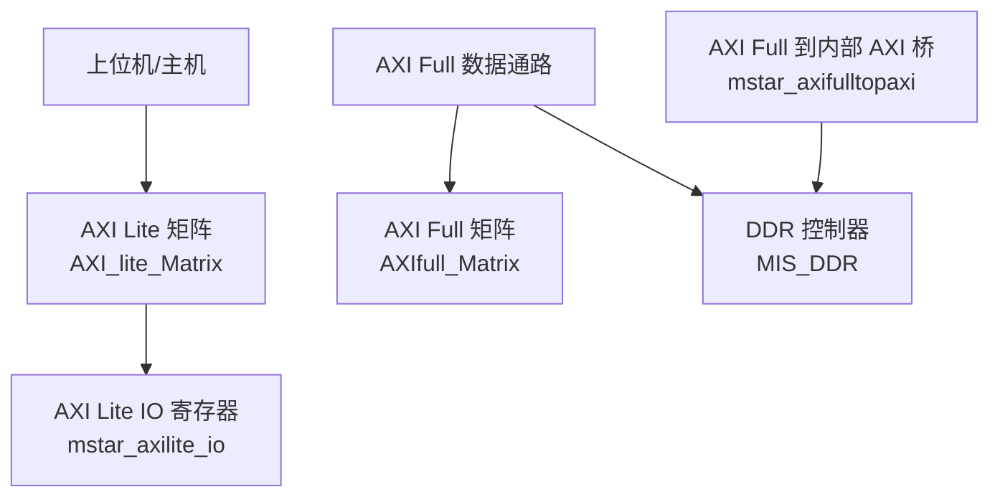
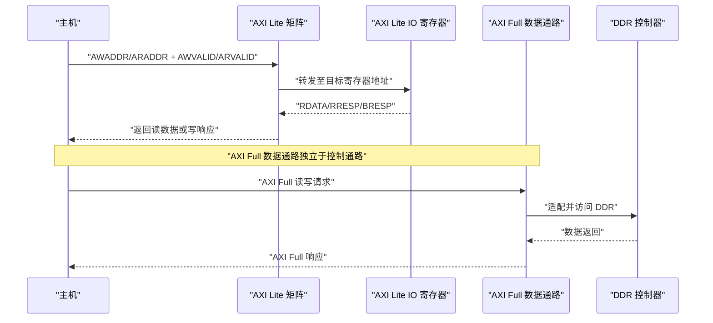
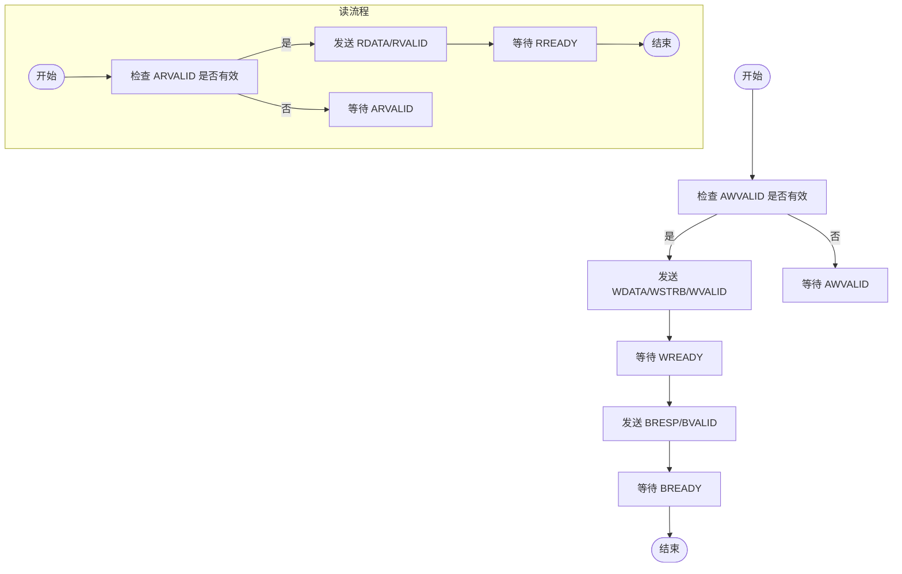
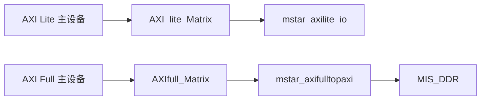

# AXI Lite总线详解

<cite>
**本文引用的文件**   
- [README.md](file://README.md)
- [mstar_axilite_io.v](file://hdl/axi_io/mstar_axilite_io.v)
- [AXI_lite_Matrix.v](file://al_ip/AXI_lite_Matrix/AXI_lite_Matrix.v)
- [mstar_axifulltopaxi.v](file://hdl/axi_io/mstar_axifulltopaxi.v)
- [AXIfull_Matrix.xml](file://al_ip/AXIfull_Matrix/AXIfull_Matrix.xml)
- [AXI_Clock_Converter_ddr.txt](file://al_ip/AXI_Clock_Converter_ddr/.params_AXI_Clock_Converter_ddr.txt)
</cite>

## 目录
1. [引言](#引言)
2. [项目结构](#项目结构)
3. [核心组件](#核心组件)
4. [架构总览](#架构总览)
5. [详细组件分析](#详细组件分析)
6. [依赖关系分析](#依赖关系分析)
7. [性能与资源特性](#性能与资源特性)
8. [故障排查指南](#故障排查指南)
9. [结论](#结论)
10. [附录：寄存器映射与编程示例](#附录寄存器映射与编程示例)

## 引言
本技术文档围绕系统中的 AXI Lite 控制通路展开，重点说明其在系统配置、状态监控与参数设置等控制场景中的用途。通过对比 AXI Lite 与 AXI Full 的差异，强调 AXI Lite 的简化接口更适合小数据量、低延迟的控制寄存器访问。文档进一步解析关键信号（ADDR、WDATA、BRESP 等），给出寄存器映射策略与访问时序，并提供典型配置场景与编程示例，帮助读者快速上手通过 AXI Lite 接口控制系统各模块。

## 项目结构
本项目为多通道 AD 数据采集设备端 FPGA 工程，包含以太网 UDP 传输、DDR 缓存、触发控制以及 AXI Lite 寄存器接口等。其中与 AXI Lite 直接相关的代码位于 hdl/axi_io 与 al_ip/AXI_lite_Matrix 两个目录；同时项目中存在 AXI Full 路径用于大数据流（如 DDR）访问，便于对比理解。

图表来源
- [AXI_lite_Matrix.v:12-92](file://al_ip/AXI_lite_Matrix/AXI_lite_Matrix.v#L12-L92)
- [mstar_axilite_io.v:22-55](file://hdl/axi_io/mstar_axilite_io.v#L22-L55)
- [mstar_axifulltopaxi.v:9-72](file://hdl/axi_io/mstar_axifulltopaxi.v#L9-L72)

章节来源
- [README.md:23-73](file://README.md#L23-L73)

## 核心组件
- AXI Lite 矩阵（AXI_lite_Matrix）：将外部 AXI Lite 主设备接入多个从设备，负责地址路由与仲裁转发。
- AXI Lite IO 寄存器（mstar_axilite_io）：实现具体的寄存器读写逻辑，提供系统配置、状态读取与 I/O 控制。
- AXI Full 数据通路（AXIfull_Matrix + MIS_DDR + mstar_axifulltopaxi）：面向高带宽数据（如 DDR）的 AXI Full 路径，与 AXI Lite 控制通路分离。

章节来源
- [AXI_lite_Matrix.v:12-92](file://al_ip/AXI_lite_Matrix/AXI_lite_Matrix.v#L12-L92)
- [mstar_axilite_io.v:22-55](file://hdl/axi_io/mstar_axilite_io.v#L22-L55)
- [mstar_axifulltopaxi.v:9-72](file://hdl/axi_io/mstar_axifulltopaxi.v#L9-L72)

## 架构总览
下图展示系统中 AXI Lite 控制通路与 AXI Full 数据通路的整体交互关系。AXI Lite 仅用于控制寄存器访问，AXI Full 用于大数据流（例如 DDR）。

图表来源
- [AXI_lite_Matrix.v:12-92](file://al_ip/AXI_lite_Matrix/AXI_lite_Matrix.v#L12-L92)
- [mstar_axilite_io.v:22-55](file://hdl/axi_io/mstar_axilite_io.v#L22-L55)
- [mstar_axifulltopaxi.v:9-72](file://hdl/axi_io/mstar_axifulltopaxi.v#L9-L72)

## 详细组件分析

### AXI Lite 与 AXI Full 差异对比
- 数据宽度与突发：
  - AXI Lite：固定 32 位数据宽度，无突发长度字段（awlen/arlen），单次事务即完成。
  - AXI Full：支持可变数据宽度（如 128 位），具备突发长度（awlen/arlen）、last 信号等，适合大数据吞吐。
- 握手与状态机复杂度：
  - AXI Lite：握手简单，状态机简洁，资源占用少。
  - AXI Full：需要处理突发、乱序、QoS、锁等特性，状态机复杂度高。
- 适用场景：
  - AXI Lite：控制寄存器、配置、状态读取等小数据量、低延迟场景。
  - AXI Full：高速数据流（如 DMA、DDR）等高吞吐场景。

章节来源
- [mstar_axifulltopaxi.v:9-72](file://hdl/axi_io/mstar_axifulltopaxi.v#L9-L72)
- [AXI_Clock_Converter_ddr.txt:1-24](file://al_ip/AXI_Clock_Converter_ddr/.params_AXI_Clock_Converter_ddr.txt#L1-L24)

### AXI Lite 接口信号与行为
- 地址通道（写）：AWADDR、AWVALID、AWREADY
- 数据通道（写）：WDATA、WSTRB、WVALID、WREADY
- 写响应通道：BRESP、BVALID、BREADY
- 地址通道（读）：ARADDR、ARVALID、ARREADY
- 读数据通道：RDATA、RRESP、RVALID、RREADY

在 mstar_axilite_io 中：
- 写 FSM：等待 AWVALID→接收 WDATA→发送 BRESP/BVALID。
- 读 FSM：等待 ARVALID→输出 RDATA/RVALID。
- 所有响应默认 OKAY（RRESP/BRESP=2'b00）。

章节来源
- [mstar_axilite_io.v:86-164](file://hdl/axi_io/mstar_axilite_io.v#L86-L164)

### 寄存器映射策略
mstar_axilite_io 定义了以下寄存器地址（按字节偏移）：
- ADDR_ID：设备标识符，只读，返回 MODEL_ID。
- ADDR_SYSCON：系统控制寄存器，可读写，bit[1:0] 控制触发使能（trigout_en/trigin_en）。
- ADDR_OUT_REG：输出寄存器，可写，bit[3:0] 控制 LED 输出（out_led=~out_io）。
- ADDR_IN_REG：输入寄存器，只读，bit[1:0] 读取外部输入（in_io）。

建议的映射策略：
- 以 4 字节对齐，每个寄存器占 4 字节。
- 使用 WSTRB 进行字节掩码写入，确保部分字节的更新不影响其他位。
- 对只读寄存器（如 ADDR_ID、ADDR_IN_REG）不响应写操作。

章节来源
- [mstar_axilite_io.v:56-59](file://hdl/axi_io/mstar_axilite_io.v#L56-L59)
- [mstar_axilite_io.v:166-192](file://hdl/axi_io/mstar_axilite_io.v#L166-L192)

### 访问时序与状态机
- 写时序：
  - 主机发送 AWADDR+AWVALID，从机返回 AWREADY。
  - 主机发送 WDATA+WSTRB+WVALID，从机返回 WREADY。
  - 从机发送 BRESP+BVALID，主机确认 BREADY。
- 读时序：
  - 主机发送 ARADDR+ARVALID，从机返回 ARREADY。
  - 从机发送 RDATA+RVALID，主机确认 RREADY。

图表来源
- [mstar_axilite_io.v:86-164](file://hdl/axi_io/mstar_axilite_io.v#L86-L164)

## 依赖关系分析
- AXI Lite 矩阵（AXI_lite_Matrix）作为中央枢纽，将外部 AXI Lite 主设备连接到内部从设备（如 mstar_axilite_io）。
- AXI Full 矩阵（AXIfull_Matrix）与 MIS_DDR 构成数据通路，与 AXI Lite 控制通路解耦。
- mstar_axifulltopaxi 作为桥接层，将 AXI Full 128 位数据转换为内部 AXI 接口，适配 DDR 控制器。

图表来源
- [AXI_lite_Matrix.v:12-92](file://al_ip/AXI_lite_Matrix/AXI_lite_Matrix.v#L12-L92)
- [AXIfull_Matrix.xml:21-2312](file://al_ip/AXIfull_Matrix/AXIfull_Matrix.xml#L21-L2312)
- [mstar_axifulltopaxi.v:9-72](file://hdl/axi_io/mstar_axifulltopaxi.v#L9-L72)

章节来源
- [AXI_lite_Matrix.v:12-92](file://al_ip/AXI_lite_Matrix/AXI_lite_Matrix.v#L12-L92)
- [AXIfull_Matrix.xml:21-2312](file://al_ip/AXIfull_Matrix/AXIfull_Matrix.xml#L21-L2312)
- [mstar_axifulltopaxi.v:9-72](file://hdl/axi_io/mstar_axifulltopaxi.v#L9-L72)

## 性能与资源特性
- AXI Lite 由于接口简化，状态机与组合逻辑较少，资源占用低，适合控制通路。
- AXI Full 支持突发、乱序、用户信号等高级特性，但资源开销大，适合数据通路。
- 在本项目中，控制与数据通路分离，有助于避免控制延迟被大数据吞吐阻塞。

章节来源
- [mstar_axilite_io.v:86-164](file://hdl/axi_io/mstar_axilite_io.v#L86-L164)
- [mstar_axifulltopaxi.v:9-72](file://hdl/axi_io/mstar_axifulltopaxi.v#L9-L72)

## 故障排查指南
- 写操作无响应：
  - 检查 AWVALID/AWREADY 握手是否正确。
  - 确认 WVALID/WREADY 握手是否完成。
  - 验证 BRESP/BVALID/BREADY 握手是否完成。
- 读操作无数据：
  - 检查 ARVALID/ARREADY 握手是否正确。
  - 确认 RVALID/RREADY 握手是否完成。
  - 验证 RDATA 是否在正确时钟边沿输出。
- 寄存器值异常：
  - 检查 WSTRB 掩码是否正确。
  - 确认地址解码逻辑是否匹配预期寄存器地址。

章节来源
- [mstar_axilite_io.v:86-192](file://hdl/axi_io/mstar_axilite_io.v#L86-L192)

## 结论
AXI Lite 在本项目中承担控制通路职责，其简化接口与低资源占用特性非常适合系统配置、状态监控与参数设置等场景。通过将控制通路与数据通路分离，系统在保证高吞吐数据流的同时，提供了稳定可靠的控制接口。开发者可通过本文提供的寄存器映射与访问时序指导，快速集成与调试 AXI Lite 控制功能。

## 附录：寄存器映射与编程示例

### 寄存器映射表
| 地址偏移 | 名称     | 类型   | 描述                           |
|----------|----------|--------|--------------------------------|
| 0x00     | ADDR_ID  | 只读   | 设备标识符，返回 MODEL_ID      |
| 0x04     | ADDR_SYSCON | 读写 | bit[1:0] 控制触发使能         |
| 0x08     | ADDR_OUT_REG | 写   | bit[3:0] 控制 LED 输出       |
| 0x0C     | ADDR_IN_REG | 只读 | bit[1:0] 读取外部输入         |

章节来源
- [mstar_axilite_io.v:56-59](file://hdl/axi_io/mstar_axilite_io.v#L56-L59)
- [mstar_axilite_io.v:166-192](file://hdl/axi_io/mstar_axilite_io.v#L166-L192)

### 典型配置场景
- 配置触发使能：
  - 向 ADDR_SYSCON 写入 bit[1:0]，启用或禁用触发输出/输入。
- 控制 LED 输出：
  - 向 ADDR_OUT_REG 写入 bit[3:0]，控制 LED 亮灭。
- 读取外部输入状态：
  - 从 ADDR_IN_REG 读取 bit[1:0]，获取外部输入状态。

### 编程示例（伪代码）
- 写触发使能：
  - 步骤：发送 AWADDR=ADDR_SYSCON → 发送 WDATA={...trigin_en,trigout_en,...} → 等待 BRESP。
- 读设备 ID：
  - 步骤：发送 ARADDR=ADDR_ID → 等待 RDATA。

章节来源
- [mstar_axilite_io.v:86-192](file://hdl/axi_io/mstar_axilite_io.v#L86-L192)