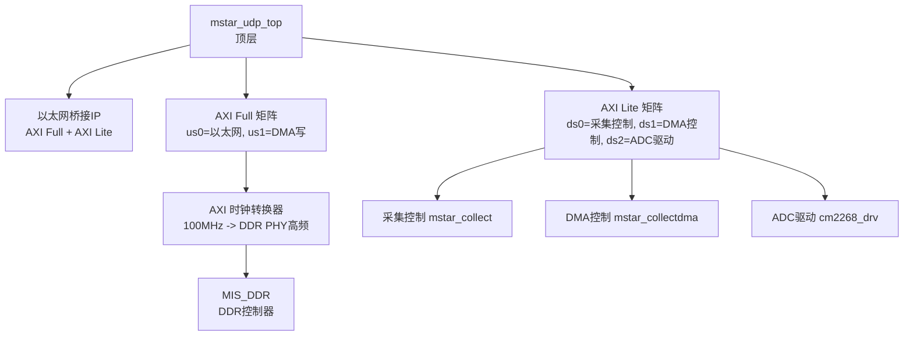
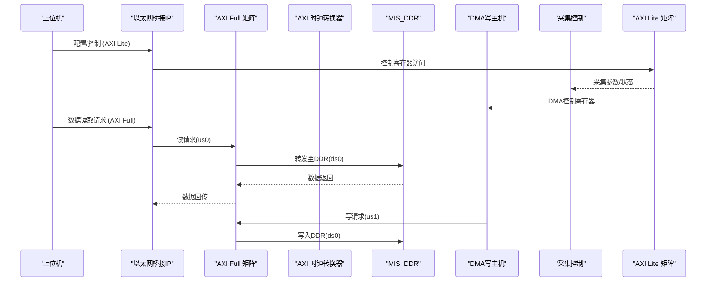
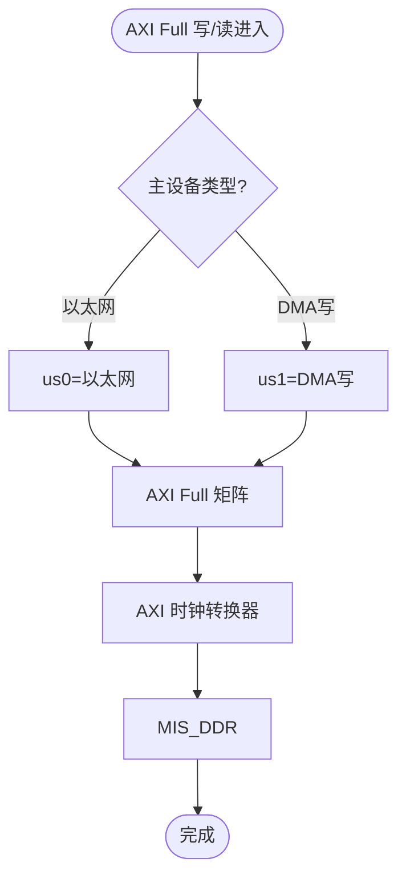
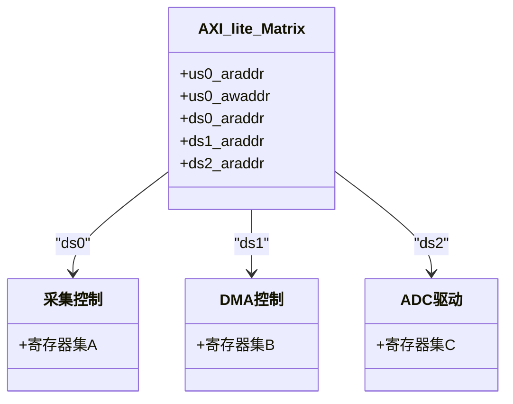
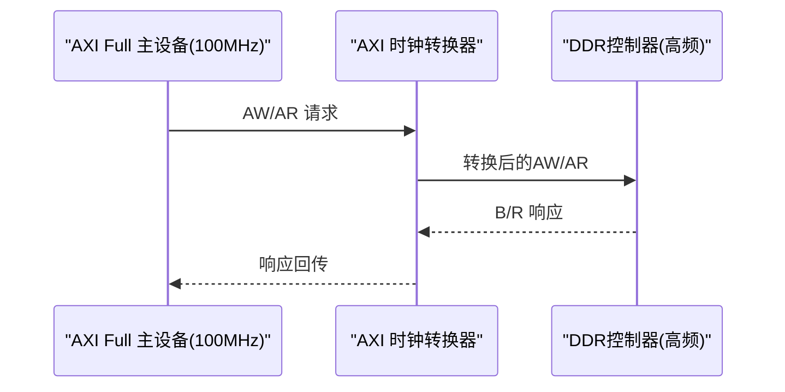
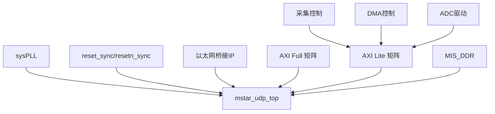

# 总线拓扑结构

<cite>
**本文引用的文件**   
- [README.md](file://README.md)
- [mstar_udp_top.v](file://hdl/mstar_udp_top.v)
- [AXIfull_Matrix.v](file://al_ip/AXIfull_Matrix/AXIfull_Matrix.v)
- [AXI_lite_Matrix.v](file://al_ip/AXI_lite_Matrix/AXI_lite_Matrix.v)
- [AXI_Clock_Converter_ddr.v](file://al_ip/AXI_Clock_Converter_ddr/AXI_Clock_Converter_ddr.v)
- [MIS_DDR.v](file://al_ip/MIS_DDR/MIS_DDR.v)
- [mstar_axifulltopaxi.v](file://hdl/axi_io/mstar_axifulltopaxi.v)
- [mstar_axilite_io.v](file://hdl/axi_io/mstar_axilite_io.v)
- [adchip_ctrl.v](file://hdl/ad_driver/adchip_ctrl.v)
</cite>

## 目录
1. [引言](#引言)
2. [项目结构](#项目结构)
3. [核心组件](#核心组件)
4. [架构总览](#架构总览)
5. [详细组件分析](#详细组件分析)
6. [依赖关系分析](#依赖关系分析)
7. [性能与带宽分配](#性能与带宽分配)
8. [故障排查指南](#故障排查指南)
9. [结论](#结论)

## 引言
本文件面向 AXI 总线系统的拓扑结构与数据流，重点说明：
- AXI Full 总线用于高速数据传输（DDR、以太网），承担大吞吐量的读写通道。
- AXI Lite 总线用于控制寄存器访问，承载配置与控制命令。
- 总线矩阵的仲裁机制与地址映射策略。
- 时钟转换器在不同频率总线间的桥接作用。
- 主从设备关系、带宽分配与关键优化点。

该工程为多通道 AD 数据采集系统，通过以太网 UDP 将采集数据经 DDR 缓存后输出至上位机，同时提供 AXI Lite 接口供上位机配置采集参数。

**章节来源**
- [README.md:5-14](file://README.md#L5-L14)

## 项目结构
工程顶层模块 mstar_udp_top 集成以下关键子系统：
- 以太网桥接 IP（加密网表）：提供 RGMII 接口与 AXI Full/Lite 接口。
- AXI Full 矩阵：汇聚以太网与 DMA 写主机到 DDR 控制器。
- AXI Lite 矩阵：汇聚上层控制逻辑（采集控制、ADC 驱动等）到各子模块寄存器。
- DDR 控制器 MIS_DDR：对外暴露 AXI Full 接口并管理物理 DDR。
- AXI 时钟转换器：在 100MHz AXI Full 域与 DDR PHY 高频域之间进行协议与时钟桥接。

**图表来源**
- [mstar_udp_top.v:371-414](file://hdl/mstar_udp_top.v#L371-L414)
- [mstar_udp_top.v:484-569](file://hdl/mstar_udp_top.v#L484-L569)
- [mstar_udp_top.v:676-920](file://hdl/mstar_udp_top.v#L676-L920)
- [MIS_DDR.v:84-130](file://al_ip/MIS_DDR/MIS_DDR.v#L84-L130)

**章节来源**
- [README.md:23-73](file://README.md#L23-L73)
- [mstar_udp_top.v:371-414](file://hdl/mstar_udp_top.v#L371-L414)

## 核心组件
- AXI Full 矩阵（AXIfull_Matrix）
  - 2个用户端（us0=以太网读/写，us1=DMA写），1个从端（ds0=DDR）。
  - 支持 128-bit 数据宽度、27-bit 地址宽度。
  - 内部封装安路矩阵 wrapper，参数化配置连接性与仲裁优先级。
- AXI Lite 矩阵（AXI_lite_Matrix）
  - 1个用户端（us0=外部 AXI Lite 主设备），3个从端（ds0/ds1/ds2=采集控制/DMA控制/ADC驱动）。
  - 32-bit 数据宽度、10-bit 地址宽度。
  - 参数化基址与地址范围，实现地址路由。
- AXI 时钟转换器（AXI_Clock_Converter_ddr）
  - 在 us_aclk=100MHz 与 ds_aclk=DDR PHY 高频之间转换 AXI Full 协议。
  - 支持异步时钟域、双向读写通道。
- DDR 控制器（MIS_DDR）
  - 对外提供 AXI Full 接口，内部封装 DDR PHY 与内存控制器。
  - 配置 APB 接口用于初始化与调试。

**章节来源**
- [AXIfull_Matrix.v:12-155](file://al_ip/AXIfull_Matrix/AXIfull_Matrix.v#L12-L155)
- [AXI_lite_Matrix.v:12-116](file://al_ip/AXI_lite_Matrix/AXI_lite_Matrix.v#L12-L116)
- [AXI_Clock_Converter_ddr.v:12-110](file://al_ip/AXI_Clock_Converter_ddr/AXI_Clock_Converter_ddr.v#L12-L110)
- [MIS_DDR.v:12-130](file://al_ip/MIS_DDR/MIS_DDR.v#L12-L130)

## 架构总览
下图展示系统级总线拓扑与数据流向：

**图表来源**
- [mstar_udp_top.v:591-675](file://hdl/mstar_udp_top.v#L591-L675)
- [mstar_udp_top.v:763-920](file://hdl/mstar_udp_top.v#L763-L920)
- [mstar_udp_top.v:484-569](file://hdl/mstar_udp_top.v#L484-L569)
- [MIS_DDR.v:148-178](file://al_ip/MIS_DDR/MIS_DDR.v#L148-L178)

## 详细组件分析

### AXI Full 总线与 DDR 路径
- 角色分工
  - 以太网桥接 IP 作为 AXI Full 主设备发起读请求，获取缓存于 DDR 中的数据。
  - DMA 写主机作为 AXI Full 主设备将采集数据写入 DDR。
  - MIS_DDR 作为 AXI Full 从设备，负责将 AXI 事务转换为 DDR 时序。
- 时钟域
  - AXI Full 工作于 w_axifull_clk=100MHz。
  - DDR PHY 工作在更高频率（由 MIS_DDR 内部 PLL 生成），通过 AXI 时钟转换器桥接。
- 地址与数据宽度
  - 数据宽度 128-bit，地址宽度 27-bit（顶层使用 26-bit 有效地址）。
  - 突发长度与尺寸由以太网与 DMA 侧设置，矩阵统一转发。

**图表来源**
- [mstar_udp_top.v:763-920](file://hdl/mstar_udp_top.v#L763-L920)
- [mstar_udp_top.v:484-569](file://hdl/mstar_udp_top.v#L484-L569)
- [MIS_DDR.v:148-178](file://al_ip/MIS_DDR/MIS_DDR.v#L148-L178)

**章节来源**
- [mstar_udp_top.v:763-920](file://hdl/mstar_udp_top.v#L763-L920)
- [AXIfull_Matrix.v:131-155](file://al_ip/AXIfull_Matrix/AXIfull_Matrix.v#L131-L155)
- [AXI_Clock_Converter_ddr.v:98-110](file://al_ip/AXI_Clock_Converter_ddr/AXI_Clock_Converter_ddr.v#L98-L110)
- [MIS_DDR.v:148-178](file://al_ip/MIS_DDR/MIS_DDR.v#L148-L178)

### AXI Lite 总线与控制寄存器
- 角色分工
  - 外部 AXI Lite 主设备（通常来自上位机或系统控制逻辑）通过 us0 接入矩阵。
  - 三个从端 ds0/ds1/ds2 分别对应：
    - ds0: 采集控制 mstar_collect
    - ds1: DMA控制 mstar_collectdma
    - ds2: ADC驱动 cm2268_drv
- 地址映射
  - 矩阵参数中定义各从端基址与地址宽度，按地址段路由到相应从设备。
  - 顶层仅使用低 12 位地址（m0_axilite_araddr[11:0]），符合矩阵配置的 10-bit 地址宽度扩展。

**图表来源**
- [AXI_lite_Matrix.v:94-116](file://al_ip/AXI_lite_Matrix/AXI_lite_Matrix.v#L94-L116)
- [mstar_udp_top.v:676-762](file://hdl/mstar_udp_top.v#L676-L762)
- [mstar_udp_top.v:951-1099](file://hdl/mstar_udp_top.v#L951-L1099)

**章节来源**
- [AXI_lite_Matrix.v:94-116](file://al_ip/AXI_lite_Matrix/AXI_lite_Matrix.v#L94-L116)
- [mstar_udp_top.v:676-762](file://hdl/mstar_udp_top.v#L676-L762)
- [mstar_udp_top.v:951-1099](file://hdl/mstar_udp_top.v#L951-L1099)

### 时钟转换器与跨时钟域桥接
- 功能
  - 将 100MHz AXI Full 域的请求与数据桥接到 DDR PHY 的高频域。
  - 支持异步时钟域（IS_ACLK_ASYNC=1），确保稳定握手与数据完整性。
- 参数
  - US_ACLK_RATIO=1，DS_ACLK_RATIO=8，表明目标时钟约为源时钟的 8 倍。
  - 支持读写通道（SUPPORTS_WRITE_CHANNEL=1，SUPPORTS_READ_CHANNEL=1）。

**图表来源**
- [AXI_Clock_Converter_ddr.v:98-110](file://al_ip/AXI_Clock_Converter_ddr/AXI_Clock_Converter_ddr.v#L98-L110)
- [mstar_udp_top.v:484-569](file://hdl/mstar_udp_top.v#L484-L569)

**章节来源**
- [AXI_Clock_Converter_ddr.v:98-110](file://al_ip/AXI_Clock_Converter_ddr/AXI_Clock_Converter_ddr.v#L98-L110)
- [mstar_udp_top.v:484-569](file://hdl/mstar_udp_top.v#L484-L569)

### 总线协议实现细节与优化
- AXI Full
  - 数据宽度 128-bit，适合高吞吐场景（以太网与 DDR）。
  - 突发传输（burst）与掩码（strb）支持细粒度写操作。
  - ID 通道可用于区分不同事务，便于乱序处理与重排序。
- AXI Lite
  - 32-bit 数据宽度，简单握手，适合控制寄存器访问。
  - 矩阵根据地址范围路由，避免竞争与冲突。
- 矩阵仲裁
  - 通过参数 AL_US_AXI_ARB_PRIORITY 与 AL_DS_AXI_*_ISSUING 配置优先级与并发度。
  - 连接性矩阵（AL_AXI_WRITE_CONNECTIVITY/READ_CONNECTIVITY）决定主从连通关系。
- 地址映射
  - 矩阵参数 AL_DS_AXI_BASE_ADDR 与各从端地址宽度定义地址空间划分。
  - 顶层对地址位宽进行裁剪与对齐，确保与矩阵配置一致。

**章节来源**
- [AXIfull_Matrix.v:131-155](file://al_ip/AXIfull_Matrix/AXIfull_Matrix.v#L131-L155)
- [AXI_lite_Matrix.v:94-116](file://al_ip/AXI_lite_Matrix/AXI_lite_Matrix.v#L94-L116)
- [mstar_udp_top.v:763-920](file://hdl/mstar_udp_top.v#L763-L920)

## 依赖关系分析
- 顶层模块依赖
  - sysPLL 产生多频时钟（125MHz、100MHz、50MHz）。
  - reset_sync/resetn_sync 提供复位同步。
  - 以太网桥接 IP 提供 RGMII 与 AXI 接口。
  - AXI 矩阵与 DDR 控制器构成数据通路。
  - 采集控制、DMA控制、ADC驱动通过 AXI Lite 矩阵接入。

**图表来源**
- [mstar_udp_top.v:371-414](file://hdl/mstar_udp_top.v#L371-L414)
- [mstar_udp_top.v:591-675](file://hdl/mstar_udp_top.v#L591-L675)
- [mstar_udp_top.v:676-920](file://hdl/mstar_udp_top.v#L676-L920)

**章节来源**
- [mstar_udp_top.v:371-414](file://hdl/mstar_udp_top.v#L371-L414)
- [mstar_udp_top.v:591-675](file://hdl/mstar_udp_top.v#L591-L675)

## 性能与带宽分配
- 带宽分配
  - AXI Full 总线承载以太网读与 DMA 写，两者共享同一从端（DDR）。
  - 以太网读通常为周期性突发读取，DMA 写为连续写入，需合理设置突发长度与 QoS。
- 仲裁策略
  - 通过矩阵参数调整 us0/us1 的优先级与并发度，平衡以太网与 DMA 的吞吐。
  - 建议在高负载时提升以太网读的优先级，保证实时性；在批量写入时提升 DMA 写的并发度。
- 时钟域隔离
  - AXI 时钟转换器隔离 100MHz 与 DDR PHY 高频域，避免跨时钟域抖动影响。
- 优化建议
  - 增大突发长度（arlen/awlen）以提升带宽利用率。
  - 合理设置 arsize/awsize 以匹配 128-bit 数据宽度。
  - 使用 QOS 字段区分紧急与常规事务。

**章节来源**
- [AXIfull_Matrix.v:131-155](file://al_ip/AXIfull_Matrix/AXIfull_Matrix.v#L131-L155)
- [mstar_udp_top.v:763-920](file://hdl/mstar_udp_top.v#L763-L920)

## 故障排查指南
- 常见问题
  - AXI Full 无响应：检查时钟转换器复位与锁相环锁定状态。
  - AXI Lite 访问失败：确认地址映射与矩阵基址配置是否匹配。
  - DDR 读写错误：检查 MIS_DDR 初始化序列与 APB 配置。
- 调试手段
  - 观察 LED 指示与 link_error 信号判断以太网链路状态。
  - 通过 AXI Lite 寄存器读取状态位，定位采集与 DMA 流程。
  - 使用逻辑分析仪抓取 AXI 握手信号，验证 valid/ready 时序。

**章节来源**
- [mstar_udp_top.v:356-370](file://hdl/mstar_udp_top.v#L356-L370)
- [MIS_DDR.v:148-178](file://al_ip/MIS_DDR/MIS_DDR.v#L148-L178)

## 结论
本系统采用 AXI Full 与 AXI Lite 双总线架构，清晰分离高速数据与控制路径。AXI Full 矩阵汇聚以太网与 DMA 到 DDR，AXI Lite 矩阵分发控制到各子模块。时钟转换器确保跨时钟域的稳定桥接。通过矩阵参数化配置，可实现灵活的仲裁与地址映射策略，满足多通道 AD 采集与以太网传输的性能需求。