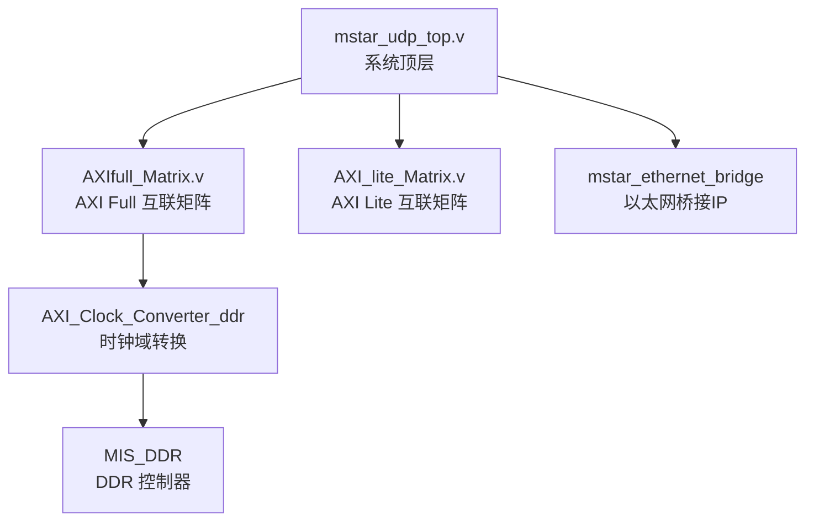
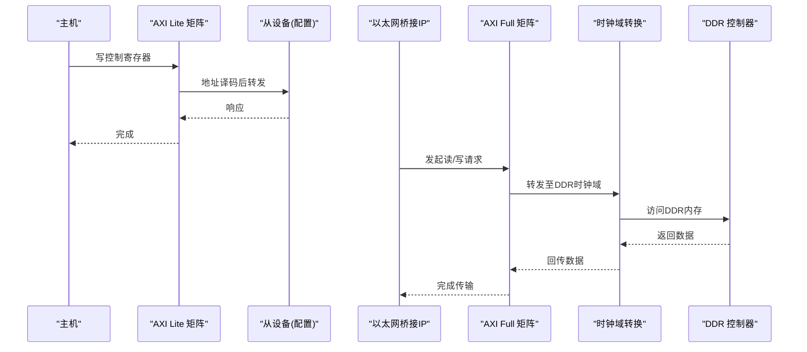
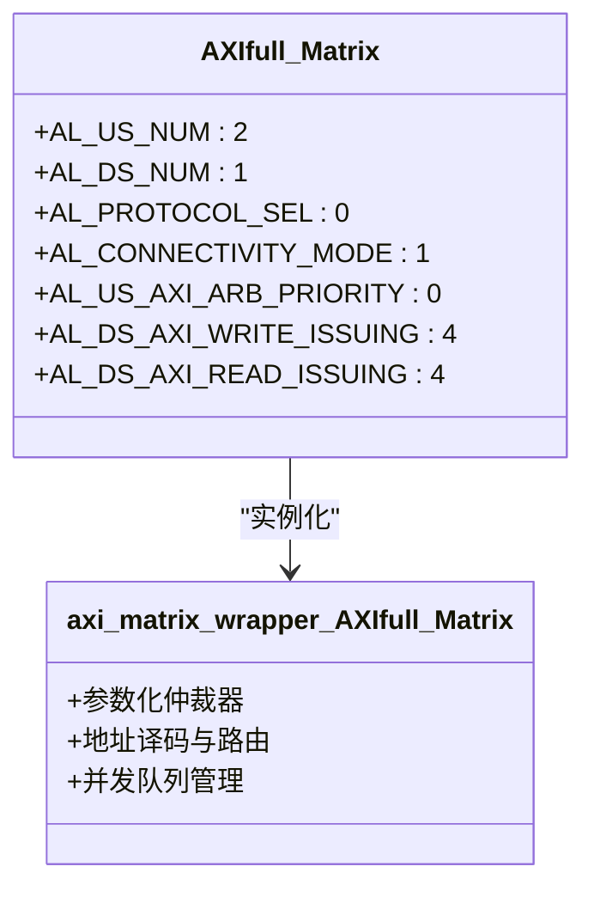
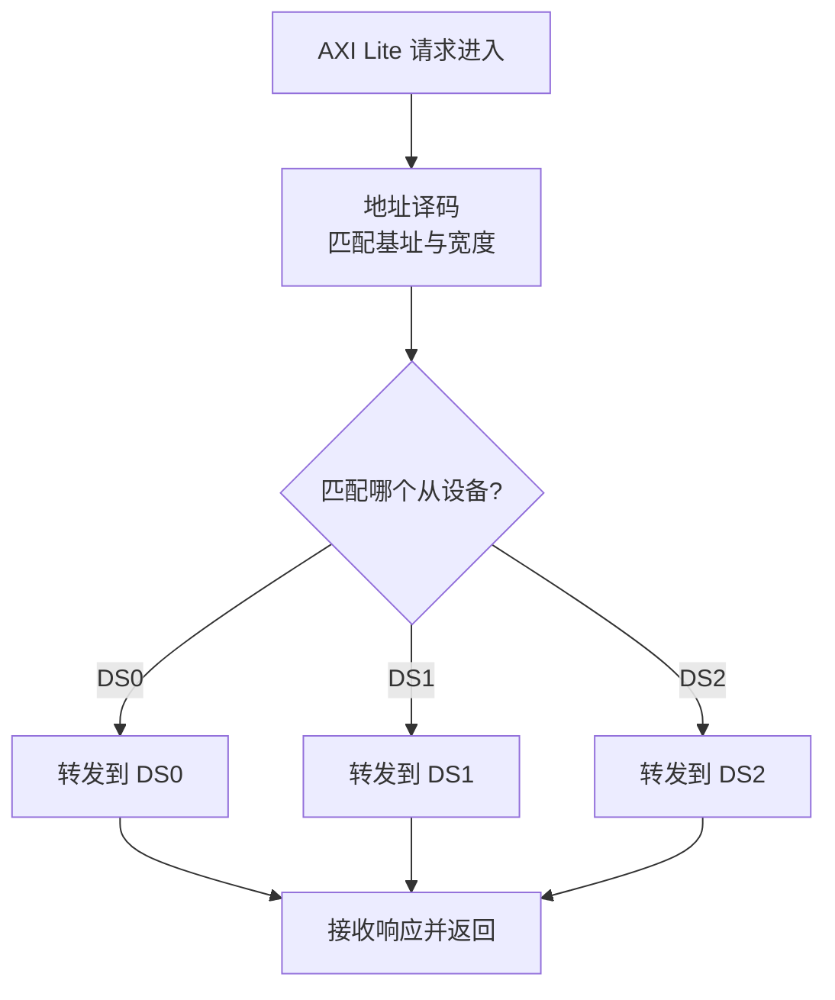
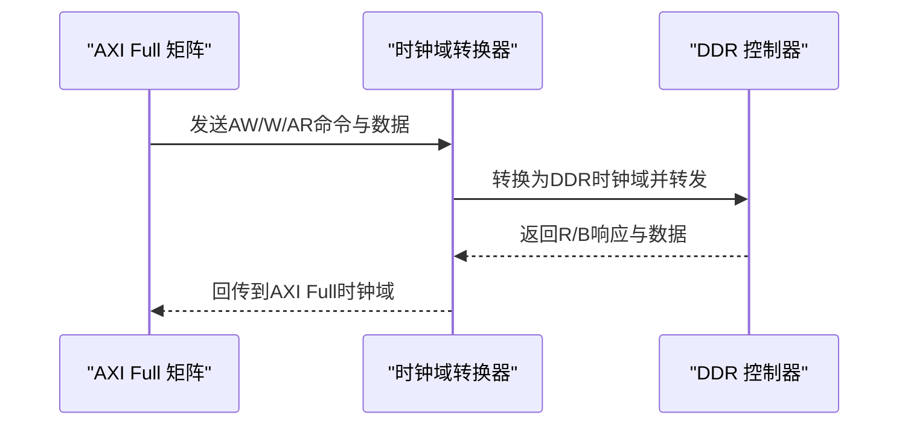
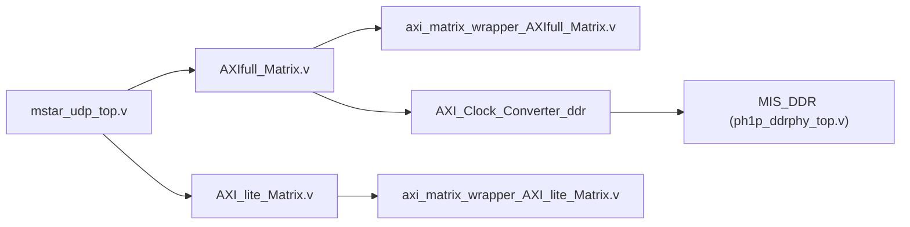

# 总线矩阵仲裁机制

<cite>
**本文引用的文件**   
- [README.md](file://README.md)
- [mstar_udp_top.v](file://hdl/mstar_udp_top.v)
- [AXIfull_Matrix.v](file://al_ip/AXIfull_Matrix/AXIfull_Matrix.v)
- [axi_matrix_wrapper_AXIfull_Matrix.v](file://al_ip/AXIfull_Matrix/RTL/axi_matrix_wrapper_AXIfull_Matrix.v)
- [AXI_lite_Matrix.v](file://al_ip/AXI_lite_Matrix/AXI_lite_Matrix.v)
- [axi_matrix_wrapper_AXI_lite_Matrix.v](file://al_ip/AXI_lite_Matrix/RTL/axi_matrix_wrapper_AXI_lite_Matrix.v)
- [ph1p_ddrphy_top.v](file://al_ip/MIS_DDR/src/rtl/phy/ph1p_ddrphy_top.v)
</cite>

## 目录
1. [引言](#引言)
2. [项目结构](#项目结构)
3. [核心组件](#核心组件)
4. [架构总览](#架构总览)
5. [详细组件分析](#详细组件分析)
6. [依赖关系分析](#依赖关系分析)
7. [性能与QoS特性](#性能与qos特性)
8. [故障排查指南](#故障排查指南)
9. [结论](#结论)

## 引言
本技术文档聚焦于多主设备共享单从设备的总线矩阵仲裁机制，围绕以下目标展开：
- 解释优先级仲裁算法、轮询机制与服务质量（QoS）保证
- 分析地址解码逻辑与路由表配置
- 对比不同仲裁模式的性能与适用场景
- 提供冲突解决策略与死锁避免机制
- 通过实际案例展示复杂拓扑下的数据传输路径与性能分析

本项目基于安路 PH1 FPGA，包含 AXI Full 数据通路矩阵与 AXI Lite 控制通路矩阵，分别用于高吞吐数据流与低延迟寄存器访问。DDR 控制器作为关键从设备，通过时钟域转换模块接入 AXI Full 矩阵。

## 项目结构
工程顶层 mstar_udp_top.v 将以太网桥接 IP、AXI Full/Lite 矩阵、DDR 控制器等集成在一起。其中：
- AXI Full 矩阵负责连接多个主设备到 DDR 控制器
- AXI Lite 矩阵负责将系统控制总线分发到多个从设备
- MIS_DDR 为 DDR 控制器，内部包含 PHY 与控制逻辑

**图表来源**
- [mstar_udp_top.v:415-569](file://hdl/mstar_udp_top.v#L415-L569)
- [AXIfull_Matrix.v:131-155](file://al_ip/AXIfull_Matrix/AXIfull_Matrix.v#L131-L155)
- [AXI_lite_Matrix.v:94-116](file://al_ip/AXI_lite_Matrix/AXI_lite_Matrix.v#L94-L116)

**章节来源**
- [README.md:23-73](file://README.md#L23-L73)
- [mstar_udp_top.v:415-569](file://hdl/mstar_udp_top.v#L415-L569)

## 核心组件
- AXI Full 矩阵：实现多主到单从的 AXI4 全功能互连，支持参数化优先级、并发度与地址范围映射
- AXI Lite 矩阵：实现控制通路的地址译码与多从设备分发
- DDR 控制器：提供大容量缓存，承载采集数据
- 时钟域转换器：在 AXI Full 主侧与 DDR 控制器之间进行跨时钟域适配

**章节来源**
- [AXIfull_Matrix.v:131-155](file://al_ip/AXIfull_Matrix/AXIfull_Matrix.v#L131-L155)
- [AXI_lite_Matrix.v:94-116](file://al_ip/AXI_lite_Matrix/AXI_lite_Matrix.v#L94-L116)
- [ph1p_ddrphy_top.v:3-156](file://al_ip/MIS_DDR/src/rtl/phy/ph1p_ddrphy_top.v#L3-L156)

## 架构总览
下图展示了系统级数据与控制通路：
- 数据通路：以太网桥接 IP → AXI Full 矩阵 → 时钟域转换 → DDR 控制器
- 控制通路：外部或内部主机 → AXI Lite 矩阵 → 各从设备（如配置寄存器）

**图表来源**
- [mstar_udp_top.v:591-675](file://hdl/mstar_udp_top.v#L591-L675)
- [mstar_udp_top.v:676-762](file://hdl/mstar_udp_top.v#L676-L762)
- [mstar_udp_top.v:763-800](file://hdl/mstar_udp_top.v#L763-L800)

## 详细组件分析

### AXI Full 矩阵与仲裁机制
AXI Full 矩阵实例化自 axi_matrix_wrapper，参数包括：
- AL_US_NUM=2：两个上游主端口
- AL_DS_NUM=1：一个下游从端口（DDR）
- AL_PROTOCOL_SEL=0：AXI4 协议
- AL_CONNECTIVITY_MODE=1：SAMD（共享地址、多数据）模式
- AL_US_AXI_ARB_PRIORITY：上游仲裁优先级（当前为0）
- AL_DS_AXI_WRITE_ISSUING / READ_ISSUING：下游最大并发事务数（均为4）

这些参数决定了：
- 地址空间划分与路由规则
- 主设备间的优先级与公平性
- 读写事务的并发能力与背压行为

**图表来源**
- [AXIfull_Matrix.v:131-155](file://al_ip/AXIfull_Matrix/AXIfull_Matrix.v#L131-L155)
- [axi_matrix_wrapper_AXIfull_Matrix.v:1-116](file://al_ip/AXIfull_Matrix/RTL/axi_matrix_wrapper_AXIfull_Matrix.v#L1-L116)

**章节来源**
- [AXIfull_Matrix.v:131-155](file://al_ip/AXIfull_Matrix/AXIfull_Matrix.v#L131-L155)
- [axi_matrix_wrapper_AXIfull_Matrix.v:1-116](file://al_ip/AXIfull_Matrix/RTL/axi_matrix_wrapper_AXIfull_Matrix.v#L1-L116)

### AXI Lite 矩阵与地址译码
AXI Lite 矩阵用于控制通路，参数包括：
- AL_US_NUM=1：单一上游
- AL_DS_NUM=3：三个下游从设备
- AL_PROTOCOL_SEL=2：AXI4Lite
- AL_DS_AXI_BASE_ADDR / AL_DS_AXI_ADDR_WIDTH：每个从设备的基址与地址宽度
- AL_US_AXI_ARB_PRIORITY：当前为0（单主无竞争）

该矩阵根据地址范围将请求路由到对应从设备，实现寄存器空间的解耦与扩展。

**图表来源**
- [AXI_lite_Matrix.v:94-116](file://al_ip/AXI_lite_Matrix/AXI_lite_Matrix.v#L94-L116)

**章节来源**
- [AXI_lite_Matrix.v:94-116](file://al_ip/AXI_lite_Matrix/AXI_lite_Matrix.v#L94-L116)

### DDR 控制器与时钟域转换
DDR 控制器通过 ph1p_ddrphy_top.v 暴露 AXI 接口，并由 AXI_Clock_Converter_ddr 在 AXI Full 主时钟与 DDR 控制器时钟之间进行同步。该设计确保：
- 数据通路在不同时钟域间稳定传输
- 时序约束满足 DDR PHY 要求
- 控制信号与复位序列正确对齐

**图表来源**
- [mstar_udp_top.v:484-569](file://hdl/mstar_udp_top.v#L484-L569)
- [ph1p_ddrphy_top.v:3-156](file://al_ip/MIS_DDR/src/rtl/phy/ph1p_ddrphy_top.v#L3-L156)

**章节来源**
- [mstar_udp_top.v:484-569](file://hdl/mstar_udp_top.v#L484-L569)
- [ph1p_ddrphy_top.v:3-156](file://al_ip/MIS_DDR/src/rtl/phy/ph1p_ddrphy_top.v#L3-L156)

## 依赖关系分析
- mstar_udp_top.v 依赖 AXI Full/Lite 矩阵以分离数据与控制通路
- AXI Full 矩阵依赖 axi_matrix_wrapper 实现仲裁与路由
- DDR 控制器依赖时钟域转换器以适配不同时钟域
- 以太网桥接 IP 通过 AXI Full 访问 DDR 存储数据

**图表来源**
- [mstar_udp_top.v:676-800](file://hdl/mstar_udp_top.v#L676-L800)
- [AXIfull_Matrix.v:131-155](file://al_ip/AXIfull_Matrix/AXIfull_Matrix.v#L131-L155)
- [AXI_lite_Matrix.v:94-116](file://al_ip/AXI_lite_Matrix/AXI_lite_Matrix.v#L94-L116)

**章节来源**
- [mstar_udp_top.v:676-800](file://hdl/mstar_udp_top.v#L676-L800)

## 性能与QoS特性
- 优先级仲裁：AL_US_AXI_ARB_PRIORITY 参数允许为主设备分配不同优先级；当前值为0，表示默认平等仲裁
- 并发控制：AL_DS_AXI_WRITE_ISSUING 与 AL_DS_AXI_READ_ISSUING 限制下游最大活跃事务数，防止拥塞
- QoS字段：AXI 协议的 arqos/awqos 可携带服务质量标记，但当前顶层未使用，由矩阵内部处理
- 模式选择：AL_CONNECTIVITY_MODE=1（SAMD）提升带宽利用率，适合大数据吞吐场景

建议优化方向：
- 若存在实时性要求高的主设备，可提高其 AL_US_AXI_ARB_PRIORITY
- 调整 AL_DS_AXI_*_ISSUING 以平衡吞吐与延迟
- 启用 USER 信号传递以增强 QoS 语义（需上层配合）

**章节来源**
- [AXIfull_Matrix.v:150-154](file://al_ip/AXIfull_Matrix/AXIfull_Matrix.v#L150-L154)
- [axi_matrix_wrapper_AXIfull_Matrix.v:82-116](file://al_ip/AXIfull_Matrix/RTL/axi_matrix_wrapper_AXIfull_Matrix.v#L82-L116)

## 故障排查指南
常见问题与定位方法：
- 总线阻塞：检查 AL_DS_AXI_*_ISSUING 是否过小导致背压；观察 bvalid/rvalid 是否长期不置位
- 地址冲突：核对 AL_DS_AXI_BASE_ADDR 与 AL_DS_AXI_ADDR_WIDTH 是否重叠；确认路由表配置
- 时钟域问题：验证 AXI_Clock_Converter_ddr 的时钟与复位同步；检查 ddr_dhi_clk 与 w_axifull_clk 的稳定性
- 优先级失效：确认 AL_US_AXI_ARB_PRIORITY 设置是否符合预期；检查是否有更高优先级主设备抢占

调试建议：
- 使用 AXI Lite 矩阵读取状态寄存器，监控各通道忙闲
- 在顶层添加握手信号探针，观察 valid/ready 握手情况
- 对 DDR 控制器 APB 接口进行配置校验，确保 PHY 初始化完成

**章节来源**
- [mstar_udp_top.v:415-569](file://hdl/mstar_udp_top.v#L415-L569)
- [AXI_lite_Matrix.v:94-116](file://al_ip/AXI_lite_Matrix/AXI_lite_Matrix.v#L94-L116)

## 结论
本项目的总线矩阵仲裁机制通过 AXI Full 与 AXI Lite 双矩阵分离数据与控制通路，结合参数化的优先级、并发度与地址路由，实现了高效的多主共享单从资源分配。DDR 控制器通过时钟域转换器稳定接入，满足高吞吐数据采集需求。未来可通过调整优先级与并发参数进一步优化 QoS 与性能表现。