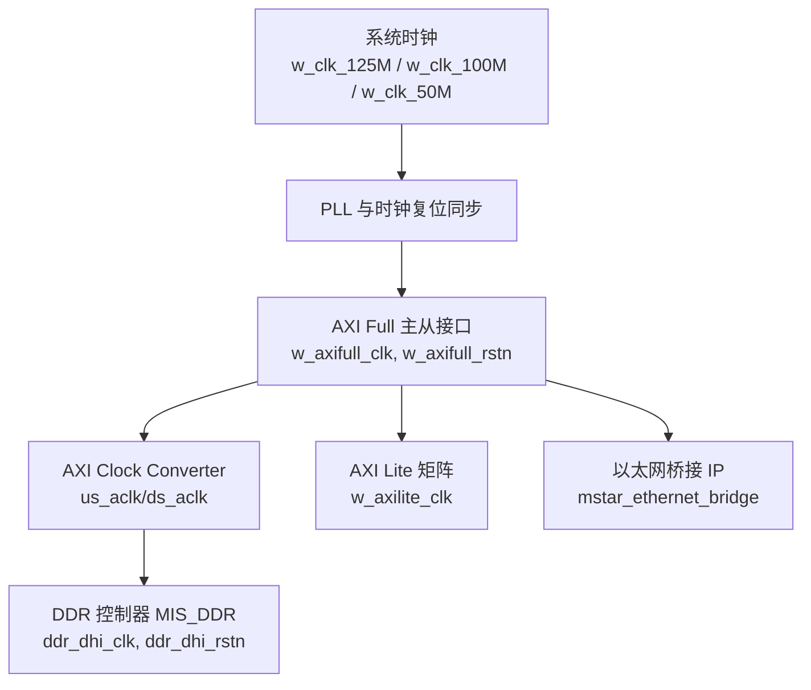
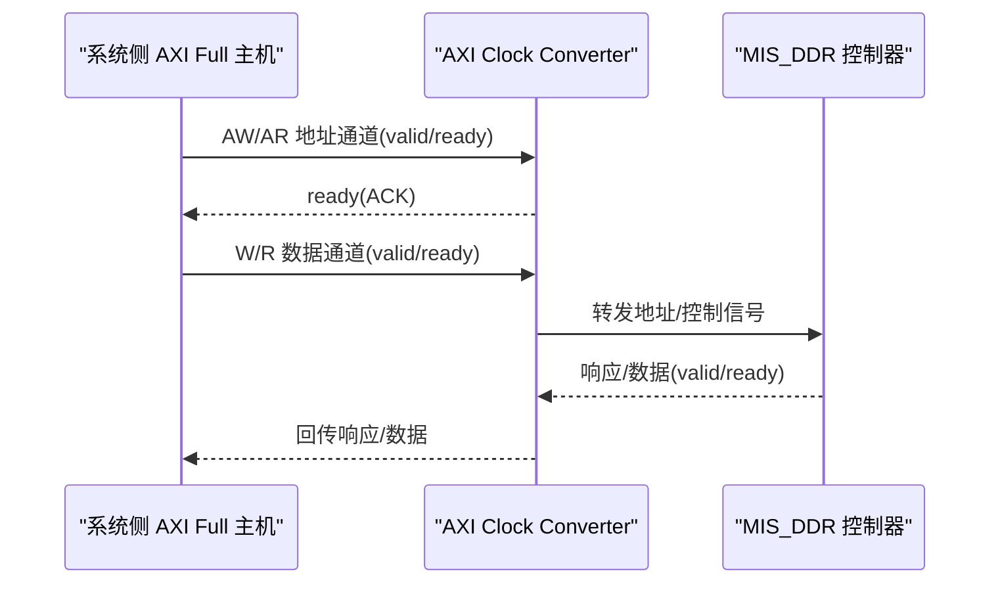
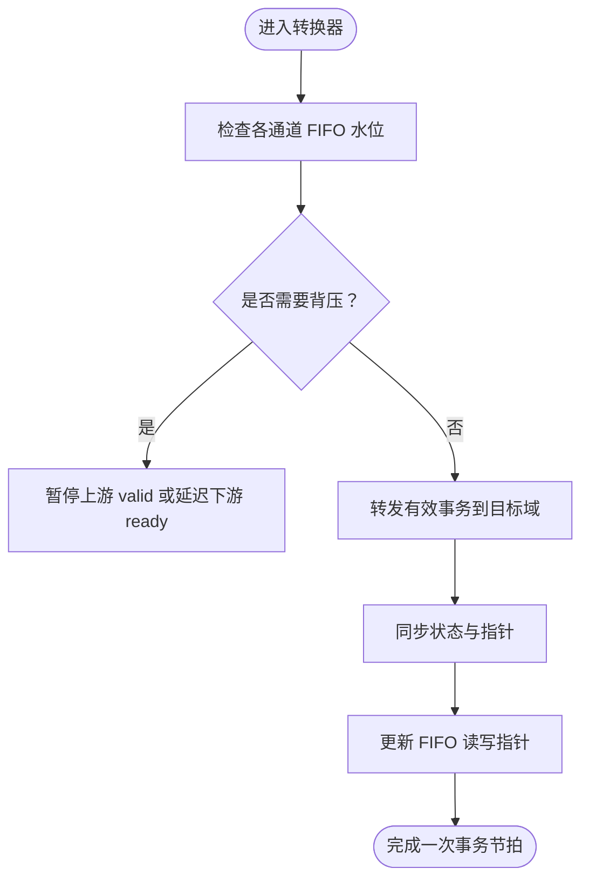
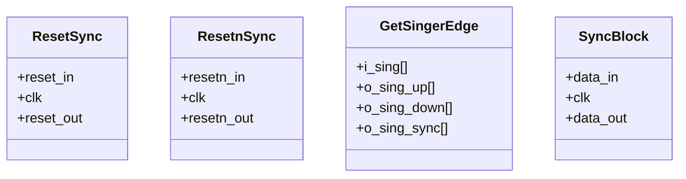
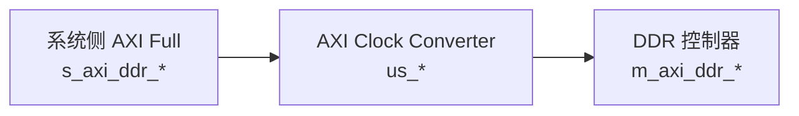
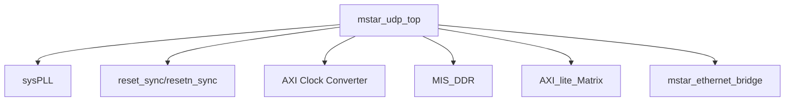

# 时钟域转换器

<cite>
**本文引用的文件**   
- [README.md](file://README.md)
- [mstar_udp_top.v](file://hdl/mstar_udp_top.v)
- [AXI_Clock_Converter_ddr.v](file://al_ip/AXI_Clock_Converter_ddr/AXI_Clock_Converter_ddr.v)
- [al_axi_clock_converter_AXI_Clock_Converter_ddr.v](file://al_ip/AXI_Clock_Converter_ddr/RTL/al_axi_clock_converter_AXI_Clock_Converter_ddr.v)
- [sync_block.v](file://hdl/sync/sync_block.v)
- [reset_sync.v](file://hdl/sync/reset_sync.v)
- [resetn_sync.v](file://hdl/sync/resetn_sync.v)
- [get_singer_edge.v](file://hdl/sync/get_singer_edge.v)
</cite>

## 目录
1. [引言](#引言)
2. [项目结构](#项目结构)
3. [核心组件](#核心组件)
4. [架构总览](#架构总览)
5. [详细组件分析](#详细组件分析)
6. [依赖关系分析](#依赖关系分析)
7. [性能与约束](#性能与约束)
8. [故障排查指南](#故障排查指南)
9. [结论](#结论)

## 引言
本技术文档围绕工程中的“时钟域转换器”展开，重点解释跨时钟域通信的挑战与解决方案，包括亚稳态抑制、握手协议与流控机制。结合工程中实际使用的安路 AXI Clock Converter IP，说明其在不同频率域（例如 100MHz AXI Full 域与 DDR PHY 更高频域）之间的数据桥接方式，并给出时序约束要求、性能评估方法与最佳实践。

## 项目结构
本项目为多通道 AD 数据采集设备端 FPGA 工程，顶层模块集成 AD 驱动、采集逻辑、DDR 缓存、以太网桥接 IP 以及 AXI 总线互联矩阵。其中，AXI Clock Converter 用于将系统侧的 AXI Full 接口转换到 DDR 控制器所需的时钟域。

图表来源
- [mstar_udp_top.v:371-414](file://hdl/mstar_udp_top.v#L371-L414)
- [mstar_udp_top.v:484-569](file://hdl/mstar_udp_top.v#L484-L569)

章节来源
- [README.md:23-73](file://README.md#L23-L73)
- [mstar_udp_top.v:371-414](file://hdl/mstar_udp_top.v#L371-L414)

## 核心组件
- AXI Clock Converter：在两个独立时钟域之间安全地传递 AXI 事务，内部通过 FIFO 缓冲和握手协议保证数据完整性与顺序性。
- 同步原语：提供信号边沿检测、复位同步等基础跨时钟域能力。
- 顶层连接：将系统侧 AXI Full 接口经转换器桥接到 DDR 控制器所需时钟域。

章节来源
- [AXI_Clock_Converter_ddr.v:12-137](file://al_ip/AXI_Clock_Converter_ddr/AXI_Clock_Converter_ddr.v#L12-L137)
- [al_axi_clock_converter_AXI_Clock_Converter_ddr.v:1-26](file://al_ip/AXI_Clock_Converter_ddr/RTL/al_axi_clock_converter_AXI_Clock_Converter_ddr.v#L1-L26)
- [sync_block.v:14-37](file://hdl/sync/sync_block.v#L14-L37)
- [reset_sync.v:13-41](file://hdl/sync/reset_sync.v#L13-L41)
- [resetn_sync.v:13-37](file://hdl/sync/resetn_sync.v#L13-L37)
- [get_singer_edge.v:21-38](file://hdl/sync/get_singer_edge.v#L21-L38)

## 架构总览
下图展示顶层中 AXI Clock Converter 的连接关系与时钟域划分：系统侧 AXI Full 使用 w_axifull_clk，DDR 控制器使用 ddr_dhi_clk；转换器负责两域间的事务转发与握手协调。

图表来源
- [mstar_udp_top.v:484-569](file://hdl/mstar_udp_top.v#L484-L569)
- [mstar_udp_top.v:415-483](file://hdl/mstar_udp_top.v#L415-L483)

## 详细组件分析

### AXI Clock Converter 工作原理
- 双时钟域输入：us_aclk（上游，通常为系统侧 AXI 时钟）与 ds_aclk（下游，通常为 DDR 控制器时钟）。
- 参数化配置：支持 ID/地址/数据宽度、协议类型、是否异步时钟、各通道 FIFO 深度、USER 信号支持等。
- 通道隔离：AW/AR/W/R/B 五类通道各自维护状态机与 FIFO，确保跨域时不丢失事务且保持顺序。
- 握手协议：每个通道遵循 AXI 协议的 valid/ready 握手，转换器根据上下游速率差异进行背压与缓冲。
- 流控机制：当某方向 FIFO 接近满或空时，转换器会延迟上游 valid 或下游 ready，避免溢出与下溢。
- 亚稳态处理：IP 内部对跨时钟域的控制信号和数据指针进行同步与编码，降低亚稳态传播风险。

图表来源
- [al_axi_clock_converter_AXI_Clock_Converter_ddr.v:1-26](file://al_ip/AXI_Clock_Converter_ddr/RTL/al_axi_clock_converter_AXI_Clock_Converter_ddr.v#L1-L26)

章节来源
- [al_axi_clock_converter_AXI_Clock_Converter_ddr.v:1-26](file://al_ip/AXI_Clock_Converter_ddr/RTL/al_axi_clock_converter_AXI_Clock_Converter_ddr.v#L1-L26)

### 时钟域划分与信号转换策略
- 时钟源：系统 PLL 产生 125MHz、100MHz、50MHz 等多路时钟；AXI Full 域使用 w_axifull_clk（100MHz），DDR 控制器使用 ddr_dhi_clk（由 DDR PHY 提供）。
- 复位同步：使用 reset_sync/resetn_sync 将全局复位同步到各时钟域，确保稳定启动。
- 信号边沿检测：get_singer_edge 提供上升沿/下降沿检测，便于跨域事件触发。
- 单比特同步：sync_block 采用两级寄存器链抑制亚稳态，适用于控制信号的跨域传输。

图表来源
- [reset_sync.v:13-41](file://hdl/sync/reset_sync.v#L13-L41)
- [resetn_sync.v:13-37](file://hdl/sync/resetn_sync.v#L13-L37)
- [get_singer_edge.v:21-38](file://hdl/sync/get_singer_edge.v#L21-L38)
- [sync_block.v:14-37](file://hdl/sync/sync_block.v#L14-L37)

章节来源
- [mstar_udp_top.v:371-414](file://hdl/mstar_udp_top.v#L371-L414)
- [sync_block.v:14-37](file://hdl/sync/sync_block.v#L14-L37)
- [reset_sync.v:13-41](file://hdl/sync/reset_sync.v#L13-L41)
- [resetn_sync.v:13-37](file://hdl/sync/resetn_sync.v#L13-L37)
- [get_singer_edge.v:21-38](file://hdl/sync/get_singer_edge.v#L21-L38)

### 顶层集成与实例化
- 顶层模块 mstar_udp_top 实例化 AXI Clock Converter，将系统侧 s_axi_ddr_* 接口连接到转换器 us_* 端口，并将 ds_* 端口连接到 MIS_DDR 控制器的 m_axi_ddr_* 接口。
- 时钟与复位：us_aclk 接 w_axifull_clk，ds_aclk 接 ddr_dhi_clk；us_aresetn 接 w_axifull_rstn，ds_aresetn 接 ddr_dhi_rstn。
- 数据路径：128bit 数据宽度，ID 宽度 4，地址宽度 27，符合 DDR 控制器需求。

图表来源
- [mstar_udp_top.v:484-569](file://hdl/mstar_udp_top.v#L484-L569)
- [AXI_Clock_Converter_ddr.v:98-137](file://al_ip/AXI_Clock_Converter_ddr/AXI_Clock_Converter_ddr.v#L98-L137)

章节来源
- [mstar_udp_top.v:484-569](file://hdl/mstar_udp_top.v#L484-L569)
- [AXI_Clock_Converter_ddr.v:98-137](file://al_ip/AXI_Clock_Converter_ddr/AXI_Clock_Converter_ddr.v#L98-L137)

### 不同频率域间的转换策略与数据完整性
- 整数倍频率比：IP 参数支持 US_ACLK_RATIO 与 DS_ACLK_RATIO，要求两时钟比为整数比，便于内部计数器与 FIFO 管理。
- 异步模式：IS_ACLK_ASYNC=1 表示时钟异步，IP 内部进行跨域同步与编码，避免直接组合逻辑跨域。
- 通道 FIFO 深度：AW/AR/W/R/B 各通道 FIFO 深度可配，需根据峰值吞吐与突发长度设置，防止溢出。
- USER 信号：可选支持 USER 信号跨域，若未启用则忽略相关位宽。

章节来源
- [al_axi_clock_converter_AXI_Clock_Converter_ddr.v:1-26](file://al_ip/AXI_Clock_Converter_ddr/RTL/al_axi_clock_converter_AXI_Clock_Converter_ddr.v#L1-L26)

## 依赖关系分析
- 顶层模块依赖：
  - sysPLL 生成多路时钟与锁相标志。
  - reset_sync/resetn_sync 提供复位同步。
  - AXI Clock Converter 作为 AXI Full 域的桥接。
  - MIS_DDR 作为 DDR 控制器。
  - AXI Lite Matrix 与 Ethernet Bridge 分别处理控制面与网络面。

图表来源
- [mstar_udp_top.v:371-414](file://hdl/mstar_udp_top.v#L371-L414)
- [mstar_udp_top.v:415-483](file://hdl/mstar_udp_top.v#L415-L483)
- [mstar_udp_top.v:591-675](file://hdl/mstar_udp_top.v#L591-L675)
- [mstar_udp_top.v:676-762](file://hdl/mstar_udp_top.v#L676-L762)

章节来源
- [mstar_udp_top.v:371-414](file://hdl/mstar_udp_top.v#L371-L414)
- [mstar_udp_top.v:415-483](file://hdl/mstar_udp_top.v#L415-L483)
- [mstar_udp_top.v:591-675](file://hdl/mstar_udp_top.v#L591-L675)
- [mstar_udp_top.v:676-762](file://hdl/mstar_udp_top.v#L676-L762)

## 性能与约束
- 时钟约束：
  - 明确定义 w_axifull_clk（100MHz）与 ddr_dhi_clk（DDR PHY 时钟）的频率与时序关系。
  - 对于 AXI Clock Converter 的跨域路径，应添加跨时钟域约束（如 set_clock_groups 或 set_false_path），避免错误时序分析。
- 数据完整性：
  - 合理配置各通道 FIFO 深度，确保突发长度与峰值吞吐不会导致溢出。
  - 对关键控制信号（如 valid/ready）使用同步原语，避免亚稳态。
- 性能评估方法：
  - 统计各通道 FIFO 水位与利用率，观察是否存在频繁满/空告警。
  - 测量端到端延迟与吞吐率，对比理论带宽（数据宽度×时钟频率）。
  - 在仿真中注入边界条件（如突发长度最大值、背压场景），验证稳定性。

[本节为通用指导，不涉及具体代码片段]

## 故障排查指南
- 现象：AXI 事务卡住或吞吐极低
  - 检查上下游时钟是否稳定，PLL lock 标志是否正常。
  - 确认 FIFO 深度是否足够，查看是否有溢出/下溢标志。
  - 检查 valid/ready 握手是否符合 AXI 协议，避免同时无效或持续有效无应答。
- 现象：复位后行为异常
  - 确认 reset_sync/resetn_sync 输出是否正确同步到各时钟域。
  - 检查复位释放顺序，确保所有子模块复位稳定后再释放。
- 现象：跨域信号抖动或误触发
  - 使用 get_singer_edge 检测边沿，确保仅在稳定时钟域内采样。
  - 对单比特控制信号使用 sync_block 两级同步。

章节来源
- [reset_sync.v:13-41](file://hdl/sync/reset_sync.v#L13-L41)
- [resetn_sync.v:13-37](file://hdl/sync/resetn_sync.v#L13-L37)
- [get_singer_edge.v:21-38](file://hdl/sync/get_singer_edge.v#L21-L38)
- [sync_block.v:14-37](file://hdl/sync/sync_block.v#L14-L37)

## 结论
在本工程中，AXI Clock Converter 承担了系统侧 AXI Full 接口与 DDR 控制器之间的跨时钟域桥接任务。通过参数化的 FIFO 缓冲、严格的握手协议与流控机制，该 IP 能够在不同频率域之间可靠地传输数据与控制信息。配合顶层的时钟与复位同步原语，整体设计具备良好的稳定性与可扩展性。在实际应用中，建议根据业务吞吐与突发特征合理配置 FIFO 深度与时序约束，并通过仿真与实测评估性能与可靠性。