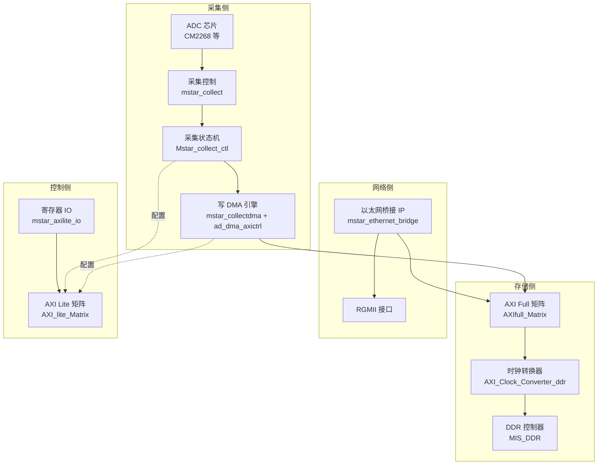
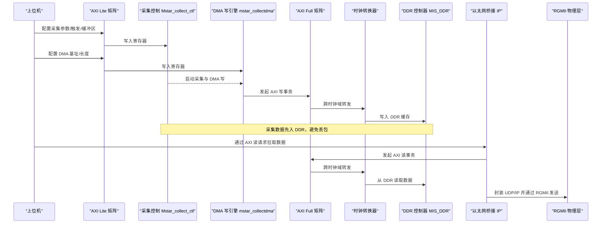
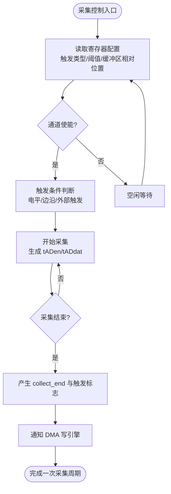
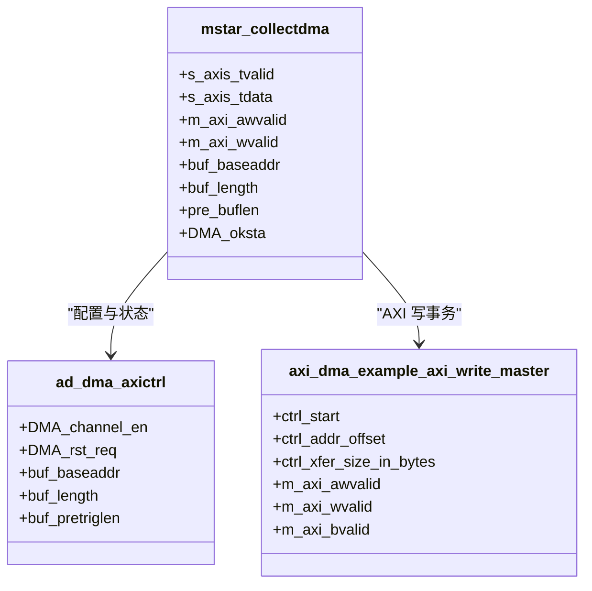
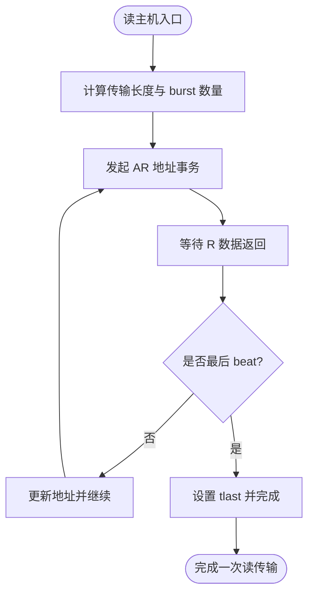
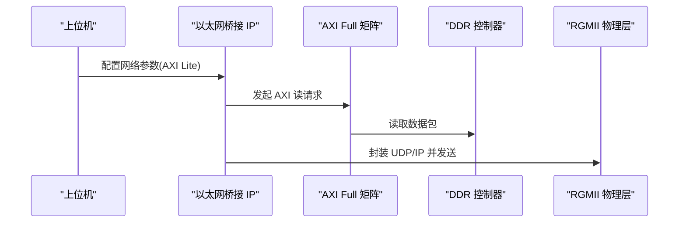
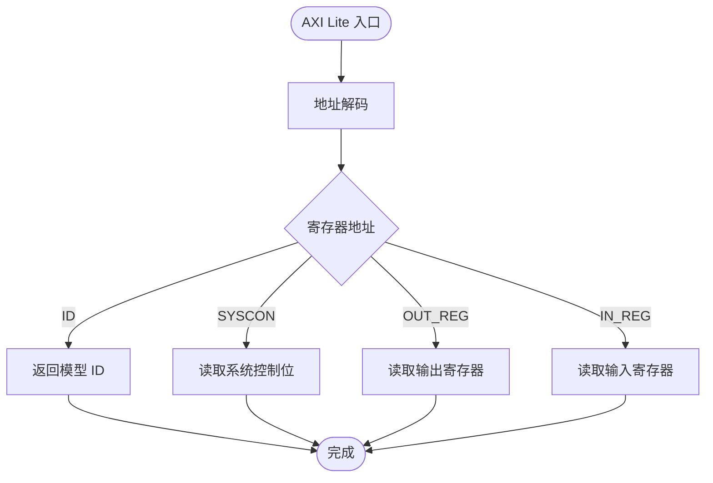
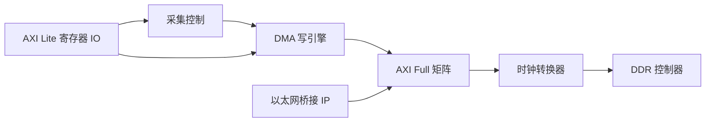

# 数据流架构

<cite>
**本文引用的文件**   
- [README.md](file://README.md)
- [mstar_udp_top.v](file://hdl/mstar_udp_top.v)
- [mstar_collect.v](file://hdl/collect/mstar_collect.v)
- [Mstar_collect_ctl.v](file://hdl/collect/Mstar_collect_ctl.v)
- [mstar_collectdma.v](file://hdl/collect/mstar_collectdma.v)
- [ad_dma_axictrl.v](file://hdl/collect/ad_dma_axictrl.v)
- [axi_dma_example_axi_write_master.sv](file://hdl/axi_dma/axi_dma_example_axi_write_master.sv)
- [axi_dma_example_axi_read_master.sv](file://hdl/axi_dma/axi_dma_example_axi_read_master.sv)
- [mstar_axilite_io.v](file://hdl/axi_io/mstar_axilite_io.v)
- [mstar_ethernet_bridge.ipr.v](file://hdl/udpip/mstar_ethernet_bridge.ipr.v)
</cite>

## 目录
1. [引言](#引言)
2. [项目结构](#项目结构)
3. [核心组件](#核心组件)
4. [架构总览](#架构总览)
5. [详细组件分析](#详细组件分析)
6. [依赖关系分析](#依赖关系分析)
7. [性能与吞吐优化](#性能与吞吐优化)
8. [故障排查指南](#故障排查指南)
9. [结论](#结论)

## 引言
本文件面向“从 ADC 采集到 DDR 缓存再到 UDP 网络传输”的完整数据路径，系统化梳理系统的数据格式转换、缓冲管理、流量控制与流水线处理机制。目标是为硬件工程师与系统集成人员提供可操作的架构说明、关键参数配置建议与排障指引。

## 项目结构
本项目为基于安路 PH1 FPGA 的多通道数据采集与 UDP 传输系统，顶层模块集成 AD 驱动、采集控制、DMA 引擎、DDR 控制器、以太网桥接 IP 以及 AXI 总线互联矩阵。整体采用多时钟域与 AXI Full/Lite 总线解耦设计，便于扩展与调优。

图表来源
- [mstar_udp_top.v:371-800](file://hdl/mstar_udp_top.v#L371-L800)
- [README.md:23-73](file://README.md#L23-L73)

章节来源
- [README.md:1-108](file://README.md#L1-L108)
- [mstar_udp_top.v:1-120](file://hdl/mstar_udp_top.v#L1-L120)

## 核心组件
- 采集控制与触发：负责多通道采样使能、触发方式（电平/边沿）、触发前后缓冲区相对位置计算、采集结束标志生成。
- DMA 写引擎：将采集数据通过 AXI Full 写入 DDR，支持突发长度、半满中断、缓冲区基址/长度配置。
- AXI 写主机示例：实现 AXI4 写事务调度、FIFO 缓冲、突发对齐与完成信号。
- AXI 读主机示例：从 DDR 读取数据并转换为 AXI Stream，供上层协议栈消费。
- 以太网桥接 IP：加密网表，提供 MAC/UDP/IP 协议栈与 AXI 接口，经 RGMII 输出。
- AXI Lite 寄存器 IO：暴露系统配置与状态寄存器，用于上位机配置采集参数与 DMA 参数。

章节来源
- [mstar_collect.v:1-210](file://hdl/collect/mstar_collect.v#L1-L210)
- [Mstar_collect_ctl.v:1-284](file://hdl/collect/Mstar_collect_ctl.v#L1-L284)
- [mstar_collectdma.v:1-150](file://hdl/collect/mstar_collectdma.v#L1-L150)
- [ad_dma_axictrl.v:1-250](file://hdl/collect/ad_dma_axictrl.v#L1-L250)
- [axi_dma_example_axi_write_master.sv:1-444](file://hdl/axi_dma/axi_dma_example_axi_write_master.sv#L1-L444)
- [axi_dma_example_axi_read_master.sv:1-386](file://hdl/axi_dma/axi_dma_example_axi_read_master.sv#L1-L386)
- [mstar_ethernet_bridge.ipr.v](file://hdl/udpip/mstar_ethernet_bridge.ipr.v)
- [mstar_axilite_io.v:1-195](file://hdl/axi_io/mstar_axilite_io.v#L1-L195)

## 架构总览
系统数据流分为三条主线：
- 采集到 DDR 的写路径：ADC → 采集控制 → DMA 写引擎 → AXI Full → 时钟转换 → DDR 控制器。
- DDR 到网络的读路径：DDR 控制器 → AXI Full → 以太网桥接 IP → RGMII。
- 控制路径：AXI Lite 矩阵 → 各子模块寄存器，用于配置采集参数、DMA 参数与系统状态。

图表来源
- [mstar_udp_top.v:415-569](file://hdl/mstar_udp_top.v#L415-L569)
- [mstar_udp_top.v:591-675](file://hdl/mstar_udp_top.v#L591-L675)
- [mstar_udp_top.v:676-800](file://hdl/mstar_udp_top.v#L676-L800)

## 详细组件分析

### 采集与触发控制
- 功能要点
  - 支持多通道并行采集，每通道独立触发类型与触发阈值。
  - 支持外部触发输入与内部触发逻辑，触发前后缓冲区相对位置可配置。
  - 产生采集开始/结束标志，驱动后续 DMA 与状态机。
- 关键信号
  - 通道使能 collect_en、触发类型 trigtype、触发数据 trigdat。
  - 采集结束 collect_end、触发标志 trigflg。
  - 缓冲区相对位置 end_relative_position、trig_relative_position。
- 状态机
  - 通过 AXI Lite 寄存器读写控制采集使能与结束请求。
  - 上升沿检测 get_singer_edge 用于同步触发与结束事件。

图表来源
- [mstar_collect.v:107-188](file://hdl/collect/mstar_collect.v#L107-L188)
- [Mstar_collect_ctl.v:98-284](file://hdl/collect/Mstar_collect_ctl.v#L98-L284)

章节来源
- [mstar_collect.v:1-210](file://hdl/collect/mstar_collect.v#L1-L210)
- [Mstar_collect_ctl.v:1-284](file://hdl/collect/Mstar_collect_ctl.v#L1-L284)

### DMA 写引擎与 AXI 写主机
- 功能要点
  - 根据配置的缓冲区基址与长度，将采集数据以 AXI Full 突发写入 DDR。
  - 支持半满中断与复位请求，便于双缓冲或环形缓冲策略。
  - 使用 FIFO 缓冲与突发长度计数，保证高吞吐与协议合规。
- 关键参数
  - C_M_AXI_DATA_WIDTH=128，LP_AXI_BURST_LEN 最大 256 beat。
  - C_MAX_OUTSTANDING 控制并发事务数，影响 FIFO 深度与带宽利用率。
- 时序流程
  - 地址通道先行，数据通道随后，响应通道确认完成。
  - 最后一个 beat 设置 wlast 与掩码 final_strb，确保边界对齐。

图表来源
- [mstar_collectdma.v:1-150](file://hdl/collect/mstar_collectdma.v#L1-L150)
- [ad_dma_axictrl.v:1-250](file://hdl/collect/ad_dma_axictrl.v#L1-L250)
- [axi_dma_example_axi_write_master.sv:1-444](file://hdl/axi_dma/axi_dma_example_axi_write_master.sv#L1-L444)

章节来源
- [mstar_collectdma.v:1-150](file://hdl/collect/mstar_collectdma.v#L1-L150)
- [ad_dma_axictrl.v:1-250](file://hdl/collect/ad_dma_axictrl.v#L1-L250)
- [axi_dma_example_axi_write_master.sv:1-444](file://hdl/axi_dma/axi_dma_example_axi_write_master.sv#L1-L444)

### AXI 读主机与 DDR 读取
- 功能要点
  - 从 DDR 读取数据并转换为 AXI Stream，供以太网桥接 IP 消费。
  - 支持可选数据 FIFO，平衡读通道与下游消费速率差异。
  - 自动计算 burst 数量与最后一段长度，处理非对齐边界。
- 关键参数
  - C_INCLUDE_DATA_FIFO=1 启用 FIFO，LP_FIFO_DEPTH 决定缓冲深度。
  - C_MAX_OUTSTANDING 限制未决事务数，防止 FIFO 溢出。

图表来源
- [axi_dma_example_axi_read_master.sv:100-386](file://hdl/axi_dma/axi_dma_example_axi_read_master.sv#L100-L386)

章节来源
- [axi_dma_example_axi_read_master.sv:1-386](file://hdl/axi_dma/axi_dma_example_axi_read_master.sv#L1-L386)

### 以太网桥接 IP 与 RGMII 输出
- 功能要点
  - 加密网表实现 MAC/UDP/IP 协议栈，提供 AXI 接口与 RGMII 物理层连接。
  - 通过 AXI Lite 进行配置，AXI Full 进行数据面读写。
  - 提供链路状态与速度指示，便于系统监控。
- 关键接口
  - AXI Lite：m_axilite_* 系列信号。
  - AXI Full：m_axi_* 系列信号。
  - RGMII：rgmii_txd/tx_ctl/txc/rx 系列信号。

图表来源
- [mstar_udp_top.v:591-675](file://hdl/mstar_udp_top.v#L591-L675)

章节来源
- [mstar_ethernet_bridge.ipr.v](file://hdl/udpip/mstar_ethernet_bridge.ipr.v)
- [mstar_udp_top.v:591-675](file://hdl/mstar_udp_top.v#L591-L675)

### AXI Lite 寄存器 IO
- 功能要点
  - 提供统一的寄存器映射，暴露系统 ID、IO 控制、触发控制等。
  - 通过 AXI Lite FSM 实现读写握手，简化上位机访问。
- 关键寄存器
  - 系统 ID、输出寄存器、输入寄存器、触发控制位。

图表来源
- [mstar_axilite_io.v:56-195](file://hdl/axi_io/mstar_axilite_io.v#L56-L195)

章节来源
- [mstar_axilite_io.v:1-195](file://hdl/axi_io/mstar_axilite_io.v#L1-L195)

## 依赖关系分析
- 模块耦合
  - 采集控制与 DMA 写引擎强耦合，需严格同步采集结束与 DMA 启动。
  - DMA 写引擎与 AXI Full 矩阵解耦，通过标准 AXI 接口通信。
  - 以太网桥接 IP 与 AXI Full 矩阵解耦，仅依赖 AXI 协议语义。
- 时钟域
  - 采集侧使用 ADC 时钟，DMA 与 AXI Full 使用 100MHz，DDR 控制器使用更高频率，通过时钟转换器隔离。
- 潜在环路
  - 无直接循环依赖；所有数据流单向或经总线仲裁。

图表来源
- [mstar_udp_top.v:415-800](file://hdl/mstar_udp_top.v#L415-L800)

章节来源
- [mstar_udp_top.v:371-800](file://hdl/mstar_udp_top.v#L371-L800)

## 性能与吞吐优化
- 缓冲区大小配置
  - 单通道缓冲区长度 buf_length 应至少容纳一个触发窗口内的全部采样数据，并结合预触发长度 pre_buflen 保留触发前数据。
  - 若存在突发对齐需求，建议将缓冲区长度设置为 AXI 最大 burst 字节数的整数倍，减少尾部碎片。
- 传输策略选择
  - 写路径：优先使用长突发（LP_AXI_BURST_LEN）以提高带宽利用率；在接近缓冲区末尾时调整 final_burst_len 与 final_strb。
  - 读路径：合理设置 C_MAX_OUTSTANDING，平衡未决事务数与 FIFO 深度，避免拥塞。
- 流水线处理
  - 采集、DMA 写、DDR 写入、AXI 读、UDP 封装并行执行，形成流水线；关键瓶颈通常在 DDR 控制器与以太网 MAC。
- 优化点
  - 调整 AXI 数据宽度与 burst 长度匹配 DDR 控制器能力。
  - 使用双缓冲或环形缓冲，避免采集与读取冲突。
  - 监控 link_error 与 speed_status，动态调整传输策略。

[本节为通用指导，不直接分析具体文件]

## 故障排查指南
- 常见问题
  - 采集丢数据：检查采集结束标志 collect_end 与 DMA 启动时序，确认缓冲区长度足够。
  - DDR 写入失败：检查 AXI 写握手与 bresp，确认地址对齐与 burst 长度合法。
  - 网络丢包：检查以太网桥接 IP 的 AXI 读请求与 RGMII 链路状态，确认链路速度与连接错误标志。
- 调试手段
  - 通过 AXI Lite 寄存器读取状态位，如 dma_OK、collect_end_sync、trigflg。
  - 观察 LED 与端口输出，辅助定位采集与传输阶段。

章节来源
- [Mstar_collect_ctl.v:198-284](file://hdl/collect/Mstar_collect_ctl.v#L198-L284)
- [ad_dma_axictrl.v:195-250](file://hdl/collect/ad_dma_axictrl.v#L195-L250)
- [mstar_udp_top.v:355-370](file://hdl/mstar_udp_top.v#L355-L370)

## 结论
本系统通过采集控制、DMA 写引擎、DDR 缓存与以太网桥接 IP 的协同工作，实现了从 ADC 到 UDP 的高吞吐数据流。关键优化点在于缓冲区大小配置、AXI 突发策略与流水线并行度。建议在工程实践中结合具体 ADC 速率与网络带宽，动态调整参数以获得最佳性能。

[本节为总结性内容，不直接分析具体文件]