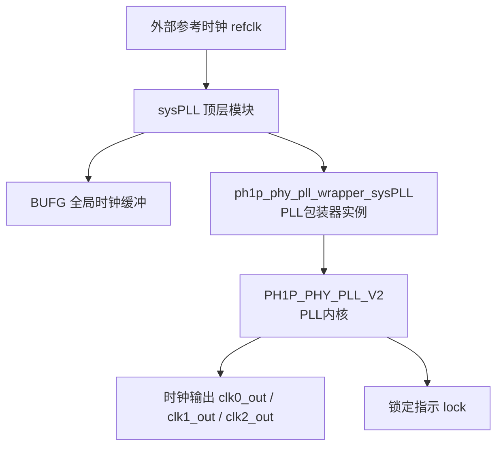
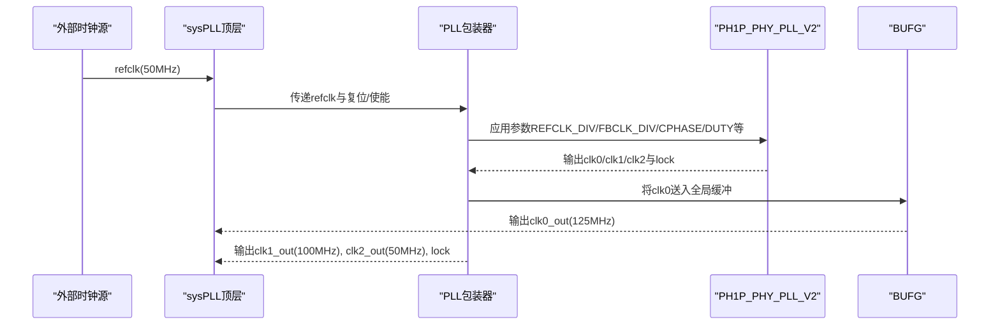
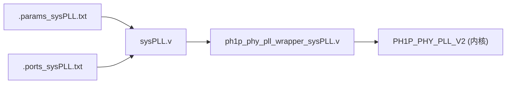

# PLL时钟生成器

<cite>
**本文引用的文件**   
- [sysPLL.v](file://al_ip/sysPLL/sysPLL.v)
- [ph1p_phy_pll_wrapper_sysPLL.v](file://al_ip/sysPLL/RTL/ph1p_phy_pll_wrapper_sysPLL.v)
- [.params_sysPLL.txt](file://al_ip/sysPLL/.params_sysPLL.txt)
- [.ports_sysPLL.txt](file://al_ip/sysPLL/.ports_sysPLL.txt)
</cite>

## 目录
1. [简介](#简介)
2. [项目结构](#项目结构)
3. [核心组件](#核心组件)
4. [架构总览](#架构总览)
5. [详细组件分析](#详细组件分析)
6. [依赖关系分析](#依赖关系分析)
7. [性能与稳定性考虑](#性能与稳定性考虑)
8. [故障排查指南](#故障排查指南)
9. [结论](#结论)
10. [附录：频率计算与配置示例](#附录频率计算与配置示例)

## 简介
本技术文档围绕系统级PLL时钟生成器（sysPLL）展开，详细说明其架构、参数配置与时钟路径。该模块以50MHz外部参考时钟为输入，通过PLL倍频与分频产生三组输出时钟：125MHz（C0）、100MHz（C1）、50MHz（C2）。文档重点解释PH1P_PLL内核的关键配置参数（REFCLK_DIV、FBCLK_DIV、CLKC0_DIV等），说明粗/细相位调整与占空比控制机制，给出频率计算公式与配置方法，并描述锁定检测与异常处理流程。

## 项目结构
sysPLL IP由顶层封装与底层PLL包装器组成，配合工具生成的参数与端口清单共同完成时钟树配置。

图表来源
- [sysPLL.v:23-136](file://al_ip/sysPLL/sysPLL.v#L23-L136)
- [ph1p_phy_pll_wrapper_sysPLL.v:185-335](file://al_ip/sysPLL/RTL/ph1p_phy_pll_wrapper_sysPLL.v#L185-L335)

章节来源
- [sysPLL.v:1-137](file://al_ip/sysPLL/sysPLL.v#L1-L137)
- [ph1p_phy_pll_wrapper_sysPLL.v:1-344](file://al_ip/sysPLL/RTL/ph1p_phy_pll_wrapper_sysPLL.v#L1-L344)

## 核心组件
- sysPLL顶层模块：对外提供refclk、reset、lock以及clk0_out/clk1_out/clk2_out；内部对clk0_out使用BUFG进行全局缓冲。
- ph1p_phy_pll_wrapper_sysPLL：将用户可配置的参数映射到PH1P_PHY_PLL_V2内核，负责时钟路径、反馈路径、相位与占空比控制、DRP/SIC接口等。
- PH1P_PHY_PLL_V2：底层PLL核，实现VCO、分频链、相位调节、锁定检测等。

关键信号与端口
- 输入：refclk、reset、wakeup、cps_step、psclk/psstep/psdown/psclksel、DRP接口（drp_clk/drp_rstn/drp_sel/drp_rd/drp_wr/drp_addr/drp_wdata）
- 输出：clk0_out/clk1_out/clk2_out及其反相输出clkbX_out、lock、psdone、DRP状态位
- 反馈：fbclk（用于外部反馈模式）

章节来源
- [.ports_sysPLL.txt:1-67](file://al_ip/sysPLL/.ports_sysPLL.txt#L1-L67)
- [ph1p_phy_pll_wrapper_sysPLL.v:116-179](file://al_ip/sysPLL/RTL/ph1p_phy_pll_wrapper_sysPLL.v#L116-L179)

## 架构总览
sysPLL采用“外部参考时钟→PLL倍频→多路分频输出”的架构。当前配置下：
- 参考时钟FIN=50MHz
- REFCLK_DIV=2，使进入PLL的参考频率降为25MHz
- FBCLK_DIV=5，反馈分频比为5
- VCO频率=25MHz×(FBCLK_DIV/REFCLK_DIV)×M/N（整数模式下M/N由工具推导）
- 根据工具生成结果，VCO工作于1000MHz，随后经各通道分频得到125/100/50MHz

图表来源
- [sysPLL.v:23-136](file://al_ip/sysPLL/sysPLL.v#L23-L136)
- [ph1p_phy_pll_wrapper_sysPLL.v:185-335](file://al_ip/sysPLL/RTL/ph1p_phy_pll_wrapper_sysPLL.v#L185-L335)

## 详细组件分析

### sysPLL顶层模块
职责
- 实例化PLL包装器，传入固定参数以生成目标频率
- 对clk0_out使用BUFG进行全局时钟缓冲，降低时钟偏斜
- 暴露lock信号供上层逻辑判断PLL是否稳定

关键参数（节选）
- FIN="50.000000000"
- REFCLK_DIV=2
- FBCLK_DIV=5
- CLKC0_ENABLE/CLKC1_ENABLE/CLKC2_ENABLE=ENABLE
- CLKC0_DIV=8, CLKC1_DIV=10, CLKC2_DIV=20
- CLKC0_CPHASE=7, CLKC1_CPHASE=9, CLKC2_CPHASE=19
- CLKC0_DUTY50=ENABLE, CLKC1_DUTY50=ENABLE, CLKC2_DUTY50=ENABLE
- PLL_FEED_TYPE="EXTERNAL"（反馈取自外部fbclk引脚）

章节来源
- [sysPLL.v:45-87](file://al_ip/sysPLL/sysPLL.v#L45-L87)
- [sysPLL.v:88-136](file://al_ip/sysPLL/sysPLL.v#L88-L136)

### ph1p_phy_pll_wrapper_sysPLL包装器
职责
- 将顶层参数映射至PH1P_PHY_PLL_V2内核
- 支持多通道时钟（C0~C6），每通道独立配置使能、预分频选择、输出分频、粗/细相位、占空比
- 提供动态相位调节接口（cps_step、psclk/psstep/psdown/psclksel）
- 暴露DRP接口用于运行时配置（当前未启用）

重要参数分组
- 参考与反馈：FBKCLK、FBKCLK_INT、FIN、REFCLK_DIV、FBCLK_DIV
- 通道通用：PREDIV_MUXCn、DIVOUT_MUXCn、CLKCn_DIV、CLKCn_CPHASE、CLKCn_FPHASE、CLKCn_DUTY50、CLKCn_DUTY_INT
- 环路与噪声：LPF_RES、LPF_CAP、ICP_CUR、PLL_FASTLOOP、WORK_MODE
- 分数N与PI：FRAC_ENABLE、SDM_FRAC、PI_OUT_SEL、PI_FRAC_EN、CLKC0_PI_SHIFT_EN
- SSC与锁定：SSC_*、REFCLK_DET_BYP
- 反馈模式：FEEDBK_MODE、DYN_CPHASE_EN

章节来源
- [ph1p_phy_pll_wrapper_sysPLL.v:1-116](file://al_ip/sysPLL/RTL/ph1p_phy_pll_wrapper_sysPLL.v#L1-L116)
- [ph1p_phy_pll_wrapper_sysPLL.v:185-335](file://al_ip/sysPLL/RTL/ph1p_phy_pll_wrapper_sysPLL.v#L185-L335)

### 时钟路径与分频机制
- 参考路径：外部refclk经REFCLK_DIV分频后进入PLL鉴相器
- 反馈路径：在外部反馈模式下，fbclk作为反馈时钟，FBCLK_DIV参与VCO频率设定
- 输出路径：每个通道从VCO或中间节点经PREDIV_MUXCn选择，再经CLKCn_DIV分频得到目标频率；可选粗相位（CPHASE）与细相位（FPHASE）调整；可选50%占空比校正（DUTY50）与整数占空比微调（DUTY_INT）

章节来源
- [ph1p_phy_pll_wrapper_sysPLL.v:185-335](file://al_ip/sysPLL/RTL/ph1p_phy_pll_wrapper_sysPLL.v#L185-L335)

## 依赖关系分析
- sysPLL依赖ph1p_phy_pll_wrapper_sysPLL提供的参数映射与接口适配
- ph1p_phy_pll_wrapper_sysPLL依赖PH1P_PHY_PLL_V2内核实现具体功能
- 工具生成的.params_sysPLL.txt与.ports_sysPLL.txt为IP配置与端口的权威来源

图表来源
- [sysPLL.v:45-136](file://al_ip/sysPLL/sysPLL.v#L45-L136)
- [ph1p_phy_pll_wrapper_sysPLL.v:185-335](file://al_ip/sysPLL/RTL/ph1p_phy_pll_wrapper_sysPLL.v#L185-L335)
- [.params_sysPLL.txt:1-434](file://al_ip/sysPLL/.params_sysPLL.txt#L1-L434)
- [.ports_sysPLL.txt:1-67](file://al_ip/sysPLL/.ports_sysPLL.txt#L1-L67)

章节来源
- [.params_sysPLL.txt:1-434](file://al_ip/sysPLL/.params_sysPLL.txt#L1-L434)
- [.ports_sysPLL.txt:1-67](file://al_ip/sysPLL/.ports_sysPLL.txt#L1-L67)

## 性能与稳定性考虑
- 环路带宽与噪声：通过LPF_RES、LPF_CAP、ICP_CUR调节环路滤波器与电荷泵电流，影响锁定速度与抖动抑制
- 反馈模式：当前使用外部反馈（PLL_FEED_TYPE="EXTERNAL"），需确保fbclk路径质量与延迟匹配
- 动态相位：cps_step用于粗相位步进，psclk/psstep/psdown/psclksel用于细相位步进；默认关闭动态相位（DYN_PHASE_PATH_SEL/DYN_FPHASE_EN=DISABLE）
- 占空比控制：启用DUTY50可获得接近50%占空比；DUTY_INT提供整数微调
- SSC（Spread Spectrum Clocking）：当前禁用（SSC_ENABLE=DISABLE），避免引入频率调制带来的时序不确定性

章节来源
- [ph1p_phy_pll_wrapper_sysPLL.v:85-115](file://al_ip/sysPLL/RTL/ph1p_phy_pll_wrapper_sysPLL.v#L85-L115)
- [ph1p_phy_pll_wrapper_sysPLL.v:256-301](file://al_ip/sysPLL/RTL/ph1p_phy_pll_wrapper_sysPLL.v#L256-L301)

## 故障排查指南
常见问题与定位要点
- 未锁定（lock=0）
  - 检查外部参考时钟refclk是否存在且频率符合FIN范围
  - 确认RESET时序正确，确保PLL在上电后经历完整复位序列
  - 验证反馈路径fbclk连接与极性，确保FBCLK_DIV设置合理
  - 观察锁定时序，必要时放宽环路带宽（增大ICP_CUR或调整LPF参数）
- 输出频率偏差
  - 核对REFCLK_DIV、FBCLK_DIV与各通道CLKCn_DIV
  - 检查PREDIV_MUXCn与DIVOUT_MUXCn选择是否符合预期
  - 若启用分数N（FRAC_ENABLE），确认SDM_FRAC与PI相关参数
- 相位/占空比不满足要求
  - 调整CLKCn_CPHASE与CLKCn_FPHASE；如需动态调整，开启DYN_PHASE_PATH_SEL/DYN_FPHASE_EN并使用cps_step/ps*接口
  - 启用CLKCn_DUTY50，并根据需要设置CLKCn_DUTY_INT

章节来源
- [ph1p_phy_pll_wrapper_sysPLL.v:116-179](file://al_ip/sysPLL/RTL/ph1p_phy_pll_wrapper_sysPLL.v#L116-L179)
- [ph1p_phy_pll_wrapper_sysPLL.v:256-301](file://al_ip/sysPLL/RTL/ph1p_phy_pll_wrapper_sysPLL.v#L256-L301)

## 结论
sysPLL基于PH1P PHY PLL内核，通过合理的REFCLK_DIV与FBCLK_DIV设置，结合各通道独立的分频与相位/占空比控制，实现了从50MHz参考时钟到125/100/50MHz多路输出的灵活时钟生成。当前设计采用外部反馈模式，并通过BUFG优化clk0路径。通过环路参数与动态相位接口，可在不同应用场景中平衡锁定速度、抖动与相位精度。

## 附录：频率计算与配置示例

### 频率计算公式
- 参考路径：F_ref_in = FIN / REFCLK_DIV
- 反馈路径：F_fb = fbclk / FBCLK_DIV
- VCO频率（整数模式）：F_VCO = F_ref_in × M/N（由工具根据目标输出推导）
- 通道输出：F_out_n = F_VCO / CLKCn_DIV（当PREDIV_MUXCn=VCO且DIVOUT_MUXCn=DIV时）

在本设计中：
- FIN=50MHz，REFCLK_DIV=2 → F_ref_in=25MHz
- FBCLK_DIV=5，外部反馈fbclk对应VCO路径
- 工具计算得VCO≈1000MHz
- 通道分频：CLKC0_DIV=8 → 125MHz；CLKC1_DIV=10 → 100MHz；CLKC2_DIV=20 → 50MHz

章节来源
- [.params_sysPLL.txt:177-216](file://al_ip/sysPLL/.params_sysPLL.txt#L177-L216)
- [.params_sysPLL.txt:326-341](file://al_ip/sysPLL/.params_sysPLL.txt#L326-L341)

### 关键参数说明
- REFCLK_DIV：参考时钟分频，影响鉴相器输入频率与环路带宽
- FBCLK_DIV：反馈分频，与REFCLK_DIV共同决定VCO频率
- CLKCn_DIV：通道输出分频，直接决定输出频率
- CLKCn_CPHASE：粗相位偏移（单位通常为VCO周期分数）
- CLKCn_FPHASE：细相位偏移（更精细的相位步进）
- CLKCn_DUTY50：启用50%占空比校正
- CLKCn_DUTY_INT：整数占空比微调
- PREDIV_MUXCn/DIVOUT_MUXCn：选择预分频与输出分频路径
- PLL_FEED_TYPE：反馈类型（INTERNAL/EXTERNAL），当前为EXTERNAL
- FEEDBK_MODE：反馈模式（NORMAL/Source synchronous/Zero delay buffer/No compensation）

章节来源
- [ph1p_phy_pll_wrapper_sysPLL.v:1-116](file://al_ip/sysPLL/RTL/ph1p_phy_pll_wrapper_sysPLL.v#L1-L116)
- [.params_sysPLL.txt:326-419](file://al_ip/sysPLL/.params_sysPLL.txt#L326-L419)

### 配置步骤建议
- 确定输入参考频率FIN与目标输出频率
- 选择合适的REFCLK_DIV与FBCLK_DIV，保证VCO工作在推荐频段
- 为每个通道设置CLKCn_DIV以获得目标频率
- 根据需要设置CLKCn_CPHASE/CLKCn_FPHASE以满足相位对齐
- 启用CLKCn_DUTY50并确保CLKCn_DUTY_INT满足占空比容差
- 如需要动态相位调整，开启DYN_PHASE_PATH_SEL/DYN_FPHASE_EN并使用cps_step/ps*接口
- 校验lock信号，确保PLL稳定后再启动下游逻辑

章节来源
- [sysPLL.v:45-87](file://al_ip/sysPLL/sysPLL.v#L45-L87)
- [.params_sysPLL.txt:1-434](file://al_ip/sysPLL/.params_sysPLL.txt#L1-L434)