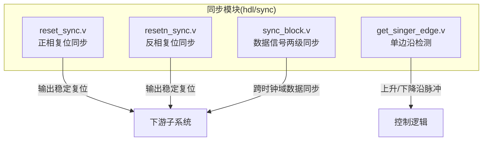
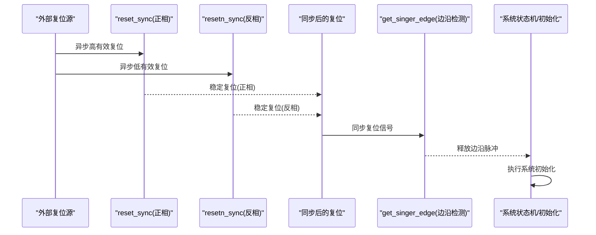
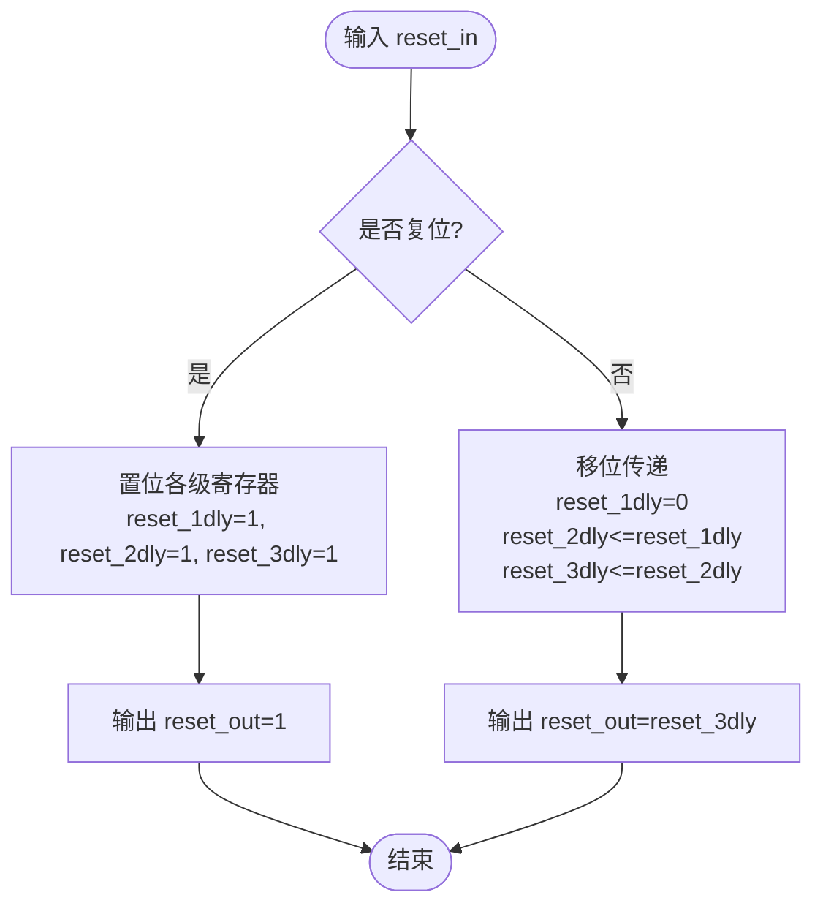
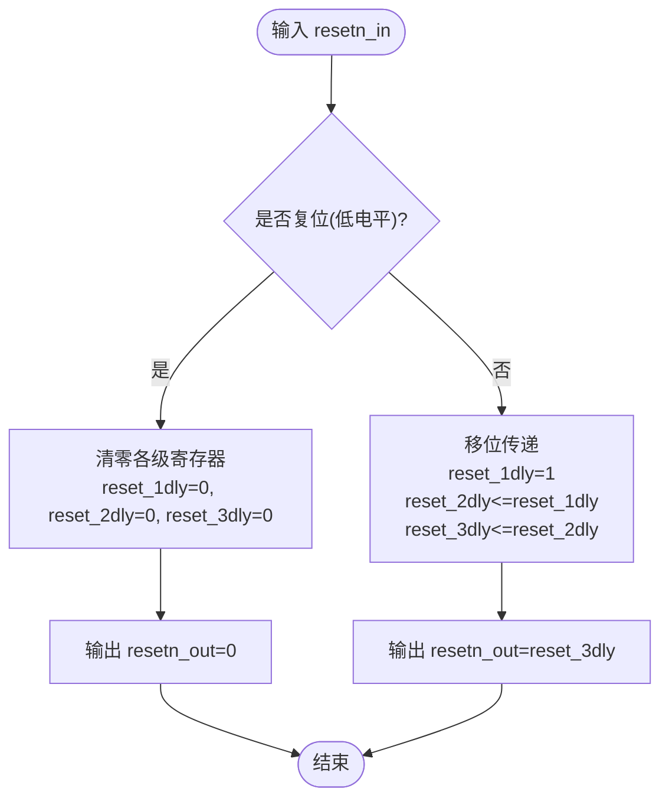
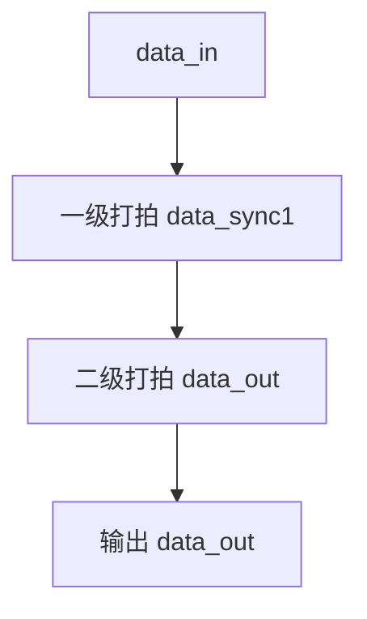
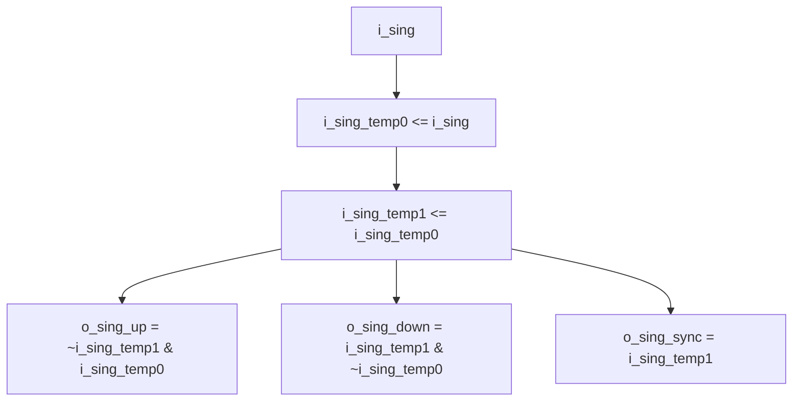
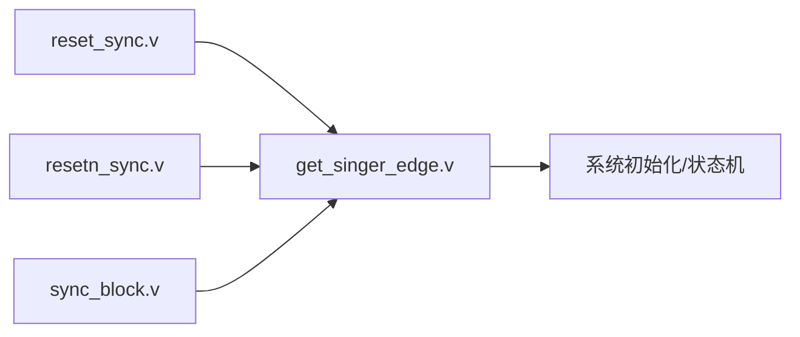

# 复位同步逻辑

<cite>
**本文引用的文件**   
- [reset_sync.v](file://hdl/sync/reset_sync.v)
- [resetn_sync.v](file://hdl/sync/resetn_sync.v)
- [sync_block.v](file://hdl/sync/sync_block.v)
- [get_singer_edge.v](file://hdl/sync/get_singer_edge.v)
- [README.md](file://README.md)
</cite>

## 目录
1. [简介](#简介)
2. [项目结构](#项目结构)
3. [核心组件](#核心组件)
4. [架构总览](#架构总览)
5. [详细组件分析](#详细组件分析)
6. [依赖关系分析](#依赖关系分析)
7. [性能与可靠性考虑](#性能与可靠性考虑)
8. [故障排查指南](#故障排查指南)
9. [结论](#结论)
10. [附录](#附录)

## 简介
本技术文档聚焦于复位同步机制，围绕异步复位信号的同步化处理展开，详细说明正相复位 reset_sync 与反相复位 resetn_sync 的实现原理、多级触发器同步电路设计、时序要求（建立/保持时间）、复位释放检测逻辑与系统初始化流程，以及不同时钟域间复位信号的协调策略。该实现位于 hdl/sync 目录下，属于多通道 AD 采集与 UDP 传输系统的底层同步基础设施。

## 项目结构
复位相关代码集中在 hdl/sync 目录：
- reset_sync.v：正相异步复位的同步化模块
- resetn_sync.v：反相异步复位的同步化模块
- sync_block.v：通用数据信号两级同步单元
- get_singer_edge.v：单边沿检测模块（可用于复位释放边沿检测）

图表来源
- [reset_sync.v:13-41](file://hdl/sync/reset_sync.v#L13-L41)
- [resetn_sync.v:13-37](file://hdl/sync/resetn_sync.v#L13-L37)
- [sync_block.v:14-30](file://hdl/sync/sync_block.v#L14-L30)
- [get_singer_edge.v:21-38](file://hdl/sync/get_singer_edge.v#L21-L38)

章节来源
- [README.md:23-58](file://README.md#L23-L58)

## 核心组件
- 正相复位同步器 reset_sync：将外部异步高有效复位信号在目标时钟域内同步为稳定的内部复位。
- 反相复位同步器 resetn_sync：将外部异步低有效复位信号在目标时钟域内同步为稳定的内部复位。
- 数据同步单元 sync_block：对任意单比特数据进行两级打拍同步，抑制亚稳态传播。
- 单边沿检测 get_singer_edge：从已同步的复位信号中提取上升/下降沿脉冲，用于复位释放检测与状态机初始化。

章节来源
- [reset_sync.v:13-41](file://hdl/sync/reset_sync.v#L13-L41)
- [resetn_sync.v:13-37](file://hdl/sync/resetn_sync.v#L13-L37)
- [sync_block.v:14-30](file://hdl/sync/sync_block.v#L14-L30)
- [get_singer_edge.v:21-38](file://hdl/sync/get_singer_edge.v#L21-L38)

## 架构总览
复位同步的整体思路是“先同步，再使用”：
- 所有来自其他时钟域的复位信号必须经过对应同步器处理后再进入本地状态机或组合逻辑。
- 对于数据通路中的跨时钟域信号，采用两级同步（如 sync_block）。
- 复位释放后，通过单边沿检测生成一次性的初始化脉冲，驱动各子模块完成上电初始化。

图表来源
- [reset_sync.v:13-41](file://hdl/sync/reset_sync.v#L13-L41)
- [resetn_sync.v:13-37](file://hdl/sync/resetn_sync.v#L13-L37)
- [get_singer_edge.v:21-38](file://hdl/sync/get_singer_edge.v#L21-L38)

## 详细组件分析

### 正相复位同步器 reset_sync
- 功能：将外部异步高有效复位 reset_in 在 clk 上升沿进行多级同步，输出稳定复位 reset_out。
- 关键实现要点：
  - 三级打拍：reset_1dly → reset_2dly → reset_3dly → reset_out，逐级降低亚稳态概率。
  - 异步复位优先：always 块以 posedge reset_in 作为异步复位条件，确保复位响应及时。
  - 正常工作时，各级寄存器按节拍传递“非复位”值，最终输出稳定复位。
- 适用场景：系统中存在高有效异步复位的外部引脚或 IP 核。

图表来源
- [reset_sync.v:28-41](file://hdl/sync/reset_sync.v#L28-L41)

章节来源
- [reset_sync.v:13-41](file://hdl/sync/reset_sync.v#L13-L41)

### 反相复位同步器 resetn_sync
- 功能：将外部异步低有效复位 resetn_in 在 clk 上升沿进行多级同步，输出稳定复位 resetn_out。
- 关键实现要点：
  - 三级打拍：reset_1dly → reset_2dly → reset_3dly → resetn_out。
  - 异步复位优先：always 块以 negedge resetn_in 作为异步复位条件，保证低电平复位立即生效。
  - 正常工作时，各级寄存器传递“非复位”值，最终输出稳定复位。
- 适用场景：系统中存在低有效异步复位的外部引脚或 IP 核。

图表来源
- [resetn_sync.v:24-37](file://hdl/sync/resetn_sync.v#L24-L37)

章节来源
- [resetn_sync.v:13-37](file://hdl/sync/resetn_sync.v#L13-L37)

### 数据信号同步单元 sync_block
- 功能：对任意单比特数据 data_in 进行两级同步，输出 data_out，抑制跨时钟域传播的亚稳态。
- 关键实现要点：
  - 两级打拍：data_sync1 → data_out。
  - 适用于数据通路中需要跨时钟域的信号，例如握手信号、标志位等。
- 注意：复位同步通常采用三级打拍以降低亚稳态概率；数据同步可采用两级打拍，视具体需求而定。

图表来源
- [sync_block.v:26-30](file://hdl/sync/sync_block.v#L26-L30)

章节来源
- [sync_block.v:14-30](file://hdl/sync/sync_block.v#L14-L30)

### 单边沿检测 get_singer_edge
- 功能：从已同步的单比特或多比特信号中提取上升沿和下降沿脉冲，同时提供同步后的采样版本。
- 关键实现要点：
  - 两级缓存 i_sing_temp0、i_sing_temp1，形成延迟链。
  - 上升沿 o_sing_up = ~i_sing_temp1 & i_sing_temp0。
  - 下降沿 o_sing_down = i_sing_temp1 & ~i_sing_temp0。
  - 同步输出 o_sing_sync = i_sing_temp1，便于后续逻辑使用稳定采样值。
- 应用：常用于复位释放检测，产生一次性初始化脉冲，驱动各子模块完成上电初始化。

图表来源
- [get_singer_edge.v:32-37](file://hdl/sync/get_singer_edge.v#L32-L37)

章节来源
- [get_singer_edge.v:21-38](file://hdl/sync/get_singer_edge.v#L21-L38)

## 依赖关系分析
- reset_sync 与 resetn_sync 均依赖目标时钟域 clk，并在各自 always 块中以异步复位条件优先。
- get_singer_edge 可接收来自 reset_sync/resetn_sync 的输出，提取复位释放边沿。
- sync_block 独立于复位同步，但常与复位释放检测配合，确保数据通路在复位期间保持稳定。

图表来源
- [reset_sync.v:13-41](file://hdl/sync/reset_sync.v#L13-L41)
- [resetn_sync.v:13-37](file://hdl/sync/resetn_sync.v#L13-L37)
- [sync_block.v:14-30](file://hdl/sync/sync_block.v#L14-L30)
- [get_singer_edge.v:21-38](file://hdl/sync/get_singer_edge.v#L21-L38)

章节来源
- [reset_sync.v:13-41](file://hdl/sync/reset_sync.v#L13-L41)
- [resetn_sync.v:13-37](file://hdl/sync/resetn_sync.v#L13-L37)
- [sync_block.v:14-30](file://hdl/sync/sync_block.v#L14-L30)
- [get_singer_edge.v:21-38](file://hdl/sync/get_singer_edge.v#L21-L38)

## 性能与可靠性考虑
- 亚稳态抑制：
  - 复位同步采用三级打拍，显著降低亚稳态传播概率。
  - 数据同步采用两级打拍，满足多数跨时钟域场景。
- 时序要求：
  - 建立时间：异步复位信号需在目标时钟上升沿前满足建立时间，避免在时钟边沿附近出现竞争。
  - 保持时间：异步复位信号在时钟边沿后需保持一定时间，确保触发器正确采样。
  - 建议通过约束文件（SDC）明确复位路径与时钟路径的时序关系，确保复位同步器的时序收敛。
- 复位释放检测：
  - 使用 get_singer_edge 提取复位释放边沿，生成一次性初始化脉冲，避免重复初始化。
  - 初始化脉冲应足够宽，确保所有子模块能可靠捕获并完成初始化。
- 不同时钟域间的复位协调：
  - 每个时钟域应有独立的复位同步器，避免跨时钟域直接复用未同步的复位信号。
  - 若多个时钟域共享同一外部复位源，应在各域分别进行同步，确保复位释放顺序可控。

[本节为通用指导，不直接分析具体文件]

## 故障排查指南
- 复位无法释放：
  - 检查 reset_sync/resetn_sync 的异步复位优先级是否正确配置。
  - 确认外部复位信号在目标时钟域的建立/保持时间是否满足。
- 复位释放抖动：
  - 检查 get_singer_edge 的输入是否为同步后的稳定信号。
  - 确保复位释放边沿宽度足够，避免被状态机漏检。
- 数据通路异常：
  - 检查 sync_block 的两级同步是否正确使用。
  - 验证跨时钟域握手信号是否遵循“先同步，再握手”的原则。
- 时序违例：
  - 审查 SDC 约束，确保复位路径与时钟路径的时序收敛。
  - 关注复位同步器与周边逻辑之间的关键路径。

章节来源
- [reset_sync.v:28-41](file://hdl/sync/reset_sync.v#L28-L41)
- [resetn_sync.v:24-37](file://hdl/sync/resetn_sync.v#L24-L37)
- [sync_block.v:26-30](file://hdl/sync/sync_block.v#L26-L30)
- [get_singer_edge.v:32-37](file://hdl/sync/get_singer_edge.v#L32-L37)

## 结论
本复位同步机制通过正相/反相复位同步器与单边沿检测模块，实现了异步复位信号在多时钟域环境下的安全同步与释放检测。三级打拍的复位同步与两级打拍的数据同步相结合，有效抑制了亚稳态传播，提升了系统的可靠性与稳定性。结合合理的时序约束与复位序列设计，可确保系统在复杂时钟域环境下稳定初始化与运行。

[本节为总结性内容，不直接分析具体文件]

## 附录
- 复位时序图（概念示意）：
  - 外部复位信号在目标时钟域内经过多级同步后变为稳定复位。
  - 复位释放时，通过单边沿检测生成一次性初始化脉冲。
- 状态转换图（概念示意）：
  - 系统状态从“复位中”转换为“初始化”，再进入“正常运行”。

[本节为概念性图示，不直接映射到具体源码文件]