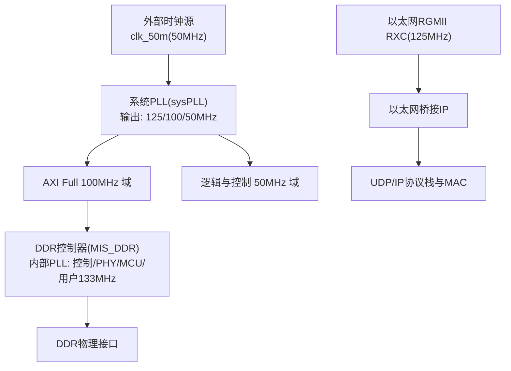
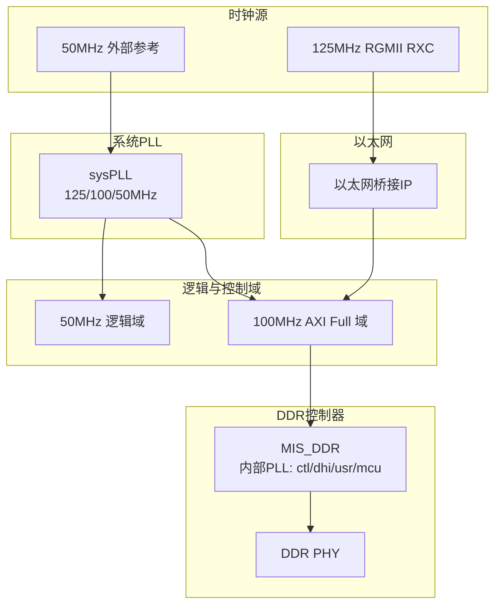
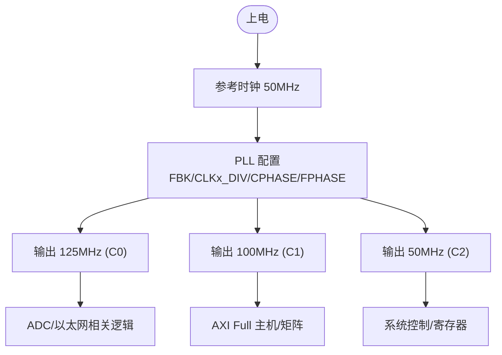
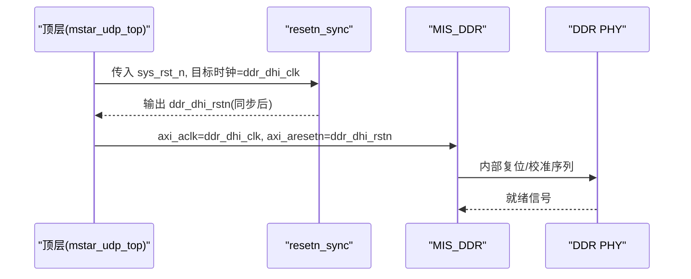
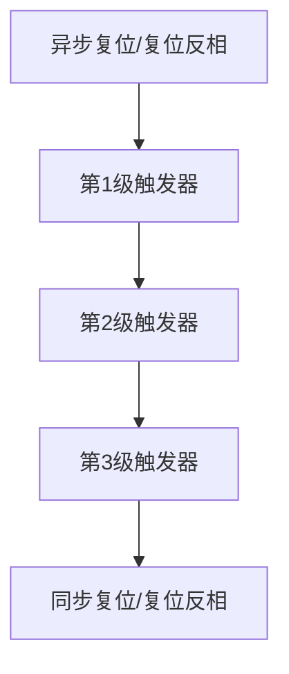
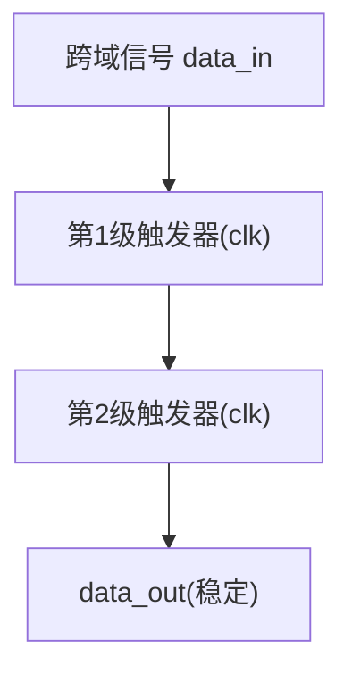
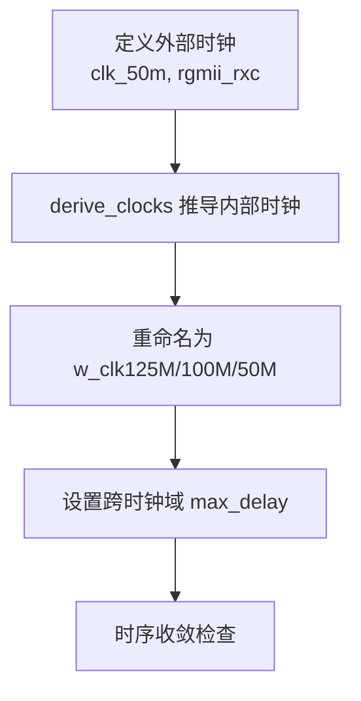
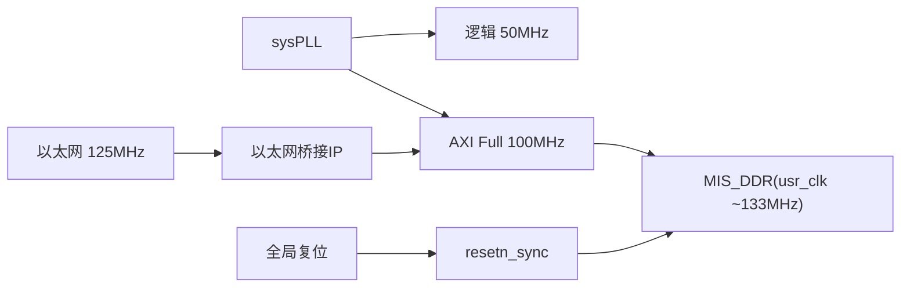

# 时钟域设计

<cite>
**本文引用的文件**   
- [README.md](file://README.md)
- [sysPLL.v](file://al_ip/sysPLL/sysPLL.v)
- [mstar_udp_sdc.sdc](file://hdl/constraint/mstar_udp_sdc.sdc)
- [MIS_DDR.sdc](file://al_ip/MIS_DDR/src/sdc/MIS_DDR.sdc)
- [MIS_DDR.v](file://al_ip/MIS_DDR/MIS_DDR.v)
- [ph1p_ddrphy_sync_rst_gen.v](file://al_ip/MIS_DDR/src/rtl/misc/ph1p_ddrphy_sync_rst_gen.v)
- [reset_sync.v](file://hdl/sync/reset_sync.v)
- [resetn_sync.v](file://hdl/sync/resetn_sync.v)
- [sync_block.v](file://hdl/sync/sync_block.v)
- [mstar_udp_top.v](file://hdl/mstar_udp_top.v)
</cite>

## 目录
1. [引言](#引言)
2. [项目结构](#项目结构)
3. [核心组件](#核心组件)
4. [架构总览](#架构总览)
5. [详细组件分析](#详细组件分析)
6. [依赖关系分析](#依赖关系分析)
7. [性能与时序考虑](#性能与时序考虑)
8. [故障排查指南](#故障排查指南)
9. [结论](#结论)
10. [附录](#附录)

## 引言
本文件面向多时钟域系统，系统化梳理本工程的时钟划分、PLL 配置、跨时钟域同步与复位策略，并给出时序收敛建议与常见问题解决方案。目标时钟域包括：
- 50MHz 系统参考时钟（外部输入）
- 125MHz ADC/以太网侧时钟（RGMII RXC）
- 100MHz AXI Full 主时钟
- 133MHz DDR 用户时钟（由 DDR IP 内部 PLL 生成）

## 项目结构
本项目为基于安路 PH1 FPGA 的多通道 AD 采集与 UDP 传输工程，顶层模块组织如下：
- 系统 PLL 提供 125MHz/100MHz/50MHz 三频输出
- MIS_DDR 控制器在内部通过双 PLL 生成控制、PHY、MCU 及用户时钟
- 跨时钟域同步模块用于复位与信号同步
- SDC 约束定义各时钟域名称、频率与时钟组异步关系

图表来源
- [sysPLL.v:12-20](file://al_ip/sysPLL/sysPLL.v#L12-L20)
- [mstar_udp_sdc.sdc:1-6](file://hdl/constraint/mstar_udp_sdc.sdc#L1-L6)
- [MIS_DDR.sdc:1-12](file://al_ip/MIS_DDR/src/sdc/MIS_DDR.sdc#L1-L12)

章节来源
- [README.md:23-73](file://README.md#L23-L73)
- [mstar_udp_sdc.sdc:1-16](file://hdl/constraint/mstar_udp_sdc.sdc#L1-L16)
- [MIS_DDR.sdc:1-12](file://al_ip/MIS_DDR/src/sdc/MIS_DDR.sdc#L1-L12)

## 核心组件
- 系统 PLL（sysPLL）
  - 功能：将 50MHz 参考时钟倍频/分频，产生 125MHz、100MHz、50MHz 三路时钟
  - 关键参数：反馈分频、输出分频、相位偏移等
- DDR 控制器（MIS_DDR）
  - 功能：对外提供 AXI Full 接口，内部通过双 PLL 生成控制、PHY、MCU 与用户时钟（usr_clk）
  - 关键参数：PLL0/PLL1 参考频率、分频比、FRAC 模式等
- 跨时钟域同步原语
  - reset_sync / resetn_sync：多级打拍实现复位同步
  - sync_block：单比特信号两级打拍同步
  - ph1p_ddrphy_sync_rst_gen：DDR PHY 复位同步生成器
- 顶层集成（mstar_udp_top.v）
  - 负责将 sysPLL 输出与各子模块时钟/复位进行连接，并对 DDR 域进行复位同步

章节来源
- [sysPLL.v:23-87](file://al_ip/sysPLL/sysPLL.v#L23-L87)
- [MIS_DDR.v:84-130](file://al_ip/MIS_DDR/MIS_DDR.v#L84-L130)
- [reset_sync.v:13-41](file://hdl/sync/reset_sync.v#L13-L41)
- [resetn_sync.v:13-37](file://hdl/sync/resetn_sync.v#L13-L37)
- [sync_block.v:14-30](file://hdl/sync/sync_block.v#L14-L30)
- [ph1p_ddrphy_sync_rst_gen.v:3-36](file://al_ip/MIS_DDR/src/rtl/misc/ph1p_ddrphy_sync_rst_gen.v#L3-L36)
- [mstar_udp_top.v:390-442](file://hdl/mstar_udp_top.v#L390-L442)

## 架构总览
下图展示系统时钟域划分与主要数据路径：

图表来源
- [sysPLL.v:12-20](file://al_ip/sysPLL/sysPLL.v#L12-L20)
- [mstar_udp_sdc.sdc:1-6](file://hdl/constraint/mstar_udp_sdc.sdc#L1-L6)
- [MIS_DDR.sdc:1-12](file://al_ip/MIS_DDR/src/sdc/MIS_DDR.sdc#L1-L12)

## 详细组件分析

### 系统 PLL（sysPLL）与时钟分配
- 输入参考：50MHz
- 输出时钟：
  - C0：125MHz（常用于 ADC/以太网侧）
  - C1：100MHz（AXI Full 主时钟）
  - C2：50MHz（系统控制逻辑）
- 约束命名：w_clk125M、w_clk100M、w_clk50M

图表来源
- [sysPLL.v:45-87](file://al_ip/sysPLL/sysPLL.v#L45-L87)
- [mstar_udp_sdc.sdc:4-6](file://hdl/constraint/mstar_udp_sdc.sdc#L4-L6)

章节来源
- [sysPLL.v:12-20](file://al_ip/sysPLL/sysPLL.v#L12-L20)
- [sysPLL.v:45-87](file://al_ip/sysPLL/sysPLL.v#L45-L87)
- [mstar_udp_sdc.sdc:4-6](file://hdl/constraint/mstar_udp_sdc.sdc#L4-L6)

### DDR 控制器（MIS_DDR）时钟与复位
- 内部双 PLL：
  - PLL0：生成 ddr 控制/PHY/MCU 相关时钟
  - PLL1：生成 usr_clk（用户逻辑访问 DDR 的时钟，约 133MHz）
- 约束中声明 mcu_clk 与其他时钟异步
- 顶层将 AXI aclk 连接到 ddr_dhi_clk（133MHz），并将复位经 resetn_sync 同步到该域

图表来源
- [mstar_udp_top.v:395-406](file://hdl/mstar_udp_top.v#L395-L406)
- [mstar_udp_top.v:415-434](file://hdl/mstar_udp_top.v#L415-L434)
- [MIS_DDR.v:110-119](file://al_ip/MIS_DDR/MIS_DDR.v#L110-L119)
- [MIS_DDR.sdc:1-12](file://al_ip/MIS_DDR/src/sdc/MIS_DDR.sdc#L1-L12)

章节来源
- [MIS_DDR.v:84-130](file://al_ip/MIS_DDR/MIS_DDR.v#L84-L130)
- [MIS_DDR.sdc:1-12](file://al_ip/MIS_DDR/src/sdc/MIS_DDR.sdc#L1-L12)
- [mstar_udp_top.v:395-434](file://hdl/mstar_udp_top.v#L395-L434)

### 跨时钟域同步机制

#### 复位同步
- reset_sync：正电平复位，三级打拍
- resetn_sync：负电平复位，三级打拍
- ph1p_ddrphy_sync_rst_gen：DDR PHY 专用复位同步，同时输出同步后的正/负复位

图表来源
- [reset_sync.v:28-41](file://hdl/sync/reset_sync.v#L28-L41)
- [resetn_sync.v:24-37](file://hdl/sync/resetn_sync.v#L24-L37)
- [ph1p_ddrphy_sync_rst_gen.v:13-34](file://al_ip/MIS_DDR/src/rtl/misc/ph1p_ddrphy_sync_rst_gen.v#L13-L34)

章节来源
- [reset_sync.v:13-41](file://hdl/sync/reset_sync.v#L13-L41)
- [resetn_sync.v:13-37](file://hdl/sync/resetn_sync.v#L13-L37)
- [ph1p_ddrphy_sync_rst_gen.v:3-36](file://al_ip/MIS_DDR/src/rtl/misc/ph1p_ddrphy_sync_rst_gen.v#L3-L36)

#### 信号同步
- sync_block：单比特信号两级打拍，适用于慢速控制/状态标志
- 注意：对高速或宽总线需采用 FIFO/握手/时钟域转换 IP

图表来源
- [sync_block.v:26-30](file://hdl/sync/sync_block.v#L26-L30)

章节来源
- [sync_block.v:14-30](file://hdl/sync/sync_block.v#L14-L30)

### 时钟约束与时序收敛
- 外部时钟定义：
  - clk_50m：周期 20ns
  - rgmii_rxc：周期 4ns（125MHz）
- 内部时钟重命名：
  - w_clk125M、w_clk100M、w_clk50M
- 跨时钟域最大延迟约束：
  - 125↔100MHz：datapath_only 8ns
  - 125↔50MHz、100↔50MHz：datapath_only 40ns
  - 100MHz ↔ MIS_DDR usr_clk：15ns/10ns
- DDR 内部时钟组：
  - derive_clocks 自动推导
  - mcu_clk 被声明为异步时钟组

图表来源
- [mstar_udp_sdc.sdc:1-16](file://hdl/constraint/mstar_udp_sdc.sdc#L1-L16)
- [MIS_DDR.sdc:1-12](file://al_ip/MIS_DDR/src/sdc/MIS_DDR.sdc#L1-L12)

章节来源
- [mstar_udp_sdc.sdc:1-16](file://hdl/constraint/mstar_udp_sdc.sdc#L1-L16)
- [MIS_DDR.sdc:1-12](file://al_ip/MIS_DDR/src/sdc/MIS_DDR.sdc#L1-L12)

## 依赖关系分析
- sysPLL 为系统时钟根，驱动 AXI Full 100MHz 与逻辑 50MHz
- MIS_DDR 内部 PLL 独立于 sysPLL，生成 usr_clk（~133MHz）供 AXI 主机访问
- 以太网侧 125MHz 时钟与逻辑域存在跨时钟域交互，需遵循约束中的 max_delay
- 复位链：全局复位 → resetn_sync → DDR 域；sysPLL lock 作为系统复位门控

图表来源
- [sysPLL.v:45-87](file://al_ip/sysPLL/sysPLL.v#L45-L87)
- [mstar_udp_top.v:390-442](file://hdl/mstar_udp_top.v#L390-L442)
- [mstar_udp_sdc.sdc:8-15](file://hdl/constraint/mstar_udp_sdc.sdc#L8-L15)

章节来源
- [mstar_udp_top.v:390-442](file://hdl/mstar_udp_top.v#L390-L442)
- [mstar_udp_sdc.sdc:8-15](file://hdl/constraint/mstar_udp_sdc.sdc#L8-L15)

## 性能与时序考虑
- 时钟域隔离
  - 使用 BUFG 缓冲输出时钟（sysPLL 已包含）
  - 跨时钟域仅允许单比特控制信号，数据通路使用 FIFO/AXI Clock Converter
- 复位策略
  - 所有跨域复位均通过多级打拍同步
  - DDR PHY 复位使用专用同步生成器，确保 PHY 内部状态机正确初始化
- 时序收敛
  - 严格遵循 SDC 中的 max_delay 约束
  - 对高频路径（125↔100MHz）优先优化组合逻辑深度
  - 避免跨时钟域直接锁存数据，必要时插入同步 FIFO 或握手协议
- 稳定性建议
  - 保持 PLL 锁定后再释放复位（sysPLL lock 作为复位门控）
  - 对 AXI 总线跨时钟域访问，建议使用 AXI Clock Converter 或同步 FIFO

[本节为通用指导，不直接分析具体文件]

## 故障排查指南
- 现象：DDR 无法初始化或 AXI 读写失败
  - 检查 MIS_DDR 内部 PLL 是否锁定（usr_clk 是否存在）
  - 确认 ddr_dhi_rstn 是否正确同步且时序满足
  - 查看 MIS_DDR.sdc 中 mcu_clk 异步组约束是否生效
- 现象：以太网侧数据丢包或误码
  - 检查 125MHz 时钟约束与路径 max_delay
  - 确认以太网桥接 IP 内部时钟与外部 RGMII RXC 对齐
- 现象：跨时钟域信号亚稳态
  - 检查是否使用了 sync_block 或更高级同步方案
  - 评估信号速率，若接近时钟边沿，增加同步级数或改用 FIFO

章节来源
- [MIS_DDR.sdc:1-12](file://al_ip/MIS_DDR/src/sdc/MIS_DDR.sdc#L1-L12)
- [mstar_udp_sdc.sdc:8-16](file://hdl/constraint/mstar_udp_sdc.sdc#L8-L16)
- [ph1p_ddrphy_sync_rst_gen.v:3-36](file://al_ip/MIS_DDR/src/rtl/misc/ph1p_ddrphy_sync_rst_gen.v#L3-L36)

## 结论
本系统以 sysPLL 为核心时钟源，结合 MIS_DDR 内部双 PLL，形成 50/100/125/133MHz 多时钟域架构。通过严格的 SDC 约束与多级复位/信号同步，确保跨时钟域的数据与控制路径稳定可靠。建议在后续扩展中继续遵循“时钟域隔离、复位同步、数据通路 FIFO/握手”的最佳实践，以保证时序收敛与系统稳定性。

[本节为总结性内容，不直接分析具体文件]

## 附录
- 时钟域对照表
  - 50MHz：系统控制逻辑、DDR 配置接口
  - 100MHz：AXI Full 主机、矩阵互联
  - 125MHz：以太网 RGMII、ADC 相关逻辑
  - 133MHz：DDR 用户时钟（usr_clk）

[本节为补充信息，不直接分析具体文件]