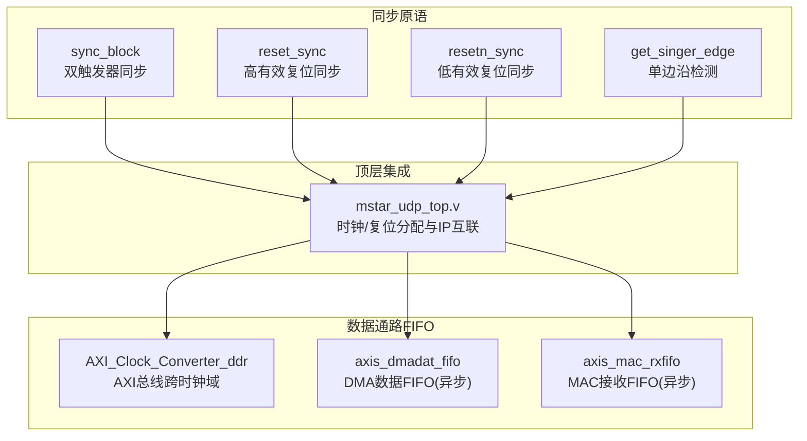
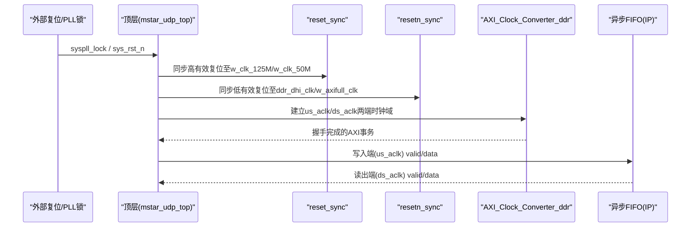
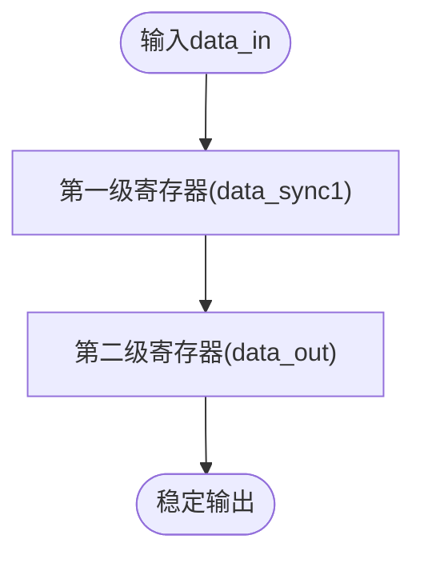
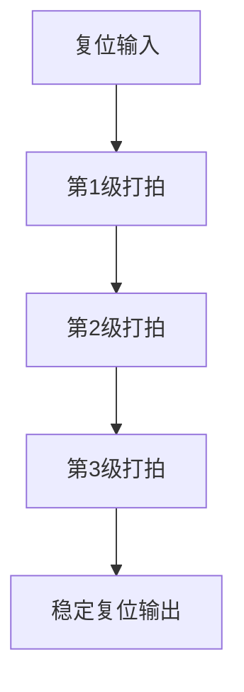
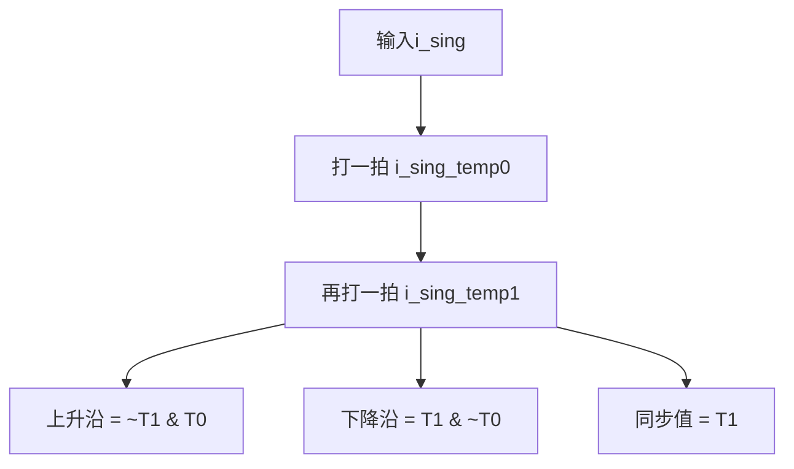
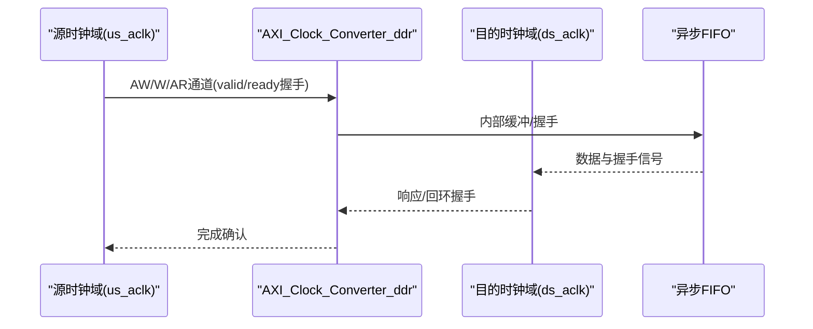
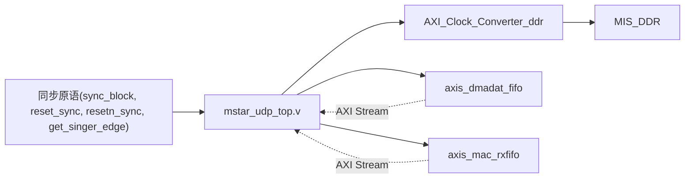

# 跨时钟域同步

<cite>
**本文引用的文件**   
- [sync_block.v](file://hdl/sync/sync_block.v)
- [reset_sync.v](file://hdl/sync/reset_sync.v)
- [resetn_sync.v](file://hdl/sync/resetn_sync.v)
- [get_singer_edge.v](file://hdl/sync/get_singer_edge.v)
- [mstar_udp_top.v](file://hdl/mstar_udp_top.v)
- [AXI_Clock_Converter_ddr.v](file://al_ip/AXI_Clock_Converter_ddr/AXI_Clock_Converter_ddr.v)
- [axis_dmadat_fifo.v](file://al_ip/axis_dmadat_fifo/axis_dmadat_fifo.v)
- [axis_data_fifo_axis_mac_rxfifo.v](file://al_ip/axis_mac_rxfifo/RTL/axis_data_fifo_axis_mac_rxfifo.v)
- [axi_dma_example_axi_read_master.sv](file://hdl/axi_dma/axi_dma_example_axi_read_master.sv)
- [alc_phy2mc_fifo_ctrl.v](file://al_ip/MIS_DDR/src/rtl/mc/alc_phy2mc_fifo_ctrl.v)
- [ph1p_ddr_fifo_dram_sync.v](file://al_ip/MIS_DDR/src/rtl/misc/ph1p_ddr_fifo_dram_sync.v)
- [mstar_udp_sdc.sdc](file://hdl/constraint/mstar_udp_sdc.sdc)
</cite>

## 目录
1. [引言](#引言)
2. [项目结构](#项目结构)
3. [核心组件](#核心组件)
4. [架构总览](#架构总览)
5. [详细组件分析](#详细组件分析)
6. [依赖关系分析](#依赖关系分析)
7. [性能与约束](#性能与约束)
8. [故障排查指南](#故障排查指南)
9. [结论](#结论)
10. [附录：设计清单与最佳实践](#附录设计清单与最佳实践)

## 引言
本技术文档聚焦于该工程中的跨时钟域（CDC）同步机制，系统性地梳理单比特信号的双触发器同步、复位同步、边沿检测，以及多比特数据通路中基于 FIFO 的异步桥接方案。文档同时给出时钟域隔离的最佳实践、常见问题与解决方案，并总结不同应用场景下的同步策略选择建议。

## 项目结构
本项目在 hdl/sync 目录下提供通用 CDC 原语模块；在顶层 mstar_udp_top.v 中完成各时钟域的复位同步与时钟分配；在 al_ip 下提供 AXI 时钟转换器与多种 AXIS FIFO IP，用于数据通路的跨时钟域缓冲与握手。

图表来源
- [mstar_udp_top.v:383-412](file://hdl/mstar_udp_top.v#L383-L412)
- [AXI_Clock_Converter_ddr.v:12-33](file://al_ip/AXI_Clock_Converter_ddr/AXI_Clock_Converter_ddr.v#L12-L33)
- [axis_dmadat_fifo.v:35-52](file://al_ip/axis_dmadat_fifo/axis_dmadat_fifo.v#L35-L52)
- [axis_data_fifo_axis_mac_rxfifo.v:35-58](file://al_ip/axis_mac_rxfifo/RTL/axis_data_fifo_axis_mac_rxfifo.v#L35-L58)

章节来源
- [README.md:23-73](file://README.md#L23-L73)

## 核心组件
- sync_block：单比特信号的双触发器同步器，用于抑制亚稳态传播。
- reset_sync / resetn_sync：对高/低有效复位进行多级同步，确保复位在各时钟域内有序释放。
- get_singer_edge：在目标时钟域内对输入信号打两拍后计算上升沿/下降沿脉冲，并输出同步后的稳定值。
- AXI_Clock_Converter_ddr：将 AXI 接口从源时钟域转换到目的时钟域，内部以握手/FIFO 实现可靠传输。
- axis_dmadat_fifo / axis_mac_rxfifo：支持异步时钟的 AXIS FIFO，用于数据包/流数据的跨时钟域缓冲与握手。

章节来源
- [sync_block.v:14-30](file://hdl/sync/sync_block.v#L14-L30)
- [reset_sync.v:13-41](file://hdl/sync/reset_sync.v#L13-L41)
- [resetn_sync.v:13-37](file://hdl/sync/resetn_sync.v#L13-L37)
- [get_singer_edge.v:21-38](file://hdl/sync/get_singer_edge.v#L21-L38)
- [AXI_Clock_Converter_ddr.v:12-33](file://al_ip/AXI_Clock_Converter_ddr/AXI_Clock_Converter_ddr.v#L12-L33)
- [axis_dmadat_fifo.v:35-52](file://al_ip/axis_dmadat_fifo/axis_dmadat_fifo.v#L35-L52)
- [axis_data_fifo_axis_mac_rxfifo.v:35-58](file://al_ip/axis_mac_rxfifo/RTL/axis_data_fifo_axis_mac_rxfifo.v#L35-L58)

## 架构总览
系统在顶层完成以下关键任务：
- 将外部复位或 PLL 锁定信号按目标时钟域分别同步，生成各域的稳定复位。
- 通过 AXI 时钟转换器连接不同时钟域的 AXI 主/从设备。
- 使用异步 FIFO 作为数据通路缓冲，承载高吞吐的数据流。

图表来源
- [mstar_udp_top.v:383-412](file://hdl/mstar_udp_top.v#L383-L412)
- [mstar_udp_top.v:484-569](file://hdl/mstar_udp_top.v#L484-L569)
- [AXI_Clock_Converter_ddr.v:12-33](file://al_ip/AXI_Clock_Converter_ddr/AXI_Clock_Converter_ddr.v#L12-L33)
- [axis_dmadat_fifo.v:35-52](file://al_ip/axis_dmadat_fifo/axis_dmadat_fifo.v#L35-L52)

## 详细组件分析

### 单比特同步：sync_block
- 功能：对任意单比特信号进行两级寄存器同步，降低亚稳态概率。
- 适用场景：控制信号、状态标志等慢速或低频事件跨时钟域传递。
- 时序特性：引入约两个时钟周期的延迟，不改变信号逻辑极性。

图表来源
- [sync_block.v:26-30](file://hdl/sync/sync_block.v#L26-L30)

章节来源
- [sync_block.v:14-30](file://hdl/sync/sync_block.v#L14-L30)

### 复位同步：reset_sync / resetn_sync
- reset_sync：对高有效复位进行三级同步，保证复位释放顺序可控。
- resetn_sync：对低有效复位进行三级同步，适用于全局低有效复位网络。
- 设计要点：复位释放需遵循“先外设后核心”的顺序，避免未就绪子系统被唤醒。

图表来源
- [reset_sync.v:28-41](file://hdl/sync/reset_sync.v#L28-L41)
- [resetn_sync.v:24-37](file://hdl/sync/resetn_sync.v#L24-L37)

章节来源
- [reset_sync.v:13-41](file://hdl/sync/reset_sync.v#L13-L41)
- [resetn_sync.v:13-37](file://hdl/sync/resetn_sync.v#L13-L37)

### 边沿检测：get_singer_edge
- 功能：在目标时钟域内对输入信号打两拍，计算上升沿/下降沿脉冲，并输出同步后的稳定值。
- 适用场景：将来自其他时钟域的事件转换为当前时钟域的单周期脉冲，便于状态机采样。

图表来源
- [get_singer_edge.v:32-37](file://hdl/sync/get_singer_edge.v#L32-L37)

章节来源
- [get_singer_edge.v:21-38](file://hdl/sync/get_singer_edge.v#L21-L38)

### 数据通路：AXI 时钟转换器与异步 FIFO
- AXI_Clock_Converter_ddr：封装了 AXI 协议在两个时钟域间的可靠传输，内部采用握手/FIFO 机制，屏蔽底层亚稳态风险。
- axis_dmadat_fifo / axis_mac_rxfifo：配置为异步模式（AL_IS_ACLK_ASYNC=1），提供 us_aclk 写端与 ds_aclk 读端的解耦缓冲，支持包边界（TLAST）与用户位（TUSER）。

图表来源
- [AXI_Clock_Converter_ddr.v:12-33](file://al_ip/AXI_Clock_Converter_ddr/AXI_Clock_Converter_ddr.v#L12-L33)
- [axis_dmadat_fifo.v:35-52](file://al_ip/axis_dmadat_fifo/axis_dmadat_fifo.v#L35-L52)
- [axis_data_fifo_axis_mac_rxfifo.v:35-58](file://al_ip/axis_mac_rxfifo/RTL/axis_data_fifo_axis_mac_rxfifo.v#L35-L58)

章节来源
- [AXI_Clock_Converter_ddr.v:12-33](file://al_ip/AXI_Clock_Converter_ddr/AXI_Clock_Converter_ddr.v#L12-L33)
- [axis_dmadat_fifo.v:35-52](file://al_ip/axis_dmadat_fifo/axis_dmadat_fifo.v#L35-L52)
- [axis_data_fifo_axis_mac_rxfifo.v:35-58](file://al_ip/axis_mac_rxfifo/RTL/axis_data_fifo_axis_mac_rxfifo.v#L35-L58)

### DDR 控制器相关同步点
- MIS_DDR 内部存在 PHY 与 MC 之间的 FIFO 控制与复位同步逻辑，体现数据路径上的跨时钟域缓冲与复位协调。
- 典型模块包括 alc_phy2mc_fifo_ctrl 与 ph1p_ddr_fifo_dram_sync，负责数据对齐、有效信号同步与复位序列。

章节来源
- [alc_phy2mc_fifo_ctrl.v:1-51](file://al_ip/MIS_DDR/src/rtl/mc/alc_phy2mc_fifo_ctrl.v#L1-L51)
- [ph1p_ddr_fifo_dram_sync.v](file://al_ip/MIS_DDR/src/rtl/misc/ph1p_ddr_fifo_dram_sync.v)

## 依赖关系分析
- 顶层模块依赖同步原语生成各域复位，并实例化 AXI 时钟转换器与多个异步 FIFO。
- 数据通路中，源侧通过 valid/ready 握手驱动 FIFO 写端，目的侧通过 valid/ready 从 FIFO 读端消费数据，形成背压闭环。
- 约束文件中定义了跨时钟域的最大延时，辅助工具评估 CDC 路径的时序裕量。

图表来源
- [mstar_udp_top.v:383-412](file://hdl/mstar_udp_top.v#L383-L412)
- [mstar_udp_top.v:484-569](file://hdl/mstar_udp_top.v#L484-L569)
- [axis_dmadat_fifo.v:35-52](file://al_ip/axis_dmadat_fifo/axis_dmadat_fifo.v#L35-L52)
- [axis_data_fifo_axis_mac_rxfifo.v:35-58](file://al_ip/axis_mac_rxfifo/RTL/axis_data_fifo_axis_mac_rxfifo.v#L35-L58)

章节来源
- [mstar_udp_top.v:383-412](file://hdl/mstar_udp_top.v#L383-L412)
- [mstar_udp_top.v:484-569](file://hdl/mstar_udp_top.v#L484-L569)

## 性能与约束
- 时钟约束：SDC 中对跨时钟域路径设置了最大延时限制，有助于综合与布局布线阶段收敛时序。
- FIFO 深度：根据业务峰值带宽与突发长度设置 FIFO 深度，避免溢出/下溢。
- 握手协议：AXI/AXIS 的 valid/ready 握手天然具备背压能力，应确保上下游均正确实现握手语义。
- 复位顺序：复位释放需满足“先外设后核心”，必要时增加复位延迟或分级复位。

章节来源
- [mstar_udp_sdc.sdc:1-16](file://hdl/constraint/mstar_udp_sdc.sdc#L1-L16)

## 故障排查指南
- 亚稳态现象
  - 症状：偶发数据错误、状态跳变异常。
  - 排查：检查是否对所有跨时钟域信号使用了双触发器同步或异步 FIFO；确认未在同步链中间插入组合逻辑。
  - 参考：[sync_block.v:26-30](file://hdl/sync/sync_block.v#L26-L30)

- 数据丢失/溢出
  - 症状：丢包、计数不一致。
  - 排查：核对 FIFO 深度与突发长度；检查 valid/ready 握手是否正确；关注 almost_full/almost_empty 告警。
  - 参考：[axis_dmadat_fifo.v:35-52](file://al_ip/axis_dmadat_fifo/axis_dmadat_fifo.v#L35-L52), [axis_data_fifo_axis_mac_rxfifo.v:35-58](file://al_ip/axis_mac_rxfifo/RTL/axis_data_fifo_axis_mac_rxfifo.v#L35-L58)

- 复位竞争
  - 症状：上电后部分模块未初始化或行为异常。
  - 排查：确认各域复位由 reset_sync/resetn_sync 产生；检查复位释放顺序与延迟。
  - 参考：[reset_sync.v:28-41](file://hdl/sync/reset_sync.v#L28-L41), [resetn_sync.v:24-37](file://hdl/sync/resetn_sync.v#L24-L37)

- 边沿丢失
  - 症状：事件未触发或重复触发。
  - 排查：确认使用 get_singer_edge 在目标时钟域内检测边沿；避免直接跨域采样窄脉冲。
  - 参考：[get_singer_edge.v:32-37](file://hdl/sync/get_singer_edge.v#L32-L37)

- 时序违例
  - 症状：CDC 路径时序不收敛。
  - 排查：检查 SDC 中跨时钟域 max_delay 设置；优化组合逻辑路径或增加流水线。
  - 参考：[mstar_udp_sdc.sdc:8-15](file://hdl/constraint/mstar_udp_sdc.sdc#L8-L15)

## 结论
本项目的跨时钟域同步以“单比特双触发器 + 复位多级同步 + 边沿检测 + 异步 FIFO/AXI 转换器”的组合策略为主，既保证了控制信号的可靠性，又为高吞吐数据通路提供了高效的缓冲与握手机制。配合合理的 SDC 约束与复位顺序管理，可在复杂多时钟域系统中获得稳定且可维护的实现。

## 附录：设计清单与最佳实践
- 单比特控制信号
  - 必须经过双触发器同步后再进入目标状态机。
  - 若需要单周期脉冲，请在目标时钟域内使用边沿检测。

- 多比特数据
  - 优先使用异步 FIFO 或 AXI 时钟转换器，避免手动握手带来的复杂度与风险。
  - 合理设置 FIFO 深度，结合 almost_full/almost_empty 做流量整形。

- 复位策略
  - 所有复位信号均需同步；明确复位释放顺序，必要时加入复位延迟。
  - 区分高/低有效复位，统一使用 reset_sync/resetn_sync。

- 时钟域隔离
  - 每个时钟域拥有独立的复位树与复位同步器。
  - 跨域信号不得直接组合，必须经同步或缓冲。

- 验证与调试
  - 仿真中加入复位序列与突发负载，观察 FIFO 水位与握手状态。
  - 使用 ILA/Oscilloscope 抓取跨域握手信号，定位亚稳态与拥塞点。