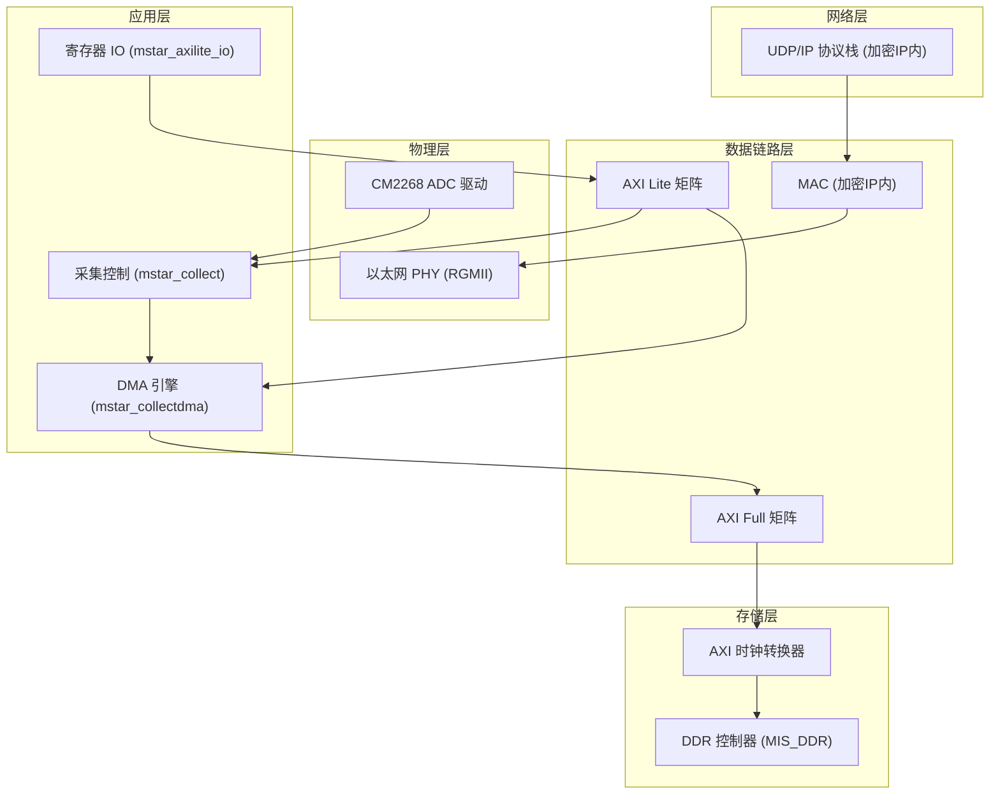
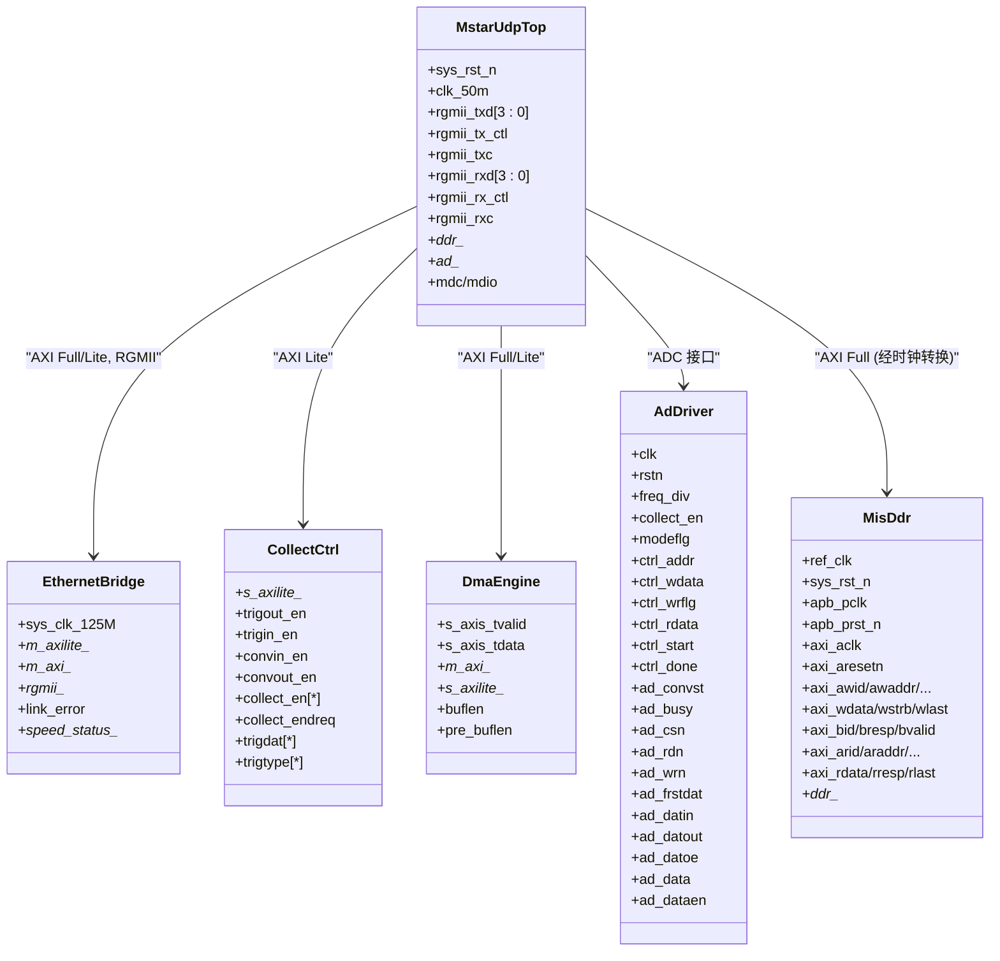
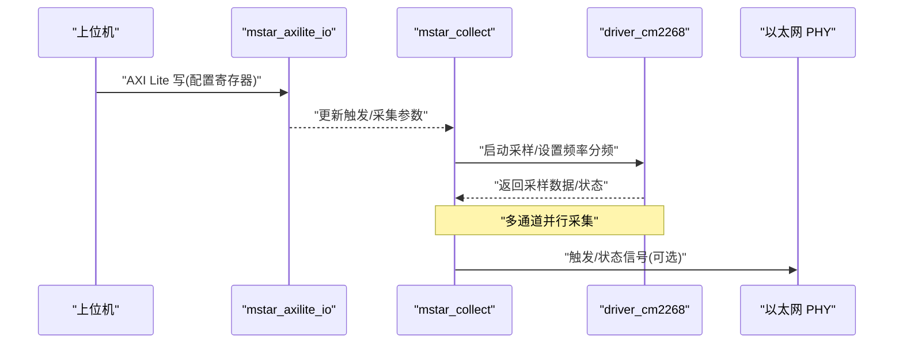
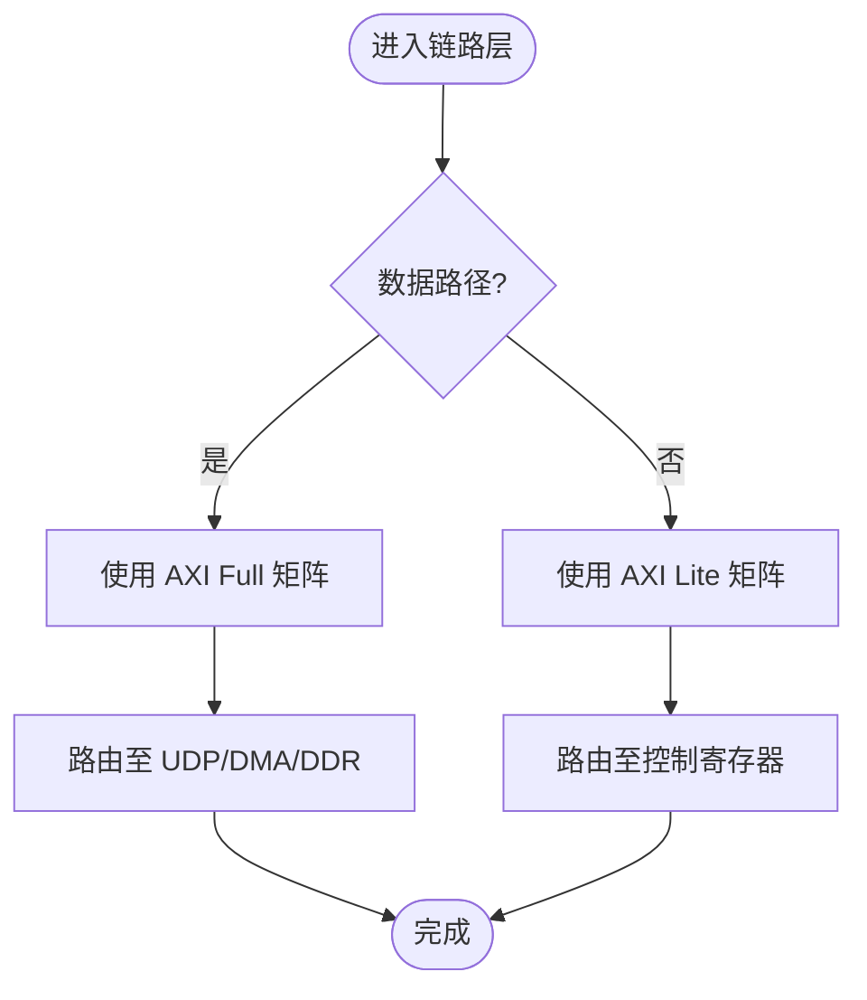
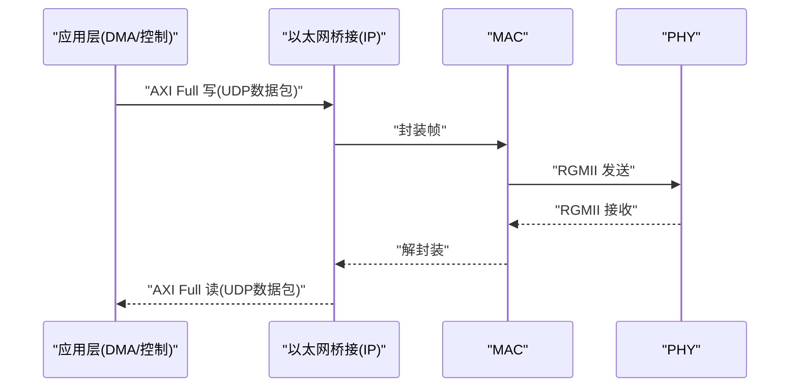
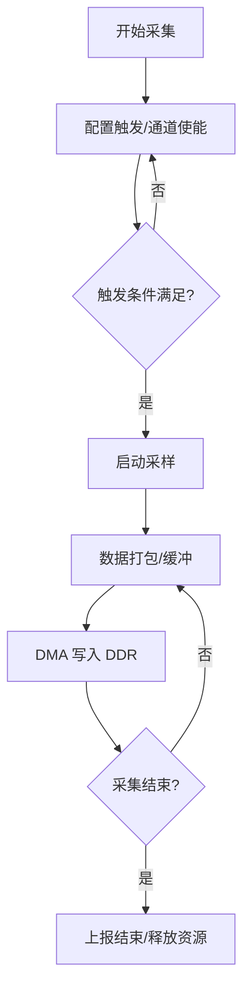
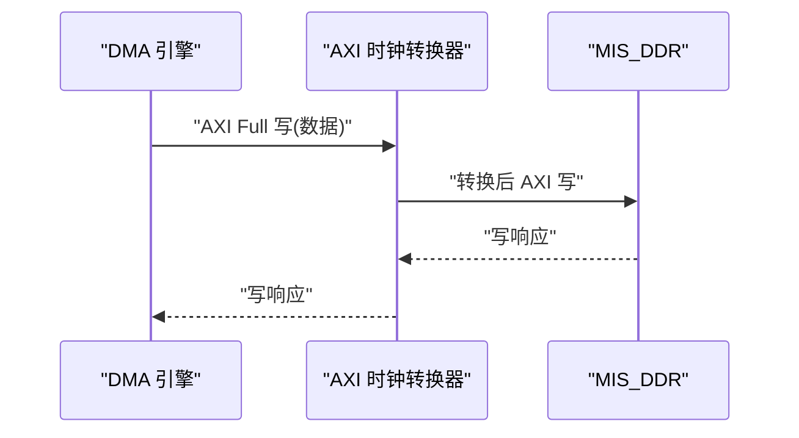
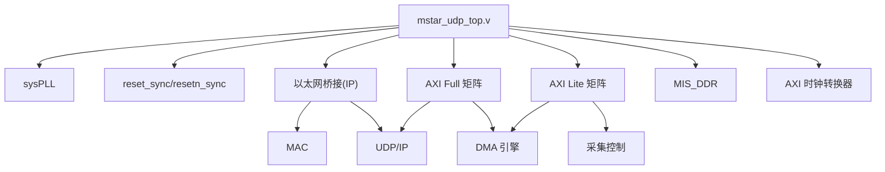

# 系统架构设计

<cite>
**本文引用的文件**   
- [README.md](file://README.md)
- [mstar_udp_top.v](file://hdl/mstar_udp_top.v)
- [mstar_collect.v](file://hdl/collect/mstar_collect.v)
- [Mstar_collect_ctl.v](file://hdl/collect/Mstar_collect_ctl.v)
- [mstar_collectdma.v](file://hdl/collect/mstar_collectdma.v)
- [driver_cm2268.v](file://hdl/ad_driver/driver_cm2268.v)
- [cm2268_drv.v](file://hdl/ad_driver/cm2268_drv.v)
- [ad_collect_trig_ctrl.v](file://hdl/collect/ad_collect_trig_ctrl.v)
- [mstar_axilite_io.v](file://hdl/axi_io/mstar_axilite_io.v)
- [AXI_Clock_Converter_ddr.v](file://al_ip/AXI_Clock_Converter_ddr/AXI_Clock_Converter_ddr.v)
- [AXI_lite_Matrix.v](file://al_ip/AXI_lite_Matrix/AXI_lite_Matrix.v)
- [AXIfull_Matrix.v](file://al_ip/AXIfull_Matrix/AXIfull_Matrix.v)
- [MIS_DDR.v](file://al_ip/MIS_DDR/MIS_DDR.v)
</cite>

## 目录
1. [引言](#引言)
2. [项目结构](#项目结构)
3. [核心组件](#核心组件)
4. [架构总览](#架构总览)
5. [详细组件分析](#详细组件分析)
6. [依赖关系分析](#依赖关系分析)
7. [性能与权衡](#性能与权衡)
8. [故障排查指南](#故障排查指南)
9. [结论](#结论)

## 引言
本设计面向多通道 ADC 数据采集系统，目标是在 FPGA 中实现从物理层（ADC、以太网 PHY）到应用层（采集控制、UDP/IP 传输）的完整数据通路。系统通过 AXI Full/Lite 总线将各模块互联，采用 DDR 作为大容量缓存，并通过加密 IP 提供的以太网桥接完成 UDP/IP 协议栈与 MAC 层功能。时钟域包含 50MHz、100MHz、125MHz 以及 DDR 相关高频时钟，跨时钟域同步通过复位同步器和 AXI 时钟转换器实现。

## 项目结构
工程以顶层模块 mstar_udp_top.v 为入口，集成：
- 物理层：CM2268 ADC 驱动、RGMII 以太网接口
- 数据链路层：MAC（由加密 IP 提供）、AXI 总线矩阵
- 网络层：UDP/IP 协议栈（由加密 IP 提供）
- 应用层：采集控制逻辑、DMA 引擎、寄存器 IO
- 存储层：DDR 控制器及 AXI 时钟转换

图表来源
- [mstar_udp_top.v:371-414](file://hdl/mstar_udp_top.v#L371-L414)
- [mstar_udp_top.v:591-675](file://hdl/mstar_udp_top.v#L591-L675)
- [mstar_udp_top.v:676-762](file://hdl/mstar_udp_top.v#L676-L762)
- [mstar_udp_top.v:763-800](file://hdl/mstar_udp_top.v#L763-L800)

章节来源
- [README.md:23-73](file://README.md#L23-L73)
- [mstar_udp_top.v:1-92](file://hdl/mstar_udp_top.v#L1-L92)

## 核心组件
- 顶层与时钟分配：顶层模块负责系统复位、PLL 时钟生成与各子模块实例化，并管理 AXI Full/Lite 总线拓扑。
- 采集控制：mstar_collect 聚合多通道触发控制、采样使能、端点标志等；Mstar_collect_ctl 实现 AXI Lite 寄存器映射与状态机。
- DMA 引擎：mstar_collectdma 将采集数据经 AXI Full 写入 DDR，同时暴露 AXI Lite 配置接口。
- ADC 驱动：driver_cm2268 与 cm2268_drv 封装 CM2268 时序与寄存器访问。
- 以太网桥接：加密 IP 提供 MAC/UDP/IP 协议栈与 RGMII 接口，并通过 AXI Full/Lite 暴露控制与数据端口。
- 存储子系统：MIS_DDR 控制器配合 AXI_Clock_Converter_ddr 完成不同时钟域间的 AXI 事务转换。

章节来源
- [mstar_udp_top.v:371-414](file://hdl/mstar_udp_top.v#L371-L414)
- [mstar_collect.v:1-62](file://hdl/collect/mstar_collect.v#L1-L62)
- [Mstar_collect_ctl.v:22-68](file://hdl/collect/Mstar_collect_ctl.v#L22-L68)
- [mstar_collectdma.v:9-66](file://hdl/collect/mstar_collectdma.v#L9-L66)
- [driver_cm2268.v:1-39](file://hdl/ad_driver/driver_cm2268.v#L1-L39)
- [cm2268_drv.v:1-29](file://hdl/ad_driver/cm2268_drv.v#L1-L29)
- [mstar_udp_top.v:591-675](file://hdl/mstar_udp_top.v#L591-L675)
- [MIS_DDR.v:1-200](file://al_ip/MIS_DDR/MIS_DDR.v#L1-L200)

## 架构总览
系统分层如下：
- 物理层：ADC 芯片（CM2268）与以太网 PHY（RGMII）
- 数据链路层：MAC（加密 IP），AXI Full/Lite 总线矩阵
- 网络层：UDP/IP 协议栈（加密 IP）
- 应用层：采集控制、DMA、寄存器 IO
- 存储层：DDR 控制器与 AXI 时钟转换器

图表来源
- [mstar_udp_top.v:371-414](file://hdl/mstar_udp_top.v#L371-L414)
- [mstar_udp_top.v:591-675](file://hdl/mstar_udp_top.v#L591-L675)
- [mstar_udp_top.v:676-762](file://hdl/mstar_udp_top.v#L676-L762)
- [mstar_udp_top.v:763-800](file://hdl/mstar_udp_top.v#L763-L800)
- [MIS_DDR.v:1-200](file://al_ip/MIS_DDR/MIS_DDR.v#L1-L200)

## 详细组件分析

### 物理层：ADC 驱动与以太网 PHY
- ADC 驱动（CM2268）：driver_cm2268 实现采样时序控制、寄存器读写模式切换、数据打包输出；cm2268_drv 封装 AXI Lite 寄存器接口与采样控制逻辑。
- 以太网 PHY：通过 RGMII 接口连接加密 IP 的以太网桥接模块，PHY 复位由顶层根据时钟锁相环锁定信号生成。

图表来源
- [driver_cm2268.v:1-39](file://hdl/ad_driver/driver_cm2268.v#L1-L39)
- [cm2268_drv.v:1-29](file://hdl/ad_driver/cm2268_drv.v#L1-L29)
- [mstar_udp_top.v:371-414](file://hdl/mstar_udp_top.v#L371-L414)

章节来源
- [driver_cm2268.v:1-39](file://hdl/ad_driver/driver_cm2268.v#L1-L39)
- [cm2268_drv.v:1-29](file://hdl/ad_driver/cm2268_drv.v#L1-L29)
- [mstar_udp_top.v:371-414](file://hdl/mstar_udp_top.v#L371-L414)

### 数据链路层：MAC 与 AXI 总线矩阵
- MAC：由加密 IP 内部实现，通过 RGMII 与 PHY 对接，提供 AXI Full/Lite 控制与数据接口。
- AXI Full 矩阵：用于高带宽数据路径（如 UDP 数据、DMA 写入 DDR）。
- AXI Lite 矩阵：用于低带宽控制路径（如采集控制、DMA 配置、以太网桥接配置）。

图表来源
- [mstar_udp_top.v:676-762](file://hdl/mstar_udp_top.v#L676-L762)
- [mstar_udp_top.v:763-800](file://hdl/mstar_udp_top.v#L763-L800)

章节来源
- [mstar_udp_top.v:676-762](file://hdl/mstar_udp_top.v#L676-L762)
- [mstar_udp_top.v:763-800](file://hdl/mstar_udp_top.v#L763-L800)

### 网络层：UDP/IP 协议栈
- 加密 IP 提供完整的 UDP/IP 协议栈与 MAC 层功能，对外暴露 AXI Full/Lite 接口供上层调用。
- 顶层将 UDP 的 AXI Full 接口接入 AXI Full 矩阵，以便与 DMA 和 DDR 进行数据交换。

图表来源
- [mstar_udp_top.v:591-675](file://hdl/mstar_udp_top.v#L591-L675)

章节来源
- [mstar_udp_top.v:591-675](file://hdl/mstar_udp_top.v#L591-L675)

### 应用层：采集控制与 DMA
- 采集控制（mstar_collect）：聚合多通道触发控制、采样使能、结束标志等；Mstar_collect_ctl 实现 AXI Lite 寄存器映射与状态机。
- DMA 引擎（mstar_collectdma）：将采集数据经 AXI Full 写入 DDR，同时暴露 AXI Lite 配置接口（缓冲区基址、长度等）。

图表来源
- [mstar_collect.v:107-188](file://hdl/collect/mstar_collect.v#L107-L188)
- [Mstar_collect_ctl.v:98-284](file://hdl/collect/Mstar_collect_ctl.v#L98-L284)
- [mstar_collectdma.v:77-148](file://hdl/collect/mstar_collectdma.v#L77-L148)

章节来源
- [mstar_collect.v:107-188](file://hdl/collect/mstar_collect.v#L107-L188)
- [Mstar_collect_ctl.v:98-284](file://hdl/collect/Mstar_collect_ctl.v#L98-L284)
- [mstar_collectdma.v:77-148](file://hdl/collect/mstar_collectdma.v#L77-L148)

### 存储层：DDR 控制器与时钟转换
- MIS_DDR：FPGA 厂商提供的 DDR 控制器，支持 AXI 接口与 APB 配置。
- AXI_Clock_Converter_ddr：在 100MHz（AXI Full）与 DDR 高频时钟之间进行异步时钟域转换，保证 AXI 事务正确性。

图表来源
- [mstar_udp_top.v:484-569](file://hdl/mstar_udp_top.v#L484-L569)
- [MIS_DDR.v:1-200](file://al_ip/MIS_DDR/MIS_DDR.v#L1-L200)

章节来源
- [mstar_udp_top.v:484-569](file://hdl/mstar_udp_top.v#L484-L569)
- [MIS_DDR.v:1-200](file://al_ip/MIS_DDR/MIS_DDR.v#L1-L200)

## 依赖关系分析
- 顶层模块依赖：
  - sysPLL 生成 125MHz、100MHz、50MHz 时钟
  - reset_sync/resetn_sync 对复位进行跨时钟域同步
  - 以太网桥接 IP（加密）提供 MAC/UDP/IP
  - AXI Full/Lite 矩阵进行总线路由
  - MIS_DDR 控制器与 AXI 时钟转换器进行 DDR 访问
- 模块间耦合：
  - 采集控制与 DMA 通过 AXI Lite 配置，通过 AXI Full 传输数据
  - 以太网桥接与 DMA 共享 AXI Full 矩阵
  - ADC 驱动与采集控制紧密耦合，负责时序与数据打包

图表来源
- [mstar_udp_top.v:371-414](file://hdl/mstar_udp_top.v#L371-L414)
- [mstar_udp_top.v:591-675](file://hdl/mstar_udp_top.v#L591-L675)
- [mstar_udp_top.v:676-762](file://hdl/mstar_udp_top.v#L676-L762)
- [mstar_udp_top.v:763-800](file://hdl/mstar_udp_top.v#L763-L800)

章节来源
- [mstar_udp_top.v:371-414](file://hdl/mstar_udp_top.v#L371-L414)
- [mstar_udp_top.v:591-675](file://hdl/mstar_udp_top.v#L591-L675)
- [mstar_udp_top.v:676-762](file://hdl/mstar_udp_top.v#L676-L762)
- [mstar_udp_top.v:763-800](file://hdl/mstar_udp_top.v#L763-L800)

## 性能与权衡
- 时钟域隔离：
  - 50MHz：控制与配置路径（AXI Lite）
  - 100MHz：AXI Full 数据路径（DMA、UDP）
  - 125MHz：以太网 MAC/PHY 路径
  - DDR 高频：DDR 控制器专用时钟
  - 通过 reset_sync 与 AXI 时钟转换器确保跨域安全
- 总线分工：
  - AXI Full：高带宽数据（UDP 包、DMA 写入 DDR）
  - AXI Lite：低带宽控制（寄存器配置、状态查询）
- 吞吐优化：
  - 多通道并行采集，减少空闲周期
  - DMA 批量写入 DDR，提高总线利用率
  - UDP/IP 协议栈在加密 IP 内实现，降低 CPU 负载
- 风险与权衡：
  - 加密 IP 不开放源码，调试受限
  - 跨时钟域增加延迟与复杂度
  - DDR 控制器配置复杂，需严格时序约束

章节来源
- [README.md:80-89](file://README.md#L80-L89)
- [mstar_udp_top.v:371-414](file://hdl/mstar_udp_top.v#L371-L414)
- [mstar_udp_top.v:484-569](file://hdl/mstar_udp_top.v#L484-L569)

## 故障排查指南
- 链路错误：
  - 检查 link_error 信号，确认以太网链路状态
  - 验证 PHY 复位信号与 MDC/MDIO 通信
- 采集异常：
  - 检查触发信号与通道使能寄存器
  - 确认 ADC 驱动状态（busy、done）
- DMA 失败：
  - 检查缓冲区基址与长度配置
  - 验证 AXI Full 握手信号（valid/ready）
- DDR 访问问题：
  - 确认 AXI 时钟转换器工作正常
  - 检查 MIS_DDR 初始化与复位序列

章节来源
- [mstar_udp_top.v:351-370](file://hdl/mstar_udp_top.v#L351-L370)
- [Mstar_collect_ctl.v:200-284](file://hdl/collect/Mstar_collect_ctl.v#L200-L284)
- [mstar_collectdma.v:77-148](file://hdl/collect/mstar_collectdma.v#L77-L148)

## 结论
本设计通过分层架构实现了多通道 ADC 数据采集与 UDP/IP 传输，利用 AXI Full/Lite 总线分离数据与控制路径，结合 DDR 缓存提升吞吐能力。时钟域隔离与同步机制确保了系统稳定性。尽管加密 IP 带来一定调试限制，但整体架构清晰、可扩展性强，适合高性能数据采集应用场景。