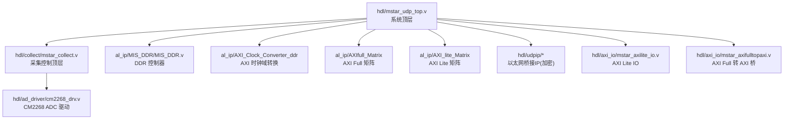
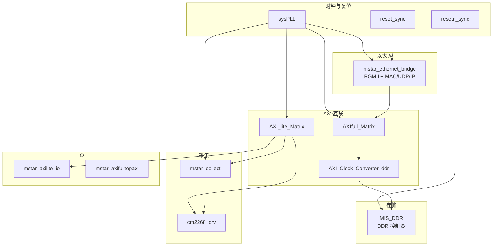
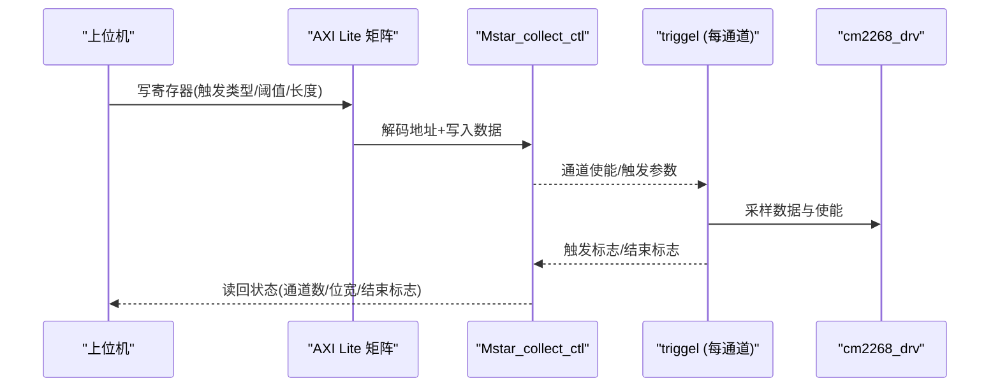
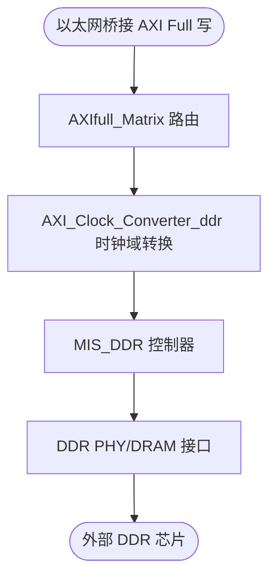
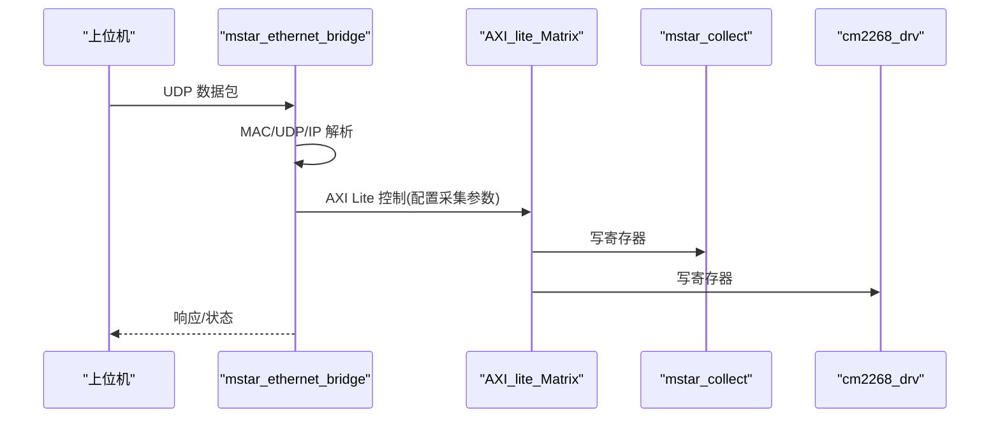
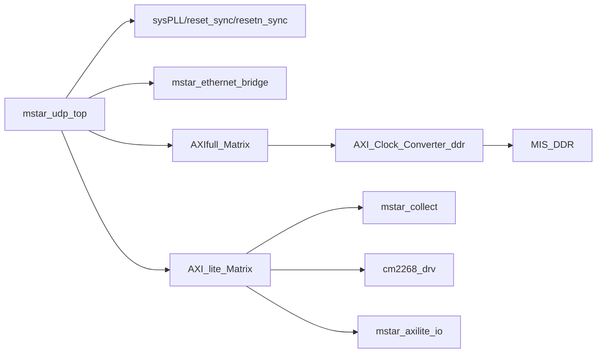

# 系统概述

<cite>
**本文引用的文件**   
- [README.md](file://README.md)
- [tand_udp.al](file://tand_udp.al)
- [mstar_udp_top.v](file://hdl/mstar_udp_top.v)
- [mstar_collect.v](file://hdl/collect/mstar_collect.v)
- [Mstar_collect_ctl.v](file://hdl/collect/Mstar_collect_ctl.v)
- [cm2268_drv.v](file://hdl/ad_driver/cm2268_drv.v)
- [mstar_axilite_io.v](file://hdl/axi_io/mstar_axilite_io.v)
- [mstar_axifulltopaxi.v](file://hdl/axi_io/mstar_axifulltopaxi.v)
- [MIS_DDR.v](file://al_ip/MIS_DDR/MIS_DDR.v)
</cite>

## 目录
1. [引言](#引言)
2. [项目结构](#项目结构)
3. [核心组件](#核心组件)
4. [架构总览](#架构总览)
5. [详细组件分析](#详细组件分析)
6. [依赖关系分析](#依赖关系分析)
7. [性能与规格](#性能与规格)
8. [硬件平台与资源](#硬件平台与资源)
9. [故障排查指南](#故障排查指南)
10. [结论](#结论)

## 引言
本系统为基于安路科技 PH1 FPGA 的多通道数据采集设备端工程，目标是将多通道 ADC 采集数据经 DDR 缓存后通过以太网 UDP 协议传输至上位机。系统以 AXI 总线为互联骨架，集成 ADC 驱动、采集控制、DDR 控制器、AXI 时钟域转换、AXI 矩阵互联以及加密的以太网桥接 IP，形成从传感器到网络的完整数据通路。

## 项目结构
工程采用分层组织：
- hdl：用户逻辑顶层与各功能模块（ADC 驱动、采集控制、AXI IO、同步原语等）
- al_ip：安路 IP 核（DDR 控制器、AXI Full/Lite 矩阵、时钟转换器、FIFO、PLL 等）
- constraint：引脚与时序约束
- 工程配置：Tang Dynasty IDE 工程文件与器件配置

图表来源
- [mstar_udp_top.v:9-92](file://hdl/mstar_udp_top.v#L9-L92)
- [mstar_udp_top.v:415-569](file://hdl/mstar_udp_top.v#L415-L569)
- [mstar_udp_top.v:591-675](file://hdl/mstar_udp_top.v#L591-L675)
- [mstar_udp_top.v:676-800](file://hdl/mstar_udp_top.v#L676-L800)
- [mstar_collect.v:9-62](file://hdl/collect/mstar_collect.v#L9-L62)
- [cm2268_drv.v:9-51](file://hdl/ad_driver/cm2268_drv.v#L9-L51)
- [mstar_axilite_io.v:22-55](file://hdl/axi_io/mstar_axilite_io.v#L22-L55)
- [mstar_axifulltopaxi.v:1-32](file://hdl/axi_io/mstar_axifulltopaxi.v#L1-L32)
- [MIS_DDR.v:12-82](file://al_ip/MIS_DDR/MIS_DDR.v#L12-L82)

章节来源
- [README.md:23-73](file://README.md#L23-L73)
- [tand_udp.al:15-234](file://tand_udp.al#L15-L234)

## 核心组件
- ADC 数据采集：CM2268 ADC 驱动封装，提供寄存器配置与采样数据输出，支持多通道并行数据流。
- 采集控制：管理触发、通道使能、缓冲区指针与状态机，对外暴露 AXI Lite 配置接口。
- DDR 存储：Anlogic MIS_DDR 控制器，提供 AXI Full 128-bit 接口访问外部 DDR。
- 网络传输：加密以太网桥接 IP，实现 MAC/UDP/IP 协议栈与 RGMII 物理层对接。
- AXI 总线互联：AXI Full/Lite 矩阵与 AXI 时钟域转换器，统一不同时钟域的 AXI 主从通信。

章节来源
- [cm2268_drv.v:9-51](file://hdl/ad_driver/cm2268_drv.v#L9-L51)
- [Mstar_collect_ctl.v:22-68](file://hdl/collect/Mstar_collect_ctl.v#L22-L68)
- [MIS_DDR.v:12-82](file://al_ip/MIS_DDR/MIS_DDR.v#L12-L82)
- [mstar_udp_top.v:591-675](file://hdl/mstar_udp_top.v#L591-L675)
- [mstar_udp_top.v:484-569](file://hdl/mstar_udp_top.v#L484-L569)

## 架构总览
系统以 mstar_udp_top 为顶层，内部包含：
- 时钟与复位：sysPLL 生成 125MHz/100MHz/50MHz 时钟，reset_sync/resetn_sync 完成跨时钟域复位同步。
- 以太网桥接：mstar_ethernet_bridge 提供 RGMII 接口与 AXI Lite/Full 控制与数据接口。
- AXI Lite 矩阵：将上位机 AXI Lite 请求路由至各子模块（采集控制、ADC 驱动、IO）。
- AXI Full 矩阵：将以太网桥接的 AXI Full 数据读写请求路由至 DDR 控制器。
- DDR 控制器：MIS_DDR 通过 AXI Clock Converter 适配 100MHz 与 ~133MHz 时钟域，连接外部 DDR。
- 采集子系统：mstar_collect 聚合 ADC 驱动与触发控制，输出带使能的采样数据。

图表来源
- [mstar_udp_top.v:371-406](file://hdl/mstar_udp_top.v#L371-L406)
- [mstar_udp_top.v:415-569](file://hdl/mstar_udp_top.v#L415-L569)
- [mstar_udp_top.v:591-675](file://hdl/mstar_udp_top.v#L591-L675)
- [mstar_udp_top.v:676-800](file://hdl/mstar_udp_top.v#L676-L800)

## 详细组件分析

### ADC 数据采集路径
- CM2268 驱动封装 cm2268_drv 提供 AXI Lite 寄存器接口与 ADC 采样控制，输出 128bit 宽的数据与有效信号。
- 采集控制 Mstar_collect_ctl 管理通道使能、触发类型与阈值、结束位置与相对触发位置，并输出 collect_en、collect_endreq 等控制信号。
- mstar_collect 将多通道触发器 triggel 实例化，按通道并行处理触发条件，输出 tADdat/tADen 给上层 DMA/存储。

图表来源
- [cm2268_drv.v:70-138](file://hdl/ad_driver/cm2268_drv.v#L70-L138)
- [Mstar_collect_ctl.v:69-284](file://hdl/collect/Mstar_collect_ctl.v#L69-L284)
- [mstar_collect.v:157-188](file://hdl/collect/mstar_collect.v#L157-L188)

章节来源
- [cm2268_drv.v:9-51](file://hdl/ad_driver/cm2268_drv.v#L9-L51)
- [Mstar_collect_ctl.v:22-68](file://hdl/collect/Mstar_collect_ctl.v#L22-L68)
- [mstar_collect.v:9-62](file://hdl/collect/mstar_collect.v#L9-L62)

### DDR 存储与 AXI 时钟域转换
- MIS_DDR 提供 AXI Full 128-bit 接口，内部通过 ph1p_ddrmc_wrapper 管理 DDR PHY 与命令调度。
- AXI_Clock_Converter_ddr 在 100MHz（us）与 ~133MHz（ds）之间进行 AXI 事务转换，保证时序收敛。
- 顶层将以太网桥接的 AXI Full 请求经 AXIfull_Matrix 路由至时钟转换器，再进入 MIS_DDR。

图表来源
- [mstar_udp_top.v:484-569](file://hdl/mstar_udp_top.v#L484-L569)
- [MIS_DDR.v:84-200](file://al_ip/MIS_DDR/MIS_DDR.v#L84-L200)

章节来源
- [MIS_DDR.v:12-82](file://al_ip/MIS_DDR/MIS_DDR.v#L12-L82)
- [mstar_udp_top.v:415-569](file://hdl/mstar_udp_top.v#L415-L569)

### UDP 网络传输与 AXI 总线互联
- 加密以太网桥接 IP mstar_ethernet_bridge 提供 RGMII 物理接口与 MAC/UDP/IP 协议栈，并通过 AXI Lite/Full 暴露控制与数据端口。
- AXI_lite_Matrix 将上位机对采集控制、ADC 驱动、IO 寄存器的访问进行解复用。
- AXI_fulltopaxi 作为 AXI Full 到 AXI 的协议桥，用于某些需要 128-bit 数据宽度的场景。

图表来源
- [mstar_udp_top.v:591-675](file://hdl/mstar_udp_top.v#L591-L675)
- [mstar_udp_top.v:676-759](file://hdl/mstar_udp_top.v#L676-L759)
- [mstar_axifulltopaxi.v:1-32](file://hdl/axi_io/mstar_axifulltopaxi.v#L1-L32)

章节来源
- [README.md:87-89](file://README.md#L87-L89)
- [mstar_udp_top.v:591-675](file://hdl/mstar_udp_top.v#L591-L675)
- [mstar_axilite_io.v:22-55](file://hdl/axi_io/mstar_axilite_io.v#L22-L55)

## 依赖关系分析
- 顶层 mstar_udp_top 依赖 sysPLL、reset_sync、resetn_sync 完成时钟与复位。
- 以太网桥接依赖 AXI Lite/Full 接口；AXI Lite 由 AXI_lite_Matrix 分发；AXI Full 由 AXIfull_Matrix 分发并经时钟转换器进入 MIS_DDR。
- 采集子系统依赖 AXI Lite 配置接口与 ADC 驱动；触发逻辑与通道控制位于 Mstar_collect_ctl。
- IO 模块通过 AXI Lite 暴露 LED/端口控制。

图表来源
- [mstar_udp_top.v:371-406](file://hdl/mstar_udp_top.v#L371-L406)
- [mstar_udp_top.v:415-569](file://hdl/mstar_udp_top.v#L415-L569)
- [mstar_udp_top.v:591-675](file://hdl/mstar_udp_top.v#L591-L675)
- [mstar_udp_top.v:676-800](file://hdl/mstar_udp_top.v#L676-L800)

章节来源
- [tand_udp.al:15-234](file://tand_udp.al#L15-L234)

## 性能与规格
- 采样率与数据带宽
  - ADC 数据位宽：16bit/通道，最多 8 通道并行（参数 AD_DATWIDTH=16，CHANNEL_NUM=8）。
  - 采集数据经 AXI Full 128-bit 总线传输，适合高吞吐场景。
- 网络吞吐量
  - 以太网接口为 RGMII，支持千兆速率；链路状态与速度指示信号已导出。
- 时钟域
  - 系统时钟：50MHz 参考，经 PLL 产生 125MHz（以太网）、100MHz（AXI Full）、50MHz（AXI Lite）。
  - DDR 控制器工作于 ~133MHz，通过 AXI 时钟转换器与 100MHz 域隔离。

章节来源
- [mstar_udp_top.v:371-414](file://hdl/mstar_udp_top.v#L371-L414)
- [mstar_udp_top.v:591-675](file://hdl/mstar_udp_top.v#L591-L675)
- [MIS_DDR.v:110-129](file://al_ip/MIS_DDR/MIS_DDR.v#L110-L129)

## 硬件平台与资源
- 目标器件：Anlogic PH1P35MDG324-3
- IDE：Tang Dynasty ≥ 6.2
- 关键 IP 与资源
  - MIS_DDR：DDR 控制器，AXI 地址宽度 25/26，数据宽度 128bit，ECC 关闭。
  - AXI Full/Lite 矩阵：用于多主/多从 AXI 总线互联。
  - AXI 时钟转换器：US/DS 时钟比 1:8，异步时钟模式。
  - 以太网桥接 IP：加密网表，提供 MAC/UDP/IP 与 AXI 接口。

章节来源
- [README.md:75-78](file://README.md#L75-L78)
- [tand_udp.al:6-10](file://tand_udp.al#L6-L10)
- [MIS_DDR.v:84-129](file://al_ip/MIS_DDR/MIS_DDR.v#L84-L129)
- [README.md:87-89](file://README.md#L87-L89)

## 故障排查指南
- 链路错误与速度指示
  - link_error 与 speed_status_1g/speed_status_100M 可用于快速判断以太网链路状态。
- 采集状态与触发
  - collect_doing/collect_end 与 trigflg 可辅助定位触发是否生效、采集是否结束。
- AXI 配置读写
  - 检查 AXI Lite 握手信号（AW/AR/W/R/B）与地址映射是否正确，确认矩阵路由是否命中目标模块。
- DDR 初始化与时钟
  - 确认 ddr_dhi_clk/ddr_cfg_clk 与复位 ddr_dhi_rstn 正常，AXI 时钟转换器锁相与复位同步正确。

章节来源
- [mstar_udp_top.v:350-370](file://hdl/mstar_udp_top.v#L350-L370)
- [mstar_udp_top.v:395-406](file://hdl/mstar_udp_top.v#L395-L406)
- [Mstar_collect_ctl.v:198-255](file://hdl/collect/Mstar_collect_ctl.v#L198-L255)

## 结论
该系统以 AXI 总线为核心，将 ADC 采集、DDR 缓存与 UDP 网络传输有机整合，具备多通道、高吞吐、可配置的采集能力。通过 AXI 矩阵与时钟域转换，系统在 PH1 FPGA 上实现了稳定可靠的端到端数据通路。开发者可基于现有模块扩展更多通道或优化网络吞吐，同时保持清晰的配置与控制接口。