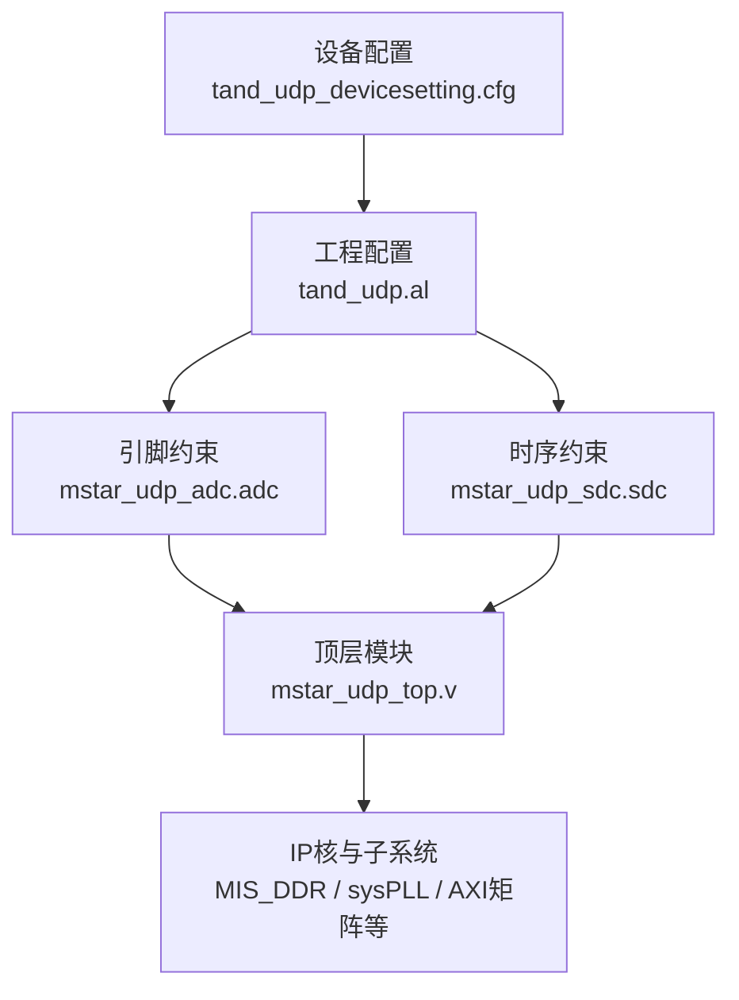
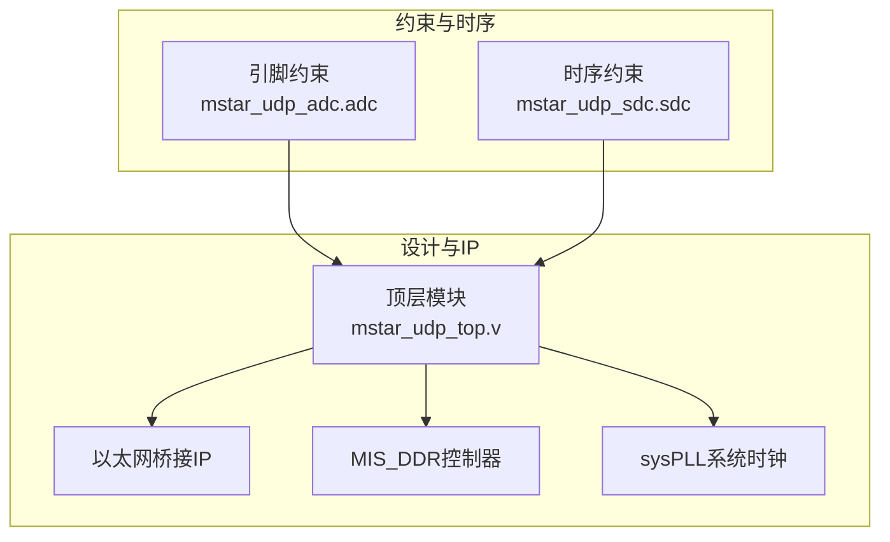
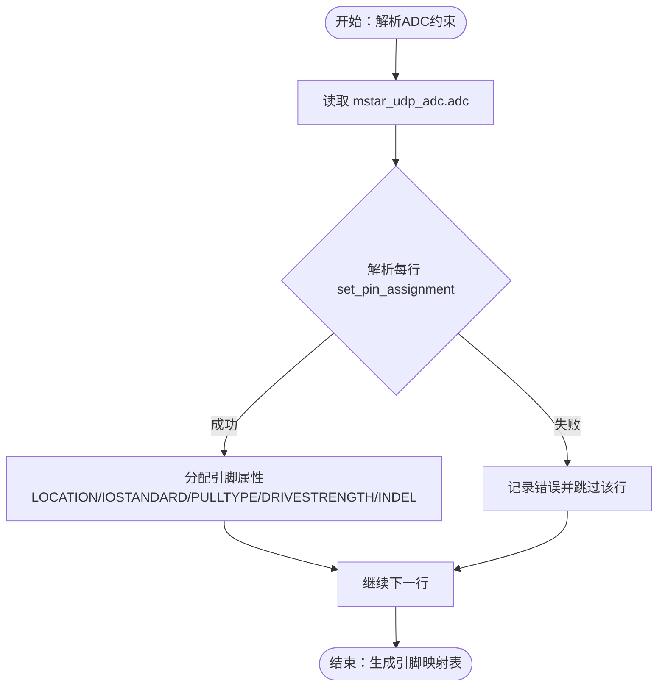
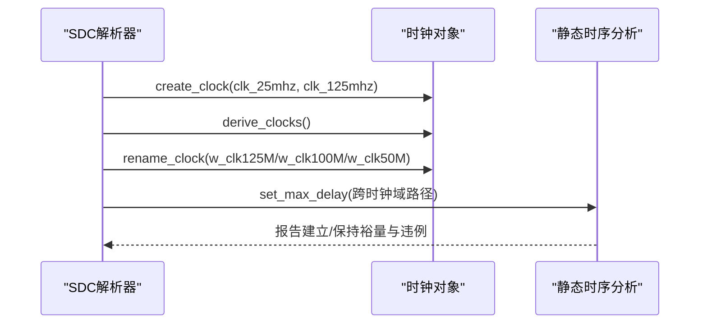
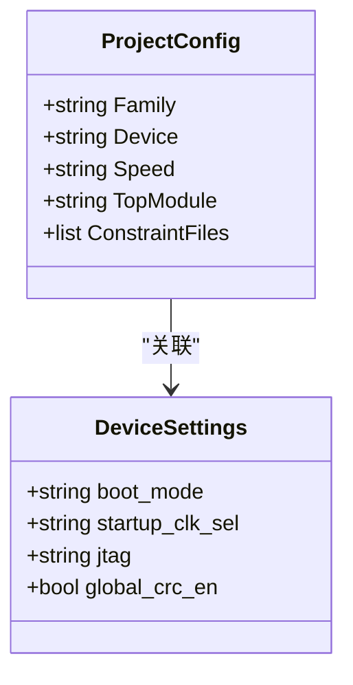
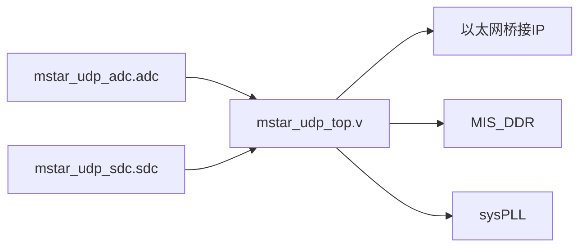

# 约束和时序设计

<cite>
**本文引用的文件**   
- [tand_udp.al](file://tand_udp.al)
- [tand_udp_devicesetting.cfg](file://tand_udp_devicesetting.cfg)
- [mstar_udp_adc.adc](file://hdl/constraint/mstar_udp_adc.adc)
- [mstar_udp_sdc.sdc](file://hdl/constraint/mstar_udp_sdc.sdc)
- [README.md](file://README.md)
</cite>

## 目录
1. [引言](#引言)
2. [项目结构](#项目结构)
3. [核心组件](#核心组件)
4. [架构总览](#架构总览)
5. [详细组件分析](#详细组件分析)
6. [依赖关系分析](#依赖关系分析)
7. [性能与优化](#性能与优化)
8. [故障排查指南](#故障排查指南)
9. [结论](#结论)
10. [附录：器件适配与调优清单](#附录器件适配与调优清单)

## 引言
本文件面向使用安路（Anlogic）PH1P35MDG324 器件的 UDP 采集与以太网桥接工程，系统性说明引脚约束与时序约束的结构、语法与最佳实践。内容覆盖：
- 引脚约束文件的结构与语法：IO标准、上拉/下拉、驱动能力、输入延迟等
- 时序约束定义：时钟周期、跨时钟域最大延迟、时钟重命名与推导
- 静态时序分析（STA）结果解读：建立时间、保持时间、违例分析与收敛策略
- 时序优化技巧与约束调优方法
- 不同FPGA器件的约束适配要点

## 项目结构
本项目采用“顶层模块 + 功能子模块 + IP核”的分层组织方式，约束文件集中在 hdl/constraint 目录下，分别负责引脚分配与时序定义。工程配置文件指定了目标器件、工具链版本、综合与布局布线策略以及约束集绑定。

图表来源
- [tand_udp.al:1-20](file://tand_udp.al#L1-L20)
- [tand_udp.al:165-184](file://tand_udp.al#L165-L184)
- [tand_udp.al:256-274](file://tand_udp.al#L256-L274)

章节来源
- [README.md:23-73](file://README.md#L23-L73)
- [tand_udp.al:1-20](file://tand_udp.al#L1-L20)
- [tand_udp.al:165-184](file://tand_udp.al#L165-L184)
- [tand_udp.al:256-274](file://tand_udp.al#L256-L274)

## 核心组件
- 工程与器件配置
  - 目标器件：PH1P35MDG324，速度等级 -3
  - 工具链版本：TD_Version 6.2.190657
  - 顶层模块：mstar_udp_top
  - 约束集：constraint_1，包含 ADC 引脚约束与 SDC 时序约束
- 引脚约束（ADC）
  - 使用 set_pin_assignment 为每个端口指定 LOCATION、IOSTANDARD、PULLTYPE、DRIVESTRENGTH、INDEL 等属性
- 时序约束（SDC）
  - 使用 create_clock 定义外部时钟源
  - derive_clocks 自动推导内部时钟
  - rename_clock 对 PLL 输出时钟进行语义化命名
  - set_max_delay 定义跨时钟域数据路径的最大延迟约束

章节来源
- [tand_udp.al:6-10](file://tand_udp.al#L6-L10)
- [tand_udp.al:242-246](file://tand_udp.al#L242-L246)
- [tand_udp.al:165-184](file://tand_udp.al#L165-L184)
- [mstar_udp_adc.adc:1-95](file://hdl/constraint/mstar_udp_adc.adc#L1-L95)
- [mstar_udp_sdc.sdc:1-17](file://hdl/constraint/mstar_udp_sdc.sdc#L1-L17)

## 架构总览
下图展示约束与时序在整体设计中的位置与作用：

图表来源
- [tand_udp.al:165-184](file://tand_udp.al#L165-L184)
- [tand_udp.al:185-234](file://tand_udp.al#L185-L234)

## 详细组件分析

### 引脚约束文件结构与语法（ADC）
- 基本语法
  - set_pin_assignment {信号名} {属性列表}
  - 常用属性：
    - LOCATION：物理引脚号
    - IOSTANDARD：IO电平标准（如 LVCMOS33）
    - PULLTYPE：上拉/下拉（PULLUP/PULLDOWN/NONE）
    - DRIVESTRENGTH：驱动强度（如 8mA）
    - INDEL：输入路径延迟（用于输入路径时序建模）
- 典型分组
  - RGMII接口：rx_ctl/rxc/rxd[3:0]、tx_ctl/txc/txd[3:0]
  - MDIO：mdc/mdio
  - LED与状态指示：link_error/speed_status_xxx
  - 通用GPIO：in_port/out_port、trig_out/trig_in、ad_convst_*
  - I2C总线：con_scl/con_sda、user_scl/user_sda
  - AD芯片接口：ad_reset/ad_convst/ad_csn/ad_rdn/ad_wrn/ad_busy/ad_frstdat/ad_data[15:0]
- IO标准与驱动能力
  - 统一使用 LVCMOS33，表示3.3V CMOS电平
  - 输出信号普遍设置 DRIVESTRENGTH = 8，以匹配PCB走线与负载
  - 输入信号多设置 PULLTYPE = PULLUP，确保未连接时稳定高电平
- 输入延迟建模
  - RGMII接收数据与CTL设置了 INDEL，用于精确建模外部RGMII到FPGA的板级延迟，提升STA准确性

图表来源
- [mstar_udp_adc.adc:1-95](file://hdl/constraint/mstar_udp_adc.adc#L1-L95)

章节来源
- [mstar_udp_adc.adc:1-95](file://hdl/constraint/mstar_udp_adc.adc#L1-L95)

### 时序约束定义（SDC）
- 时钟定义
  - create_clock -name {clk_25mhz} -period 20.000 -waveform {0.000 10.000} [get_ports {clk_50m}]
    - 将外部50MHz时钟端口定义为25MHz时钟（半频），波形占空比50%
  - create_clock -name {clk_125mhz} -period 4.000 -waveform {0.000 2.000} [get_ports {rgmii_rxc}]
    - 将RGMII RX时钟端口定义为125MHz时钟
- 时钟推导与重命名
  - derive_clocks：自动从已有时钟推导衍生时钟（例如PLL输出）
  - rename_clock：将PLL输出的内部时钟重命名为 w_clk125M/w_clk100M/w_clk50M，便于后续约束引用
- 跨时钟域最大延迟
  - set_max_delay -from [时钟A] -to [时钟B] -datapath_only <ns>
    - 针对关键跨时钟域路径设定最大允许延迟，避免STA过度悲观或乐观
    - 示例：w_clk125M与w_clk100M之间双向8ns；w_clk125M与w_clk50M之间双向40ns
  - MIS_DDR用户时钟与w_clk100M之间的双向延迟约束（15ns/10ns）
  - RGMII内部时钟自环路径的8ns约束，用于约束MAC/PHY接口内部路径

图表来源
- [mstar_udp_sdc.sdc:1-17](file://hdl/constraint/mstar_udp_sdc.sdc#L1-L17)

章节来源
- [mstar_udp_sdc.sdc:1-17](file://hdl/constraint/mstar_udp_sdc.sdc#L1-L17)

### 工程与设备配置
- 工程配置（tand_udp.al）
  - 目标器件：Family=PH1，Device=PH1P35MDG324，Speed=-3
  - 顶层模块：mstar_udp_top
  - 约束集：constraint_1，包含ADC与SDC两类约束文件
  - 综合与布局布线策略：opt_timing=high，强调时序优化
- 设备配置（tand_udp_devicesetting.cfg）
  - boot_mode=mspix1，启动模式选择
  - startup_clk_sel=clk_2MHz，启动时钟源
  - jtag=dedicate，JTAG调试模式
  - 其他配置项：CRC校验、多启动、PLL锁定等待等

图表来源
- [tand_udp.al:6-10](file://tand_udp.al#L6-L10)
- [tand_udp.al:242-246](file://tand_udp.al#L242-L246)
- [tand_udp.al:256-274](file://tand_udp.al#L256-L274)
- [tand_udp_devicesetting.cfg:1-26](file://tand_udp_devicesetting.cfg#L1-L26)

章节来源
- [tand_udp.al:6-10](file://tand_udp.al#L6-L10)
- [tand_udp.al:242-246](file://tand_udp.al#L242-L246)
- [tand_udp.al:256-274](file://tand_udp.al#L256-L274)
- [tand_udp_devicesetting.cfg:1-26](file://tand_udp_devicesetting.cfg#L1-L26)

## 依赖关系分析
- 约束文件依赖
  - ADC约束依赖顶层模块端口定义（如 clk_50m、rgmii_rxc、led、in_port/out_port、ad_data[*] 等）
  - SDC约束依赖时钟网络（外部端口与PLL内部时钟）
- 设计模块依赖
  - 顶层模块依赖以太网桥接IP、DDR控制器、系统PLL等IP核
  - 约束通过工具链注入到综合与布局布线阶段，影响最终时序收敛

图表来源
- [tand_udp.al:165-184](file://tand_udp.al#L165-L184)
- [tand_udp.al:185-234](file://tand_udp.al#L185-L234)

章节来源
- [tand_udp.al:165-184](file://tand_udp.al#L165-L184)
- [tand_udp.al:185-234](file://tand_udp.al#L185-L234)

## 性能与优化
- 时序收敛建议
  - 合理设置跨时钟域最大延迟，避免过于宽松导致资源浪费，或过于严格导致无法收敛
  - 对关键路径（如RGMII、DDR用户时钟）增加局部约束或插入寄存器打拍
  - 使用derive_clocks与rename_clock明确时钟域边界，减少STA误判
- IO时序建模
  - 对外部高速接口（RGMII）设置INDEL，提高输入路径时序精度
  - 输出驱动强度与上拉/下拉根据PCB负载调整，减少信号反射与串扰
- 综合与布局布线策略
  - opt_timing=high有助于时序优化，但可能增加功耗与面积，需权衡
  - 对关键模块（如以太网、DDR）可考虑分区约束与实例化优化

[本节为通用指导，不直接分析具体文件]

## 故障排查指南
- 常见STA违例类型
  - 建立时间违例（Setup Violation）：数据到达太晚，需减小组合逻辑延迟或提前数据
  - 保持时间违例（Hold Violation）：数据变化太快，需增加缓冲或降低时钟频率
  - 跨时钟域违例：时钟偏移或路径延迟过大，需调整set_max_delay或插入同步器
- 排查步骤
  - 检查时钟定义是否正确（频率、波形、端口绑定）
  - 核对IO标准与驱动能力是否与硬件一致
  - 查看违例路径，定位关键组合逻辑或跨时钟域路径
  - 调整约束后重新运行综合与布局布线，观察裕量改善情况

[本节为通用指导，不直接分析具体文件]

## 结论
本项目通过明确的引脚与时序约束，结合工程与设备配置，构建了稳定的UDP采集与以太网桥接平台。合理的约束定义与STA调优是保证时序收敛与系统可靠性的关键。建议在后续迭代中持续优化跨时钟域路径、细化IO时序建模，并根据实际板级延迟校准约束参数。

[本节为总结性内容，不直接分析具体文件]

## 附录：器件适配与调优清单
- 器件差异要点
  - 不同厂商/系列FPGA的IO标准名称与驱动强度范围不同，需对照器件手册调整IOSTANDARD与DRIVESTRENGTH
  - 时钟约束语法在不同工具链中略有差异，注意create_clock/derive_clocks/rename_clock的可用性与参数
- 调优清单
  - 确认所有外部端口已正确绑定引脚与IO标准
  - 对高速接口（RGMII、DDR）设置INDEL与跨时钟域延迟约束
  - 对关键路径插入寄存器或流水线，降低组合逻辑深度
  - 使用工具提供的时序报告，关注WNS/TNS与违例数量趋势
  - 逐步放宽/收紧约束，平衡性能与资源

[本节为通用指导，不直接分析具体文件]