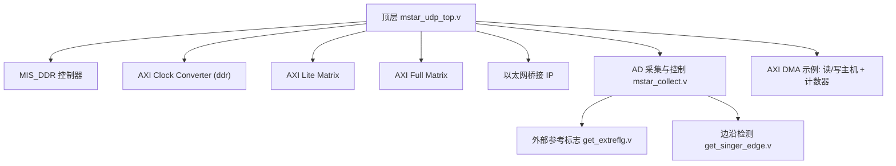
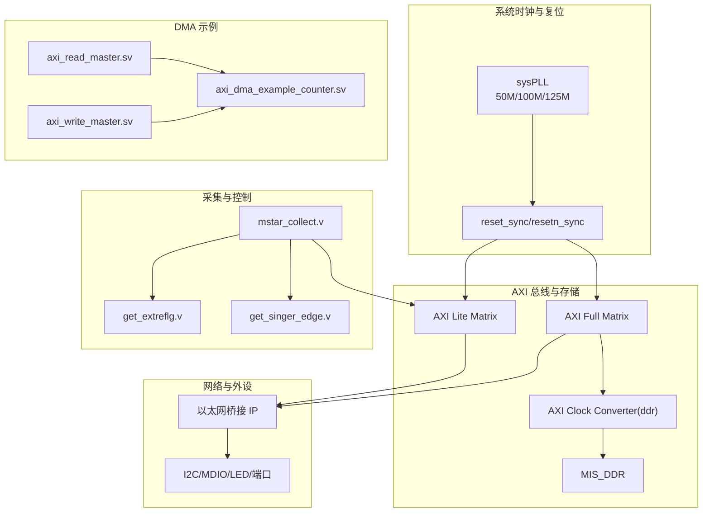
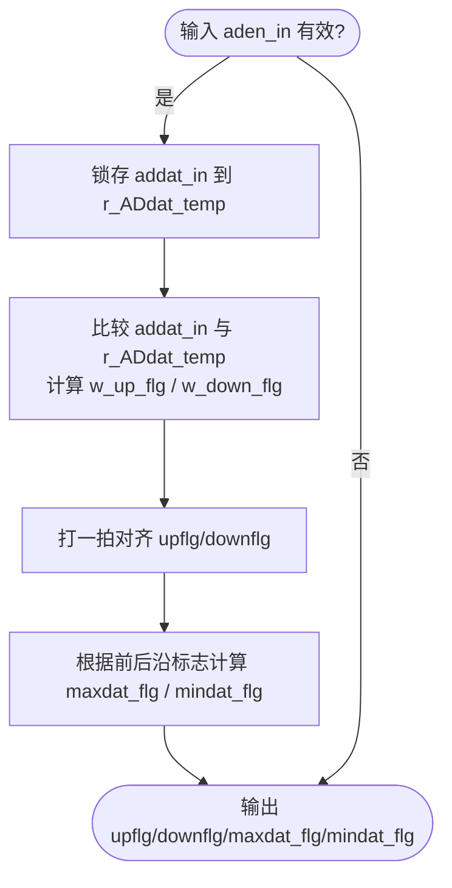
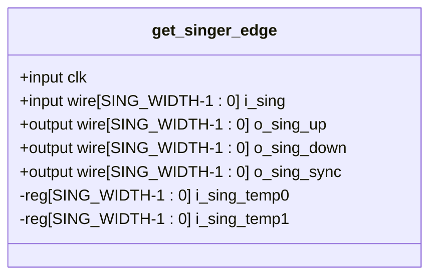
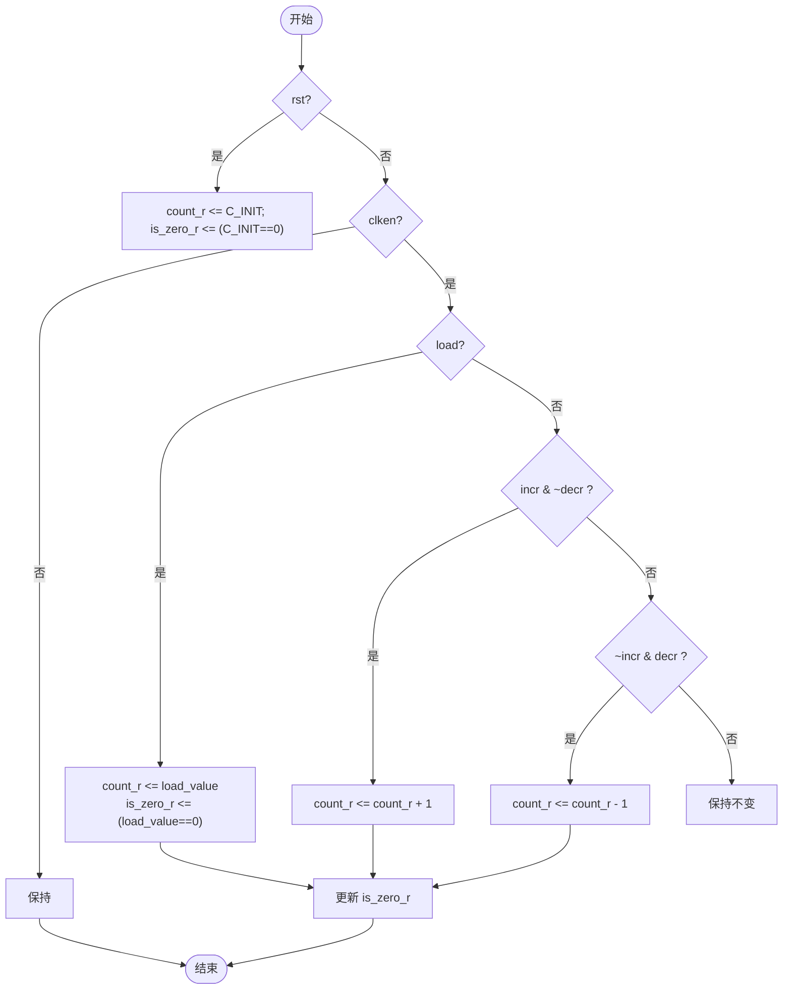
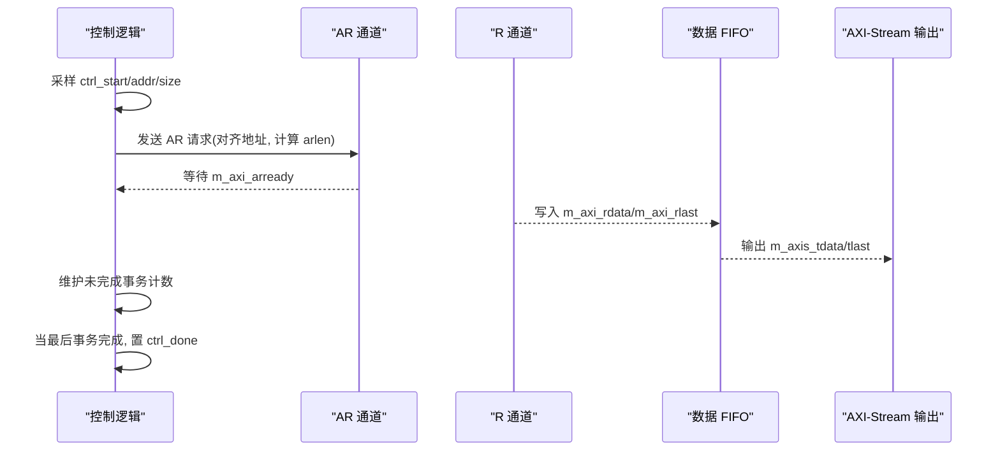
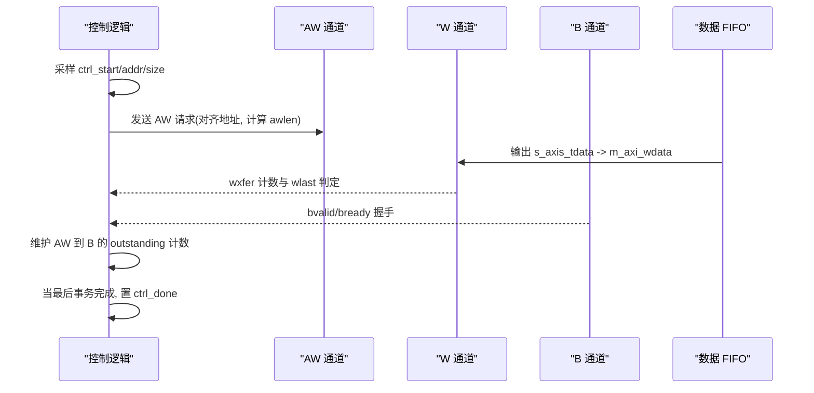
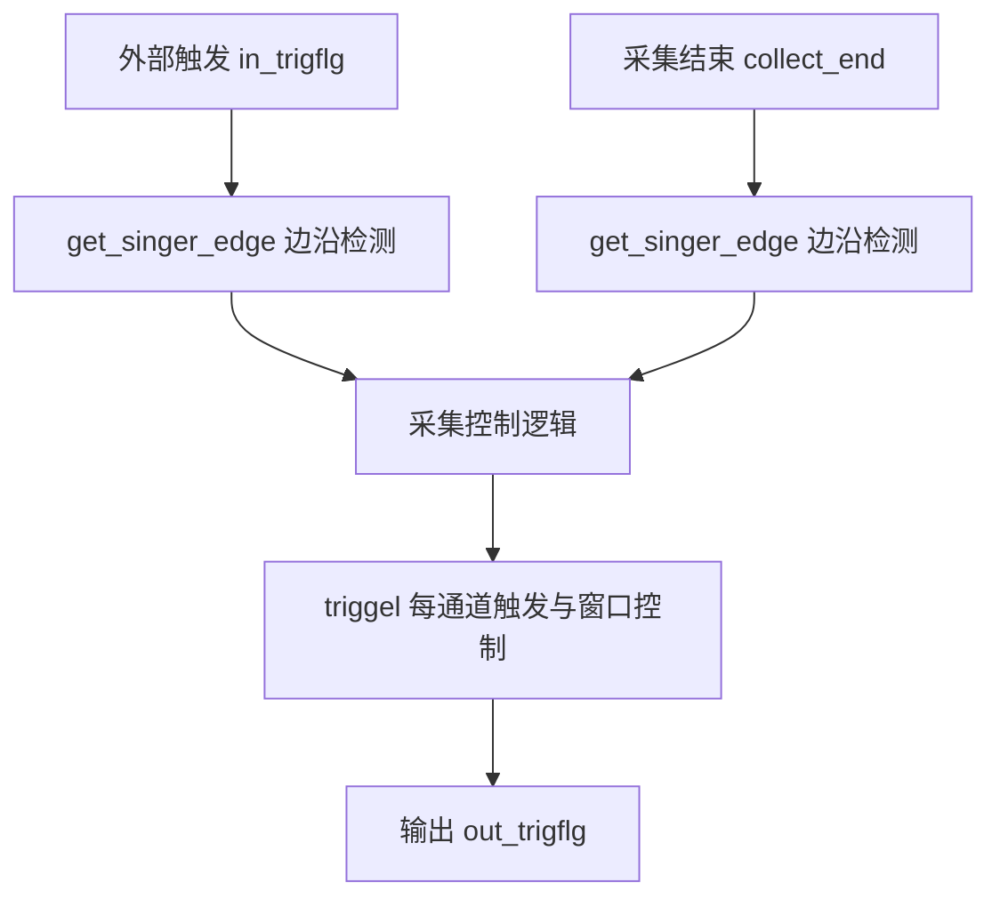
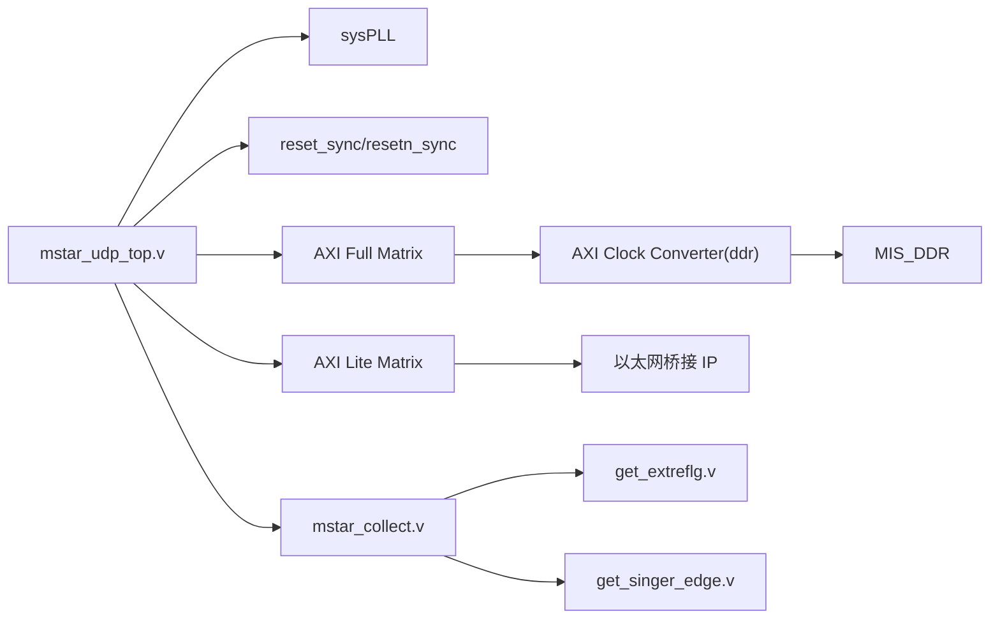

# 仿真测试

<cite>
**本文引用的文件**   
- [README.md](file://README.md)
- [mstar_udp_top.v](file://hdl/mstar_udp_top.v)
- [get_extreflg.v](file://hdl/collect/get_extreflg.v)
- [get_singer_edge.v](file://hdl/sync/get_singer_edge.v)
- [axi_dma_example_counter.sv](file://hdl/axi_dma/axi_dma_example_counter.sv)
- [axi_dma_example_axi_read_master.sv](file://hdl/axi_dma/axi_dma_example_axi_read_master.sv)
- [axi_dma_example_axi_write_master.sv](file://hdl/axi_dma/axi_dma_example_axi_write_master.sv)
- [mstar_collect.v](file://hdl/collect/mstar_collect.v)
</cite>

## 目录
1. [简介](#简介)
2. [项目结构](#项目结构)
3. [核心组件](#核心组件)
4. [架构总览](#架构总览)
5. [详细组件分析](#详细组件分析)
6. [依赖关系分析](#依赖关系分析)
7. [性能与资源考量](#性能与资源考量)
8. [故障排查指南](#故障排查指南)
9. [结论](#结论)
10. [附录：仿真用例清单](#附录仿真用例清单)

## 简介
本指导文档面向使用 Tang Dynasty IDE 进行功能仿真的工程师，目标是帮助你搭建测试平台、生成激励信号、查看波形，并针对以下关键模块完成系统化验证：
- 外部参考信号检测模块（上升沿/下降沿检测、数据边界检测）
- 边沿检测模块（单时钟域捕获；多时钟域场景下的同步与捕获）
- AXI DMA 计数器与读写主机（AXI Full 读/写时序与计数控制）
- 数据采集与控制链路（触发、缓存位置、采集窗口）

同时提供常见仿真问题的定位方法与优化建议，包括时序违例分析、资源使用统计、性能瓶颈识别等。

## 项目结构
本项目为基于安路 PH1 FPGA 的多通道 AD 采集设备端工程，顶层集成 AD 驱动、数据采集、DDR 缓存、以太网桥接 IP 及 AXI 总线互联。仿真重点集中在 hdl 目录下的逻辑模块与 axi_dma 示例模块。

图表来源
- [mstar_udp_top.v:371-483](file://hdl/mstar_udp_top.v#L371-L483)
- [mstar_udp_top.v:484-569](file://hdl/mstar_udp_top.v#L484-L569)
- [mstar_udp_top.v:591-675](file://hdl/mstar_udp_top.v#L591-L675)
- [mstar_udp_top.v:676-762](file://hdl/mstar_udp_top.v#L676-L762)
- [mstar_udp_top.v:763-800](file://hdl/mstar_udp_top.v#L763-L800)
- [mstar_collect.v:107-155](file://hdl/collect/mstar_collect.v#L107-L155)
- [get_extreflg.v:8-23](file://hdl/collect/get_extreflg.v#L8-L23)
- [get_singer_edge.v:21-29](file://hdl/sync/get_singer_edge.v#L21-L29)
- [axi_dma_example_axi_read_master.sv:22-79](file://hdl/axi_dma/axi_dma_example_axi_read_master.sv#L22-L79)
- [axi_dma_example_axi_write_master.sv:22-74](file://hdl/axi_dma/axi_dma_example_axi_write_master.sv#L22-L74)

章节来源
- [README.md:23-73](file://README.md#L23-L73)

## 核心组件
- 外部参考标志检测 get_extreflg.v：在 ADC 数据流中检测参考信号的上升/下降沿，并输出最大/最小值边界标志，用于触发或校准。
- 边沿检测 get_singer_edge.v：对输入信号做两级打拍，产生单边沿脉冲（上升/下降），并提供同步后的延迟版本。
- AXI DMA 计数器 axi_dma_example_counter.sv：可加载、递增/递减的计数器，支持 is_zero 标志，被读/写主机用于事务计数与突发长度控制。
- AXI DMA 读主机 axi_dma_example_axi_read_master.sv：通过 AXI Full 从 DDR 读取数据，管理地址突发、未完成事务数、FIFO 缓冲与 AXI-Stream 输出。
- AXI DMA 写主机 axi_dma_example_axi_write_master.sv：通过 AXI Full 将数据写入 DDR，管理写地址/数据/响应通道，以及突发长度与字节掩码。
- 数据采集与控制 mstar_collect.v：集成 AXI Lite 配置接口、AD 驱动实例化、触发逻辑与采集窗口控制。

章节来源
- [get_extreflg.v:8-66](file://hdl/collect/get_extreflg.v#L8-L66)
- [get_singer_edge.v:21-38](file://hdl/sync/get_singer_edge.v#L21-L38)
- [axi_dma_example_counter.sv:22-98](file://hdl/axi_dma/axi_dma_example_counter.sv#L22-L98)
- [axi_dma_example_axi_read_master.sv:22-386](file://hdl/axi_dma/axi_dma_example_axi_read_master.sv#L22-L386)
- [axi_dma_example_axi_write_master.sv:22-444](file://hdl/axi_dma/axi_dma_example_axi_write_master.sv#L22-L444)
- [mstar_collect.v:9-62](file://hdl/collect/mstar_collect.v#L9-L62)

## 架构总览
下图展示顶层模块与子系统之间的交互关系，便于理解仿真时各激励与观测点的组织方式。

图表来源
- [mstar_udp_top.v:371-483](file://hdl/mstar_udp_top.v#L371-L483)
- [mstar_udp_top.v:484-569](file://hdl/mstar_udp_top.v#L484-L569)
- [mstar_udp_top.v:591-675](file://hdl/mstar_udp_top.v#L591-L675)
- [mstar_udp_top.v:676-762](file://hdl/mstar_udp_top.v#L676-L762)
- [mstar_udp_top.v:763-800](file://hdl/mstar_udp_top.v#L763-L800)

## 详细组件分析

### 外部参考信号检测模块 get_extreflg.v
该模块在 ADC 数据有效期间比较当前数据与前一个数据，判断是否发生上升/下降变化，并进一步检测数据边界（最大值/最小值跳变）。

- 输入/输出要点
  - 输入：clk_50M、rst、addat_in、aden_in
  - 输出：upflg（上升标志）、downflg（下降标志）、maxdat_flg（最大值边界）、mindat_flg（最小值边界）、addat_out、aden_out
- 行为说明
  - 在 aden_in 有效时锁存 addat_in，并与前一拍数据进行有符号比较，得到 w_up_flg/w_down_flg
  - 通过两级寄存器 r_up_flg_temp/r_down_flg_temp 对齐输出 upflg/downflg
  - maxdat_flg/mindat_flg 通过前后沿标志的异或与组合实现边界检测
- 复杂度
  - 组合逻辑仅包含一次比较与少量逻辑门，时序路径短
  - 寄存器数量少，资源开销低

图表来源
- [get_extreflg.v:30-63](file://hdl/collect/get_extreflg.v#L30-L63)

#### 测试方法
- 上升沿检测验证
  - 激励：在 aden_in=1 的周期内，构造 addat_in 由小到大变化的序列（例如 0x0001→0x0002→…）
  - 期望：upflg 在每次增加处出现单周期脉冲；downflg 保持低电平
- 下降沿检测验证
  - 激励：在 aden_in=1 的周期内，构造 addat_in 由大到小的序列（例如 0xFFFF→0xFFFE→…）
  - 期望：downflg 在每次减少处出现单周期脉冲；upflg 保持低电平
- 数据边界检测测试
  - 激励：构造跨越符号位的数据跳变（如 0x7FFF→0x8000 或 0x8000→0x7FFF），以及极值附近跳变（0x7FFF→0x7FFE、0x8001→0x8000）
  - 期望：maxdat_flg 在达到局部最大值后下降时拉高；mindat_flg 在达到局部最小值后上升时拉高

章节来源
- [get_extreflg.v:8-66](file://hdl/collect/get_extreflg.v#L8-L66)

### 边沿检测模块 get_singer_edge.v
该模块对输入信号进行两级打拍，产生单边沿脉冲，并提供同步后的延迟版本。

- 输入/输出要点
  - 输入：clk、i_sing[SING_WIDTH-1:0]
  - 输出：o_sing_up、o_sing_down、o_sing_sync
- 行为说明
  - 在每个时钟沿将 i_sing 移入 i_sing_temp0/i_sing_temp1
  - o_sing_up = ~i_sing_temp1 & i_sing_temp0
  - o_sing_down = i_sing_temp1 & ~i_sing_temp0
  - o_sing_sync = i_sing_temp1（同步后的输入）

图表来源
- [get_singer_edge.v:21-38](file://hdl/sync/get_singer_edge.v#L21-L38)

#### 仿真验证流程
- 单时钟域边沿捕获测试
  - 激励：在单一时钟域下，对 i_sing 施加随机或确定性跳变序列
  - 期望：o_sing_up/o_sing_down 仅在对应边沿出现单周期脉冲；o_sing_sync 比输入延迟一拍
- 多时钟域边沿捕获测试（跨时钟域）
  - 激励：在源时钟域生成异步边沿，目标时钟域采样
  - 期望：在目标时钟域观察到稳定且无毛刺的 o_sing_up/o_sing_down；必要时在源侧先做同步打拍再进入本模块

章节来源
- [get_singer_edge.v:21-38](file://hdl/sync/get_singer_edge.v#L21-L38)

### AXI DMA 计数器 axi_dma_example_counter.sv
该计数器用于控制 DMA burst 长度与数据传输计数，支持 load/incr/decr 控制，并输出 is_zero 标志。

- 输入/输出要点
  - 输入：clk、clken、rst、load、incr、decr、load_value[C_WIDTH-1:0]
  - 输出：count[C_WIDTH-1:0]、is_zero
- 行为说明
  - rst 时清零；clken 使能时根据 load/incr/decr 更新 count
  - is_zero 在 count 为零时置高，并在 incr/decr 边界条件时正确翻转

图表来源
- [axi_dma_example_counter.sv:59-95](file://hdl/axi_dma/axi_dma_example_counter.sv#L59-L95)

#### 仿真用例
- 基本计数
  - 激励：load=1 加载初值，随后 incr/decr 交替
  - 期望：count 按预期增减，is_zero 在零值处拉高
- 溢出/下溢保护
  - 激励：在最大值处继续 incr，或在最小值处继续 decr
  - 期望：is_zero 状态符合设计约束（不越界或按设计回绕）

章节来源
- [axi_dma_example_counter.sv:22-98](file://hdl/axi_dma/axi_dma_example_counter.sv#L22-L98)

### AXI DMA 读主机 axi_dma_example_axi_read_master.sv
该模块通过 AXI Full 从 DDR 读取数据，管理地址突发、未完成事务数、FIFO 缓冲与 AXI-Stream 输出。

- 关键参数
  - C_M_AXI_ADDR_WIDTH、C_M_AXI_DATA_WIDTH、C_XFER_SIZE_WIDTH、C_MAX_OUTSTANDING、C_INCLUDE_DATA_FIFO
- 控制接口
  - ctrl_start：启动一次传输
  - ctrl_addr_offset：起始地址偏移
  - ctrl_xfer_size_in_bytes：传输字节数
- 行为要点
  - 将传输长度转换为 AXI arlen 格式并按 4KB 对齐
  - 维护未完成事务计数，避免 FIFO 溢出
  - 可选同步 FIFO 缓冲 AXI 读数据至 AXI-Stream

图表来源
- [axi_dma_example_axi_read_master.sv:156-202](file://hdl/axi_dma/axi_dma_example_axi_read_master.sv#L156-L202)
- [axi_dma_example_axi_read_master.sv:217-271](file://hdl/axi_dma/axi_dma_example_axi_read_master.sv#L217-L271)
- [axi_dma_example_axi_read_master.sv:294-386](file://hdl/axi_dma/axi_dma_example_axi_read_master.sv#L294-L386)

#### 时序验证要点
- AR 通道：arvalid/arready 握手、araddr 对齐、arlen 计算
- R 通道：rvalid/rready 握手、rlast 标记、事务计数
- FIFO：满/空阈值与 FWFT 模式下的吞吐
- 控制：ctrl_done 在最后一个事务完成后拉高

章节来源
- [axi_dma_example_axi_read_master.sv:22-386](file://hdl/axi_dma/axi_dma_example_axi_read_master.sv#L22-L386)

### AXI DMA 写主机 axi_dma_example_axi_write_master.sv
该模块通过 AXI Full 将数据写入 DDR，管理写地址/数据/响应通道，以及突发长度与字节掩码。

- 关键参数
  - C_M_AXI_ADDR_WIDTH、C_M_AXI_DATA_WIDTH、C_XFER_SIZE_WIDTH、C_MAX_OUTSTANDING、C_INCLUDE_DATA_FIFO
- 控制接口
  - ctrl_start：启动一次传输
  - ctrl_addr_offset：起始地址偏移
  - ctrl_xfer_size_in_bytes：传输字节数
- 行为要点
  - 将传输长度转换为 AXI awlen/wlen 格式并按突发长度对齐
  - 维护 W 到 AW 的 outstanding 计数，防止地址超前过多
  - 最后一拍设置 byte_remainder 对应的 wstrb

图表来源
- [axi_dma_example_axi_write_master.sv:157-188](file://hdl/axi_dma/axi_dma_example_axi_write_master.sv#L157-L188)
- [axi_dma_example_axi_write_master.sv:190-267](file://hdl/axi_dma/axi_dma_example_axi_write_master.sv#L190-L267)
- [axi_dma_example_axi_write_master.sv:329-438](file://hdl/axi_dma/axi_dma_example_axi_write_master.sv#L329-L438)

#### 时序验证要点
- AW 通道：awvalid/awready 握手、awaddr 对齐、awlen 计算
- W 通道：wvalid/wready 握手、wlast 标记、wstrb 掩码
- B 通道：bvalid/bready 握手、事务计数
- 控制：ctrl_done 在最后一个 B 事务完成后拉高

章节来源
- [axi_dma_example_axi_write_master.sv:22-444](file://hdl/axi_dma/axi_dma_example_axi_write_master.sv#L22-L444)

### 数据采集与控制 mstar_collect.v
该模块集成 AXI Lite 配置接口、AD 驱动实例化、触发逻辑与采集窗口控制，并通过 get_singer_edge 对触发信号进行边沿检测。

- 关键端口
  - AD 数据：ADdat[AD_DATWIDTH*CHANNEL_NUM-1:0]、ADen
  - AXI Lite：s_axilite_*
  - 触发：in_trigflg、out_trigflg、trigtype、trigdat
  - 采集控制：convin_en、convout_en、collect_doing、collect_end
- 行为要点
  - 使用 get_singer_edge 对 in_trigflg 与 collect_end 进行边沿检测
  - 通过 Mstar_collect_ctrl 处理 AXI Lite 配置与触发类型
  - 通过 triggel 实例化每个通道的触发与采集窗口控制

图表来源
- [mstar_collect.v:93-106](file://hdl/collect/mstar_collect.v#L93-L106)
- [mstar_collect.v:107-155](file://hdl/collect/mstar_collect.v#L107-L155)
- [mstar_collect.v:157-188](file://hdl/collect/mstar_collect.v#L157-L188)

章节来源
- [mstar_collect.v:9-210](file://hdl/collect/mstar_collect.v#L9-L210)

## 依赖关系分析
- 顶层 mstar_udp_top.v 将 sysPLL 产生的多时钟域（50M/100M/125M）分配给不同子系统，并通过 reset_sync/resetn_sync 提供复位同步。
- AXI Full 矩阵连接 UDP 桥接与 DDR 控制器，AXI Clock Converter 负责时钟域转换。
- AXI Lite 矩阵将上位机配置路由到以太网桥接与采集控制。
- 采集控制 mstar_collect.v 依赖 get_extreflg.v 与 get_singer_edge.v 完成参考信号与触发边沿检测。
- AXI DMA 示例模块独立于采集链路，可用于验证 AXI Full 读写时序与计数逻辑。

图表来源
- [mstar_udp_top.v:371-483](file://hdl/mstar_udp_top.v#L371-L483)
- [mstar_udp_top.v:484-569](file://hdl/mstar_udp_top.v#L484-L569)
- [mstar_udp_top.v:591-675](file://hdl/mstar_udp_top.v#L591-L675)
- [mstar_udp_top.v:676-762](file://hdl/mstar_udp_top.v#L676-L762)
- [mstar_udp_top.v:763-800](file://hdl/mstar_udp_top.v#L763-L800)

章节来源
- [mstar_udp_top.v:371-800](file://hdl/mstar_udp_top.v#L371-L800)

## 性能与资源考量
- 时钟与复位
  - 确保 sysPLL 锁定后再释放各子系统的复位，避免亚稳态与初始化竞争
  - 跨时钟域信号需经过两级同步（get_singer_edge 已提供）
- AXI 总线
  - 合理设置 C_MAX_OUTSTANDING 与 FIFO 深度，平衡吞吐与资源
  - 注意地址对齐与突发长度限制，避免协议违规导致的 stall 或错误
- 数据采集
  - 参考信号检测与边沿检测的组合逻辑应尽量靠近时钟，减少组合路径延迟
  - 多通道并行触发时，注意 triggel 实例的资源占用与时序收敛

[本节为通用指导，不直接分析具体文件]

## 故障排查指南
- 时序违例分析
  - 检查组合逻辑路径（如 get_extreflg.v 的比较逻辑）是否存在过长路径
  - 确认跨时钟域信号是否经过同步打拍（get_singer_edge.v）
  - 在 AXI 总线中检查 arlen/awlen 与地址对齐是否符合协议
- 资源使用统计
  - 关注 LUT/FF/DSP/BRAM 的使用情况，尤其是 FIFO 与计数器实例的数量
  - 评估 AXI Full 矩阵与 AXI Lite 矩阵的互连开销
- 性能瓶颈识别
  - 观察 AXI 读/写主机的 outstanding 计数与 FIFO 水位，判断是否因背压导致吞吐下降
  - 检查采集控制链路的触发频率与缓存大小匹配性，避免数据丢失或溢出

[本节为通用指导，不直接分析具体文件]

## 结论
通过本指导文档，你可以在 Tang Dynasty IDE 中搭建完整的仿真环境，针对外部参考信号检测、边沿检测、AXI DMA 计数器与读写主机进行系统化验证。结合顶层架构与各模块的行为特性，能够高效定位问题并优化设计与仿真覆盖率。

[本节为总结性内容，不直接分析具体文件]

## 附录：仿真用例清单
- 外部参考信号检测
  - 上升沿检测：单调递增数据序列，验证 upflg
  - 下降沿检测：单调递减数据序列，验证 downflg
  - 数据边界检测：符号位跳变与极值附近跳变，验证 maxdat_flg/mindat_flg
- 边沿检测
  - 单时钟域：随机/确定性跳变，验证 o_sing_up/o_sing_down/o_sing_sync
  - 多时钟域：源时钟域异步边沿，目标时钟域稳定捕获
- AXI DMA 计数器
  - 基本计数：load/incr/decr 组合，验证 count/is_zero
  - 边界保护：最大值/最小值处的 incr/decr 行为
- AXI DMA 读主机
  - AR/R 通道握手、arlen/rlast 标记、FIFO 吞吐、ctrl_done 时序
- AXI DMA 写主机
  - AW/W/B 通道握手、awlen/wlast/wstrb、outstanding 计数、ctrl_done 时序
- 数据采集与控制
  - 触发类型（电平/上升沿/下降沿）与采集窗口位置控制
  - 外部触发输入与采集结束边沿检测

[本节为清单性内容，不直接分析具体文件]