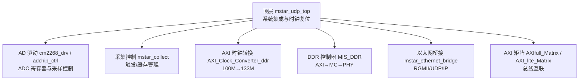
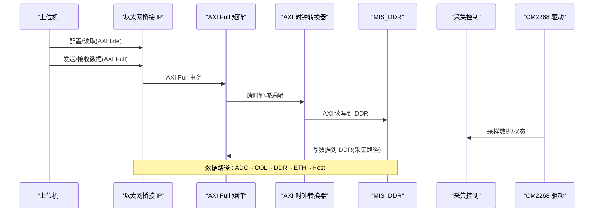
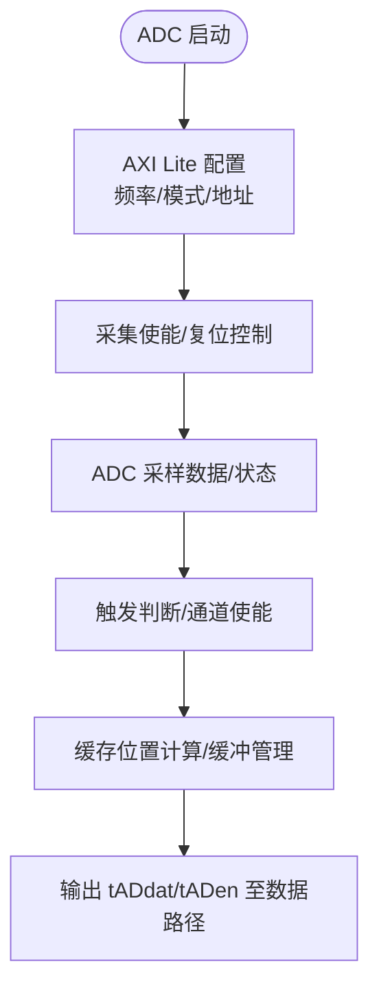
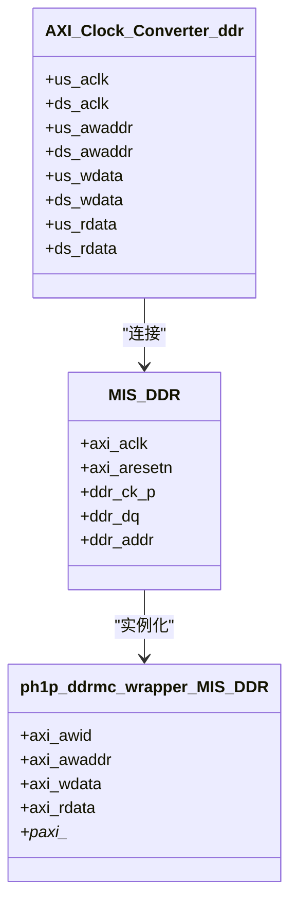
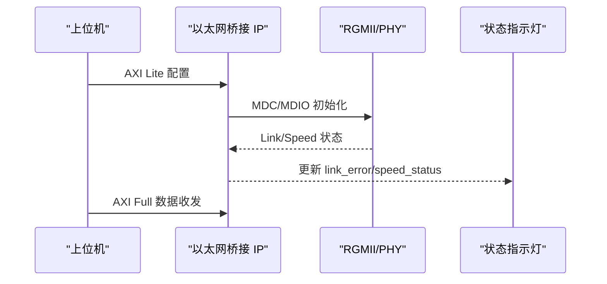
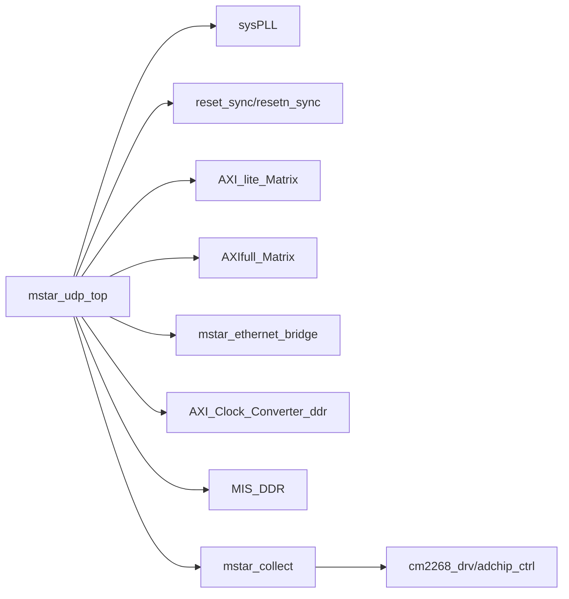

# 故障排除

<cite>
**本文引用的文件**   
- [README.md](file://README.md)
- [mstar_udp_top.v](file://hdl/mstar_udp_top.v)
- [mstar_udp_sdc.sdc](file://hdl/constraint/mstar_udp_sdc.sdc)
- [mstar_udp_adc.adc](file://hdl/constraint/mstar_udp_adc.adc)
- [MIS_DDR.sdc](file://al_ip/MIS_DDR/src/sdc/MIS_DDR.sdc)
- [MIS_DDR.adc](file://al_ip/MIS_DDR/src/adc/MIS_DDR.adc)
- [MIS_DDR.v](file://al_ip/MIS_DDR/MIS_DDR.v)
- [ph1p_ddrmc_wrapper_MIS_DDR.v](file://al_ip/MIS_DDR/ph1p_ddrmc_wrapper_MIS_DDR.v)
- [mstar_collect.v](file://hdl/collect/mstar_collect.v)
- [adchip_ctrl.v](file://hdl/ad_driver/adchip_ctrl.v)
- [cm2268_drv.v](file://hdl/ad_driver/cm2268_drv.v)
- [axi_dma_example_axi_read_master.sv](file://hdl/axi_dma/axi_dma_example_axi_read_master.sv)
- [axi_dma_example_axi_write_master.sv](file://hdl/axi_dma/axi_dma_example_axi_write_master.sv)
</cite>

## 目录
1. [简介](#简介)
2. [项目结构](#项目结构)
3. [核心组件](#核心组件)
4. [架构总览](#架构总览)
5. [详细组件分析](#详细组件分析)
6. [依赖关系分析](#依赖关系分析)
7. [性能考虑](#性能考虑)
8. [故障排查指南](#故障排查指南)
9. [结论](#结论)
10. [附录](#附录)

## 简介
本指南面向多通道 ADC 数据采集与 UDP 以太网传输的 FPGA 系统，聚焦于故障诊断与排错。内容覆盖：
- ADC 数据采集异常、DDR 访问错误、网络通信失败等常见问题定位与修复
- 时序问题（建立时间违例、保持时间违例、时钟偏斜）分析与解决
- 资源不足（LUT/FF/BRAM 使用率过高、综合问题）排查与优化
- 功能异常调试流程（模块级隔离测试、接口协议验证、数据路径追踪）
- 性能优化建议（流水线、并行、缓存策略）
- 完整故障诊断清单与最佳实践

## 项目结构
工程为基于安路 PH1 FPGA 的多通道采集设备端设计，包含 AD 驱动、采集控制、DDR 缓存、以太网桥接 IP 及 AXI 总线互联矩阵。顶层模块集成各子系统，并通过 AXI Lite 提供配置接口。

图表来源
- [mstar_udp_top.v:371-414](file://hdl/mstar_udp_top.v#L371-L414)
- [mstar_udp_top.v:415-569](file://hdl/mstar_udp_top.v#L415-L569)
- [mstar_udp_top.v:591-675](file://hdl/mstar_udp_top.v#L591-L675)
- [mstar_udp_top.v:676-800](file://hdl/mstar_udp_top.v#L676-L800)

章节来源
- [README.md:23-73](file://README.md#L23-L73)
- [mstar_udp_top.v:1-92](file://hdl/mstar_udp_top.v#L1-L92)

## 核心组件
- 顶层与时钟复位
  - 系统 PLL 生成 125M/100M/50M 时钟，复位同步器为各域提供稳定复位
  - 关键信号：syspll_lock、clk_125M_rst、w_axifull_clk、w_axilite_clk
- DDR 子系统
  - AXI Clock Converter 在 100M 与 133M 之间进行跨时钟域适配
  - MIS_DDR 封装 MC/PHY，暴露 AXI Full 接口与物理引脚
- 以太网子系统
  - 加密 IP 实现 MAC/UDP/IP，通过 RGMII 与 PHY 交互
  - 提供 AXI Lite 配置与 AXI Full 数据通路
- 采集与 AD 驱动
  - mstar_collect 负责触发逻辑、通道使能、缓存位置计算
  - cm2268_drv + adchip_ctrl 实现 ADC 寄存器读写与采样控制

章节来源
- [mstar_udp_top.v:371-414](file://hdl/mstar_udp_top.v#L371-L414)
- [mstar_udp_top.v:415-569](file://hdl/mstar_udp_top.v#L415-L569)
- [mstar_udp_top.v:591-675](file://hdl/mstar_udp_top.v#L591-L675)
- [mstar_collect.v:1-62](file://hdl/collect/mstar_collect.v#L1-L62)
- [cm2268_drv.v:1-51](file://hdl/ad_driver/cm2268_drv.v#L1-L51)
- [adchip_ctrl.v:184-240](file://hdl/ad_driver/adchip_ctrl.v#L184-L240)

## 架构总览
系统数据流从 ADC 经采集控制写入 DDR，再由以太网桥接 IP 通过 RGMII 输出至上位机；控制面通过 AXI Lite 对以太网桥接与采集控制进行配置。

图表来源
- [mstar_udp_top.v:591-675](file://hdl/mstar_udp_top.v#L591-L675)
- [mstar_udp_top.v:676-800](file://hdl/mstar_udp_top.v#L676-L800)
- [mstar_udp_top.v:484-569](file://hdl/mstar_udp_top.v#L484-L569)
- [MIS_DDR.v:84-200](file://al_ip/MIS_DDR/MIS_DDR.v#L84-L200)

## 详细组件分析

### ADC 数据采集链路
- 驱动层
  - cm2268_drv 封装 AXI Lite 寄存器与底层 driver_cm2268，完成频率分频、采样使能、数据打包
  - adchip_ctrl 处理寄存器读写、采集使能、复位、模式切换
- 采集控制
  - mstar_collect 聚合多通道触发、缓存大小、相对位置、结束标志，并输出 tADdat/tADen 给上层 DMA/AXI 路径

图表来源
- [cm2268_drv.v:70-138](file://hdl/ad_driver/cm2268_drv.v#L70-L138)
- [adchip_ctrl.v:184-240](file://hdl/ad_driver/adchip_ctrl.v#L184-L240)
- [mstar_collect.v:107-188](file://hdl/collect/mstar_collect.v#L107-L188)

章节来源
- [cm2268_drv.v:1-142](file://hdl/ad_driver/cm2268_drv.v#L1-L142)
- [adchip_ctrl.v:184-240](file://hdl/ad_driver/adchip_ctrl.v#L184-L240)
- [mstar_collect.v:1-210](file://hdl/collect/mstar_collect.v#L1-L210)

### DDR 访问与跨时钟域
- 时钟域
  - 100M (AXI 主机侧) ↔ 133M (DDR AXI 侧)
  - 通过 AXI_Clock_Converter_ddr 进行握手与队列适配
- 控制器
  - MIS_DDR 内部调用 ph1p_ddrmc_wrapper，将 AXI 事务转换为 MC/PHY 命令
  - SDC 定义时钟组与异步约束，确保时序收敛

图表来源
- [mstar_udp_top.v:484-569](file://hdl/mstar_udp_top.v#L484-L569)
- [MIS_DDR.v:84-200](file://al_ip/MIS_DDR/MIS_DDR.v#L84-L200)
- [ph1p_ddrmc_wrapper_MIS_DDR.v:233-335](file://al_ip/MIS_DDR/ph1p_ddrmc_wrapper_MIS_DDR.v#L233-L335)

章节来源
- [mstar_udp_top.v:415-569](file://hdl/mstar_udp_top.v#L415-L569)
- [MIS_DDR.v:1-202](file://al_ip/MIS_DDR/MIS_DDR.v#L1-L202)
- [MIS_DDR.sdc:1-13](file://al_ip/MIS_DDR/src/sdc/MIS_DDR.sdc#L1-L13)

### 以太网通信链路
- 接口
  - RGMII 收发与 MDC/MDIO 配置
  - AXI Lite 用于配置寄存器，AXI Full 用于数据吞吐
- 状态指示
  - link_error、speed_status_1g、speed_status_100M 反映链路状态

图表来源
- [mstar_udp_top.v:591-675](file://hdl/mstar_udp_top.v#L591-L675)
- [mstar_udp_top.v:356-370](file://hdl/mstar_udp_top.v#L356-L370)

章节来源
- [mstar_udp_top.v:591-675](file://hdl/mstar_udp_top.v#L591-L675)

## 依赖关系分析
- 顶层依赖
  - sysPLL 提供多时钟域
  - reset_sync/resetn_sync 提供复位同步
  - AXI Lite Matrix 与 AXI Full Matrix 作为总线枢纽
- 子系统依赖
  - 以太网桥接依赖 AXI Lite/Full 与时钟复位
  - DDR 控制器依赖 AXI Clock Converter 与时钟约束
  - 采集控制依赖 AD 驱动与触发逻辑

图表来源
- [mstar_udp_top.v:371-414](file://hdl/mstar_udp_top.v#L371-L414)
- [mstar_udp_top.v:676-800](file://hdl/mstar_udp_top.v#L676-L800)

章节来源
- [mstar_udp_top.v:371-800](file://hdl/mstar_udp_top.v#L371-L800)

## 性能考虑
- 流水线优化
  - 在采集控制中拆分触发判断与缓存写入阶段，避免长组合逻辑
  - 在 AXI 写路径增加 FIFO 缓冲以平滑突发写入
- 并行处理
  - 多通道触发并行评估，减少串行瓶颈
  - 以太网桥接与 DDR 写入可并行进行，提升吞吐
- 缓存策略
  - 合理设置缓存大小与预取深度，降低丢包与溢出风险
  - 使用 AXI burst 长度与 size 匹配 DDR 控制器最优参数

[本节为通用指导，不直接分析具体文件]

## 故障排查指南

### 一、ADC 数据采集异常
常见现象
- 无数据或数据乱序
- 触发无效或误触发
- 寄存器读写失败

排查步骤
1. 检查 ADC 驱动配置
   - 确认频率分频、采集使能、复位序列正确
   - 参考寄存器读写流程与位定义
2. 验证触发逻辑
   - 检查外部触发输入边沿检测与通道使能
   - 观察触发标志与相对位置是否正确
3. 数据路径追踪
   - 在采集控制输出 tADdat/tADen 处抓波形，确认数据有效
   - 检查 AXI 写事务是否被矩阵转发至 DDR

定位要点
- 若寄存器读写失败，优先检查 AXI Lite 总线握手与地址映射
- 若触发无效，检查 get_singer_edge 边沿检测与 in_trigflg 同步

章节来源
- [cm2268_drv.v:70-138](file://hdl/ad_driver/cm2268_drv.v#L70-L138)
- [adchip_ctrl.v:184-240](file://hdl/ad_driver/adchip_ctrl.v#L184-L240)
- [mstar_collect.v:93-106](file://hdl/collect/mstar_collect.v#L93-L106)
- [mstar_collect.v:157-188](file://hdl/collect/mstar_collect.v#L157-L188)

### 二、DDR 访问错误
常见现象
- AXI 读写超时或响应错误
- 数据写入后读回不一致
- 时序违例导致不稳定

排查步骤
1. 检查跨时钟域
   - 确认 AXI_Clock_Converter_ddr 的 us_aclk/ds_aclk 与复位同步
   - 核对 AXI 地址宽度与数据宽度匹配
2. 检查控制器参数
   - MIS_DDR 参数 tCK/BK_NUM/AXI_DATA_WIDTH 等是否与硬件一致
   - 查看 ph1p_ddrmc_wrapper 的 AXI 端口连接
3. 时序约束
   - 检查 MIS_DDR.sdc 中的时钟组与异步约束
   - 检查顶层 sdc 中对 usr_clk 与其他时钟的最大延迟约束

定位要点
- 若出现建立/保持时间违例，重点检查 100M↔133M 跨时钟路径与最大延迟约束
- 若 ECC 或校验报错，关注 MIS_DDR 的 ecc_err_sig/ecc_err_mul 信号

章节来源
- [mstar_udp_top.v:484-569](file://hdl/mstar_udp_top.v#L484-L569)
- [MIS_DDR.v:84-200](file://al_ip/MIS_DDR/MIS_DDR.v#L84-L200)
- [MIS_DDR.sdc:1-13](file://al_ip/MIS_DDR/src/sdc/MIS_DDR.sdc#L1-L13)
- [mstar_udp_sdc.sdc:1-17](file://hdl/constraint/mstar_udp_sdc.sdc#L1-L17)

### 三、网络通信失败
常见现象
- 链路无法建立或频繁断开
- 速度协商异常（100M/1G）
- 数据包丢失或校验错误

排查步骤
1. 检查 RGMII 引脚与时序
   - 确认引脚分配与 INDEL 延迟设置
   - 检查时钟源与相位
2. 检查 MDC/MDIO 配置
   - 确认 PHY 初始化序列与寄存器配置
3. 状态信号观测
   - link_error、speed_status_1g、speed_status_100M 反映链路状态
4. 数据路径验证
   - 通过 AXI Full 读写以太网桥接 IP 的缓冲区，验证数据通路

定位要点
- 若链路状态异常，优先检查 PHY 复位与 MDC/MDIO 通信
- 若数据吞吐低，检查 AXI burst 长度与矩阵转发是否饱和

章节来源
- [mstar_udp_adc.adc:1-15](file://hdl/constraint/mstar_udp_adc.adc#L1-L15)
- [mstar_udp_top.v:591-675](file://hdl/mstar_udp_top.v#L591-L675)
- [mstar_udp_top.v:356-370](file://hdl/mstar_udp_top.v#L356-L370)

### 四、时序问题分析
常见问题
- 建立时间违例（Setup Violation）
- 保持时间违例（Hold Violation）
- 时钟偏斜（Clock Skew）

分析方法
1. 识别关键路径
   - 跨时钟域路径：100M↔133M、125M↔100M、100M↔50M
   - 高速接口路径：RGMII 数据与控线
2. 检查约束
   - 顶层 sdc 中的 create_clock/derive_clock/rename_clock
   - 最大延迟 set_max_delay 与各时钟对之间的 datapath_only 值
   - MIS_DDR.sdc 中的时钟组与异步约束
3. 调整策略
   - 增加寄存器打拍以降低组合逻辑深度
   - 调整时钟相位或插入缓冲
   - 修正引脚延迟 INDEL 与 IOSTANDARD

章节来源
- [mstar_udp_sdc.sdc:1-17](file://hdl/constraint/mstar_udp_sdc.sdc#L1-L17)
- [MIS_DDR.sdc:1-13](file://al_ip/MIS_DDR/src/sdc/MIS_DDR.sdc#L1-L13)
- [mstar_udp_adc.adc:1-15](file://hdl/constraint/mstar_udp_adc.adc#L1-L15)

### 五、资源不足问题
常见问题
- LUT/FF/BRAM 使用率过高
- 综合失败或布局布线拥塞

排查方法
1. 定位高资源模块
   - 采集控制中的多通道并行逻辑
   - AXI 矩阵与 FIFO 深度
   - DDR 控制器与 PHY 相关逻辑
2. 优化策略
   - 合并相邻状态机，减少冗余逻辑
   - 降低 FIFO 深度或使用共享 FIFO
   - 使用更紧凑的数据格式与压缩策略
3. 工具辅助
   - 使用综合报告查看资源分布
   - 针对拥塞区域进行分区或重构

[本节为通用指导，不直接分析具体文件]

### 六、功能异常调试流程
推荐流程
1. 模块级隔离测试
   - 单独验证 AD 驱动寄存器读写与采样输出
   - 单独验证采集控制触发与缓存管理
   - 单独验证以太网桥接 AXI Lite/Full 接口
2. 接口协议验证
   - AXI Lite：地址、数据、握手信号完整性
   - AXI Full：burst、size、last、valid/ready 配对
   - RGMII：时钟、数据、控制信号对齐
3. 数据路径追踪
   - 从 ADC 到 DDR 再到以太网桥接，逐段抓取波形
   - 对比预期数据与真实数据，定位丢包或错位点

章节来源
- [mstar_collect.v:107-188](file://hdl/collect/mstar_collect.v#L107-L188)
- [cm2268_drv.v:70-138](file://hdl/ad_driver/cm2268_drv.v#L70-L138)
- [mstar_udp_top.v:591-675](file://hdl/mstar_udp_top.v#L591-L675)

### 七、性能优化建议
- 流水线优化
  - 将触发判断与缓存写入分离，减少关键路径延迟
  - 在 AXI 写路径加入多级 FIFO，提高突发写入效率
- 并行处理
  - 多通道触发并行评估，缩短决策时间
  - 以太网桥接与 DDR 写入并行执行，提升整体吞吐
- 缓存策略
  - 根据采集速率与网络带宽动态调整缓存大小
  - 使用合适的 AXI burst 长度与 size，匹配 DDR 控制器最优参数

[本节为通用指导，不直接分析具体文件]

### 八、完整故障诊断清单
- ADC 采集
  - 寄存器配置是否正确？频率分频与采集使能是否生效？
  - 触发边沿检测是否正常？通道使能与结束标志是否准确？
  - tADdat/tADen 输出是否有效？AXI 写事务是否成功？
- DDR 访问
  - AXI 时钟域转换是否稳定？复位同步是否到位？
  - MIS_DDR 参数是否与硬件一致？ECC 错误信号是否上报？
  - 时序约束是否满足？跨时钟路径最大延迟是否合理？
- 网络通信
  - RGMII 引脚与时序是否正确？INDEL 延迟是否合适？
  - MDC/MDIO 初始化是否成功？链路状态是否正常？
  - AXI Full 数据通路是否通畅？数据包是否丢失？
- 资源与性能
  - LUT/FF/BRAM 使用率是否过高？是否存在拥塞区域？
  - 是否可通过流水线与并行优化提升吞吐？
  - 缓存策略是否匹配采集与网络带宽？

[本节为通用指导，不直接分析具体文件]

## 结论
通过对 ADC 采集、DDR 访问、以太网通信与时序约束的系统性排查，结合模块级隔离测试与数据路径追踪，可有效定位并解决大多数故障。同时，合理的流水线、并行与缓存优化能够显著提升系统性能与稳定性。建议在开发过程中持续使用综合与时序分析报告，结合波形验证，形成闭环的调试流程。

[本节为总结性内容，不直接分析具体文件]

## 附录

### 常用调试信号与接口
- 链路状态
  - link_error、speed_status_1g、speed_status_100M
- AXI Lite 配置
  - m0_axilite_* 信号族
- AXI Full 数据
  - s_axi_udp_*、m_axi_ddr_* 信号族
- DDR 控制器
  - ddr_ck_p/n、ddr_dq、ddr_addr、ddr_ba

章节来源
- [mstar_udp_top.v:356-370](file://hdl/mstar_udp_top.v#L356-L370)
- [mstar_udp_top.v:591-675](file://hdl/mstar_udp_top.v#L591-L675)
- [MIS_DDR.v:68-81](file://al_ip/MIS_DDR/MIS_DDR.v#L68-L81)

### 示例：AXI DMA 读写主机
- 读主机
  - axi_dma_example_axi_read_master.sv：从 DDR 读取数据，适合验证读路径
- 写主机
  - axi_dma_example_axi_write_master.sv：向 DDR 写入数据，适合验证写路径

章节来源
- [axi_dma_example_axi_read_master.sv:1-39](file://hdl/axi_dma/axi_dma_example_axi_read_master.sv#L1-L39)
- [axi_dma_example_axi_write_master.sv:1-38](file://hdl/axi_dma/axi_dma_example_axi_write_master.sv#L1-L38)