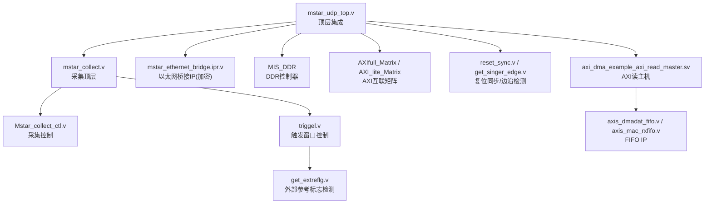
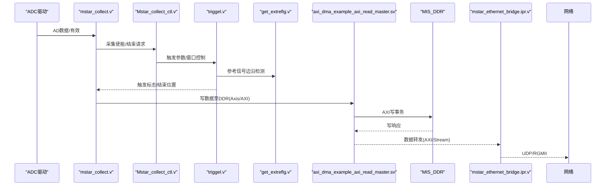
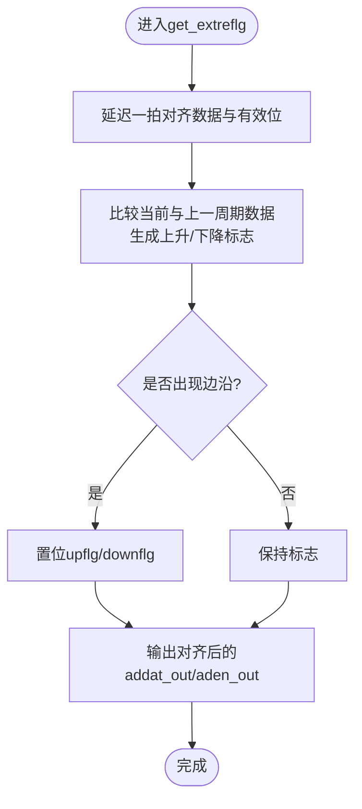
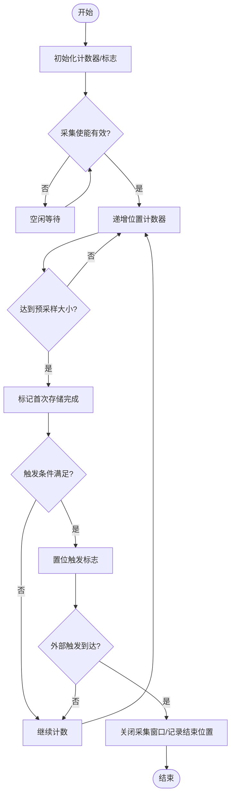
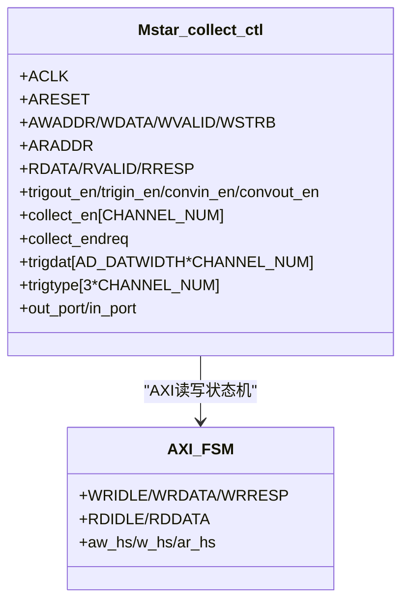
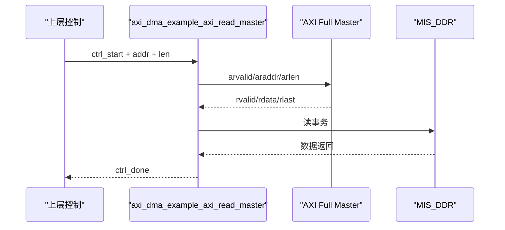
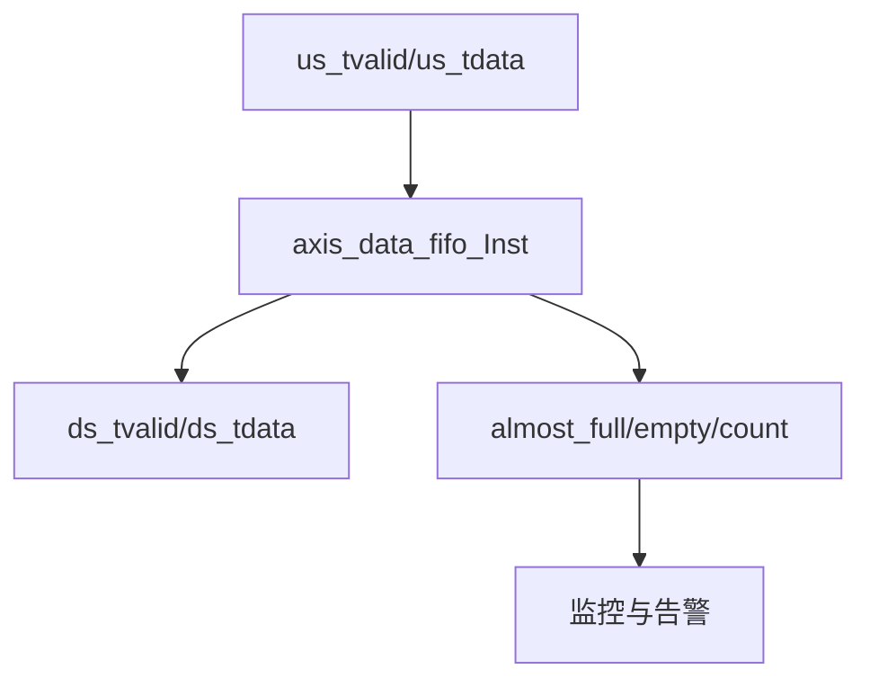
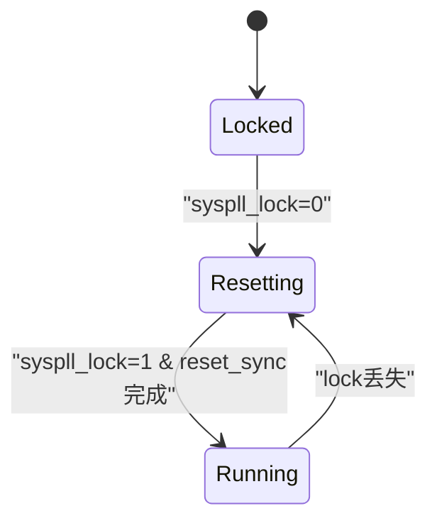
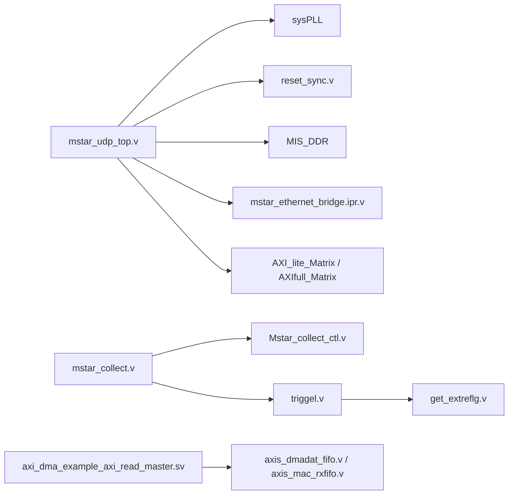

# 硬件调试

<cite>
**本文引用的文件**   
- [README.md](file://README.md)
- [mstar_udp_top.v](file://hdl/mstar_udp_top.v)
- [mstar_collect.v](file://hdl/collect/mstar_collect.v)
- [Mstar_collect_ctl.v](file://hdl/collect/Mstar_collect_ctl.v)
- [ad_collect_trig_ctrl.v](file://hdl/collect/ad_collect_trig_ctrl.v)
- [triggel.v](file://hdl/collect/triggel.v)
- [get_extreflg.v](file://hdl/collect/get_extreflg.v)
- [reset_sync.v](file://hdl/sync/reset_sync.v)
- [get_singer_edge.v](file://hdl/sync/get_singer_edge.v)
- [axi_dma_example_axi_read_master.sv](file://hdl/axi_dma/axi_dma_example_axi_read_master.sv)
- [axis_dmadat_fifo.v](file://al_ip/axis_dmadat_fifo/axis_dmadat_fifo.v)
- [axis_mac_rxfifo.v](file://al_ip/axis_mac_rxfifo/axis_mac_rxfifo.v)
- [ph1p_ddrmc_top.v](file://al_ip/MIS_DDR/src/rtl/top/ph1p_ddrmc_top.v)
</cite>

## 目录
1. [简介](#简介)
2. [项目结构](#项目结构)
3. [核心组件](#核心组件)
4. [架构总览](#架构总览)
5. [详细组件分析](#详细组件分析)
6. [依赖关系分析](#依赖关系分析)
7. [性能与资源分析](#性能与资源分析)
8. [故障诊断指南](#故障诊断指南)
9. [结论](#结论)
10. [附录：调试清单与最佳实践](#附录调试清单与最佳实践)

## 简介
本指南面向使用安路科技（Anlogic）PH1 FPGA 的多通道数据采集设备，提供基于 Tang Dynasty IDE 的板级调试方法。重点包括：
- ILA 探针配置与信号捕获设置
- 外部参考信号检测功能调试（ADC 数据流监控、触发信号验证、数据完整性检查）
- FIFO 状态监控（满空标志、数据深度、溢出保护）
- 系统性能分析（带宽利用率、延迟测量、资源占用）
- 常见硬件问题诊断（时钟、复位同步、总线仲裁）

## 项目结构
工程采用分层组织方式：顶层模块集成 AD 驱动、采集控制、DDR DMA、以太网桥接 IP 及 AXI 互联矩阵；采集逻辑位于 collect 子目录；跨时钟域同步与边沿检测位于 sync 子目录；AXI DMA 示例与 FIFO IP 位于 al_ip 与 hdl/axi_dma。

图示来源
- [mstar_udp_top.v:371-483](file://hdl/mstar_udp_top.v#L371-L483)
- [mstar_udp_top.v:591-675](file://hdl/mstar_udp_top.v#L591-L675)
- [mstar_udp_top.v:676-800](file://hdl/mstar_udp_top.v#L676-L800)
- [mstar_collect.v:1-62](file://hdl/collect/mstar_collect.v#L1-L62)
- [Mstar_collect_ctl.v:22-68](file://hdl/collect/Mstar_collect_ctl.v#L22-L68)
- [triggel.v:11-44](file://hdl/collect/triggel.v#L11-L44)
- [get_extreflg.v:8-23](file://hdl/collect/get_extreflg.v#L8-L23)
- [reset_sync.v:13-22](file://hdl/sync/reset_sync.v#L13-L22)
- [get_singer_edge.v:21-29](file://hdl/sync/get_singer_edge.v#L21-L29)
- [axi_dma_example_axi_read_master.sv:22-79](file://hdl/axi_dma/axi_dma_example_axi_read_master.sv#L22-L79)
- [axis_dmadat_fifo.v:35-52](file://al_ip/axis_dmadat_fifo/axis_dmadat_fifo.v#L35-L52)
- [axis_mac_rxfifo.v:35-58](file://al_ip/axis_mac_rxfifo/axis_mac_rxfifo.v#L35-L58)

章节来源
- [README.md:23-73](file://README.md#L23-L73)

## 核心组件
- 顶层集成与时钟复位：顶层模块实例化 sysPLL、复位同步、DDR 控制器、以太网桥接 IP、AXI 互联矩阵，并管理多时钟域复位与锁相环锁定状态。
- 采集控制：采集顶层将 AXI Lite 配置接口、AD 驱动、触发控制与缓存管理整合，输出采集使能、结束标志、触发标志等。
- 触发窗口控制：支持电平、上升沿、下降沿等多种触发模式，计算触发相对位置与采集结束相对位置。
- 外部参考标志检测：从 ADC 数据流中提取参考信号的上升/下降标志，辅助触发判断。
- AXI DMA 读主机：通过 AXI Full 从 DDR 读取数据，支持突发长度、事务计数、FIFO 缓冲与背压控制。
- FIFO IP：用于跨时钟域数据缓冲与流量整形，提供 almost_full/empty 等状态。

章节来源
- [mstar_udp_top.v:371-483](file://hdl/mstar_udp_top.v#L371-L483)
- [mstar_collect.v:1-62](file://hdl/collect/mstar_collect.v#L1-L62)
- [Mstar_collect_ctl.v:22-68](file://hdl/collect/Mstar_collect_ctl.v#L22-L68)
- [triggel.v:11-44](file://hdl/collect/triggel.v#L11-L44)
- [get_extreflg.v:8-23](file://hdl/collect/get_extreflg.v#L8-L23)
- [axi_dma_example_axi_read_master.sv:22-79](file://hdl/axi_dma/axi_dma_example_axi_read_master.sv#L22-L79)
- [axis_dmadat_fifo.v:35-52](file://al_ip/axis_dmadat_fifo/axis_dmadat_fifo.v#L35-L52)
- [axis_mac_rxfifo.v:35-58](file://al_ip/axis_mac_rxfifo/axis_mac_rxfifo.v#L35-L58)

## 架构总览
下图展示从 ADC 到 DDR 再到以太网的整体数据路径与控制路径，以及关键调试点。

图示来源
- [mstar_collect.v:107-155](file://hdl/collect/mstar_collect.v#L107-L155)
- [Mstar_collect_ctl.v:239-284](file://hdl/collect/Mstar_collect_ctl.v#L239-L284)
- [triggel.v:123-272](file://hdl/collect/triggel.v#L123-L272)
- [get_extreflg.v:30-63](file://hdl/collect/get_extreflg.v#L30-L63)
- [axi_dma_example_axi_read_master.sv:175-252](file://hdl/axi_dma/axi_dma_example_axi_read_master.sv#L175-L252)
- [mstar_udp_top.v:591-675](file://hdl/mstar_udp_top.v#L591-L675)

## 详细组件分析

### 外部参考信号检测（ADC 数据流监控、触发信号验证、数据完整性检查）
- 功能要点
  - 提取 ADC 数据的上升/下降标志，用于触发条件判断。
  - 输出延时对齐的数据与有效信号，便于后续比较与时序对齐。
  - 提供最大/最小值标志，辅助数据完整性检查。
- 调试建议
  - 在 ADC 数据路径上插入 ILA 探针，捕获 addat_in、aden_in、upflg、downflg、maxdat_flg、mindat_flg。
  - 对比触发阈值 trigdat 与实际数据 w_ADdat，确认触发条件符合预期。
  - 观察 aden_out/addat_out 的时序对齐，确保无丢包或错位。

图示来源
- [get_extreflg.v:30-63](file://hdl/collect/get_extreflg.v#L30-L63)

章节来源
- [get_extreflg.v:8-63](file://hdl/collect/get_extreflg.v#L8-L63)

### 触发窗口控制（triggel）
- 功能要点
  - 支持多种触发模式：不触发、电平触发、上升沿触发、下降沿触发。
  - 维护位置计数器，计算触发相对位置与采集结束相对位置。
  - 结合外部触发输入 in_trigflg，实现精确的采集窗口控制。
- 调试建议
  - 在 triggel 内部探针 r_position_counter、r_triger_flg、colection_end、end_relative_position、trig_relative_position。
  - 验证不同触发模式下触发标志 r_triger_flg 的时机是否符合预期。
  - 检查外部触发 in_trigflg 的边沿检测与窗口关闭逻辑。

图示来源
- [triggel.v:123-272](file://hdl/collect/triggel.v#L123-L272)

章节来源
- [triggel.v:11-272](file://hdl/collect/triggel.v#L11-L272)

### 采集控制（Mstar_collect_ctl）
- 功能要点
  - 管理 AXI Lite 寄存器读写，暴露模型 ID、端口 IO、使能标志、通道触发类型/阈值、相对位置等。
  - 根据写入的控制字更新采集使能、结束请求、通道使能与触发类型。
  - 输出 out_port 与读取 in_port，便于外部 IO 控制与状态回读。
- 调试建议
  - 通过 AXI Lite 读写寄存器，验证地址映射与数据回读正确性。
  - 观察 collect_en、collect_endreq、trigtype、trigdat 的变化，确认控制逻辑生效。
  - 使用 get_singer_edge 检测 collect_end 的上升沿，确保状态机复位与清理。

图示来源
- [Mstar_collect_ctl.v:22-68](file://hdl/collect/Mstar_collect_ctl.v#L22-L68)
- [Mstar_collect_ctl.v:119-197](file://hdl/collect/Mstar_collect_ctl.v#L119-L197)
- [Mstar_collect_ctl.v:239-284](file://hdl/collect/Mstar_collect_ctl.v#L239-L284)

章节来源
- [Mstar_collect_ctl.v:22-284](file://hdl/collect/Mstar_collect_ctl.v#L22-L284)

### AXI DMA 读主机（axi_dma_example_axi_read_master）
- 功能要点
  - 接收 ctrl_start 启动读操作，计算突发长度与事务数量。
  - 管理 AXI 读地址通道与数据通道，支持最大并发事务数与 FIFO 缓冲。
  - 输出 m_axis_tvalid/tdata/tlast 给下游处理单元。
- 调试建议
  - 探针 ctrl_start、ctrl_done、ar_transactions_to_go、r_final_transaction、stall_ar。
  - 观察 outstanding_vacancy_count 与 FIFO almost_full/empty，评估背压与吞吐。
  - 验证地址对齐与突发长度计算是否正确。

图示来源
- [axi_dma_example_axi_read_master.sv:175-252](file://hdl/axi_dma/axi_dma_example_axi_read_master.sv#L175-L252)
- [axi_dma_example_axi_read_master.sv:274-345](file://hdl/axi_dma/axi_dma_example_axi_read_master.sv#L274-L345)

章节来源
- [axi_dma_example_axi_read_master.sv:22-386](file://hdl/axi_dma/axi_dma_example_axi_read_master.sv#L22-L386)

### FIFO 状态监控（axis_dmadat_fifo / axis_mac_rxfifo）
- 功能要点
  - 提供跨时钟域数据缓冲，支持几乎满/空标志与数据计数。
  - 用于流量整形与背压控制，避免数据丢失。
- 调试建议
  - 探针 almost_full/empty、ds_aclk/ds_tvalid/ds_tready、us_aclk/us_tvalid/us_tready。
  - 监控数据计数（如 axis_rd_data_count），评估 FIFO 深度与溢出风险。
  - 结合上位机统计丢包率与重传次数，验证数据完整性。

图示来源
- [axis_dmadat_fifo.v:35-52](file://al_ip/axis_dmadat_fifo/axis_dmadat_fifo.v#L35-L52)
- [axis_mac_rxfifo.v:35-58](file://al_ip/axis_mac_rxfifo/axis_mac_rxfifo.v#L35-L58)

章节来源
- [axis_dmadat_fifo.v:35-52](file://al_ip/axis_dmadat_fifo/axis_dmadat_fifo.v#L35-L52)
- [axis_mac_rxfifo.v:35-58](file://al_ip/axis_mac_rxfifo/axis_mac_rxfifo.v#L35-L58)

### 时钟与复位同步（sysPLL / reset_sync / get_singer_edge）
- 功能要点
  - sysPLL 产生多路时钟（125M/100M/50M），并提供 lock 指示。
  - reset_sync 对异步复位进行三级打拍同步，避免亚稳态。
  - get_singer_edge 检测单边沿，用于事件触发与状态切换。
- 调试建议
  - 探针 syspll_lock、clk_125M_rst、clk_50m_rst、ddr_dhi_rstn。
  - 观察 reset_sync 输出与 get_singer_edge 的上升沿脉冲，确保时序稳定。
  - 在多时钟域边界处插入 ILA，验证复位释放顺序与时序约束。

图示来源
- [mstar_udp_top.v:371-406](file://hdl/mstar_udp_top.v#L371-L406)
- [reset_sync.v:13-41](file://hdl/sync/reset_sync.v#L13-L41)
- [get_singer_edge.v:30-37](file://hdl/sync/get_singer_edge.v#L30-L37)

章节来源
- [mstar_udp_top.v:371-406](file://hdl/mstar_udp_top.v#L371-L406)
- [reset_sync.v:13-69](file://hdl/sync/reset_sync.v#L13-L69)
- [get_singer_edge.v:21-39](file://hdl/sync/get_singer_edge.v#L21-L39)

## 依赖关系分析
- 顶层模块依赖 sysPLL、reset_sync、DDR 控制器、以太网桥接 IP、AXI 互联矩阵。
- 采集模块依赖 AXI Lite 控制、触发控制、外部参考标志检测。
- DMA 模块依赖 AXI Full 协议与 FIFO IP。
- FIFO IP 提供跨时钟域缓冲与状态反馈。

图示来源
- [mstar_udp_top.v:371-800](file://hdl/mstar_udp_top.v#L371-L800)
- [mstar_collect.v:107-188](file://hdl/collect/mstar_collect.v#L107-L188)
- [axi_dma_example_axi_read_master.sv:297-345](file://hdl/axi_dma/axi_dma_example_axi_read_master.sv#L297-L345)

章节来源
- [mstar_udp_top.v:371-800](file://hdl/mstar_udp_top.v#L371-L800)
- [mstar_collect.v:107-188](file://hdl/collect/mstar_collect.v#L107-L188)
- [axi_dma_example_axi_read_master.sv:297-345](file://hdl/axi_dma/axi_dma_example_axi_read_master.sv#L297-L345)

## 性能与资源分析
- 带宽利用率
  - 通过 AXI 事务计数与数据宽度估算理论带宽，结合实际 tvalid/tready 占空比计算有效带宽。
  - 监控 FIFO almost_full/empty 与 outstanding 事务数，识别瓶颈环节。
- 延迟测量
  - 在 ADC 数据入口与 DDR 写入口插入时间戳，计算端到端延迟。
  - 使用 get_singer_edge 的上升沿作为触发点，测量触发到数据输出的时延。
- 资源占用
  - 关注 LUT/FF/DSP/BRAM 的使用情况，尤其是 FIFO IP 与 DDR 控制器。
  - 通过 Tang Dynasty 综合报告查看关键路径与时钟频率余量。

章节来源
- [axi_dma_example_axi_read_master.sv:103-117](file://hdl/axi_dma/axi_dma_example_axi_read_master.sv#L103-L117)
- [axis_dmadat_fifo.v:35-52](file://al_ip/axis_dmadat_fifo/axis_dmadat_fifo.v#L35-L52)
- [axis_mac_rxfifo.v:35-58](file://al_ip/axis_mac_rxfifo/axis_mac_rxfifo.v#L35-L58)

## 故障诊断指南
- 时钟问题
  - 检查 syspll_lock 是否稳定，多时钟域复位释放顺序是否正确。
  - 在 PLL 输出与各模块时钟处插入 ILA，观察抖动与相位关系。
- 复位同步
  - 验证 reset_sync 输出是否按预期延迟释放，避免亚稳态。
  - 检查各模块复位极性（高/低有效）与同步策略一致性。
- 总线仲裁
  - 观察 AXI Lite/Full 的 awready/arready/bvalid/rvalid 握手，确认无死锁。
  - 使用 AXI 协议分析仪或 ILA 抓取握手信号，定位阻塞点。
- 数据完整性
  - 监控 FIFO overflow/underflow 标志，检查数据丢包与重复。
  - 对比 ADC 原始数据与 DDR 中回放数据，校验一致性与对齐。

章节来源
- [mstar_udp_top.v:371-406](file://hdl/mstar_udp_top.v#L371-L406)
- [reset_sync.v:13-41](file://hdl/sync/reset_sync.v#L13-L41)
- [axi_dma_example_axi_read_master.sv:274-345](file://hdl/axi_dma/axi_dma_example_axi_read_master.sv#L274-L345)

## 结论
本指南基于工程源码提供了针对安路 PH1 FPGA 的硬件调试方法，涵盖 ILA 探针配置、信号捕获、触发与 FIFO 监控、性能分析与常见问题诊断。建议在开发初期即建立完善的调试点与监控机制，结合 Tang Dynasty IDE 的综合与仿真工具，快速定位并解决问题。

## 附录：调试清单与最佳实践
- ILA 探针配置
  - 在 ADC 数据路径、触发逻辑、FIFO 状态、AXI 握手信号处添加探针。
  - 使用触发器捕获特定事件（如外部触发、FIFO 几乎满）。
- 信号捕获设置
  - 设置合适的采样深度与触发条件，避免数据过载。
  - 分阶段捕获：先抓控制信号，再抓数据通路。
- 实时波形观察
  - 在运行模式下观察关键信号的时序关系，验证功能正确性。
  - 对比仿真与实测波形，校准时序与延迟。
- 外部参考信号检测调试
  - 验证 upflg/downflg 的准确性，调整触发阈值与模式。
  - 检查数据对齐与完整性，确保无错位与丢包。
- FIFO 状态监控
  - 监控 almost_full/empty 与数据计数，评估深度与溢出风险。
  - 结合上位机统计，验证数据完整性和传输可靠性。
- 系统性能分析
  - 计算理论带宽与实际带宽，识别瓶颈环节。
  - 测量端到端延迟，优化关键路径与时钟频率。
- 常见硬件问题诊断
  - 时钟与复位：检查 PLL 锁定与复位同步。
  - 总线仲裁：检查 AXI 握手与死锁。
  - 数据完整性：检查 FIFO 溢出与数据对齐。