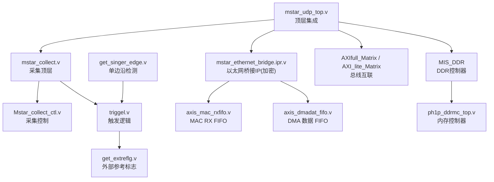
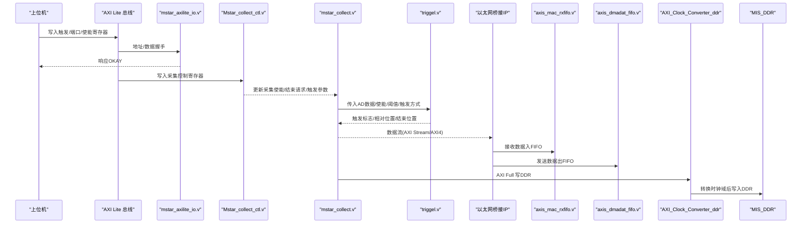
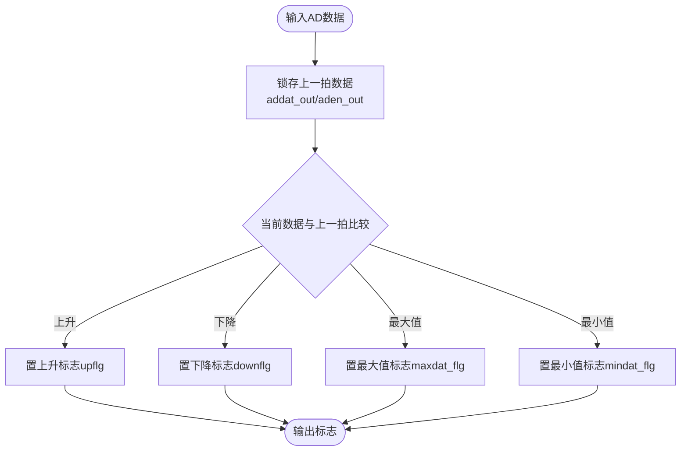
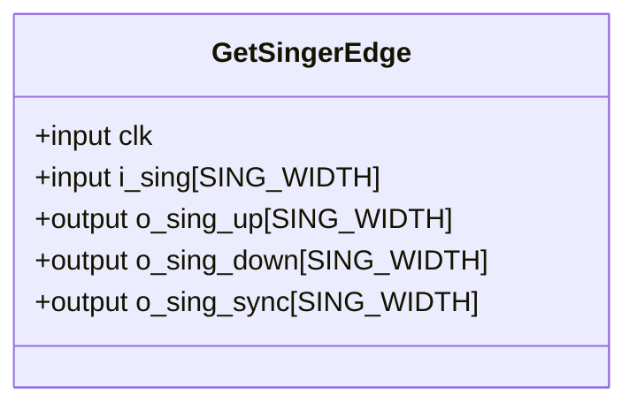
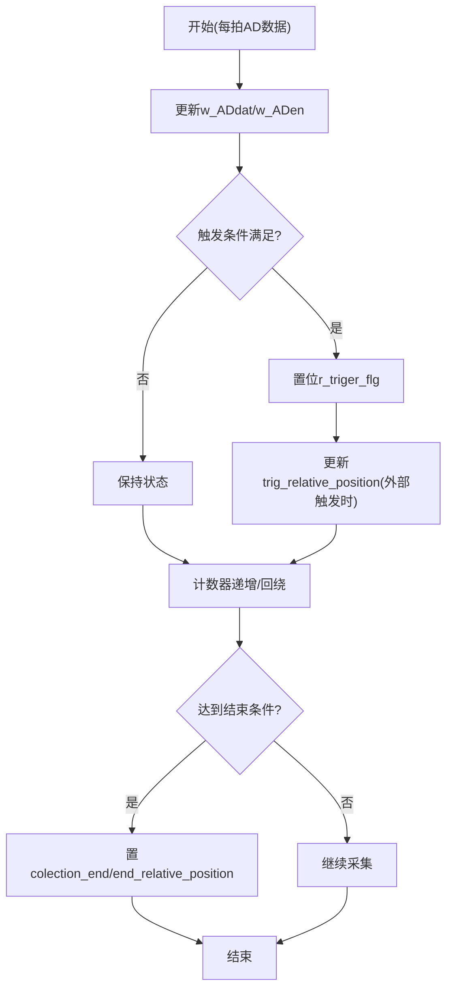
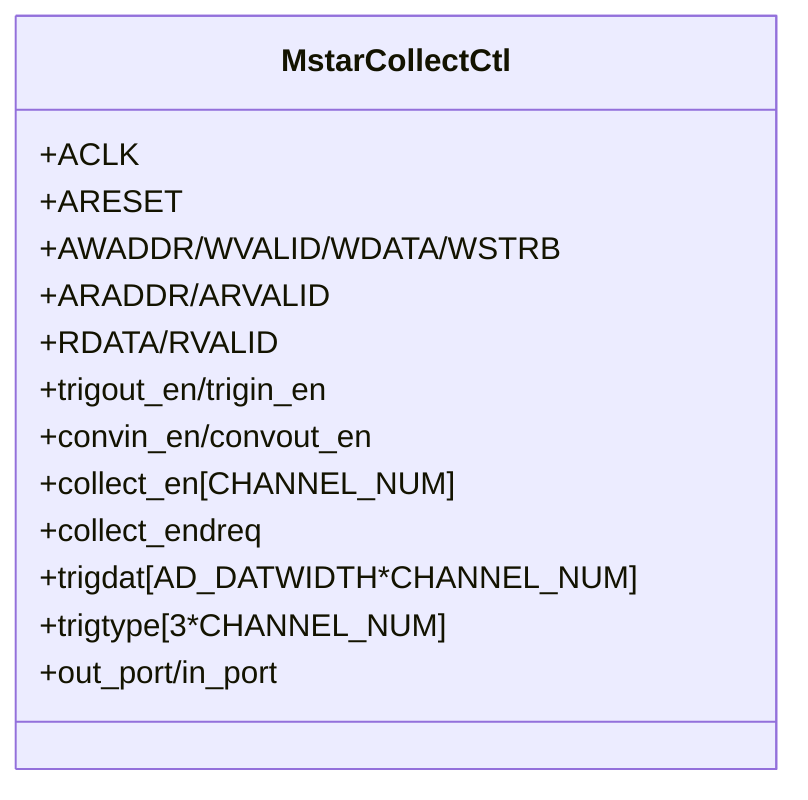
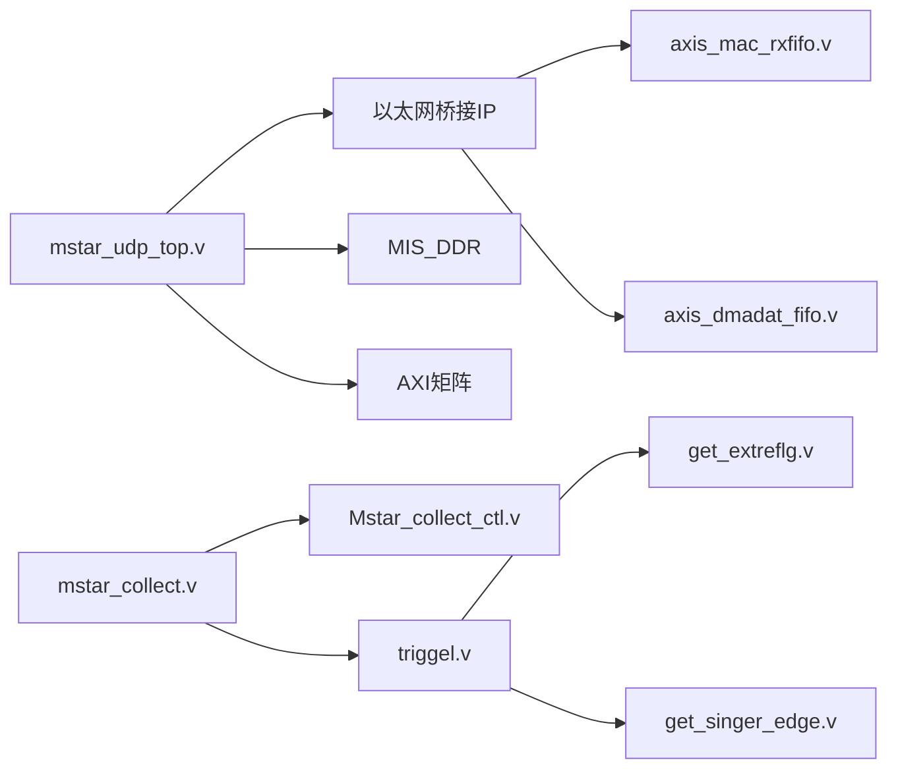

# 调试和测试

<cite>
**本文引用的文件**   
- [README.md](file://README.md)
- [mstar_udp_top.v](file://hdl/mstar_udp_top.v)
- [mstar_collect.v](file://hdl/collect/mstar_collect.v)
- [Mstar_collect_ctl.v](file://hdl/collect/Mstar_collect_ctl.v)
- [get_extreflg.v](file://hdl/collect/get_extreflg.v)
- [triggel.v](file://hdl/collect/triggel.v)
- [get_singer_edge.v](file://hdl/sync/get_singer_edge.v)
- [mstar_axilite_io.v](file://hdl/axi_io/mstar_axilite_io.v)
- [axis_mac_rxfifo.v](file://al_ip/axis_mac_rxfifo/axis_mac_rxfifo.v)
- [axis_dmadat_fifo.v](file://al_ip/axis_dmadat_fifo/axis_dmadat_fifo.v)
- [ph1p_ddrmc_top.v](file://al_ip/MIS_DDR/src/rtl/top/ph1p_ddrmc_top.v)
</cite>

## 目录
1. [简介](#简介)
2. [项目结构](#项目结构)
3. [核心组件](#核心组件)
4. [架构总览](#架构总览)
5. [详细组件分析](#详细组件分析)
6. [依赖关系分析](#依赖关系分析)
7. [性能与资源考量](#性能与资源考量)
8. [故障诊断与排错](#故障诊断与排错)
9. [结论](#结论)
10. [附录：测试用例与验证清单](#附录测试用例与验证清单)

## 简介
本指南面向调试与测试工程师，围绕多通道 AD 数据采集、DDR 缓存、以太网 UDP 传输的 FPGA 工程，提供系统化的调试接口说明、仿真验证方法、硬件调试（ILA）实践以及常见问题排查。重点覆盖：
- 外部参考信号检测与边沿检测
- FIFO 状态监控与数据流观测
- AXI Lite 寄存器配置与状态读取
- 触发控制与采集窗口定位
- 仿真激励生成与波形分析方法
- ILA 探针设置、捕获策略与性能分析
- 常见时序违例、资源不足与功能异常的定位与解决

## 项目结构
该工程为基于安路 PH1 FPGA 的多通道数据采集设备端设计，顶层模块集成 AD 驱动、采集逻辑、DDR DMA、以太网桥接 IP 及 AXI 总线互联矩阵。关键目录与职责：
- hdl：用户逻辑（顶层、采集、AXI IO、同步原语等）
- al_ip：安路 IP（DDR、AXI 矩阵、FIFO、PLL 等）
- constraint：引脚与时序约束

图示来源
- [mstar_udp_top.v:371-675](file://hdl/mstar_udp_top.v#L371-L675)
- [mstar_collect.v:107-188](file://hdl/collect/mstar_collect.v#L107-L188)
- [Mstar_collect_ctl.v:22-68](file://hdl/collect/Mstar_collect_ctl.v#L22-L68)
- [triggel.v:11-44](file://hdl/collect/triggel.v#L11-L44)
- [get_extreflg.v:8-23](file://hdl/collect/get_extreflg.v#L8-L23)
- [get_singer_edge.v:21-38](file://hdl/sync/get_singer_edge.v#L21-L38)
- [axis_mac_rxfifo.v:35-58](file://al_ip/axis_mac_rxfifo/axis_mac_rxfifo.v#L35-L58)
- [axis_dmadat_fifo.v:35-52](file://al_ip/axis_dmadat_fifo/axis_dmadat_fifo.v#L35-L52)
- [ph1p_ddrmc_top.v:298-338](file://al_ip/MIS_DDR/src/rtl/top/ph1p_ddrmc_top.v#L298-L338)

章节来源
- [README.md:23-73](file://README.md#L23-L73)

## 核心组件
- 顶层 mstar_udp_top.v：时钟复位分配、DDR 控制器实例化、以太网桥接 IP、AXI 矩阵互联、LED/PHY 状态输出。
- 采集子系统 mstar_collect.v + Mstar_collect_ctl.v：通过 AXI Lite 配置采集参数、触发方式、端口 I/O；管理采集使能、结束请求、相对位置等。
- 触发 triggel.v：支持电平/上升沿/下降沿/连续采集模式，计算触发相对位置与采集结束位置。
- 外部参考 get_extreflg.v：从 AD 数据流中检测参考信号的上升/下降/最大最小值标志。
- 边沿检测 get_singer_edge.v：通用单比特或多比特边沿检测，输出上升沿、下降沿与同步延迟版本。
- AXI Lite IO mstar_axilite_io.v：提供模型 ID、系统控制位、输出/输入寄存器的读写接口。
- FIFO 与 DMA：axis_mac_rxfifo.v、axis_dmadat_fifo.v 用于 MAC 接收与 DMA 数据缓冲；AXI 读/写 Master 示例在 axi_dma_example_*.sv。
- DDR MIS_DDR：包含 PHY、MC、FIFO 控制等，提供 AXI 到 DDR 的数据通路。

章节来源
- [mstar_udp_top.v:9-92](file://hdl/mstar_udp_top.v#L9-L92)
- [mstar_collect.v:9-62](file://hdl/collect/mstar_collect.v#L9-L62)
- [Mstar_collect_ctl.v:22-68](file://hdl/collect/Mstar_collect_ctl.v#L22-L68)
- [triggel.v:11-44](file://hdl/collect/triggel.v#L11-L44)
- [get_extreflg.v:8-23](file://hdl/collect/get_extreflg.v#L8-L23)
- [get_singer_edge.v:21-38](file://hdl/sync/get_singer_edge.v#L21-L38)
- [mstar_axilite_io.v:22-55](file://hdl/axi_io/mstar_axilite_io.v#L22-L55)
- [axis_mac_rxfifo.v:35-58](file://al_ip/axis_mac_rxfifo/axis_mac_rxfifo.v#L35-L58)
- [axis_dmadat_fifo.v:35-52](file://al_ip/axis_dmadat_fifo/axis_dmadat_fifo.v#L35-L52)

## 架构总览
系统数据与控制流如下：
- 上位机通过 AXI Lite 访问 mstar_axilite_io.v 与 Mstar_collect_ctl.v，配置触发类型、阈值、端口输出、采集使能等。
- 采集逻辑根据触发条件（内部数据比较或外部触发）产生采集窗口，并输出 tADdat/tADen 给后续 DMA/FIFO。
- 以太网桥接 IP 经 RGMII 收发数据，内部使用 axis_mac_rxfifo.v 与 axis_dmadat_fifo.v 进行数据缓冲。
- DDR 路径由 AXI Clock Converter 将 AXI Full 从 100MHz 域转换至 DDR PHY 时钟域，再进入 MIS_DDR 控制器。

图示来源
- [mstar_axilite_io.v:166-192](file://hdl/axi_io/mstar_axilite_io.v#L166-L192)
- [Mstar_collect_ctl.v:202-283](file://hdl/collect/Mstar_collect_ctl.v#L202-L283)
- [mstar_collect.v:107-188](file://hdl/collect/mstar_collect.v#L107-L188)
- [triggel.v:123-272](file://hdl/collect/triggel.v#L123-L272)
- [axis_mac_rxfifo.v:35-58](file://al_ip/axis_mac_rxfifo/axis_mac_rxfifo.v#L35-L58)
- [axis_dmadat_fifo.v:35-52](file://al_ip/axis_dmadat_fifo/axis_dmadat_fifo.v#L35-L52)
- [mstar_udp_top.v:484-569](file://hdl/mstar_udp_top.v#L484-L569)
- [mstar_udp_top.v:415-483](file://hdl/mstar_udp_top.v#L415-L483)

## 详细组件分析

### 外部参考信号检测（get_extreflg.v）
- 功能：对 AD 数据流进行逐拍比较，检测上升/下降标志，并输出最大/最小值标志，同时延时对齐 addat_out/aden_out。
- 关键点：
  - 使用前一拍数据进行比较，避免组合逻辑冒险。
  - 符号位处理区分正负数范围，确保有符号比较正确性。
  - 输出 upflg/downflg/maxdat_flg/mindat_flg 供上层触发逻辑使用。

图示来源
- [get_extreflg.v:30-63](file://hdl/collect/get_extreflg.v#L30-L63)

章节来源
- [get_extreflg.v:8-66](file://hdl/collect/get_extreflg.v#L8-L66)

### 边沿检测（get_singer_edge.v）
- 功能：对输入信号进行两级打拍，输出上升沿、下降沿与同步延迟版本。
- 用途：用于外部触发输入、采集结束标志等的边沿捕捉，保证跨时钟域或异步信号处理的稳定性。

图示来源
- [get_singer_edge.v:21-38](file://hdl/sync/get_singer_edge.v#L21-L38)

章节来源
- [get_singer_edge.v:1-39](file://hdl/sync/get_singer_edge.v#L1-L39)

### 触发逻辑（triggel.v）
- 功能：实现多种触发模式（无触发、电平、上升沿、下降沿、连续），计算触发相对位置与采集结束相对位置，输出采集结束标志。
- 关键流程：
  - 通过 get_extreflg.v 获取 w_up_flg/w_down_flg。
  - 根据 trig_type 判断是否满足触发条件，置位 r_triger_flg。
  - 维护 r_position_counter 计数，结合 pre_cachsize/cachsize 确定采集窗口。
  - 外部触发 in_trigflg 通过 get_singer_edge 捕捉上升沿，记录 trig_relative_position。

图示来源
- [triggel.v:89-101](file://hdl/collect/triggel.v#L89-L101)
- [triggel.v:123-272](file://hdl/collect/triggel.v#L123-L272)

章节来源
- [triggel.v:11-276](file://hdl/collect/triggel.v#L11-L276)

### 采集控制（Mstar_collect_ctl.v）
- 功能：AXI Lite 读写状态机，暴露寄存器映射以配置采集参数、端口输出、触发使能等；管理 collect_allen/collect_endreq 等全局控制信号。
- 寄存器要点：
  - ADDR_ENABLEFLG：读取 enable flags（trigout_en/trigin_en/convout_en/convin_en）。
  - ADDR_CONSTA：读取通道数、AD位宽、采集结束同步标志、endreq/allen。
  - 每通道寄存器：trigtype/trigdat/end_relative_position/trig_relative_position。
  - ADDR_OUTPORT/ADDR_INPORT：端口输出/输入读写。

图示来源
- [Mstar_collect_ctl.v:22-68](file://hdl/collect/Mstar_collect_ctl.v#L22-L68)
- [Mstar_collect_ctl.v:202-283](file://hdl/collect/Mstar_collect_ctl.v#L202-L283)

章节来源
- [Mstar_collect_ctl.v:1-284](file://hdl/collect/Mstar_collect_ctl.v#L1-L284)

### AXI Lite IO（mstar_axilite_io.v）
- 功能：提供模型 ID、系统控制位（trigout_en/trigin_en）、输出/输入寄存器的读写接口。
- 适用场景：快速验证 AXI Lite 总线协议、寄存器映射与上位机通信。

章节来源
- [mstar_axilite_io.v:22-195](file://hdl/axi_io/mstar_axilite_io.v#L22-L195)

### FIFO 与 DMA（axis_mac_rxfifo.v / axis_dmadat_fifo.v）
- 功能：封装 XPM FIFO，提供几乎满/空指示、数据计数等，便于监控数据流拥塞与吞吐。
- 调试建议：
  - 观察 almost_full/empty 与 rd_data_count/wr_data_count，评估背压与丢包风险。
  - 在 DMA 路径上增加断点，确认 AXI 握手与 Stream 数据一致性。

章节来源
- [axis_mac_rxfifo.v:35-58](file://al_ip/axis_mac_rxfifo/axis_mac_rxfifo.v#L35-L58)
- [axis_dmadat_fifo.v:35-52](file://al_ip/axis_dmadat_fifo/axis_dmadat_fifo.v#L35-L52)

### DDR 路径（MIS_DDR / ph1p_ddrmc_top.v）
- 功能：DDR PHY 与内存控制器，提供 AXI 到 DDR 的数据通路；内部包含 PHY2MC FIFO 控制。
- 调试关注点：
  - dhi_clk/dhi_rstn 复位序列与锁定状态。
  - AXI 握手时序与带宽利用率。
  - 初始化完成标志与错误状态。

章节来源
- [ph1p_ddrmc_top.v:298-338](file://al_ip/MIS_DDR/src/rtl/top/ph1p_ddrmc_top.v#L298-L338)

## 依赖关系分析
- 模块耦合：
  - mstar_udp_top.v 作为顶层，耦合以太网桥接 IP、DDR、AXI 矩阵、时钟复位。
  - mstar_collect.v 依赖 Mstar_collect_ctl.v 与 triggel.v。
  - triggel.v 依赖 get_extreflg.v 与 get_singer_edge.v。
  - 以太网桥接 IP 依赖 axis_mac_rxfifo.v 与 axis_dmadat_fifo.v。
- 潜在环路与交叉时钟域：
  - AXI Clock Converter 负责 100MHz 与 DDR PHY 时钟域转换，需确保复位与握手时序正确。
  - 外部触发与采集结束信号需经过边沿检测与同步处理。

图示来源
- [mstar_udp_top.v:371-675](file://hdl/mstar_udp_top.v#L371-L675)
- [mstar_collect.v:107-188](file://hdl/collect/mstar_collect.v#L107-L188)
- [Mstar_collect_ctl.v:22-68](file://hdl/collect/Mstar_collect_ctl.v#L22-L68)
- [triggel.v:11-44](file://hdl/collect/triggel.v#L11-L44)
- [get_extreflg.v:8-23](file://hdl/collect/get_extreflg.v#L8-L23)
- [get_singer_edge.v:21-38](file://hdl/sync/get_singer_edge.v#L21-L38)
- [axis_mac_rxfifo.v:35-58](file://al_ip/axis_mac_rxfifo/axis_mac_rxfifo.v#L35-L58)
- [axis_dmadat_fifo.v:35-52](file://al_ip/axis_dmadat_fifo/axis_dmadat_fifo.v#L35-L52)

## 性能与资源考量
- 时钟与复位：
  - sysPLL 生成 125M/100M/50M 时钟，需确保 PLL lock 后再释放各域复位。
  - reset_sync/resetn_sync 用于跨域复位同步，避免亚稳态。
- 带宽与吞吐：
  - AXI Full 数据宽度 128bit，注意 burst 长度与 size 配置。
  - FIFO almost_full/empty 与 rd/wr data count 用于背压控制。
- 资源占用：
  - DDR 控制器与 PHY 占用较多资源，需合理分配 BRAM/LUT/DSP。
  - 以太网桥接 IP 为加密网表，关注其内部资源与功耗。

## 故障诊断与排错
- 时序违例：
  - 检查约束文件（sdc/ad）与时钟域划分，确认跨时钟域同步与复位序列。
  - 针对 AXI 握手违例，检查 valid/ready 握手与 backpressure。
- 资源不足：
  - 降低 FIFO 深度或关闭未用通道，减少 BRAM 使用。
  - 优化 burst 长度与并行度，平衡吞吐与资源。
- 功能异常：
  - 触发不生效：核对 trig_type/trigdat 配置，检查 get_extreflg 输出标志。
  - 采集窗口错位：检查 pre_cachsize/cachsize 与 trig_relative_position 计算。
  - 以太网无数据：查看 link_error/speed_status，确认 PHY 连接与 IP 配置。
- 调试手段：
  - 使用 ChipWatcher/ILA 抓取关键信号：trigflg、collect_end、AXI 握手、FIFO 状态。
  - 上位机通过 AXI Lite 读取状态寄存器，逐步缩小问题范围。

章节来源
- [mstar_udp_top.v:371-414](file://hdl/mstar_udp_top.v#L371-L414)
- [Mstar_collect_ctl.v:202-283](file://hdl/collect/Mstar_collect_ctl.v#L202-L283)
- [triggel.v:123-272](file://hdl/collect/triggel.v#L123-L272)

## 结论
本指南梳理了系统的调试接口与信号路径，提供了仿真与硬件调试的实践方法，并总结了常见问题与解决思路。建议在开发初期即建立完善的测试用例与验证清单，结合 AXI Lite 配置、FIFO 状态与 ILA 探针，形成闭环的调试流程。

## 附录：测试用例与验证清单
- 仿真验证
  - 搭建 Testbench：注入 AD 数据流、外部触发、AXI Lite 配置。
  - 激励生成：随机/固定阈值触发、不同 trig_type 组合。
  - 波形分析：观察 trigflg、tADdat/tADen、AXI 握手、FIFO 状态。
- 硬件调试
  - ILA 探针：trigflg、collect_end、AXI aw/ar/w/r/b 通道、FIFO almost_full/empty。
  - 性能分析：统计吞吐率、丢包率、DDR 带宽利用率。
- 验证清单
  - AXI Lite 寄存器读写正确性（ID/Enable/Port/TrigType/TrigData/Positions）。
  - 触发逻辑：电平/上升沿/下降沿/连续采集模式均正常。
  - 采集窗口：pre_cachsize/cachsize 与 trig_relative_position 计算准确。
  - 数据通路：MAC RX/TX FIFO 无溢出/下溢，DDR 写入无误。
  - 以太网链路：link_error=0，speed_status 符合预期。