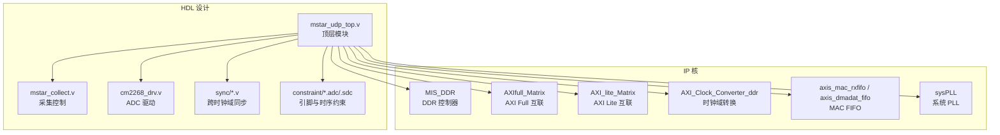
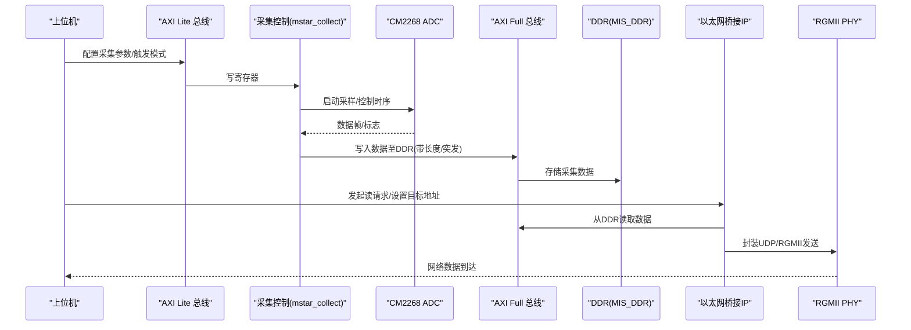
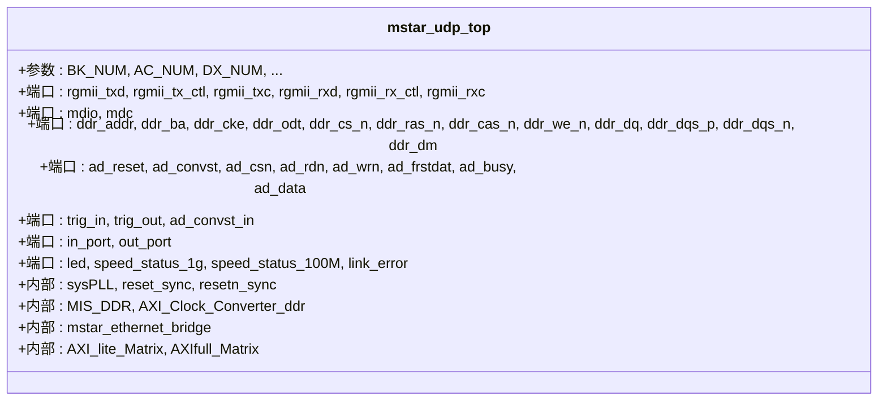
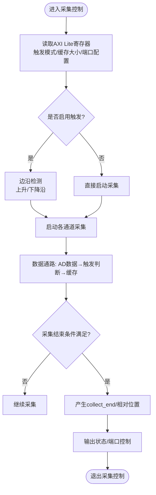
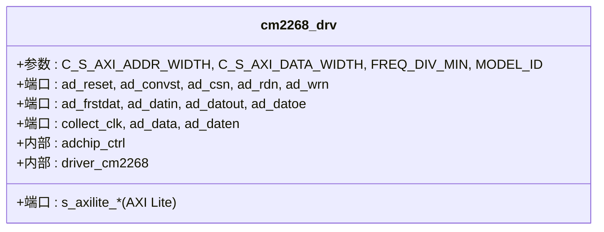
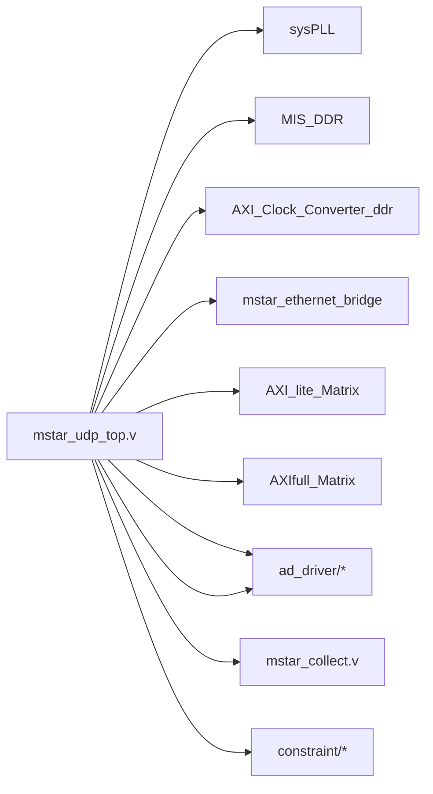

# 部署和集成

<cite>
**本文引用的文件**   
- [README.md](file://README.md)
- [tand_udp.al](file://tand_udp.al)
- [tand_udp_devicesetting.cfg](file://tand_udp_devicesetting.cfg)
- [mstar_udp_top.v](file://hdl/mstar_udp_top.v)
- [mstar_udp_adc.adc](file://hdl/constraint/mstar_udp_adc.adc)
- [mstar_udp_sdc.sdc](file://hdl/constraint/mstar_udp_sdc.sdc)
- [mstar_collect.v](file://hdl/collect/mstar_collect.v)
- [cm2268_drv.v](file://hdl/ad_driver/cm2268_drv.v)
</cite>

## 目录
1. [引言](#引言)
2. [项目结构](#项目结构)
3. [核心组件](#核心组件)
4. [架构总览](#架构总览)
5. [详细组件分析](#详细组件分析)
6. [依赖关系分析](#依赖关系分析)
7. [性能与资源特性](#性能与资源特性)
8. [硬件平台准备与连接](#硬件平台准备与连接)
9. [软件集成步骤](#软件集成步骤)
10. [生产环境部署方案](#生产环境部署方案)
11. [系统集成注意事项与最佳实践](#系统集成注意事项与最佳实践)
12. [部署检查清单](#部署检查清单)
13. [验收标准](#验收标准)
14. [故障排查指南](#故障排查指南)
15. [结论](#结论)

## 引言
本实施指南面向将 MStar UDP 多通道数据采集 FPGA 工程部署到安路 PH1 系列开发板，并与上位机软件集成的工程师。文档覆盖硬件平台准备、外设连接、电源与时钟管理、FPGA 工程构建与烧录、上位机通信参数配置、数据接收处理流程、批量生产烧录与版本管理、质量控制与验收标准，以及常见问题定位方法。

该工程基于 Anlogic PH1P35MDG324-3 FPGA，使用 Tang Dynasty IDE ≥ 6.2 进行综合、布局布线与比特流生成；通过 RGMII 千兆以太网以 UDP 协议向上位机传输采集数据，支持 8 通道 ADC（如 CM2268）采集、DDR 缓存、AXI Lite 寄存器配置、外部触发输入输出等能力。

**章节来源**
- [README.md:1-14](file://README.md#L1-L14)
- [README.md:75-89](file://README.md#L75-L89)

## 项目结构
工程采用“功能模块 + IP 核 + 约束”的分层组织方式：
- hdl：顶层与业务逻辑（AD 驱动、采集控制、AXI DMA、AXI IO、UDP/IP 桥接、跨时钟域同步、约束）
- al_ip：安路 IP 核（DDR 控制器、AXI Full/Lite 矩阵、时钟转换器、MAC FIFO、系统 PLL 等）
- 工程与器件配置：tand_udp.al、tand_udp_devicesetting.cfg

**图表来源**
- [mstar_udp_top.v:1-35](file://hdl/mstar_udp_top.v#L1-L35)
- [mstar_udp_top.v:371-483](file://hdl/mstar_udp_top.v#L371-L483)
- [mstar_udp_top.v:591-675](file://hdl/mstar_udp_top.v#L591-L675)
- [mstar_udp_top.v:676-800](file://hdl/mstar_udp_top.v#L676-L800)
- [README.md:23-73](file://README.md#L23-L73)

**章节来源**
- [README.md:23-73](file://README.md#L23-L73)
- [tand_udp.al:15-234](file://tand_udp.al#L15-L234)

## 核心组件
- 顶层模块 mstar_udp_top：集成 AD 驱动、采集控制、DDR 缓存、以太网桥接 IP、AXI 总线矩阵与时钟复位管理。
- 采集控制 mstar_collect：提供 AXI Lite 配置接口、触发逻辑、通道级采集控制与状态输出。
- ADC 驱动 cm2268_drv：封装 CM2268 ADC 的寄存器访问、采样时序与数据打包。
- 以太网桥接 IP：加密网表实现 MAC/UDP/IP 协议栈与 AXI 总线接口，经 RGMII 收发数据。
- DDR 控制器 MIS_DDR：提供大容量缓冲，配合 AXI Full 与 Clock Converter 完成高速数据搬运。
- AXI 矩阵与时钟转换：AXI_full_matrix、AXI_lite_matrix、AXI_Clock_Converter_ddr 负责地址路由与时钟域适配。
- 约束文件：引脚分配与跨时钟域时序约束确保信号完整性与时序收敛。

**章节来源**
- [mstar_udp_top.v:1-35](file://hdl/mstar_udp_top.v#L1-L35)
- [mstar_collect.v:1-21](file://hdl/collect/mstar_collect.v#L1-L21)
- [cm2268_drv.v:1-14](file://hdl/ad_driver/cm2268_drv.v#L1-L14)
- [README.md:87-89](file://README.md#L87-L89)

## 架构总览
系统数据流从 ADC 采样开始，经采集控制与 AXI Full 写入 DDR，再由以太网桥接 IP 读取并封装为 UDP 包，通过 RGMII 发送至主机。控制面通过 AXI Lite 由上位机配置采集参数、触发模式、端口状态等。

**图表来源**
- [mstar_udp_top.v:591-675](file://hdl/mstar_udp_top.v#L591-L675)
- [mstar_udp_top.v:415-483](file://hdl/mstar_udp_top.v#L415-L483)
- [mstar_udp_top.v:763-800](file://hdl/mstar_udp_top.v#L763-L800)
- [mstar_collect.v:107-155](file://hdl/collect/mstar_collect.v#L107-L155)
- [cm2268_drv.v:70-138](file://hdl/ad_driver/cm2268_drv.v#L70-L138)

## 详细组件分析

### 顶层模块 mstar_udp_top
- 功能职责：
  - 时钟与复位：sysPLL 产生 125M/100M/50M 时钟，reset_sync/resetn_sync 做跨时钟域复位同步。
  - DDR 子系统：MIS_DDR 通过 AXI Full 与 Clock Converter 对接 100M/133M 时钟域。
  - 以太网子系统：mstar_ethernet_bridge 提供 AXI Lite/AXI Full 接口与 RGMII 物理层连接。
  - AXI 矩阵：AXI_lite_Matrix 与 AXIfull_Matrix 对多个从设备进行地址路由。
  - I/O 与调试：LED、速度/链路状态、I2C、GPIO 端口、触发信号。
- 关键接口：
  - RGMII：rgmii_txd[3:0]、rgmii_tx_ctl、rgmii_txc、rgmii_rxd[3:0]、rgmii_rx_ctl、rgmii_rxc。
  - MDIO/MDC：mdio、mdc。
  - DDR：ddr_addr/ba/cke/odt/cs_n/ras_n/cas_n/we_n/dq/dqs_p/n/dm。
  - ADC：ad_reset/convst/csn/rdn/wrn/frstdat/busy/data。
  - 触发：trig_in/trig_out、ad_convst_in/out。
  - GPIO：in_port/out_port。
- 时钟与复位路径：
  - sysPLL → w_clk_125M/w_clk_100M/w_clk_50M
  - reset_sync(tx_reset_gen, reset_sync_clk50m_u0)、resetn_sync(ddr_dhi_rstn, w_axifull_rstn)

**图表来源**
- [mstar_udp_top.v:9-92](file://hdl/mstar_udp_top.v#L9-L92)
- [mstar_udp_top.v:371-406](file://hdl/mstar_udp_top.v#L371-L406)
- [mstar_udp_top.v:415-569](file://hdl/mstar_udp_top.v#L415-L569)
- [mstar_udp_top.v:591-675](file://hdl/mstar_udp_top.v#L591-L675)
- [mstar_udp_top.v:676-800](file://hdl/mstar_udp_top.v#L676-L800)

**章节来源**
- [mstar_udp_top.v:1-35](file://hdl/mstar_udp_top.v#L1-L35)
- [mstar_udp_top.v:371-406](file://hdl/mstar_udp_top.v#L371-L406)
- [mstar_udp_top.v:415-569](file://hdl/mstar_udp_top.v#L415-L569)
- [mstar_udp_top.v:591-675](file://hdl/mstar_udp_top.v#L591-L675)
- [mstar_udp_top.v:676-800](file://hdl/mstar_udp_top.v#L676-L800)

### 采集控制 mstar_collect
- 功能职责：
  - 通过 AXI Lite 暴露采集控制寄存器（触发模式、缓存大小、相对位置、端口控制等）。
  - 按通道生成采集使能、结束标志，并计算触发相对位置与结束相对位置。
  - 对外提供触发输出、外部触发输入边沿检测、采集状态指示。
- 关键信号：
  - AXI Lite：AWADDR/WDATA/WSTRB/ARADDR/RDATA 等。
  - 采集控制：convin_en/convout_en/collect_en/collect_endreq/collect_end。
  - 触发：trigout_en/trigin_en/trigflg/in_trigflg/out_trigflg。
  - 端口：in_port/out_port。

**图表来源**
- [mstar_collect.v:107-155](file://hdl/collect/mstar_collect.v#L107-L155)
- [mstar_collect.v:157-188](file://hdl/collect/mstar_collect.v#L157-L188)
- [mstar_collect.v:86-106](file://hdl/collect/mstar_collect.v#L86-L106)

**章节来源**
- [mstar_collect.v:1-21](file://hdl/collect/mstar_collect.v#L1-L21)
- [mstar_collect.v:86-106](file://hdl/collect/mstar_collect.v#L86-L106)
- [mstar_collect.v:107-155](file://hdl/collect/mstar_collect.v#L107-L155)
- [mstar_collect.v:157-188](file://hdl/collect/mstar_collect.v#L157-L188)

### ADC 驱动 cm2268_drv
- 功能职责：
  - 封装 CM2268 ADC 的寄存器访问（频率分频、工作模式、控制命令）。
  - 生成 ADC 控制时序（CS/RD/WR/CONVST），处理数据有效标志与数据总线。
  - 通过 AXI Lite 暴露控制接口，供上层采集控制模块调用。
- 关键信号：
  - AXI Lite：AWADDR/WDATA/WSTRB/ARADDR/RDATA。
  - ADC 控制：ad_reset/ad_convst/ad_csn/ad_rdn/ad_wrn/ad_frstdat/ad_datin/ad_datout/ad_datoe。
  - 数据输出：ad_data/ad_daten。

**图表来源**
- [cm2268_drv.v:9-50](file://hdl/ad_driver/cm2268_drv.v#L9-L50)
- [cm2268_drv.v:70-138](file://hdl/ad_driver/cm2268_drv.v#L70-L138)

**章节来源**
- [cm2268_drv.v:1-14](file://hdl/ad_driver/cm2268_drv.v#L1-L14)
- [cm2268_drv.v:70-138](file://hdl/ad_driver/cm2268_drv.v#L70-L138)

## 依赖关系分析
- 顶层依赖：
  - sysPLL：提供多时钟源。
  - MIS_DDR：DDR 控制器，需 AXI Full 与 APB 配置。
  - AXI_Clock_Converter_ddr：在 100M/133M 之间进行 AXI 时钟域转换。
  - mstar_ethernet_bridge：以太网桥接 IP，提供 AXI Lite/AXI Full 与 RGMII。
  - AXI_lite_Matrix/AXIfull_Matrix：AXI 总线矩阵，路由多个从设备。
- 约束依赖：
  - mstar_udp_adc.adc：引脚分配与电平标准。
  - mstar_udp_sdc.sdc：时钟定义与跨时钟域最大延迟约束。

**图表来源**
- [mstar_udp_top.v:371-483](file://hdl/mstar_udp_top.v#L371-L483)
- [mstar_udp_top.v:591-675](file://hdl/mstar_udp_top.v#L591-L675)
- [mstar_udp_top.v:676-800](file://hdl/mstar_udp_top.v#L676-L800)
- [mstar_udp_adc.adc:1-95](file://hdl/constraint/mstar_udp_adc.adc#L1-L95)
- [mstar_udp_sdc.sdc:1-17](file://hdl/constraint/mstar_udp_sdc.sdc#L1-L17)

**章节来源**
- [tand_udp.al:185-234](file://tand_udp.al#L185-L234)
- [mstar_udp_adc.adc:1-95](file://hdl/constraint/mstar_udp_adc.adc#L1-L95)
- [mstar_udp_sdc.sdc:1-17](file://hdl/constraint/mstar_udp_sdc.sdc#L1-L17)

## 性能与资源特性
- 时钟与带宽：
  - RGMII 125MHz 参考时钟，100MHz AXI Full 数据通路，DDR 控制器运行于更高时钟域（约 133MHz）。
  - 跨时钟域最大延迟约束用于保证稳定传输。
- 数据吞吐：
  - 128-bit AXI Full 数据宽度，结合突发传输提升带宽利用率。
  - DDR 作为大容量缓冲，缓解 ADC 与以太网之间的速率差异。
- 资源占用：
  - 目标器件 PH1P35MDG324-3，IDE 默认策略优化时序。
  - 加密 IP（以太网桥接）不开放源码，但提供功能接口。

**章节来源**
- [mstar_udp_sdc.sdc:1-17](file://hdl/constraint/mstar_udp_sdc.sdc#L1-L17)
- [mstar_udp_top.v:23-34](file://hdl/mstar_udp_top.v#L23-L34)
- [README.md:75-89](file://README.md#L75-L89)

## 硬件平台准备与连接
- 目标器件与 IDE：
  - FPGA：Anlogic PH1P35MDG324-3。
  - IDE：Tang Dynasty ≥ 6.2。
- 电源与时钟：
  - 外部 50MHz 时钟输入 clk_50m。
  - 系统复位 sys_rst_n。
  - 确保供电稳定，避免噪声影响 RGMII 与 DDR 信号完整性。
- 以太网连接：
  - RGMII 信号：rgmii_txd[3:0]、rgmii_tx_ctl、rgmii_txc、rgmii_rxd[3:0]、rgmii_rx_ctl、rgmii_rxc。
  - MDIO/MDC：mdio、mdc。
  - 建议直连交换机或 PC 网卡，确认链路状态指示灯正常。
- ADC 外设连接：
  - CM2268 控制信号：ad_reset、ad_convst、ad_csn、ad_rdn、ad_wrn、ad_frstdat、ad_busy、ad_data[15:0]。
  - 触发信号：trig_in、trig_out、ad_convst_in。
- GPIO 与 LED：
  - in_port/out_port：用于扩展 I/O。
  - led、speed_status_1g、speed_status_100M、link_error：用于状态指示与调试。

**章节来源**
- [README.md:75-89](file://README.md#L75-L89)
- [mstar_udp_adc.adc:1-95](file://hdl/constraint/mstar_udp_adc.adc#L1-L95)
- [mstar_udp_top.v:37-92](file://hdl/mstar_udp_top.v#L37-L92)

## 软件集成步骤
- 安装与打开工程：
  - 安装 Tang Dynasty IDE ≥ 6.2。
  - 打开 tand_udp.al 工程文件。
  - 确认目标器件为 PH1P35MDG324-3。
- 构建流程：
  - 执行综合 → 布局布线 → 生成比特流。
  - 检查时序收敛与资源占用报告。
- 上位机软件：
  - 配套上位机示波器软件（MStar Oscilloscope）用于数据采集与波形显示。
  - 配置网络参数（IP、端口）与 FPGA 侧 UDP 目标一致。
- 通信参数设置：
  - 通过 AXI Lite 配置采集参数（采样率、触发模式、缓存大小）。
  - 通过以太网桥接 IP 的寄存器设置 UDP 目标地址与端口。
- 数据接收处理：
  - 上位机接收 UDP 数据包，解析帧头/帧尾与通道数据。
  - 校验数据完整性（CRC/序列号），统计丢包率与延迟。

**章节来源**
- [README.md:80-89](file://README.md#L80-L89)
- [README.md:19-22](file://README.md#L19-L22)
- [mstar_udp_top.v:591-675](file://hdl/mstar_udp_top.v#L591-L675)
- [mstar_collect.v:107-155](file://hdl/collect/mstar_collect.v#L107-L155)

## 生产环境部署方案
- 批量烧录：
  - 使用 JTAG 或 SPI Flash 批量烧录工具，统一固件版本。
  - 烧录前验证比特流签名与 CRC。
- 版本管理：
  - 每个版本对应唯一 Git Tag 与构建产物哈希。
  - 记录 IDE 版本、综合策略、约束文件变更。
- 质量控制：
  - 出厂测试包括：链路连通性、UDP 吞吐、丢包率、触发响应时间、ADC 线性度。
  - 抽检与全检结合，保留测试日志与波形截图。
- 环境与可靠性：
  - 温度循环与振动测试（根据应用场景）。
  - 长期运行稳定性监测（看门狗、错误计数）。

**章节来源**
- [tand_udp.al:256-275](file://tand_udp.al#L256-L275)
- [tand_udp_devicesetting.cfg:1-26](file://tand_udp_devicesetting.cfg#L1-L26)

## 系统集成注意事项与最佳实践
- 时钟与复位：
  - 确保 sysPLL 锁定后再释放复位，避免亚稳态。
  - 跨时钟域信号使用 reset_sync/resetn_sync 同步。
- 信号完整性：
  - RGMII 走线等长、阻抗匹配，避免反射与串扰。
  - DDR 信号遵循厂商推荐布局布线规则。
- 功耗与散热：
  - 监控 FPGA 与 DDR 功耗，必要时增加散热片。
- 调试与观测：
  - 利用 LED、速度/链路状态、link_error 快速定位问题。
  - 使用逻辑分析仪抓取触发与 ADC 控制信号。

**章节来源**
- [mstar_udp_top.v:371-406](file://hdl/mstar_udp_top.v#L371-L406)
- [mstar_udp_top.v:355-370](file://hdl/mstar_udp_top.v#L355-L370)

## 部署检查清单
- 硬件准备
  - [ ] 目标器件 PH1P35MDG324-3 已正确安装。
  - [ ] 50MHz 时钟输入与复位信号正常。
  - [ ] RGMII 与 MDIO/MDC 连接无误。
  - [ ] ADC 控制与数据信号连接正确。
  - [ ] GPIO 与 LED 连接可用于调试。
- 软件构建
  - [ ] Tang Dynasty IDE ≥ 6.2 已安装。
  - [ ] 工程文件 tand_udp.al 已打开且目标器件正确。
  - [ ] 综合、布局布线、比特流生成成功。
  - [ ] 时序收敛无违例。
- 通信与数据
  - [ ] 上位机软件已安装并配置网络参数。
  - [ ] UDP 目标地址与端口与 FPGA 侧一致。
  - [ ] 数据接收完整，无丢包或乱序。
- 生产质量
  - [ ] 批量烧录脚本与版本标签已就绪。
  - [ ] 出厂测试用例执行通过。
  - [ ] 测试日志与结果归档。

## 验收标准
- 功能验收
  - 8 通道 ADC 数据采集正常，触发响应准确。
  - UDP 数据传输连续，无丢包或严重乱序。
  - AXI Lite 配置生效，端口控制与状态指示正确。
- 性能验收
  - 链路速率（100M/1G）与吞吐量达到预期。
  - 端到端延迟与抖动符合应用要求。
- 可靠性验收
  - 长时间运行无崩溃或异常复位。
  - 温度与环境应力测试通过。

## 故障排查指南
- 无法建立以太网链路：
  - 检查 RGMII 信号与 MDIO/MDC 连接。
  - 查看 link_error 与速度状态 LED。
- 数据丢包或乱序：
  - 检查 DDR 读写时序与 AXI Full 突发配置。
  - 核对上位机缓冲区大小与接收策略。
- 触发无效：
  - 检查触发模式寄存器与外部触发信号边沿。
  - 使用逻辑分析仪观察 trig_in/trig_out。
- ADC 数据异常：
  - 检查 ad_frstdat 与 ad_busy 信号。
  - 验证 ad_data 总线连接与电平标准。

**章节来源**
- [mstar_udp_top.v:355-370](file://hdl/mstar_udp_top.v#L355-L370)
- [mstar_udp_top.v:591-675](file://hdl/mstar_udp_top.v#L591-L675)
- [mstar_collect.v:86-106](file://hdl/collect/mstar_collect.v#L86-L106)
- [cm2268_drv.v:110-138](file://hdl/ad_driver/cm2268_drv.v#L110-L138)

## 结论
本实施指南提供了从硬件准备、软件集成到生产部署的全流程说明。通过严格遵循约束与最佳实践，可确保 MStar UDP 数据采集系统在安路 PH1 FPGA 上稳定运行，并与上位机软件高效协同。建议在量产前完成完整的测试与验证，确保产品的一致性与可靠性。