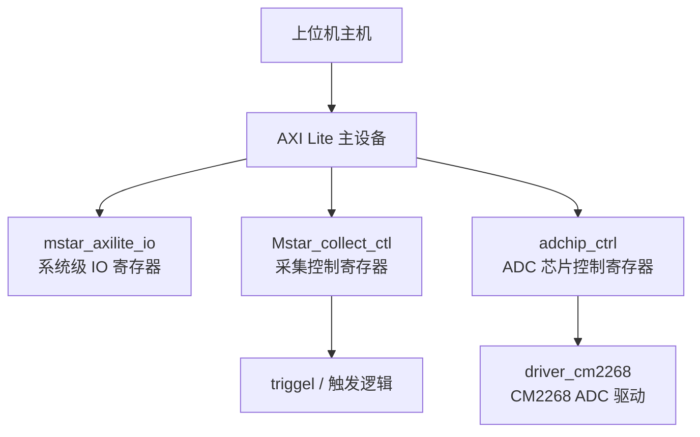
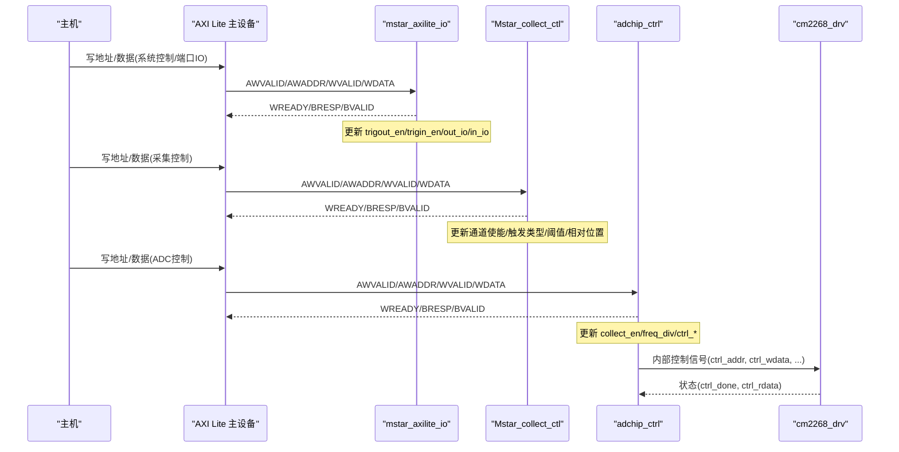
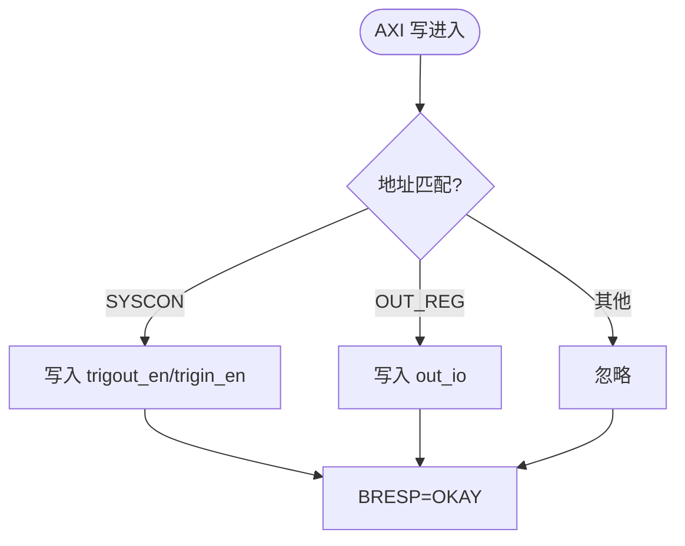
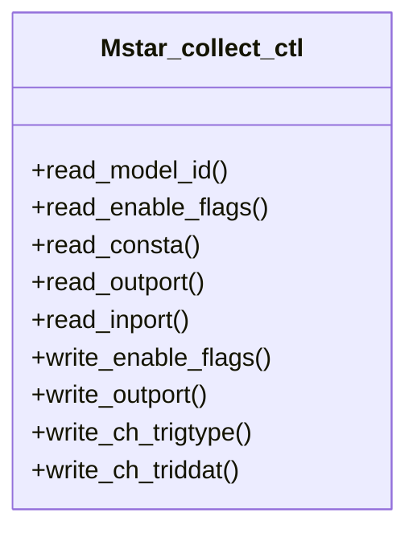
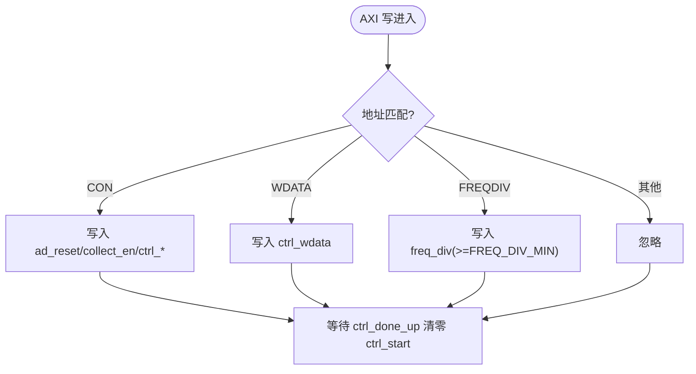
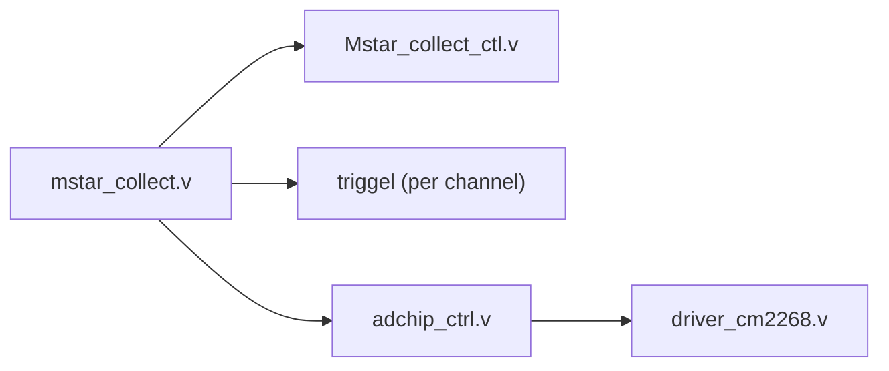

# 配置和寄存器接口

<cite>
**本文引用的文件**   
- [README.md](file://README.md)
- [mstar_axilite_io.v](file://hdl/axi_io/mstar_axilite_io.v)
- [mstar_collect.v](file://hdl/collect/mstar_collect.v)
- [Mstar_collect_ctl.v](file://hdl/collect/Mstar_collect_ctl.v)
- [ad_collect_trig_ctrl.v](file://hdl/collect/ad_collect_trig_ctrl.v)
- [cm2268_drv.v](file://hdl/ad_driver/cm2268_drv.v)
- [adchip_ctrl.v](file://hdl/ad_driver/adchip_ctrl.v)
</cite>

## 目录
1. [简介](#简介)
2. [项目结构](#项目结构)
3. [核心组件](#核心组件)
4. [架构总览](#架构总览)
5. [详细组件分析](#详细组件分析)
6. [依赖关系分析](#依赖关系分析)
7. [性能与实现特性](#性能与实现特性)
8. [故障排查指南](#故障排查指南)
9. [结论](#结论)
10. [附录：AXI Lite 寄存器映射表](#附录axi-lite-寄存器映射表)

## 简介
本参考文档面向通过 AXI Lite 总线对采集系统进行配置的工程师，提供完整的寄存器映射、访问协议与时序要求、配置步骤与最佳实践。系统支持多通道 AD 采集、DDR DMA 缓存、UDP 以太网传输以及外部触发控制，上位机可通过 AXI Lite 接口完成采集参数、触发策略、端口 IO 等配置。

## 项目结构
本项目为基于安路 PH1 FPGA 的多通道数据采集设备端工程，顶层包含 AD 驱动、采集控制、AXI Lite 寄存器 IO、DMA 与 UDP 网络桥接等模块。与配置和寄存器接口直接相关的代码位于 hdl/axi_io 与 hdl/collect、hdl/ad_driver 子目录中。

图表来源
- [mstar_axilite_io.v:22-55](file://hdl/axi_io/mstar_axilite_io.v#L22-L55)
- [Mstar_collect_ctl.v:22-68](file://hdl/collect/Mstar_collect_ctl.v#L22-L68)
- [adchip_ctrl.v:9-50](file://hdl/ad_driver/adchip_ctrl.v#L9-L50)
- [cm2268_drv.v:9-51](file://hdl/ad_driver/cm2268_drv.v#L9-L51)

章节来源
- [README.md:23-72](file://README.md#L23-L72)

## 核心组件
- mstar_axilite_io：系统级 AXI Lite 寄存器 IO，暴露模型 ID、系统控制（触发使能）、输出端口、输入端口等寄存器。
- Mstar_collect_ctl：采集控制寄存器，管理通道使能、触发类型、触发阈值、采集结束相对位置、触发相对位置、端口 IO 等。
- adchip_ctrl：ADC 芯片控制寄存器，提供 ADC 复位、采集使能、内部读写控制、分频器设置、当前数据读取等。
- cm2268_drv：CM2268 ADC 完整驱动封装，集成 AXI Lite 寄存器接口与底层 ADC 时序控制。

章节来源
- [mstar_axilite_io.v:6-18](file://hdl/axi_io/mstar_axilite_io.v#L6-L18)
- [Mstar_collect_ctl.v:6-18](file://hdl/collect/Mstar_collect_ctl.v#L6-L18)
- [adchip_ctrl.v:5-8](file://hdl/ad_driver/adchip_ctrl.v#L5-L8)
- [cm2268_drv.v:5-8](file://hdl/ad_driver/cm2268_drv.v#L5-L8)

## 架构总览
下图展示从主机到各功能模块的 AXI Lite 访问路径与数据流。

图表来源
- [mstar_axilite_io.v:86-192](file://hdl/axi_io/mstar_axilite_io.v#L86-L192)
- [Mstar_collect_ctl.v:119-283](file://hdl/collect/Mstar_collect_ctl.v#L119-L283)
- [adchip_ctrl.v:82-238](file://hdl/ad_driver/adchip_ctrl.v#L82-L238)
- [cm2268_drv.v:70-138](file://hdl/ad_driver/cm2268_drv.v#L70-L138)

## 详细组件分析

### 系统级 IO 寄存器 (mstar_axilite_io)
- 功能：提供模型 ID、系统控制（触发输出/输入使能）、输出端口、输入端口寄存器。
- 关键行为：
  - 读地址 0x00：返回 MODEL_ID。
  - 读地址 0x04：返回系统控制位（trigout_en、trigin_en）。
  - 读地址 0x08：返回 out_io（低电平有效 LED）。
  - 读地址 0x0C：返回 in_io。
  - 写地址 0x04：写入 trigout_en、trigin_en。
  - 写地址 0x08：写入 out_io。

图表来源
- [mstar_axilite_io.v:56-59](file://hdl/axi_io/mstar_axilite_io.v#L56-L59)
- [mstar_axilite_io.v:177-192](file://hdl/axi_io/mstar_axilite_io.v#L177-L192)

章节来源
- [mstar_axilite_io.v:22-55](file://hdl/axi_io/mstar_axilite_io.v#L22-L55)
- [mstar_axilite_io.v:86-192](file://hdl/axi_io/mstar_axilite_io.v#L86-L192)

### 采集控制寄存器 (Mstar_collect_ctl)
- 功能：管理多通道采集使能、触发模式、触发阈值、采集结束相对位置、触发相对位置、端口 IO 等。
- 关键行为：
  - 读地址 0x20：返回模型地址空间宽度、BUFLENWIDTH、通道数、位宽、采集结束标志、采集请求/全局使能等。
  - 读地址 0x24：返回端口输出值。
  - 读地址 0x28：返回端口输入值。
  - 读地址 0x2C+16*i：通道 i 触发类型/使能/状态。
  - 读地址 0x30+16*i：通道 i 触发阈值。
  - 读地址 0x34+16*i：通道 i 采集结束相对位置。
  - 读地址 0x38+16*i：通道 i 触发相对位置。
  - 写地址 0x24：写入 out_port。
  - 写地址 0x20：写入 enable flags（含 trigout_en/trigin_en/convout_en/convin_en）。
  - 写地址 0x2C+16*i：写入通道 i 的采集使能与触发类型。
  - 写地址 0x30+16*i：写入通道 i 的触发阈值。

图表来源
- [Mstar_collect_ctl.v:69-77](file://hdl/collect/Mstar_collect_ctl.v#L69-L77)
- [Mstar_collect_ctl.v:202-283](file://hdl/collect/Mstar_collect_ctl.v#L202-L283)

章节来源
- [Mstar_collect_ctl.v:22-68](file://hdl/collect/Mstar_collect_ctl.v#L22-L68)
- [Mstar_collect_ctl.v:119-283](file://hdl/collect/Mstar_collect_ctl.v#L119-L283)

### ADC 芯片控制寄存器 (adchip_ctrl)
- 功能：提供 ADC 复位、采集使能、内部读写控制、分频器设置、当前数据读取等。
- 关键行为：
  - 读地址 0x00：返回 MODEL_ID。
  - 读地址 0x04：返回控制状态（ad_reset、ctrl_wrflg、ctrl_start、collect_en、ctrl_size、in_convclk_en、ctrl_addr、ctrl_done_sync、modeflg）。
  - 读地址 0x08：返回 ctrl_wdata。
  - 读地址 0x0C：返回 ctrl_rdata。
  - 读地址 0x10：返回 freq_div。
  - 读地址 0x14~0x20：返回 ad_curdata[31:0]/[63:32]/[95:64]/[127:96]。
  - 写地址 0x04：写入控制位（复位、采集使能、内部读写启动、大小、地址等）。
  - 写地址 0x08：写入 ctrl_wdata。
  - 写地址 0x10：写入 freq_div（带最小值限制）。

图表来源
- [adchip_ctrl.v:51-59](file://hdl/ad_driver/adchip_ctrl.v#L51-L59)
- [adchip_ctrl.v:164-238](file://hdl/ad_driver/adchip_ctrl.v#L164-L238)

章节来源
- [adchip_ctrl.v:9-50](file://hdl/ad_driver/adchip_ctrl.v#L9-L50)
- [adchip_ctrl.v:82-238](file://hdl/ad_driver/adchip_ctrl.v#L82-L238)

### CM2268 ADC 驱动封装 (cm2268_drv)
- 功能：将 AXI Lite 寄存器接口与底层 ADC 驱动对接，提供统一的控制与数据通路。
- 关键行为：
  - 实例化 adchip_ctrl 进行寄存器处理。
  - 实例化 driver_cm2268 进行 ADC 时序控制。
  - 传递控制信号（ctrl_addr、ctrl_wdata、ctrl_wrflg、ctrl_start、ctrl_done）与数据（ad_data、ad_daten）。

章节来源
- [cm2268_drv.v:9-51](file://hdl/ad_driver/cm2268_drv.v#L9-L51)
- [cm2268_drv.v:70-138](file://hdl/ad_driver/cm2268_drv.v#L70-L138)

## 依赖关系分析
- mstar_collect.v 作为采集顶层，实例化 Mstar_collect_ctl 与各通道 triggel，并连接外部触发与采集状态。
- Mstar_collect_ctl 通过 AXI Lite 暴露采集控制寄存器，同时输出端口 IO 与触发相关信号。
- adchip_ctrl 通过 AXI Lite 暴露 ADC 控制寄存器，并与 driver_cm2268 交互以控制 ADC 硬件。
- cm2268_drv 将寄存器层与 ADC 物理层解耦，便于扩展不同 ADC 型号。

图表来源
- [mstar_collect.v:107-155](file://hdl/collect/mstar_collect.v#L107-L155)
- [Mstar_collect_ctl.v:22-68](file://hdl/collect/Mstar_collect_ctl.v#L22-L68)
- [adchip_ctrl.v:9-50](file://hdl/ad_driver/adchip_ctrl.v#L9-L50)
- [cm2268_drv.v:70-138](file://hdl/ad_driver/cm2268_drv.v#L70-L138)

章节来源
- [mstar_collect.v:1-210](file://hdl/collect/mstar_collect.v#L1-L210)

## 性能与实现特性
- AXI Lite 读写 FSM：所有寄存器模块均使用简单的三态写 FSM（WRIDLE/WRDATA/WRRESP）与两态读 FSM（RDIDLE/RDDATA），保证标准 AXI Lite 握手时序。
- 字节选通（WSTRB）：写掩码按字节生成，支持半字/全字写入。
- 边沿检测：使用 get_singer_edge 同步上升沿，用于 ctrl_done、collect_end 等事件处理，避免跨时钟域问题。
- 频率分频保护：freq_div 写入时带有最小值限制，防止非法配置导致 ADC 时序异常。

章节来源
- [mstar_axilite_io.v:86-192](file://hdl/axi_io/mstar_axilite_io.v#L86-L192)
- [Mstar_collect_ctl.v:119-283](file://hdl/collect/Mstar_collect_ctl.v#L119-L283)
- [adchip_ctrl.v:82-238](file://hdl/ad_driver/adchip_ctrl.v#L82-L238)

## 故障排查指南
- 无法识别模型 ID：检查 MODEL_ADDRESS_SPACE 与 MODEL_ID 参数是否一致；确认 AXI Lite 地址对齐与总线宽度。
- 触发未生效：确认 trigout_en/trigin_en 已正确写入；检查通道触发类型与阈值配置；验证外部触发信号与采集使能。
- ADC 无数据：检查 adchip_ctrl 的 collect_en 与 freq_div 配置；确认 ctrl_start/ctrl_wrflg 序列是否正确；观察 ctrl_done 状态。
- 端口 IO 不响应：确认 ADDR_OUTPORT/ADDR_INPORT 读写地址与位宽；注意 out_io 低电平有效 LED 映射。

章节来源
- [mstar_axilite_io.v:166-192](file://hdl/axi_io/mstar_axilite_io.v#L166-L192)
- [Mstar_collect_ctl.v:202-283](file://hdl/collect/Mstar_collect_ctl.v#L202-L283)
- [adchip_ctrl.v:164-238](file://hdl/ad_driver/adchip_ctrl.v#L164-L238)

## 结论
本工程的 AXI Lite 寄存器接口设计清晰，采用模块化方式将系统 IO、采集控制与 ADC 控制分离，便于扩展与维护。通过严格的 FSM 与边沿同步机制，保证了寄存器访问的稳定性和可靠性。建议在上位机侧遵循“先配置后启动”的原则，并在关键参数变更时进行一致性校验与回读验证。

## 附录：AXI Lite 寄存器映射表

说明
- 所有地址均为字节偏移，单位为字节。
- 默认值在复位后由代码初始化决定。
- 权限标注：R=只读，W=只写，RW=可读可写。

### 系统级 IO 寄存器 (mstar_axilite_io)
- 地址 0x00，名称：MODEL_ID，位宽：32，权限：R，默认值：MODEL_ID 参数
- 地址 0x04，名称：SYSCON，位宽：32，权限：RW，默认值：{trigout_en,trigin_en}=0
- 地址 0x08，名称：OUT_REG，位宽：32，权限：RW，默认值：out_io=0
- 地址 0x0C，名称：IN_REG，位宽：32，权限：R，默认值：in_io

章节来源
- [mstar_axilite_io.v:56-59](file://hdl/axi_io/mstar_axilite_io.v#L56-L59)
- [mstar_axilite_io.v:166-192](file://hdl/axi_io/mstar_axilite_io.v#L166-L192)

### 采集控制寄存器 (Mstar_collect_ctl)
- 地址 0x20，名称：ENABLEFLG，位宽：32，权限：RW，默认值：高位保留，低位{trigout_en,trigin_en,convout_en,convin_en}=0
- 地址 0x24，名称：OUTPORT，位宽：32，权限：RW，默认值：out_io=0
- 地址 0x28，名称：INPORT，位宽：32，权限：R，默认值：in_port
- 地址 0x2C，名称：CONSTA，位宽：32，权限：RW，默认值：高位保留，低位{collect_endreq,collect_allen}=0
- 地址 0x2C+16*i，名称：CHi_TRIGTYPE，位宽：32，权限：RW，默认值：采集使能=0，触发类型=0
- 地址 0x30+16*i，名称：CHi_TRIDDAT，位宽：32，权限：RW，默认值：trigdat=0
- 地址 0x34+16*i，名称：CHi_ENDCOLLECTPOS，位宽：32，权限：R，默认值：end_relative_position
- 地址 0x38+16*i，名称：CHi_TRIGCOLLECTPOS，位宽：32，权限：R，默认值：trig_relative_position

章节来源
- [Mstar_collect_ctl.v:69-77](file://hdl/collect/Mstar_collect_ctl.v#L69-L77)
- [Mstar_collect_ctl.v:202-283](file://hdl/collect/Mstar_collect_ctl.v#L202-L283)

### ADC 芯片控制寄存器 (adchip_ctrl)
- 地址 0x00，名称：MODEL_ID，位宽：32，权限：R，默认值：MODEL_ID 参数
- 地址 0x04，名称：CON，位宽：32，权限：RW，默认值：{ad_reset,ctrl_wrflg,ctrl_start,collect_en}=0，ctrl_size=0，in_convclk_en=0，ctrl_addr=0，{ctrl_done_sync,modeflg}=0
- 地址 0x08，名称：WDATA，位宽：32，权限：RW，默认值：ctrl_wdata=0
- 地址 0x0C，名称：RDATA，位宽：32，权限：R，默认值：ctrl_rdata
- 地址 0x10，名称：FREQDIV，位宽：32，权限：RW，默认值：freq_div=FREQ_DIV_MIN
- 地址 0x14，名称：ADDATA0，位宽：32，权限：R，默认值：ad_curdata[31:0]
- 地址 0x18，名称：ADDATA1，位宽：32，权限：R，默认值：ad_curdata[63:32]
- 地址 0x1C，名称：ADDATA2，位宽：32，权限：R，默认值：ad_curdata[95:64]
- 地址 0x20，名称：ADDATA3，位宽：32，权限：R，默认值：ad_curdata[127:96]

章节来源
- [adchip_ctrl.v:51-59](file://hdl/ad_driver/adchip_ctrl.v#L51-L59)
- [adchip_ctrl.v:164-238](file://hdl/ad_driver/adchip_ctrl.v#L164-L238)

## AXI Lite 访问协议与时序要求
- 写事务：
  - 主机发送 AWVALID/AWADDR，器件在 AWREADY 拉高时捕获地址。
  - 主机发送 WVALID/WDATA，器件在 WREADY 拉高时接收数据。
  - 器件在 WRRESP 状态拉高 BVALID，主机在 BREADY 拉高时完成写事务。
- 读事务：
  - 主机发送 ARVALID/ARADDR，器件在 ARREADY 拉高时捕获地址。
  - 器件在 RDDATA 状态拉高 RVALID/RDATA，主机在 RREADY 拉高时完成读事务。
- 字节选通：
  - WSTRB 按字节选择有效数据段，模块内部生成 wmask 进行按字节写入。
- 复位行为：
  - ARESET 拉高时，FSM 回到初始状态，寄存器恢复默认值。

章节来源
- [mstar_axilite_io.v:86-192](file://hdl/axi_io/mstar_axilite_io.v#L86-L192)
- [Mstar_collect_ctl.v:119-283](file://hdl/collect/Mstar_collect_ctl.v#L119-L283)
- [adchip_ctrl.v:82-238](file://hdl/ad_driver/adchip_ctrl.v#L82-L238)

## 配置示例流程（描述性步骤）
- 初始化系统 IO：
  - 写入 SYSCON 启用触发输出/输入。
  - 根据需要设置 OUT_REG 控制 LED/端口。
- 配置采集参数：
  - 写入 ENABLEFLG 设置采集相关使能。
  - 对每个通道写入 TRIGTYPE/TRIDDAT 配置触发类型与阈值。
  - 设置 ENDRELATIVEPOSITION/TRIGRELATIVEPOSITION 定义采集窗口。
- 配置 ADC：
  - 写入 CON 启动采集或执行内部读写操作。
  - 设置 FREQDIV 调整采样时钟分频。
  - 读取 ADDATA0~ADDATA3 获取当前数据。
- 启动采集：
  - 确保通道使能与全局使能已设置。
  - 监控 collect_end 与 collect_endreq 状态。

章节来源
- [mstar_axilite_io.v:177-192](file://hdl/axi_io/mstar_axilite_io.v#L177-L192)
- [Mstar_collect_ctl.v:230-283](file://hdl/collect/Mstar_collect_ctl.v#L230-L283)
- [adchip_ctrl.v:194-238](file://hdl/ad_driver/adchip_ctrl.v#L194-L238)

## 最佳实践与注意事项
- 参数一致性：确保 MODEL_ADDRESS_SPACE、BUFLENWIDTH、CHANNEL_NUM、AD_DATWIDTH 等参数与上位机软件一致。
- 安全写入：对 freq_div 等关键参数进行范围校验，避免非法值导致硬件异常。
- 原子更新：对多寄存器组合配置（如触发类型+阈值）建议在同一事务或紧密序列中完成，减少中间状态。
- 状态回读：关键控制位（如 collect_en、ctrl_done_sync）应进行回读验证，确保配置生效。
- 触发时序：外部触发需与采集使能配合，避免在采集过程中频繁切换触发模式。

章节来源
- [adchip_ctrl.v:227-238](file://hdl/ad_driver/adchip_ctrl.v#L227-L238)
- [Mstar_collect_ctl.v:230-283](file://hdl/collect/Mstar_collect_ctl.v#L230-L283)