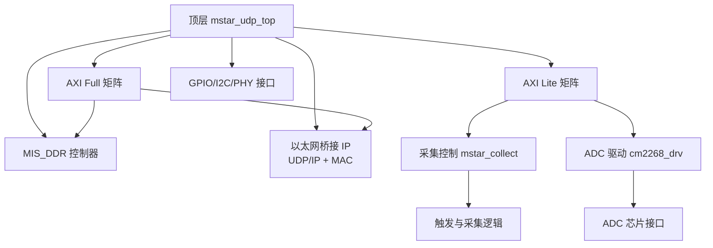
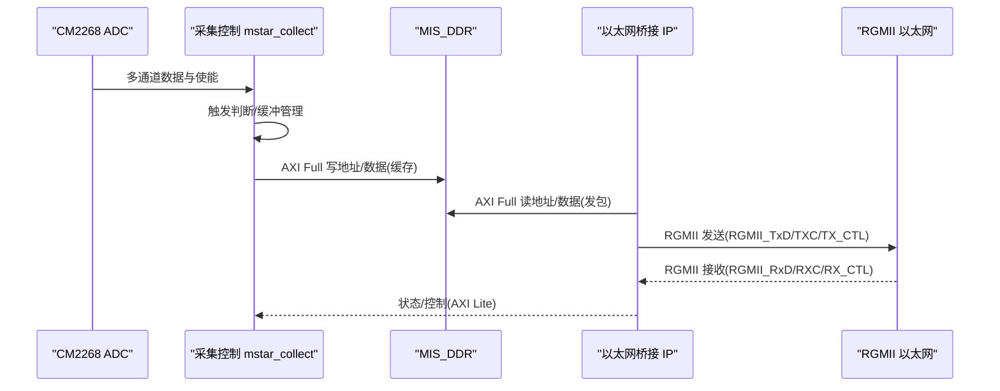
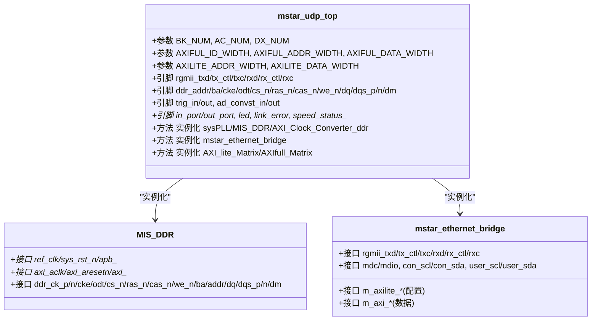
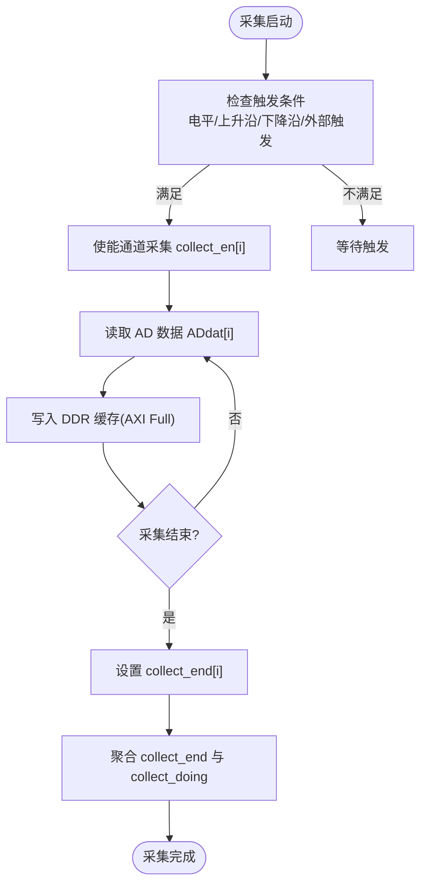
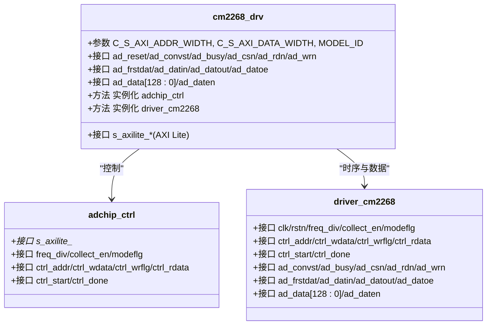
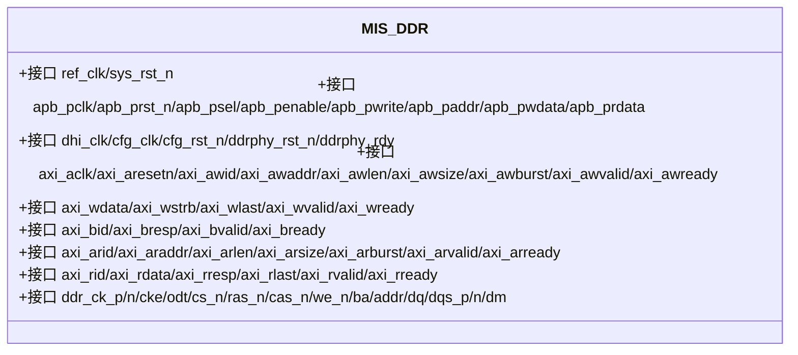
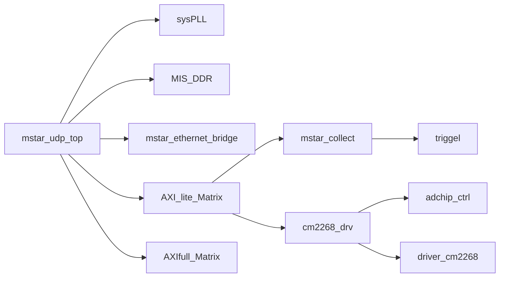

# 项目概述

<cite>
**本文引用的文件**   
- [README.md](file://README.md)
- [tand_udp.al](file://tand_udp.al)
- [tand_udp_devicesetting.cfg](file://tand_udp_devicesetting.cfg)
- [mstar_udp_top.v](file://hdl/mstar_udp_top.v)
- [mstar_collect.v](file://hdl/collect/mstar_collect.v)
- [cm2268_drv.v](file://hdl/ad_driver/cm2268_drv.v)
- [MIS_DDR.v](file://al_ip/MIS_DDR/MIS_DDR.v)
- [mstar_udp_adc.adc](file://hdl/constraint/mstar_udp_adc.adc)
</cite>

## 目录
1. [简介](#简介)
2. [项目结构](#项目结构)
3. [核心组件](#核心组件)
4. [架构总览](#架构总览)
5. [详细组件分析](#详细组件分析)
6. [依赖关系分析](#依赖关系分析)
7. [性能与规格](#性能与规格)
8. [故障排查指南](#故障排查指南)
9. [结论](#结论)
10. [附录](#附录)

## 简介
本项目是基于安路科技 PH1 FPGA 的多通道数据采集系统，面向高速、多通道 ADC 数据实时采集与以太网传输场景。系统以 PH1P35MDG324-3 为目标器件，使用 Tang Dynasty IDE 进行开发与构建，提供如下核心能力：
- 8 通道 ADC 数据采集（CM2268 等 ADC 驱动）
- DDR 缓存与 AXI Full 总线 DMA 读写
- UDP/IP 网络传输（RGMII 千兆以太网）
- 触发控制（外部触发输入/输出、边沿/电平触发）
- AXI Lite 寄存器接口用于参数配置与状态读取

该工程同时配套上位机软件（示波器），便于快速验证与波形显示。

**章节来源**
- [README.md:1-14](file://README.md#L1-L14)

## 项目结构
工程采用分层模块化组织方式，顶层模块负责时钟、复位、AXI 互联矩阵、DDR 控制器、以太网桥接 IP 以及外设接口；采集逻辑、ADC 驱动、同步与约束文件分别位于独立子目录。

**图表来源**
- [mstar_udp_top.v:371-675](file://hdl/mstar_udp_top.v#L371-L675)
- [mstar_udp_top.v:676-800](file://hdl/mstar_udp_top.v#L676-L800)
- [mstar_collect.v:107-188](file://hdl/collect/mstar_collect.v#L107-L188)
- [cm2268_drv.v:70-138](file://hdl/ad_driver/cm2268_drv.v#L70-L138)
- [MIS_DDR.v:84-200](file://al_ip/MIS_DDR/MIS_DDR.v#L84-L200)

**章节来源**
- [README.md:23-73](file://README.md#L23-L73)
- [tand_udp.al:15-234](file://tand_udp.al#L15-L234)

## 核心组件
- 顶层集成器 mstar_udp_top：负责时钟域生成、复位同步、AXI 总线互联、DDR 控制器实例化、以太网桥接 IP 连接、GPIO/I2C/PHY 管理。
- 采集子系统 mstar_collect：实现多通道采集控制、触发策略、AXI Lite 配置接口、采集结束与触发标志处理。
- ADC 驱动 cm2268_drv：封装 CM2268 ADC 的时序控制、寄存器访问、数据流打包与使能信号管理。
- MIS_DDR：安路官方 DDR 控制器 IP，提供 AXI 到 DDR 的读写转换与时钟/复位管理。
- 以太网桥接 IP：加密网表，提供 RGMII 物理层接口、MAC/UDP/IP 协议栈及 AXI 总线接口。

**章节来源**
- [mstar_udp_top.v:5-8](file://hdl/mstar_udp_top.v#L5-L8)
- [mstar_collect.v:5-8](file://hdl/collect/mstar_collect.v#L5-L8)
- [cm2268_drv.v:5-8](file://hdl/ad_driver/cm2268_drv.v#L5-L8)
- [MIS_DDR.v:12-82](file://al_ip/MIS_DDR/MIS_DDR.v#L12-L82)
- [README.md:87-89](file://README.md#L87-L89)

## 架构总览
系统整体数据流从 ADC 采样开始，经采集控制与触发逻辑进入 DDR 缓存，再通过 AXI Full 总线由以太网桥接 IP 转换为 UDP 数据包，最终通过 RGMII 接口发送到上位机。

**图表来源**
- [mstar_udp_top.v:371-675](file://hdl/mstar_udp_top.v#L371-L675)
- [mstar_udp_top.v:676-800](file://hdl/mstar_udp_top.v#L676-L800)
- [mstar_collect.v:107-188](file://hdl/collect/mstar_collect.v#L107-L188)
- [MIS_DDR.v:84-200](file://al_ip/MIS_DDR/MIS_DDR.v#L84-L200)

## 详细组件分析

### 顶层模块 mstar_udp_top
- 功能职责
  - 时钟与复位：通过 sysPLL 生成 125MHz、100MHz、50MHz 时钟，并进行跨时钟域复位同步。
  - DDR 控制器：实例化 MIS_DDR，并通过 AXI_Clock_Converter_ddr 完成 AXI Full 时钟域转换。
  - 以太网桥接：实例化 mstar_ethernet_bridge，提供 RGMII 接口与 AXI Lite/AXI Full 总线。
  - AXI 互联：通过 AXI_lite_Matrix 与 AXIfull_Matrix 将多个主/从设备互联。
  - GPIO/I2C/PHY：管理 LED、端口 IO、I2C 总线与 PHY 复位/状态指示。
- 关键信号
  - RGMII：rgmii_txd/rgmii_tx_ctl/rgmii_txc、rgmii_rxd/rgmii_rx_ctl/rgmii_rxc
  - DDR：ddr_addr/ddr_ba/ddr_cke/ddr_odt/ddr_cs_n/ddr_ras_n/ddr_cas_n/ddr_we_n/ddr_dq/ddr_dqs_p/n/ddm
  - 触发/IO：trig_in/trig_out、ad_convst_in/out、in_port/out_port、led/link_error/speed_status_*
- 设计要点
  - 多时钟域隔离：125MHz（以太网）、100MHz（AXI Full）、50MHz（AXI Lite/控制）
  - 复位链：syspll_lock -> reset_sync/resetn_sync -> 各子模块复位
  - 总线拓扑：AXI Lite 矩阵服务于配置与控制，AXI Full 矩阵服务于大数据吞吐

**图表来源**
- [mstar_udp_top.v:9-92](file://hdl/mstar_udp_top.v#L9-L92)
- [mstar_udp_top.v:371-675](file://hdl/mstar_udp_top.v#L371-L675)
- [MIS_DDR.v:12-82](file://al_ip/MIS_DDR/MIS_DDR.v#L12-L82)

**章节来源**
- [mstar_udp_top.v:371-675](file://hdl/mstar_udp_top.v#L371-L675)
- [mstar_udp_top.v:676-800](file://hdl/mstar_udp_top.v#L676-L800)

### 采集子系统 mstar_collect
- 功能职责
  - 多通道采集控制：根据 CHANNEL_NUM 参数实例化每通道触发逻辑 triggel。
  - 触发策略：支持不触发/电平触发/上升沿触发/下降沿触发，并支持外部触发输入。
  - 采集结束检测：统计各通道结束标志，产生 collect_end 与 collect_doing 状态。
  - AXI Lite 配置接口：通过 Mstar_collect_ctrl 暴露寄存器空间供上位机配置。
- 关键信号
  - AD 数据：ADdat[AD_DATWIDTH*CHANNEL_NUM-1:0]、ADen
  - 触发：in_trigflg、out_trigflg、trigtype、trig_relative_position
  - 状态：collect_en、collect_endreq、collect_end、collect_doing
- 设计要点
  - 通道并行：generate for 循环为每个通道实例化 triggel，提升吞吐。
  - 边沿检测：get_singer_edge 对触发与采集结束信号做边沿提取，避免毛刺。

**图表来源**
- [mstar_collect.v:107-188](file://hdl/collect/mstar_collect.v#L107-L188)
- [mstar_collect.v:157-188](file://hdl/collect/mstar_collect.v#L157-L188)

**章节来源**
- [mstar_collect.v:9-62](file://hdl/collect/mstar_collect.v#L9-L62)
- [mstar_collect.v:107-188](file://hdl/collect/mstar_collect.v#L107-L188)

### ADC 驱动 cm2268_drv
- 功能职责
  - 封装 CM2268 ADC 的寄存器访问与采样时序控制。
  - 提供 AXI Lite 接口用于配置分频、模式切换、采集使能等。
  - 输出 128bit 宽的数据包与数据有效信号，适配后续采集逻辑。
- 关键信号
  - AXI Lite：s_axilite_AWADDR/WDATA/WSTRB/ARADDR/RDATA 等
  - ADC 接口：ad_reset/ad_convst/ad_busy/ad_csn/ad_rdn/ad_wrn/ad_frstdat/ad_datin/ad_datout/ad_datoe
  - 数据流：ad_data[128:0]/ad_daten
- 设计要点
  - 分离控制路径与数据路径：adchip_ctrl 负责寄存器控制，driver_cm2268 负责时序与数据打包。
  - 可配置分频：FREQ_DIV_MIN 参数控制采样时钟分频。

**图表来源**
- [cm2268_drv.v:9-51](file://hdl/ad_driver/cm2268_drv.v#L9-L51)
- [cm2268_drv.v:70-138](file://hdl/ad_driver/cm2268_drv.v#L70-L138)

**章节来源**
- [cm2268_drv.v:5-8](file://hdl/ad_driver/cm2268_drv.v#L5-L8)
- [cm2268_drv.v:70-138](file://hdl/ad_driver/cm2268_drv.v#L70-L138)

### DDR 控制器 MIS_DDR
- 功能职责
  - 提供 AXI 到 DDR 的读写转换，内部包含 PHY、MC、时序与初始化逻辑。
  - 输出 dhi_clk、cfg_clk、cfg_rst_n 等时钟与复位信号。
  - 暴露 APB 接口用于配置（本工程中未启用）。
- 关键参数
  - tCK/BK_NUM/AC_NUM/DX_NUM/CWL/CL 等 DDR 时序参数
  - MC_ECC/MC_ADDR_MAP/MC_REORDER 等内存控制器特性
  - AXI_ID_WIDTH/AXI_ADDR_WIDTH/AXI_DATA_WIDTH/AXI_MASK_WIDTH
- 设计要点
  - 通过 AXI_Clock_Converter_ddr 将 100MHz AXI Full 域与 DDR 控制器时钟域解耦。
  - 地址映射 ROW_COL_BANK，支持正常重排序。

**图表来源**
- [MIS_DDR.v:12-82](file://al_ip/MIS_DDR/MIS_DDR.v#L12-L82)
- [MIS_DDR.v:84-200](file://al_ip/MIS_DDR/MIS_DDR.v#L84-L200)

**章节来源**
- [MIS_DDR.v:12-82](file://al_ip/MIS_DDR/MIS_DDR.v#L12-L82)
- [MIS_DDR.v:84-200](file://al_ip/MIS_DDR/MIS_DDR.v#L84-L200)

## 依赖关系分析
- 顶层依赖
  - sysPLL：时钟源
  - MIS_DDR：DDR 存储
  - mstar_ethernet_bridge：以太网协议栈与 MAC
  - AXI_lite_Matrix/AXIfull_Matrix：总线互联
- 采集子系统依赖
  - Mstar_collect_ctrl：AXI Lite 配置与状态
  - triggel：通道级触发逻辑
- ADC 驱动依赖
  - adchip_ctrl：寄存器控制
  - driver_cm2268：时序与数据打包

**图表来源**
- [mstar_udp_top.v:371-800](file://hdl/mstar_udp_top.v#L371-L800)
- [mstar_collect.v:107-188](file://hdl/collect/mstar_collect.v#L107-L188)
- [cm2268_drv.v:70-138](file://hdl/ad_driver/cm2268_drv.v#L70-L138)

**章节来源**
- [tand_udp.al:15-234](file://tand_udp.al#L15-L234)

## 性能与规格
- 目标器件与开发环境
  - FPGA：Anlogic PH1P35MDG324-3
  - IDE：Tang Dynasty ≥ 6.2
- 时钟与带宽
  - 以太网：RGMII 千兆（125MHz 参考）
  - AXI Full：100MHz，128bit 数据宽度
  - AXI Lite：50MHz，32bit 数据宽度
- 采集能力
  - 通道数：8 通道
  - ADC 位宽：16bit（CM2268）
  - 触发方式：不触发/电平/上升沿/下降沿，支持外部触发
- 存储与缓存
  - DDR 控制器：MIS_DDR，支持 ECC 可选、ROW_COL_BANK 地址映射
- 构建流程
  - 安装 IDE → 打开工程 → 确认器件 → 综合 → 布局布线 → 生成比特流

**章节来源**
- [README.md:75-86](file://README.md#L75-L86)
- [tand_udp.al:6-10](file://tand_udp.al#L6-L10)
- [mstar_udp_top.v:23-34](file://hdl/mstar_udp_top.v#L23-L34)
- [MIS_DDR.v:84-129](file://al_ip/MIS_DDR/MIS_DDR.v#L84-L129)

## 故障排查指南
- 以太网链路问题
  - 检查 RGMII 引脚约束与 PHY 复位信号
  - 观察 speed_status_1g/speed_status_100M 与 link_error 状态
- 触发异常
  - 检查 trig_in/trig_out 引脚与 get_singer_edge 边沿检测
  - 确认 triggel 中触发类型与相对位置参数
- DDR 访问失败
  - 检查 AXI_Clock_Converter_ddr 时钟域与复位同步
  - 验证 MIS_DDR 的 AXI 握手信号与地址映射
- ADC 无数据
  - 检查 ad_convst/ad_csn/ad_rdn/ad_wrn 时序
  - 确认 ad_busy/ad_frstdat 状态与数据总线连接

**章节来源**
- [mstar_udp_top.v:355-370](file://hdl/mstar_udp_top.v#L355-L370)
- [mstar_udp_top.v:591-675](file://hdl/mstar_udp_top.v#L591-L675)
- [mstar_collect.v:93-106](file://hdl/collect/mstar_collect.v#L93-L106)
- [mstar_udp_adc.adc:1-95](file://hdl/constraint/mstar_udp_adc.adc#L1-L95)

## 结论
本项目以 PH1 FPGA 为核心，结合 CM2268 ADC、MIS_DDR 与以太网桥接 IP，构建了高吞吐、多通道、可触发的数据采集系统。通过 AXI Lite/AXI Full 总线与 RGMII 接口，系统实现了从 ADC 采样到 UDP 传输的完整数据通路，具备清晰的模块化设计与良好的可扩展性，适用于示波器、频谱分析与工业数据采集等场景。

## 附录
- 硬件实物照片
  - 数据采集器实物图见 README 中的图片引用。

**章节来源**
- [README.md:15-17](file://README.md#L15-L17)