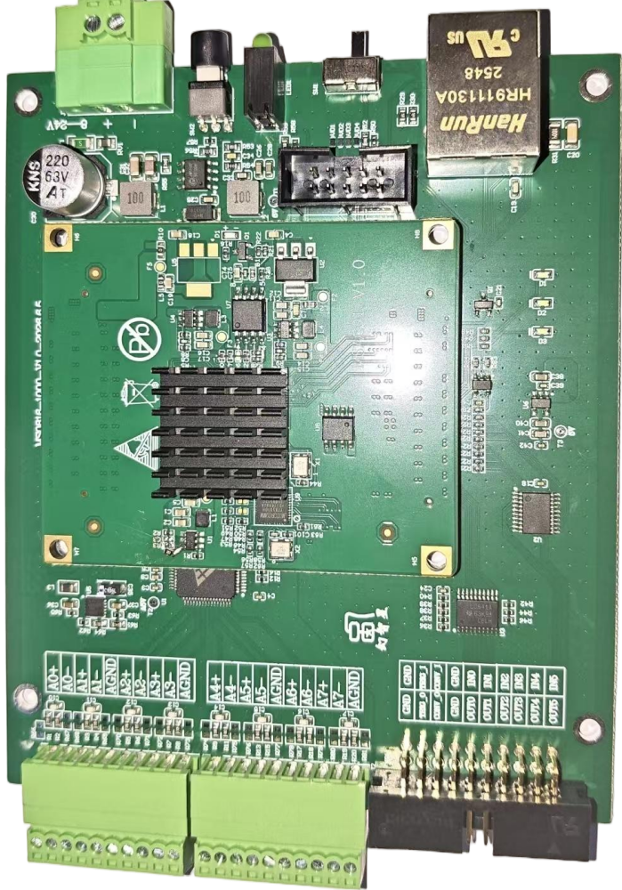

# MStar Collect FPGA

基于安路科技 (Anlogic) PH1 FPGA 的多数据采集设备端 FPGA 工程，使用 Tang Dynasty IDE 开发。

## 功能概述

本工程设计用于多通道 AD 数据采集系统，通过以太网 (RGMII) 将采集数据经 UDP 传输至上位机。主要功能包括：

- **多通道 AD 采集**：支持 8 通道 AD 数据采集（CM2268 等 ADC 芯片驱动）
- **DDR 缓存**：通过 DDR 接口实现采集数据的 DMA 缓存
- **以太网传输**：基于 UDP/IP 协议栈，经 RGMII 千兆以太网输出数据
- **触发控制**：支持外部触发信号输入/输出
- **AXI Lite 寄存器接口**：上位机可通过 AXI Lite 总线配置采集参数

## 实物照片



## 工程结构

```
tand_udp/
├── hdl/
│   ├── mstar_udp_top.v          # 顶层模块
│   ├── ad_driver/               # AD 芯片驱动
│   │   ├── adchip_ctrl.v
│   │   ├── cm2268_drv.v
│   │   └── driver_cm2268.v
│   ├── collect/                 # 数据采集逻辑
│   │   ├── mstar_collect.v
│   │   ├── Mstar_collect_ctl.v
│   │   ├── mstar_collectdma.v
│   │   ├── ad_collect_trig_ctrl.v
│   │   ├── ad_dma_axictrl.v
│   │   ├── get_extreflg.v
│   │   ├── onedmafifo_con.v
│   │   └── triggel.v
│   ├── axi_dma/                 # AXI DMA 读写主机
│   │   ├── axi_dma_example_axi_read_master.sv
│   │   ├── axi_dma_example_axi_write_master.sv
│   │   └── axi_dma_example_counter.sv
│   ├── axi_io/                  # AXI Lite 寄存器 IO
│   │   ├── mstar_axifulltopaxi.v
│   │   └── mstar_axilite_io.v
│   ├── udpip/                   # 以太网桥接 IP (加密)
│   │   └── mstar_ethernet_bridge.ipr.v
│   ├── sync/                    # 跨时钟域同步
│   │   ├── sync_block.v
│   │   ├── reset_sync.v
│   │   ├── resetn_sync.v
│   │   └── get_singer_edge.v
│   └── constraint/              # 约束文件
│       ├── mstar_udp_adc.adc    # 引脚约束
│       └── mstar_udp_sdc.sdc    # 时序约束
├── al_ip/                       # 安路 IP 核
│   ├── MIS_DDR/                 # DDR 控制器
│   ├── AXIfull_Matrix/          # AXI Full 互联矩阵
│   ├── AXI_lite_Matrix/         # AXI Lite 互联矩阵
│   ├── AXI_Clock_Converter_ddr/ # AXI 时钟域转换
│   ├── axis_dmadat_fifo/        # DMA 数据 FIFO
│   ├── axis_mac_rxfifo/         # MAC 接收 FIFO
│   ├── axis_macdat_fifo/        # MAC 数据 FIFO
│   ├── fifo_axis_parkenumber/   # 包计数 FIFO
│   ├── fifo_axis_rullcmd/       # 命令 FIFO
│   └── sysPLL/                  # 系统 PLL
├── chip_debugger/               # 调试配置
├── tand_udp.al                  # Tang Dynasty 工程文件
└── tand_udp_devicesetting.cfg   # 器件配置
```

## 目标器件

- **FPGA**: Anlogic PH1P35MDG324-3
- **IDE**: Tang Dynasty ≥ 6.2

## 构建说明

1. 安装 Tang Dynasty IDE (≥ 6.2)
2. 打开 `tand_udp.al` 工程文件
3. 确认目标器件为 PH1P35MDG324-3
4. 执行综合 → 布局布线 → 生成比特流

## 加密 IP 说明

`hdl/udpip/mstar_ethernet_bridge.ipr.v` 为加密 IP 网表，实现以太网桥接功能（含 MAC 层、UDP/IP 协议栈、AXI 总线接口等）。该 IP 以加密形式开源，提供功能接口但不开放源码。

## 联系方式

- Company: Hangzhou Magicstar Technology Co., Ltd.
- Email: yupc123@qq.com
- Phone: +86-13867435883
- Taobao: https://magicstar.taobao.com/

## 许可证

详见 [LICENSE](LICENSE) 文件。

## 更新日志

### v1.0 (2026-10-15)
- 首次开源发布
- 添加全部 RTL 源码文件头（版权声明 + SPDX 许可证标识）
- 添加采集器实物照片
